# KỊCH BẢN PHÂN NHÁNH — 72 GIỜ TRONG SIÊU THỊ

> Nguồn: ý tưởng "C. 72 Giờ Trong Siêu Thị – Story Branch" (người dùng gửi trong chat). Giữ nguyên thế giới, nhân vật chính Khoa, 6 người lạ có bí mật, bí mật trung tâm (thí nghiệm xã hội của một tập đoàn, người sống sót được thả + tiền), đủ 6 nút lựa chọn theo đúng thứ tự gốc và 4 kết cục. Phần thêm vào: tên + bí mật + động cơ cho 6 người lạ, "sự thật phía sau", 3 cờ đúng/sai, đạo cụ cài trước cho cao trào, bảng cán cân quyền lực sau mỗi cái chết. Mọi thay đổi ghi ở cuối file.

| Thẻ tập | |
|---|---|
| Thị trường | TP.HCM, Việt Nam · tiền VND (bản sản xuất viết tiếng Anh, giữ tên Việt). Thương hiệu tự đặt: siêu thị **TRỌN NGÀY 24/7**, tập đoàn **HALVANE** |
| Thể loại · cơ chế | Thriller sinh tồn · thí nghiệm xã hội · *Phép tính của kẻ sống sót*: 30 tỷ chia đều cho người còn sống ở giờ 72, kho chỉ đủ ăn cho 4 người. Mỗi cái chết làm phần tiền của người khác to hơn. Khoa muốn sống mà không thành thứ tập đoàn muốn quay được |
| Motif | `SD-M3` (phi vụ sinh tử) — gần nhất; truyện là sinh tồn kín, không phải mafia |
| Chế độ trạng thái | `free` (truyện quyết định đạo đức theo hành trình, không phải dạng "điều tra 2 manh mối" của `house`) |
| Bối cảnh chính | A: Khu bán hàng (quầy thu ngân, dãy kệ, cửa cuốn sắt, bảng LED quảng cáo trên quầy, các đầu báo khói đèn đỏ trên trần) · B: Kho hàng sau + kho lạnh (cửa inox có ô kính tròn, nhiệt kế **-18°C**, song thông gió sơn số **"03"** sau kho lạnh, bình chữa cháy treo cạnh cửa kho) · C: Khu kỹ thuật (hành lang ống gió, tủ điện, phòng quản lý có tường màn hình camera) · Ngoại lệ cho `END_THOAT_CUNG_NHOM` và `END_CHI_MINH_BAN`: bãi xe sau siêu thị lúc bình minh |
| Nhân vật | `khoa_le` Lê Minh Khoa (26, nhân viên ca đêm; polo đồng phục xanh lá có chữ **"TRỌN NGÀY"**, bảng tên **"KHOA"**, chùm chìa khóa kho đeo ở thắt lưng, vết bỏng cũ ở mu bàn tay phải) · `bao_ngo` Ngô Quốc Bảo (44, to con, áo khoác da sờn, sẹo ngang cằm, dao rọc giấy luôn trong tay) · `vy_trinh` Trịnh Tường Vy (29, điều dưỡng; áo blouse trắng ngắn tay khoác ngoài váy xanh, tóc búi thấp, **nốt tai nghe màu da** sau tai trái) · `tuan_dang` Đặng Anh Tuấn (33, hoodie đen trùm đầu, râu lởm chởm, cây **bút có ống kính** cài túi ngực, sổ tay bìa đen) · `tam_pham` Phạm Văn Tâm (70, ông cụ gầy, áo sơ mi caro bạc màu, kính lão buộc dây, túi đeo chéo đựng bút insulin) · `linh_ho` Hồ Mỹ Linh (19, sinh viên livestream; áo khoác lông hồng, tóc nhuộm tím hai bên, gậy selfie gắn đèn ring) · `quan_lam` Lâm Hoàng Quân (38, sơ mi trắng vest xám, đồng hồ to, **vòng nhựa đen giấu dưới cổ tay áo trái**) |
| Cờ là gì? | Cờ là điều Khoa đã làm. Game tự nhớ để rẽ ở kết, không hiện thanh điểm. **CÔNG BỐ** (`cong_bo_do_an`): Khoa đã nói thật với cả nhóm về kho đồ ăn. **MÁU TRÊN TAY** (`mau_tren_tay`): Khoa đã tự tay đẩy một người vào chỗ chết. **LỐI THOÁT** (`biet_loi_thoat`): Khoa biết song gió số 03 sau kho lạnh dẫn ra bãi xe |
| Cờ | `cong_bo_do_an=true`: đặt ở **1A**, đọc ở kiểm tra sau **6B** (có → `END_THOAT_CUNG_NHOM`, không → `END_TAT_CA_CHET`). Gợi ý khi thiếu: "Người từng giấu đồ ăn, giờ đứng trước camera nói như kẻ thắng cuộc. Không ai tin đó là diễn." / "The man who hid the food is now playing the winner on camera. Nobody believes it is an act." · `mau_tren_tay=true`: đặt ở **3A** hoặc **5B**, đọc ở kiểm tra sau **6A** và **6B**. Gợi ý: "Tay bạn đã dính máu. Những người còn lại không đi theo bạn nữa." / "There is blood on your hands. The others will not follow you." · `biet_loi_thoat=true`: đặt ở **3B** (ông Tâm), **4A** (sơ đồ thông gió) hoặc **5A** (Tuấn), đọc ở kiểm tra sau **6A**. Gợi ý: "Mất điện 3 phút, nhưng bạn không biết đường nào ra." / "Three minutes of darkness, and you don't know the way out." |
| Kết cục | `END_THOAT_CUNG_NHOM` (True · bittersweet: thoát cùng nhóm nhỏ nhưng bị theo dõi suốt đời; 6A khi có `biet_loi_thoat` và không có `mau_tren_tay`, hoặc 6B khi không có `mau_tren_tay` và có `cong_bo_do_an`) · `END_CHI_MINH_BAN` (Karma · chỉ mình bạn sống, mang tội ác; 6A khi có `biet_loi_thoat` và `mau_tren_tay`) · `END_NGUOI_TO_CHUC` (Twist · thành người tổ chức phiên bản tiếp theo; 6B khi có `mau_tren_tay`) · `END_TAT_CA_CHET` (Bad · tất cả chết, không ai biết sự thật; 6A khi thiếu `biet_loi_thoat`, hoặc 6B khi không có cả `mau_tren_tay` lẫn `cong_bo_do_an`) |

### Sự thật phía sau (cho biên kịch — người chơi lần ra dần)
* **Thí nghiệm:** HALVANE là tập đoàn dữ liệu hành vi, bán "mô hình ra quyết định của con người trong khủng hoảng" cho bảo hiểm, quân sự, quảng cáo. Đêm nay là **Phiên bản 07**. Siêu thị Trọn Ngày là tài sản của HALVANE, dựng lại riêng cho thí nghiệm. Đầu báo khói đèn đỏ trên trần thật ra là camera.
* **Tiếng súng và còi bên ngoài:** chỉ là băng ghi âm phát từ loa gắn trên cột điện quanh siêu thị. Bên ngoài là một con phố trống bị rào. Người chơi chỉ biết điều này ở `END_THOAT_CUNG_NHOM` và `END_CHI_MINH_BAN`.
* **Phép tính:** loa hứa **30 tỷ VND chia đều** cho người còn sống ở giờ 72. Phiếu nhập kho của HALVANE ghi **"KHẨU PHẦN: 4 NGƯỜI × 72 GIỜ"**. Tập đoàn thiết kế sẵn để 3 người phải chết.
* **Ai cũng được dụ tới:** 23:00 đêm thứ Sáu, mỗi người lạ nhận một tin nhắn từ số ký tên "H." (việc làm 30 triệu, khám bệnh miễn phí, casting show truyền hình, tin mật về một vụ án…). Khoa bị "quản lý" nhắn đổi sang ca đêm đột xuất.
* **Bí mật và động cơ của 6 người lạ:**
  * **Bảo** — nợ xã hội đen 2 tỷ, bị dọa giết vợ con. Động cơ: tiền, bằng mọi giá. Bí mật: anh đến vì tin nhắn "việc 30 triệu, không hỏi". Mạnh nhất, giành kho lạnh ngay giờ đầu.
  * **Vy** — **nhân viên HALVANE cài vào** (người quan sát hiện trường), nói chuyện với phòng điều khiển qua tai nghe màu da. Động cơ: giữ thí nghiệm đúng kịch bản, được thăng chức. Bề ngoài hiền nhất, chia khẩu phần công bằng nhất. Ở tuyến Khoa theo Vy, chính Vy tiêm insulin của ông Tâm cho Quân để bịt miệng anh ta.
  * **Tuấn** — **nhà báo điều tra** đã theo dấu HALVANE 2 năm (6 phiên bản trước đều được báo chí ghi là "hỏa hoạn" hoặc "rò rỉ khí"). Bút có ống kính, sổ ghi tên từng người, lén cắt dây cáp. Trông khả nghi nhất nhưng là người duy nhất muốn phơi bày sự thật.
  * **Ông Tâm** — tiểu đường, cần đường và insulin, là "người yếu nhất". Bí mật: năm 2009 ông là kỹ sư lắp hệ thống thông gió cho tòa nhà này, nhận ra song gió số 03 khi ngồi cạnh kho lạnh. Ông giấu vì không tin ai.
  * **Linh** — nộp hồ sơ casting "show thực tế sinh tồn" của HALVANE, đã ký thỏa thuận bảo mật, tưởng mọi thứ là quay show. Động cơ: nổi tiếng. Bí mật giải thích vì sao cô cứ nói chuyện với ống kính.
  * **Quân** — **người sống sót duy nhất của Phiên bản 06**, thắng 5 tỷ rồi thua sạch ở sòng bài, tự đăng ký chơi lại. Biết luật: càng ít người sống, tiền càng nhiều. Vòng nhựa đen dưới cổ tay áo ghi **"PHIÊN BẢN 06 · NGƯỜI SỐNG SÓT"**. Chết ở giờ 24 trên mọi tuyến; xác anh là chứng cứ đầu tiên rằng đây là thí nghiệm.
* **Kết cục và tập đoàn:** HALVANE chỉ cần một "câu chuyện có kết". Phá camera mà không có đường ra = dữ liệu hỏng → **quy trình xóa** (xả khí qua hệ thống chữa cháy, báo chí ghi "chập điện"). Diễn trước ống kính = cho họ một kết. Nếu Khoa thật sự đã giết người, cái kết đó là thật và HALVANE tuyển anh. Kể cả khi thoát, cả nhóm vẫn nằm trong thiết kế: đúng 4 người ra, nhận tiền, và từ đó bị theo dõi.

### Cán cân quyền lực sau mỗi cái chết
| Mốc | Người chết | Ai nắm quyền | Lòng tin đổi thế nào |
|---|---|---|---|
| Giờ 0–8 | — | Khoa giữ chìa kho, rồi Bảo giành kho lạnh | 1A: cả nhóm tin Khoa nhưng sợ. 1B: Quân bắt quả tang, cả nhóm thấy Khoa là kẻ giấu đồ |
| Giờ 24 | **Quân** (tuyến Bảo: Bảo đánh; tuyến Vy: Vy tiêm) | Bảo (có kho lạnh + nắm đấm) | Loa công bố 30 tỷ chia đều: mọi người bắt đầu đếm nhau. Vòng tay "Phiên bản 06" lộ ra |
| Giờ 36 | **Ông Tâm** (nếu 3A) | 3A: Khoa và Bảo thành đồng phạm. 3B: Bảo thành kẻ thù của Khoa (kể cả khi đang là đồng minh) | 3B: ông Tâm mang ơn, nói ra song gió 03 |
| Giờ 60 | **Tuấn** (nếu 5B, chết cóng trong kho lạnh) | Khoa cầm thẻ từ HALVANE | 5A: Tuấn chỉ ra Vy là người cài. 5B: Khoa một mình, không ai biết anh vừa làm gì — trừ camera |
| Giờ 72 | tùy kết | HALVANE | — |

### Sơ đồ phân nhánh

```mermaid
flowchart TD
    S1["S01 · A→B · Giờ 0 · 23:00: Cửa cuốn sập, còi hú, loa: phong tỏa 72 giờ · Khoa vào kho lấy nước: kệ toàn hộp rỗng, phiếu nhập kho KHẨU PHẦN 4 NGƯỜI × 72 GIỜ"] --> C1{"LỰA CHỌN 1: Công bố sự thật về đồ ăn hay giấu?"}
    C1 -->|"1A · Đập hộp mì rỗng trước mặt cả nhóm (đặt cờ CÔNG BỐ)"| S2A["S02_CONG_KHAI · A · Giờ 8: Hoảng loạn, Bảo giật chùm chìa khóa kho lạnh khỏi thắt lưng Khoa · Vy đứng ra chia khẩu phần"]
    C1 -->|"1B · Giấu, cất chìa kho lạnh vào túi"| S2B["S02_BI_LO · B · Giờ 8: 3 giờ sáng Quân bắt quả tang Khoa ăn vụng trong kho · sáng ra cả nhóm biết, Bảo giành kho"]
    S2A --> C2{"LỰA CHỌN 2: Liên minh với ai trước?"}
    S2B --> C2
    C2 -->|"2A · Theo Bảo: cùng canh kho lạnh"| S3A["S03_PHE_BAO · B · Giờ 24: Quân mò tới đề nghị chia phe, Bảo đánh, Quân đập đầu vào kệ inox · vòng tay PHIÊN BẢN 06 · loa: 30 tỷ chia đều"]
    C2 -->|"2B · Theo Vy: cùng chăm ông Tâm"| S3B["S03_PHE_VY · A · Giờ 24: Quân định nói gì đó với Khoa thì Vy kéo đi đo huyết áp · sáng ra Quân chết giữa dãy đồ hộp · vòng tay PHIÊN BẢN 06 · loa: 30 tỷ chia đều"]
    S3A --> S4["S04 · B · Giờ 36: Ông Tâm hạ đường huyết, hộp nước cam cuối cùng trong tay Bảo · Bớt một người, mỗi đứa thêm một tỷ"]
    S3B --> S4
    S4 --> C3{"LỰA CHỌN 3: Giết người yếu nhất hay bảo vệ ông ấy?"}
    C3 -->|"3A · Đóng cửa kho lạnh nhốt ông Tâm bên trong (đặt cờ MÁU TRÊN TAY)"| S5["S05 · A · Giờ 48: Loa: 24 giờ cuối · tiếng súng dày hơn · Linh thú nhận cô ký hợp đồng casting với HALVANE"]
    C3 -->|"3B · Đứng chắn trước ông Tâm, đưa ông phần ăn của mình (đặt cờ LỐI THOÁT: song gió số 03)"| S5
    S5 --> C4{"LỰA CHỌN 4: Tìm lối thoát bí mật hay ở lại chờ giờ 72?"}
    C4 -->|"4A · Mở khu kỹ thuật tìm đường ra (đặt cờ LỐI THOÁT: sơ đồ thông gió)"| S5K["S05_KY_THUAT · C · Giờ 54: Sơ đồ thông gió trên tường · Tuấn đang cắt dây cáp, đeo thẻ từ HALVANE"]
    C4 -->|"4B · Ở lại quầy thu ngân, giữ sức"| S5O["S05_O_LAI · A · Giờ 54: Đêm, Bảo mài dao trên kệ · Khoa thiếp đi, tỉnh dậy với bàn tay Tuấn bịt miệng, thẻ từ HALVANE lấp lánh"]
    S5K --> C5{"LỰA CHỌN 5: Tin vào người khả nghi nhất?"}
    S5O --> C5
    C5 -->|"5A · Tin Tuấn, đi theo anh ta (đặt cờ LỐI THOÁT: bản vẽ của Tuấn)"| S6T["S06_PHONG_CAMERA · C · Giờ 66: Phòng quản lý, tường màn hình PHIÊN BẢN 07 · Tuấn là nhà báo · màn hình: Vy nói vào tai nghe"]
    C5 -->|"5B · Không tin: đánh ngất Tuấn, nhốt vào kho lạnh, lấy thẻ từ (đặt cờ MÁU TRÊN TAY)"| S6M["S06_MOT_MINH · C · Giờ 66: Khoa một mình trong phòng quản lý · màn hình: Tuấn đập vào ô kính kho lạnh, chậm dần · Vy nói vào tai nghe"]
    S6T --> C6{"LỰA CHỌN 6: Phá camera hay diễn trước ống kính?"}
    S6M --> C6
    C6 -->|"6A · Giật cầu dao tổng, đập camera"| CHK_A{"Kiểm tra: có cờ LỐI THOÁT (đi 3B, 4A hoặc 5A)?"}
    C6 -->|"6B · Nhìn thẳng vào ống kính và diễn vai kẻ thắng cuộc"| CHK_B{"Kiểm tra: có cờ MÁU TRÊN TAY (đi 3A hoặc 5B)?"}
    CHK_A -->|"Có LỐI THOÁT"| CHK_A2{"Kiểm tra: có cờ MÁU TRÊN TAY (đi 3A hoặc 5B)?"}
    CHK_A -->|"Không có LỐI THOÁT"| E_ALL(["ENDING · Tất Cả Đều Chết"])
    CHK_A2 -->|"Có MÁU TRÊN TAY"| E_ALONE(["ENDING · Chỉ Mình Bạn Sống"])
    CHK_A2 -->|"Không có MÁU TRÊN TAY"| E_GROUP(["TRUE ENDING · Thoát Cùng Nhóm Nhỏ"])
    CHK_B -->|"Có MÁU TRÊN TAY"| E_ORG(["TWIST ENDING · Người Tổ Chức Phiên Bản 08"])
    CHK_B -->|"Không có MÁU TRÊN TAY"| CHK_B2{"Kiểm tra: có cờ CÔNG BỐ (đi 1A)?"}
    CHK_B2 -->|"Có CÔNG BỐ"| E_GROUP
    CHK_B2 -->|"Không có CÔNG BỐ"| E_ALL
```

---

### S01 · Bối cảnh A → B · NỘI · KHU BÁN HÀNG → KHO HÀNG · GIỜ 0 (23:00 ĐÊM THỨ SÁU)
**Nhân vật:** Khoa, Bảo (6 người lạ có mặt trong cảnh, mỗi khung ≤ 2 người có tên) · **Đạo cụ neo:** phiếu nhập kho **"HALVANE LOGISTICS — KHẨU PHẦN: 4 NGƯỜI × 72 GIỜ"** · Cài trước: bảng LED trên quầy, đầu báo khói đèn đỏ trên trần, song gió số **"03"** sau kho lạnh, bình chữa cháy cạnh cửa kho, hộp nước cam trên kệ kho lạnh

Khoa đang quét mã một hộp sữa thì cửa cuốn sắt sập xuống cả bốn phía, rầm một tiếng. Còi báo động hú. Bảng LED trên quầy đổi chữ: **"GIỜ 00/72"**. LOA (giọng nữ, ngọt): "Vì an toàn của quý khách, siêu thị Trọn Ngày tạm phong tỏa trong 72 giờ." Bên ngoài vang lên hai loạt súng. Sáu người lạ ùa về quầy thu ngân: Bảo đấm vào cửa cuốn, Linh giơ điện thoại không có sóng, ông Tâm ôm túi thuốc, Quân chỉnh lại cổ tay áo. Chỉ có Tuấn đứng yên ở cuối dãy kệ, ghi gì đó vào sổ.

BẢO: "Mày là nhân viên. Mở cửa ra!"

Khoa vào kho lấy nước cho mọi người. Thùng nước nhẹ bẫng: bên trong là xốp. Anh rạch thêm năm thùng mì, cả năm đều rỗng. Kệ hàng ngoài kia chỉ là vỏ hộp. Đồ ăn thật chỉ nằm trong kho lạnh, và trên cửa kho lạnh kẹp một tờ phiếu nhập kho anh chưa từng ký.

**[LỰA CHỌN 1 — Kho chỉ đủ cho 4 người]**
* **1A (Mang hộp mì rỗng ra, đập vỡ trước mặt cả nhóm)** → `S02_CONG_KHAI` · đặt cờ `cong_bo_do_an`: KHOA: "Kệ ngoài kia toàn hộp rỗng. Đồ ăn thật chỉ đủ cho bốn người." Cả nhóm im bặt, rồi cùng nhìn chùm chìa khóa trên thắt lưng Khoa.
* **1B (Gấp phiếu nhập kho bỏ túi, khóa kho lạnh, giữ chìa)** → `S02_BI_LO`: KHOA (nội tâm): "Nói ra bây giờ thì họ xé nhau trước khi trời sáng." Anh mang ra mấy chai nước thật cuối cùng, mỉm cười: "Trong kho còn nhiều lắm."

### S02_CONG_KHAI · Bối cảnh A · NỘI · QUẦY THU NGÂN · GIỜ 8
**Nhân vật:** Khoa, Bảo, Vy · **Đạo cụ neo:** chùm chìa khóa kho lạnh

Bảo quật Khoa vào quầy, giật chùm chìa khóa khỏi thắt lưng anh. Bảo đứng chắn cửa kho lạnh như một tay bảo kê. Vy bước lên giữa hai người, xé một tờ lịch làm bảng chia khẩu phần: mỗi người nửa hộp cơm sấy, một chai nước, ông Tâm được thêm phần đường. Vy vén tóc ra sau tai; Khoa thoáng thấy một chấm màu da dưới tai trái cô. Tuấn từ chối phần ăn, chỉ xin một cây bút.

VY: "Ai cũng ăn như nhau. Không ai phải chết vì đói cả."

BẢO: "Chìa nằm ở tao. Ai muốn ăn thì đứng về phía tao."

**[LỰA CHỌN 2 — Liên minh với ai trước?]** → xem chung ở cuối `S02_BI_LO`.

### S02_BI_LO · Bối cảnh B · NỘI · KHO LẠNH · GIỜ 8 (3 GIỜ SÁNG → SÁNG)
**Nhân vật:** Khoa, Quân, Bảo · **Đạo cụ neo:** ổ bánh mì cắn dở, phiếu nhập kho

3 giờ sáng, Khoa ngồi trong kho lạnh nhai vội nửa ổ bánh mì. Ánh đèn điện thoại rọi vào mặt anh: Quân đứng ở cửa, mỉm cười như người vừa thắng ván bài. Quân rút tờ phiếu nhập kho từ túi áo Khoa, đọc lướt rồi gật gù như đã biết trước. Sáng ra, chính Quân đứng giữa quầy thu ngân đọc to tờ phiếu. Bảo giật chùm chìa khóa khỏi thắt lưng Khoa, cả nhóm nhìn Khoa như nhìn kẻ trộm. Vy là người duy nhất kéo Khoa dậy.

QUÂN: "Cậu giấu đồ ăn. Còn tôi giấu cái khác. Mình hợp nhau đấy."

**[LỰA CHỌN 2 — Liên minh với ai trước?]** (chung cho `S02_CONG_KHAI` và `S02_BI_LO`)
* **2A (Theo Bảo: cùng canh kho lạnh)** → `S03_PHE_BAO`: KHOA: "Anh có kho. Tôi biết chỗ này. Mình cùng giữ." Bảo ném lại cho Khoa một hộp cơm sấy: lời hứa đầu tiên.
* **2B (Theo Vy: cùng chăm ông Tâm)** → `S03_PHE_VY`: KHOA: "Chị chia đồ ăn. Tôi lo phần còn lại." Vy siết tay Khoa, tay cô lạnh và rất khô.

### S03_PHE_BAO · Bối cảnh B · NỘI · KHO LẠNH · GIỜ 24
**Nhân vật:** Khoa, Bảo, Quân · **Đạo cụ neo:** vòng nhựa đen **"PHIÊN BẢN 06 · NGƯỜI SỐNG SÓT"**

Khoa và Bảo thay nhau ngồi canh cửa kho lạnh. Nửa đêm Quân mò tới, thì thầm với Bảo: "Tôi biết luật của trò này. Hai ta loại thằng nhóc đi." Bảo nhìn Khoa, rồi nện thẳng vào mặt Quân. Quân ngã ngửa, gáy đập vào cạnh kệ inox. Anh ta không dậy nữa. Khoa quỳ xuống, kéo tay áo Quân lên: một chiếc vòng nhựa đen. Bảng LED ngoài quầy nháy sáng.

BẢO (thở hổn hển): "Nó định bán mày đấy. Tao vừa cứu mày."

LOA: "Giờ 24. Còn 6 người. Phần thưởng 30 tỷ chia đều cho người còn sống ở giờ 72." LED: **"GIỜ 24/72 · CÒN 6 NGƯỜI · 5.000.000.000Đ/NGƯỜI"**. → `S04`

### S03_PHE_VY · Bối cảnh A · NỘI · DÃY KỆ ĐỒ HỘP → QUẦY THU NGÂN · GIỜ 24
**Nhân vật:** Khoa, Vy, Quân · **Đạo cụ neo:** vòng nhựa đen **"PHIÊN BẢN 06 · NGƯỜI SỐNG SÓT"**, bút insulin của ông Tâm

Khoa và Vy dựng một ổ nằm bằng thùng xốp cho ông Tâm sau quầy. Vy đếm bút insulin trong túi ông: còn ba cây. Quân ngồi xuống cạnh Khoa, nói rất khẽ: "Tôi từng ở đây rồi. Không phải đúng chỗ này. Một chỗ giống hệt." Vy nhẹ nhàng xen vào, kéo Quân đi đo huyết áp. Sáng ra Quân nằm sấp giữa dãy đồ hộp, mắt mở. Vy kiểm tra mạch, lắc đầu: "Nhồi máu cơ tim." Khoa kéo tay áo Quân lên: một chiếc vòng nhựa đen. Bảng LED ngoài quầy nháy sáng.

VY: "Áp lực quá. Tim anh ấy không chịu nổi."

LOA: "Giờ 24. Còn 6 người. Phần thưởng 30 tỷ chia đều cho người còn sống ở giờ 72." LED: **"GIỜ 24/72 · CÒN 6 NGƯỜI · 5.000.000.000Đ/NGƯỜI"**. → `S04`

### S04 · Bối cảnh B · NỘI · KHO LẠNH · GIỜ 36
**Nhân vật:** Khoa, Bảo, ông Tâm · **Đạo cụ neo:** hộp nước cam cuối cùng · Cài trước: song gió số 03

Ông Tâm ngồi bệt cạnh cửa kho lạnh, run bần bật, mồ hôi vã ra: hạ đường huyết. Hộp nước cam cuối cùng đang nằm trong bàn tay to bè của Bảo. Bảo bóp nhẹ hộp nước, ngước nhìn bảng LED qua khe cửa.

BẢO: "Ông già ăn phần của hai người. Bớt một người, mỗi đứa thêm một tỷ."

Bảo đặt tay lên cánh cửa inox của kho lạnh, nhìn Khoa, chờ.

**[LỰA CHỌN 3 — Giết người yếu nhất hay bảo vệ ông ấy?]**
* **3A (Đỡ ông Tâm vào trong, rồi tự tay đóng sập cửa kho lạnh)** → `S05` · đặt cờ `mau_tren_tay`: Bàn tay ông Tâm áp lên ô kính tròn, mờ dần sau lớp hơi lạnh. Nhiệt kế: **-18°C**. Bảo vỗ vai Khoa: "Giờ mày với tao là một."
* **3B (Đứng chắn trước ông Tâm, giật hộp nước cam đưa cho ông)** → `S05` · đặt cờ `biet_loi_thoat`: Bảo đấm Khoa ngã dúi vào tường. *(Nếu đang theo Bảo: liên minh vỡ ngay tại đây.)* BẢO: "Mày chọn ông già. Nhớ đấy." Khi Bảo đi rồi, ông Tâm uống từng ngụm, kéo tay Khoa chỉ vào song gió sau lưng: "Năm 2009 tôi lắp cái ống này. Số 03 thông ra bãi xe."

### S05 · Bối cảnh A · NỘI · QUẦY THU NGÂN · GIỜ 48
**Nhân vật:** Khoa, Linh · **Đạo cụ neo:** gậy selfie đèn ring của Linh · Cài trước: đầu báo khói đèn đỏ

LED: **"GIỜ 48/72"** (dòng số người bị nhiễu, không đọc được). LOA: "24 giờ cuối. Cửa sẽ mở cho những người còn sống." Ngoài cửa cuốn tiếng súng dày hơn, gần hơn. Linh ngồi trên quầy, nói với chiếc điện thoại không sóng dưới ánh đèn ring như đang livestream. Khoa giật điện thoại khỏi tay cô.

LINH (khóc): "Em ký hợp đồng casting với HALVANE. Họ bảo là show thực tế. Em tưởng tiếng súng là hiệu ứng…"

Khoa nhìn lên trần. Đầu báo khói ngay trên đầu họ chớp đèn đỏ, đều như một con mắt.

**[LỰA CHỌN 4 — Tìm lối thoát bí mật hay ở lại?]**
* **4A (Lấy chìa nhân viên mở cửa "KHU KỸ THUẬT — CHỈ NHÂN VIÊN", tìm đường ra)** → `S05_KY_THUAT` · đặt cờ `biet_loi_thoat` (sơ đồ thông gió trên tường)
* **4B (Ở lại quầy thu ngân, giữ sức chờ giờ 72)** → `S05_O_LAI`: KHOA: "Họ muốn mình chạy. Mình không chạy."

### S05_KY_THUAT · Bối cảnh C · NỘI · HÀNH LANG KỸ THUẬT · GIỜ 54
**Nhân vật:** Khoa, Tuấn · **Đạo cụ neo:** sơ đồ **"SƠ ĐỒ THÔNG GIÓ — ỐNG SỐ 03 → BÃI XE"**, thẻ từ **"HALVANE ACCESS"**

Hành lang kỹ thuật nóng hầm, ống gió ù ù. Trên tường dán một tấm sơ đồ thông gió đã ngả vàng, ống số 03 được tô đỏ chạy thẳng ra bãi xe. Khoa xé tấm sơ đồ nhét vào áo. Cuối hành lang có tiếng kim loại: Tuấn đang ngồi xổm dưới tủ điện, cắt một bó dây cáp. Trên cổ anh ta đeo một tấm thẻ từ có chữ **HALVANE**.

TUẤN (giơ kìm lên): "Đừng la. Họ đang nghe."

### S05_O_LAI · Bối cảnh A · NỘI · QUẦY THU NGÂN · GIỜ 54 (ĐÊM)
**Nhân vật:** Khoa, Tuấn (Bảo ở xa, không thoại) · **Đạo cụ neo:** thẻ từ **"HALVANE ACCESS"**

Đèn siêu thị giảm còn một nửa. Ở cuối dãy kệ, Bảo kéo lưỡi dao rọc giấy qua cạnh kệ sắt, từng nhát một. Khoa thiếp đi sau quầy. Anh choàng tỉnh vì một bàn tay bịt chặt miệng: Tuấn cúi sát, mặt trong bóng mũ trùm. Trên cổ anh ta lủng lẳng một tấm thẻ từ có chữ **HALVANE**.

TUẤN: "Đừng la. Họ đang nghe. Đi với tôi."

**[LỰA CHỌN 5 — Tin vào người khả nghi nhất?]** (chung cho `S05_KY_THUAT` và `S05_O_LAI`)
* **5A (Gật đầu, đi theo Tuấn)** → `S06_PHONG_CAMERA` · đặt cờ `biet_loi_thoat` (Tuấn có bản vẽ tòa nhà): KHOA: "Một phút. Nói sai một câu là tôi la lên."
* **5B (Giật bình chữa cháy, đánh ngất Tuấn, kéo vào kho lạnh khóa lại, lấy thẻ từ)** → `S06_MOT_MINH` · đặt cờ `mau_tren_tay`: KHOA (nội tâm): "Thẻ của bọn chúng. Hắn là người của bọn chúng." Nhiệt kế kho lạnh: **-18°C**.

### S06_PHONG_CAMERA · Bối cảnh C · NỘI · PHÒNG QUẢN LÝ · GIỜ 66
**Nhân vật:** Khoa, Tuấn (Vy chỉ trên màn hình) · **Đạo cụ neo:** tường màn hình **"HALVANE · PHIÊN BẢN 07 · GIỜ 66/72"**, thẻ nhà báo của Tuấn

Thẻ từ quẹt qua, cửa "PHÒNG QUẢN LÝ" bật mở. Một bức tường 40 màn hình: mỗi dãy kệ, mỗi góc kho lạnh, cả chỗ Khoa vừa ngủ. Tuấn chìa thẻ nhà báo, lật sổ: ảnh cháy đen của 6 phiên bản trước, báo chí đều ghi "hỏa hoạn". Trong một ảnh, Quân đứng cạnh chữ **"PHIÊN BẢN 06"**. Tuấn đặt tấm bản vẽ tòa nhà vào tay Khoa, ngón tay gõ vào ống số 03. Trên một màn hình nhỏ, Vy đứng trong nhà vệ sinh, ngón tay ấn vào tai.

VY (trên màn hình, giọng qua loa phòng): "Phiên bản 07, giờ 66. Mọi thứ đúng kịch bản."

TUẤN: "Cúp điện thì camera tắt 3 phút. Hoặc cho họ cái kết họ muốn, để họ nhìn anh mà quên nhìn chỗ khác."

### S06_MOT_MINH · Bối cảnh C · NỘI · PHÒNG QUẢN LÝ · GIỜ 66
**Nhân vật:** Khoa (Tuấn và Vy chỉ trên màn hình) · **Đạo cụ neo:** tường màn hình **"HALVANE · PHIÊN BẢN 07 · GIỜ 66/72"**, thẻ từ dính máu

Khoa quẹt tấm thẻ dính máu, cửa "PHÒNG QUẢN LÝ" bật mở. Một bức tường 40 màn hình: mỗi dãy kệ, mỗi góc kho lạnh. Trên màn hình kho lạnh, Tuấn đập tay vào ô kính tròn, mỗi lúc một chậm. Khoa vớ cuốn sổ đen rơi ra từ túi Tuấn: thẻ nhà báo kẹp giữa trang, ảnh cháy đen của 6 phiên bản trước. Anh đã nhốt nhầm người. Trên một màn hình nhỏ, Vy đứng trong nhà vệ sinh, ngón tay ấn vào tai.

VY (trên màn hình, giọng qua loa phòng): "Phiên bản 07, giờ 66. Mọi thứ đúng kịch bản."

Đèn camera trên đầu Khoa chớp đỏ. Nó đã quay hết.

**[LỰA CHỌN 6 — Phá camera hay diễn trước ống kính?]** (chung cho `S06_PHONG_CAMERA` và `S06_MOT_MINH`)
* **6A (Giật cầu dao tổng, đập vỡ màn hình và camera)** → kiểm tra `biet_loi_thoat`: không có → `END_TAT_CA_CHET`; có → kiểm tra `mau_tren_tay`: có → `END_CHI_MINH_BAN`, không → `END_THOAT_CUNG_NHOM`.
* **6B (Nhìn thẳng vào ống kính, diễn vai kẻ thắng cuộc)** → kiểm tra `mau_tren_tay`: có → `END_NGUOI_TO_CHUC`; không → kiểm tra `cong_bo_do_an`: có → `END_THOAT_CUNG_NHOM` (cả nhóm tin đó là diễn, lẻn vào ống 03 sau lưng anh), không → `END_TAT_CA_CHET`. KHOA (vào ống kính): "Các người muốn xem ai thắng? Là tôi."

---

### HỆ THỐNG KẾT CỤC
* **`END_THOAT_CUNG_NHOM` · TRUE (bittersweet) · THOÁT CÙNG NHÓM NHỎ** *(6A khi có `biet_loi_thoat`, không có `mau_tren_tay`; hoặc 6B khi không có `mau_tren_tay`, có `cong_bo_do_an`)*: Song gió số 03 bật ra. Khoa chui ra cuối cùng, sau ông Tâm, Tuấn và Linh, xuống bãi xe sau siêu thị lúc bình minh. Không có chiến tranh. Con phố trống, rào kín, loa gắn trên cột điện vẫn đang phát tiếng súng. Linh bật cười rồi bật khóc. Điện thoại cả bốn người cùng rung: **"+5.000.000.000Đ — Cảm ơn bạn đã tham gia Phiên bản 07. Chúng tôi luôn dõi theo. — H."** Ở đầu bãi xe, một chiếc xe đen tắt đèn, cửa kính kéo lên. Hình cuối: phòng trọ của Khoa ba tháng sau, đầu báo khói trên trần chớp đèn đỏ. Chữ trên màn hình: **BẠN ĐÃ THOÁT. HỌ CHƯA BAO GIỜ TẮT MÁY QUAY.** · chơi lại từ `S04` (gợi ý: "Có một lối ra không ai bị bỏ lại — và một lối ra chỉ đủ cho một người.").
* **`END_CHI_MINH_BAN` · KARMA · CHỈ MÌNH BẠN SỐNG** *(6A khi có `biet_loi_thoat` và `mau_tren_tay`)*: Bóng tối. Khoa lần tới song gió số 03. Sau lưng có tiếng chân, tiếng Bảo gầm tên anh. Không ai muốn đi theo một kẻ đã đẩy người khác vào kho lạnh, và Khoa cũng không chờ ai. Anh chui vào ống, kéo song sắt đóng lại, gài chốt từ bên trong. Phía sau, hệ thống chữa cháy xì khí trắng. Bình minh ở bãi xe: Khoa ngồi một mình trên nền xi măng, loa trên cột điện vẫn phát tiếng súng. Một chiếc xe đen dừng lại, cửa kính hạ xuống, đưa ra một phong bì: **"NGƯỜI SỐNG SÓT DUY NHẤT — 30.000.000.000Đ"**. Khoa nhìn hai bàn tay mình, ửng đỏ vì bỏng lạnh. Chữ trên màn hình: **BẠN SỐNG. HỌ THÌ KHÔNG. VÀ CAMERA NHỚ HẾT.** · chơi lại từ `S04`.
* **`END_NGUOI_TO_CHUC` · TWIST · NGƯỜI TỔ CHỨC PHIÊN BẢN 08** *(6B khi có `mau_tren_tay`)*: Khoa nói xong, đèn phòng quản lý bật sáng trắng. Cửa mở, Vy bước vào, tháo tai nghe màu da đặt vào lòng bàn tay anh. VY: "Anh không diễn. Giám đốc muốn gặp anh." Cắt: phòng điều khiển, sáu tháng sau. Khoa mặc vest đen, tai nghe màu da sau tai trái, nhìn 40 màn hình của một siêu thị khác. Trên màn hình, một cậu nhân viên ca đêm mặc polo xanh lá đang quét mã một hộp sữa. Khoa ấn micro, giọng ngọt như giọng loa đêm ấy: "Vì an toàn của quý khách…" Màn hình: **"PHIÊN BẢN 08 · GIỜ 00/72"**. · chơi lại từ `S04` (gợi ý: "Camera chỉ tuyển người đã thật sự giết.").
* **`END_TAT_CA_CHET` · BAD · TẤT CẢ ĐỀU CHẾT** *(6A khi không có `biet_loi_thoat`; hoặc 6B khi không có `mau_tren_tay` lẫn `cong_bo_do_an`)*: Đèn đỏ chớp khắp siêu thị. LOA: "Phiên bản 07 không đạt yêu cầu. Kích hoạt quy trình xóa." Vòi chữa cháy trên trần phun khí trắng. Vy đập tay vào cửa nhân viên: "Tôi là người của các người! Mở cửa!" Cửa không mở. Khoa ngồi tựa quầy thu ngân, bảng LED trên đầu: **"PHIÊN BẢN 07 · KẾT THÚC · 0/7"**. Cắt: màn hình tivi bản tin sáng: **"HỎA HOẠN SIÊU THỊ TRỌN NGÀY: 7 NGƯỜI TỬ VONG DO CHẬP ĐIỆN"**. Hình cuối: cửa kính một siêu thị Trọn Ngày khác, tờ giấy dán **"TUYỂN NHÂN VIÊN CA ĐÊM"**. Chữ trên màn hình: **KHÔNG AI BIẾT SỰ THẬT. THÍ NGHIỆM VẪN TIẾP TỤC.** · chơi lại từ `S01` (xóa toàn bộ cờ; gợi ý: "Lời nói thật đầu tiên quyết định ai tin bạn ở giờ cuối.").

### Ước lượng thời lượng (cảnh ~38s, kết ~25s)
| Đường | Cảnh | Ước lượng |
|---|---|---|
| Mọi đường: `S01 → S02_* → S03_* → S04 → S05 → S05_* → S06_* → END_*` | 7 | ~291s |

Mọi đường chơi đều đi qua 7 cảnh + 1 kết, nên ngắn nhất = trung vị = dài nhất ≈ 4,9 phút. Footage độc nhất: 11 cảnh × 38s + 4 kết × 25s ≈ 518s (≈ 1,8× trung vị).

### Ghi chú lệch chuẩn
* **Nhân vật: 7 người có tên** (gợi ý 4, tối đa 5). Ý tưởng gốc yêu cầu đúng 6 người lạ có bí mật riêng nên giữ đủ. Giảm tải: Quân chết ở giờ 24 (chỉ có mặt `S01`–`S03`), Linh chỉ có thoại ở `S05` và kết. Mỗi cảnh ≤ 3 người có thoại; mọi khung ≤ 2 người có tên — các lúc "cả nhóm" ở `S01`, `S02_CONG_KHAI` dựng bằng cặp hai người + tiếng nói ngoài khung, không có cảnh toàn 7 người. Mỗi nhân vật thêm = 1 bộ ảnh tham chiếu (tổng 7 bộ).
* **Lựa chọn yếu nhất: Lựa chọn 2 (Bảo hay Vy).** Không đặt cờ; nó đổi cảnh `S03` (ai giết Quân, Khoa thấy gì) và đổi Bảo thành đồng minh hay kẻ thù khi tới 3B. Giữ vì ý tưởng gốc yêu cầu nút này, và nó tạo cú "đồng minh thành kẻ thù" ở 3B. Muốn nó có hậu quả cứng: cho 2B (theo Vy, người cài) khóa lựa chọn 6A ở giờ 66 vì Vy đã báo sơ đồ ống 03 cho phòng điều khiển — sẽ cần cờ thứ 4 (vượt trần 3 cờ của `free`).
* **Lựa chọn 4 khá nhẹ về cờ:** 4A đặt `biet_loi_thoat`, nhưng người đi 3B hoặc 5A đã có cờ này. 4A chỉ quyết định kết với người đi 3A + 5B. Bù lại 4A và 4B dẫn tới hai cảnh khác nhau (bắt gặp Tuấn cắt dây vs. Tuấn bịt miệng lúc ngủ).
* **Cờ `biet_loi_thoat` có 3 nguồn** (ông Tâm 3B, sơ đồ 4A, Tuấn 5A) — cố ý: người hoài nghi đến cùng (3A + 4B + 5B) là người duy nhất không biết đường ra, và phá camera thì cả siêu thị chết theo.
* **Kết `END_TAT_CA_CHET` và `END_THOAT_CUNG_NHOM` đều có 2 lối vào** (6A và 6B). Video kết giống hệt nhau trên cả hai lối nên mở bằng câu loa trung tính ("không đạt yêu cầu") và không nhắc cầu dao hay bài diễn.
* **Không có kết `END_KARMA` quay lại điều tra** (không bắt buộc ở `free`). 4 kết theo đúng ý tưởng gốc; `END_THOAT_CUNG_NHOM` là True (tốt nhất có thể, nhưng vẫn bị theo dõi).
* **Thay đổi để truyện khớp:** "tiếng súng (hoặc chỉ là tiếng loa)" được chốt là băng ghi âm, chỉ lộ ở 2 kết thoát ra ngoài. Đồ ăn hạn chế được làm thành hình ảnh: kệ hàng toàn vỏ hộp rỗng + phiếu nhập kho "4 NGƯỜI × 72 GIỜ" — để người chơi tự đếm ra rằng 3 người phải chết. Bảng LED chỉ hiện số người ở giờ 24 (mọi tuyến đều còn 6); từ giờ 48 dòng số người bị nhiễu vì số người còn sống khác nhau theo tuyến. Ông Tâm và Tuấn không xuất hiện trên hình ở cảnh sau lúc họ có thể đã chết; cả hai chỉ có mặt ở `END_THOAT_CUNG_NHOM`, nơi luật cờ bảo đảm họ còn sống (cần 3B + 5A).
* **Cái chết của Quân khác nhau theo tuyến** (Bảo đánh / Vy tiêm). Mọi câu ở cảnh sau chỉ nói "Quân chết", không nói ai giết. Câu của Vy ở `S06_*` ("mọi thứ đúng kịch bản") đúng trên cả hai tuyến.
* **Đạo cụ cài trước cho cao trào:** song gió số 03 (S01, S04 → 3B, kết), bình chữa cháy (S01 → 5B), đầu báo khói đèn đỏ = camera (S01, S05 → S06, kết True), hộp nước cam (S01 → S04), chấm tai nghe của Vy (S02_CONG_KHAI, S06 → kết Twist), thẻ từ HALVANE (S05_* → S06_*), vòng tay Phiên bản 06 (S03_* → ảnh trong sổ Tuấn S06_PHONG_CAMERA).
* **Thời lượng:** 7 cảnh/đường ≈ 291s, trong mốc 270–330s. Mọi đường cùng độ dài nên không có "đường ngắn nhất" riêng (≥ 180s đạt).
* **Khóa chữ trên hình:** "TRỌN NGÀY", "KHOA", "GIỜ 00/72", "HALVANE LOGISTICS — KHẨU PHẦN: 4 NGƯỜI × 72 GIỜ", "PHIÊN BẢN 06 · NGƯỜI SỐNG SÓT", "GIỜ 24/72 · CÒN 6 NGƯỜI · 5.000.000.000Đ/NGƯỜI", "-18°C", "03", "KHU KỸ THUẬT — CHỈ NHÂN VIÊN", "SƠ ĐỒ THÔNG GIÓ — ỐNG SỐ 03 → BÃI XE", "HALVANE ACCESS", "PHÒNG QUẢN LÝ", "HALVANE · PHIÊN BẢN 07 · GIỜ 66/72", "PHIÊN BẢN 07 · KẾT THÚC · 0/7", "PHIÊN BẢN 08 · GIỜ 00/72", "TUYỂN NHÂN VIÊN CA ĐÊM", tin nhắn "+5.000.000.000Đ … — H.". Khi lên Mức 3 cần quyết định chữ trên hình để tiếng Việt hay tiếng Anh.
* **Đạo cụ đổi trạng thái (mỗi trạng thái 1 ảnh tham chiếu):** thùng hàng (nguyên → rạch, lộ xốp) · hộp mì (nguyên → đập vỡ rỗng ở 1A) · cửa kho lạnh (mở → đóng, có tay áp ô kính ở 3A/5B) · thẻ từ (sạch → dính máu ở 5B) · tường màn hình (sáng → vỡ tối ở 6A) · song gió 03 (đóng → bật ra) · bảng LED (4 trạng thái chữ).
* **Góc máy:** `cinematic_storyteller` (ngôi 3, Khoa xuất hiện trên hình, lời dẫn nội tâm của Khoa là VO miệng khép).
