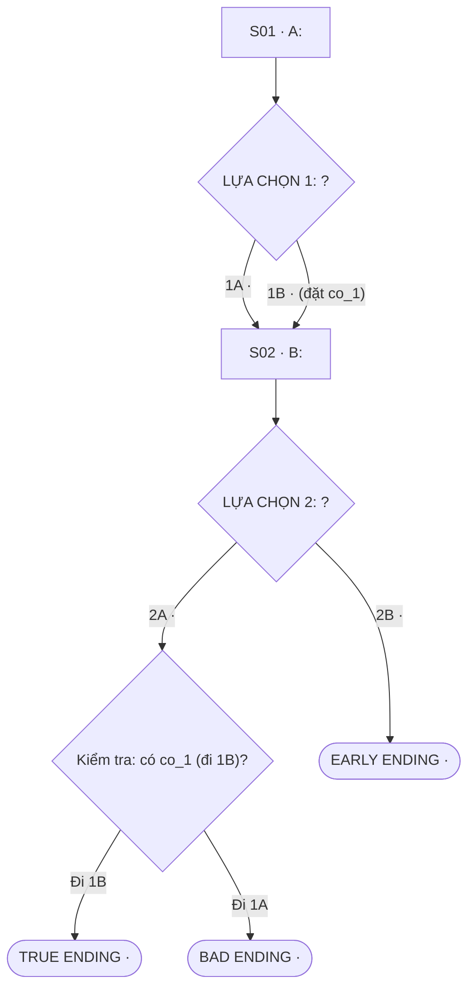

# MẪU PHÁC THẢO KỊCH BẢN — MỨC 1 (chuẩn để chuyển thẳng sang `kich-ban-game`)

**Mức 1 = đủ để duyệt cốt truyện, nhánh và để chuyển sang game mà KHÔNG phải viết lại.** Viết tới cảnh, lựa chọn, cờ, kết cục.
**KHÔNG viết:** shot, góc máy (CU/MCU…), số giây từng shot, prompt ảnh/video. Phần đó do bước Mức 3 sinh ra.

| Mức | Nội dung | Nơi lưu |
|---|---|---|
| 0 · Logline | 1–2 câu: hook · twist · kết | chat |
| **1 · Phác thảo** | **thẻ tập + sơ đồ nhánh + mỗi cảnh = 1 node + cờ + kết cục** | **`y-tuong-kich-ban-notebook/<slug>.md`** |
| 2 · Chia shot (tùy chọn) | chỉ khi muốn xem nhịp shot trước | `y-tuong-kich-ban/NN_slug/` |
| 3 · Chốt & sản xuất | nguồn `scripts/episodes/gm<NN>_<slug>.mjs` → biên dịch | `kich-ban-game/<NN>_<slug>/` |

**Nguyên tắc:** truyện hay ưu tiên hơn con số. Mọi con số dưới đây là **gợi ý**, trừ dòng ghi **[bắt buộc]**. Lệch gợi ý thì ghi vào "Ghi chú lệch chuẩn", không cắt truyện để đạt số.

## 1. Thẻ tập — điền TRƯỚC khi viết cảnh (đổi về sau tốn cả một lượt viết lại)

| Mục | Quy ước |
|---|---|
| Thị trường & bối cảnh | Quốc gia/thành phố, tiền tệ, tên nhân vật theo thị trường đó (bản sản xuất viết tiếng Anh). Không dùng thương hiệu thật **[bắt buộc]** |
| Chế độ trạng thái | `house` (mặc định: 2 cờ manh mối, khung node chuẩn, 4 kết True/Bittersweet/Redeem/Karma) **hoặc** `free` (1–3 cờ tự đặt, kết tự chọn, nên ≥ 3 kết). Chọn `free` khi truyện không phải dạng "điều tra manh mối" |
| Bối cảnh chính | `A`, `B` mặc định; tối đa `A`–`D` khi truyện cần. Mỗi bối cảnh thêm = 1 bộ ảnh tham chiếu. Kết đặc biệt có thể thêm 1 bối cảnh ngoại lệ |
| Nhân vật | ≤ 5 nhân vật có tên (thường 4), ID tiếng Anh `ten_ho`. **≤ 2 nhân vật có tên trong cùng một khung hình [bắt buộc]**. Quái/vai câm = vai phụ + đạo cụ. Series dùng chung ID và mô tả |
| Cờ | 1–3 cờ dạng `ten_co=true`: đặt ở lựa chọn nào, đọc ở lựa chọn nào, câu gợi ý khi nút bị khóa (VI + EN) |
| Kết cục | ID `END_<TEN>` + vai trò (True / bittersweet / bẫy / chết sớm…) + điều kiện + điểm chơi lại |

**Không dùng [bắt buộc]:** thanh chỉ số (máu, tâm lý, độ tin cậy), điều kiện kiểu "đi 1A + 2A + 4C", khóa sang tập sau, đồng hồ đếm ngược thật (đồng hồ chỉ là chi tiết truyện). Trạng thái chỉ là các cờ đúng/sai.

## 2. Gợi ý nhịp (không bắt buộc)

- Mỗi cảnh = **1 node**, khoảng 28–40s khi lên game (3–5 shot). Kết cục 15–30s.
- Một lượt chơi trung vị ~5 phút ≈ 7–9 cảnh trên đường đi. Đường ngắn nhất nên ≥ 3 phút.
- Xung đột trong 3–5s đầu; lựa chọn đầu ở cuối cảnh mở màn. 2 lựa chọn/nút, tối đa 3.
- Mỗi cảnh 1 đạo cụ neo. Đạo cụ dùng ở cao trào phải xuất hiện trước đó. Đạo cụ đổi trạng thái (vỡ, rách) ghi rõ "trước/sau".

## 3. Khung node khi chọn `house`

| Node | Vai trò |
|---|---|
| `S01` | Mở màn, hook, lựa chọn đầu |
| `S01_INSPECT` | Soi manh mối 1 (đặt cờ 1) |
| `S01_TAUNT`, `S01_PRESSURE` | Bị khiêu khích / bị dồn ép — tuyến chưa có manh mối đi qua đây, **không** được mặc định đã biết manh mối |
| `S01_CLUE_HUB` | Manh mối 2 (đặt cờ 2) |
| `S03` | Bẫy giữa truyện (tuyến không manh mối → `END_KARMA`) |
| `S02_BRINK` → `S02` | Cao trào (cần cờ 1) |
| `S04_BROADCAST` | Lật ngược (cần cờ 1 + 2) |
| `END_TRUE_SUPREME`, `END_BITTERSWEET`, `END_REDEEM`, `END_KARMA` (+ ≤ 2 kết riêng) | `END_KARMA` phải dẫn người chơi quay lại điều tra |

Thêm node riêng tùy truyện (`S03_CARDS`, `S05_CURTAIN`…). Với `free`: ID tự đặt, node gốc luôn là `S01`, kết cục luôn bắt đầu bằng `END_`.

## 4. Quy ước sơ đồ (để `check_branch_graphs.py` đọc được)

- Đúng **1** node gốc. Không node nào cụt (trừ kết cục).
- Kết cục: `E_ID(["ENDING · Tên"])` · Lựa chọn: `C1{"LỰA CHỌN 1: ..."}` · Điều kiện: `CHK{"Kiểm tra: ..."}`.
- Nhãn cạnh lựa chọn bắt đầu bằng mã `"1A · ..."`; điều kiện về sau gọi lại mã (`Đi 1B`) hoặc tên cờ.

## 5. Khung file (chép rồi điền)

````markdown
# KỊCH BẢN PHÂN NHÁNH — <TÊN TRUYỆN>

| Thẻ tập | |
|---|---|
| Thị trường | <thành phố, quốc gia> · tiền <USD/…> |
| Thể loại · cơ chế | <thể loại> · <nhân vật muốn gì, cái giá của lựa chọn> |
| Chế độ trạng thái | house / free |
| Bối cảnh chính | A: <…> · B: <…> (· C: <…>) |
| Nhân vật | <ten_id> <Tên> (<tuổi>, vai trò, dấu hiệu nhìn thấy được) · … |
| Cờ | `co_1=true`: đặt ở 1B, đọc ở 2A — gợi ý khóa: "<VI>" / "<EN>" · … |
| Kết cục | `END_TRUE_<…>` (True, cần co_1) · `END_<…>` (…) · … |

### Sơ đồ phân nhánh


### S01 · Bối cảnh A · NỘI/NGOẠI · <THỜI GIAN>
**Nhân vật:** <tối đa 2 người có tên cùng lúc> · **Đạo cụ neo:** <…>

<2–5 câu hành động: xung đột ngay từ đầu>

<NHÂN VẬT>: <1 câu thoại chốt>

**[LỰA CHỌN 1 — <tình huống>]**
* **1A (<hành động cụ thể>)** → `S02`: <hệ quả ngắn>
* **1B (<hành động cụ thể>)** → `S02` · đặt `co_1`: <hệ quả ngắn>

### HỆ THỐNG KẾT CỤC
* **`END_TRUE_<…>` · TRUE · <TÊN>** *(cần `co_1`, chọn 2A)*: <1–3 câu, hình ảnh cuối> · chơi lại từ `S02`
* **`END_EARLY_<…>` · <TÊN>** *(chọn 2B)*: <…> · chơi lại từ `S02`

### Ghi chú lệch chuẩn (nếu có)
* <vd: đường ngắn nhất ~2 phút vì kết chết sớm là điểm nhấn của truyện>
````

## 6. Kiểm tra trước khi nộp

```bash
cd D:/Projects/Tiktok-Videos
PYTHONIOENCODING=utf-8 python skills/pov-fmv-video-pipeline/scripts/check_branch_graphs.py y-tuong-kich-ban-notebook
```
Sạch lỗi cấu trúc → tự đọc lại: thẻ tập đủ chưa, cờ nào cũng được đặt và đọc, mỗi kết có đường tới và có điểm chơi lại.

## 7. Câu lệnh mẫu giao cho Hermes

**Mức 0 — lô logline**
> Đọc `y-tuong-kich-ban-notebook/MAU_PHAC_THAO.md`. Đề xuất 10 logline FMV 9:16 thể loại `<thể loại>` cho thị trường `<…>`, mỗi cái 2 câu (hook · twist · kết), kèm chế độ house/free phù hợp và 1 dòng "vì sao người xem sẽ chọn". Không trùng truyện đã có trong `y-tuong-kich-ban-notebook/` và `kich-ban-game/`. Chỉ trả trong chat.

**Mức 1 — phác thảo một truyện**
> Đọc `y-tuong-kich-ban-notebook/MAU_PHAC_THAO.md`. Viết phác thảo Mức 1 cho logline: `<dán logline>`, thị trường `<…>`. Điền đủ thẻ tập, mỗi cảnh là 1 node có ID, ghi rõ cờ đặt/đọc ở đâu. Lưu `y-tuong-kich-ban-notebook/<slug_khong_dau>.md`. KHÔNG viết shot/góc máy/prompt. Chạy `check_branch_graphs.py` đến khi sạch, rồi báo: số cảnh, số lựa chọn, cờ, danh sách kết cục, các điểm lệch chuẩn, và 1 lựa chọn yếu nhất.

**Đưa lên trang duyệt** (gộp luôn vào lệnh Mức 1 nếu muốn lên trang ngay — script, không tốn token LLM)
> Chạy `python y-tuong-kich-ban-notebook/them_vao_trang.py <slug>.md` (tự kiểm sơ đồ, thêm vào CUỐI `STORIES`, build và publish lên https://tviethung.github.io/kich-ban-review/). Báo link và kết quả.

**Mức 3 — chốt vào `kich-ban-game` (chỉ khi đã duyệt)**
> Làm theo skill `vertical-micro-drama-pipeline`, reference `05_port_standalone_episode_to_game_pack.md`. Chuyển `y-tuong-kich-ban-notebook/<slug>.md` thành tập `GM<NN>` (số tiếp theo chưa dùng), **giữ nguyên 1:1** thẻ tập, node, cờ, kết cục (chế độ house/free và `mainLocs` theo thẻ tập): viết `scripts/episodes/gm<NN>_<slug>.mjs` theo `scripts/episodes/README.md`, đăng ký `GM<NN>` trong `scripts/style_presets.mjs`, compile dưới khóa `.compile.lock`, chạy validator và `audit_script_readiness.mjs GM<NN>`. Không cắt/gộp cảnh hay kết để đạt con số gợi ý — lệch thì báo. KHÔNG sửa tay file trong `kich-ban-game/<NN>_<slug>/`.
