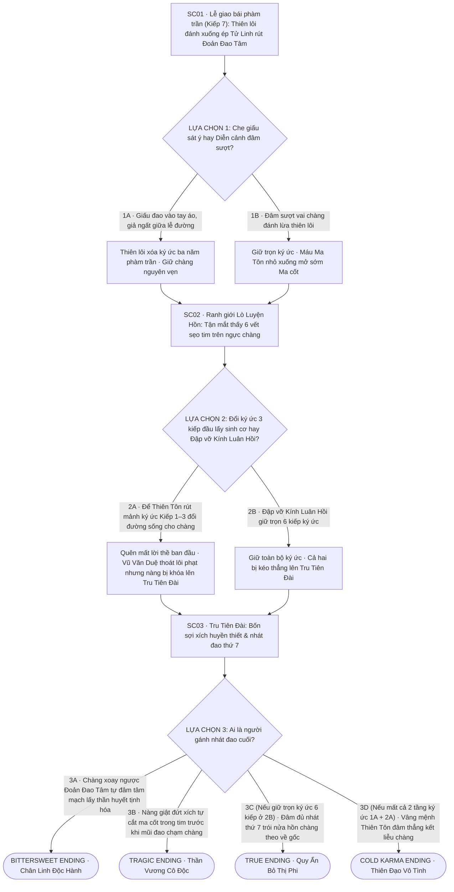
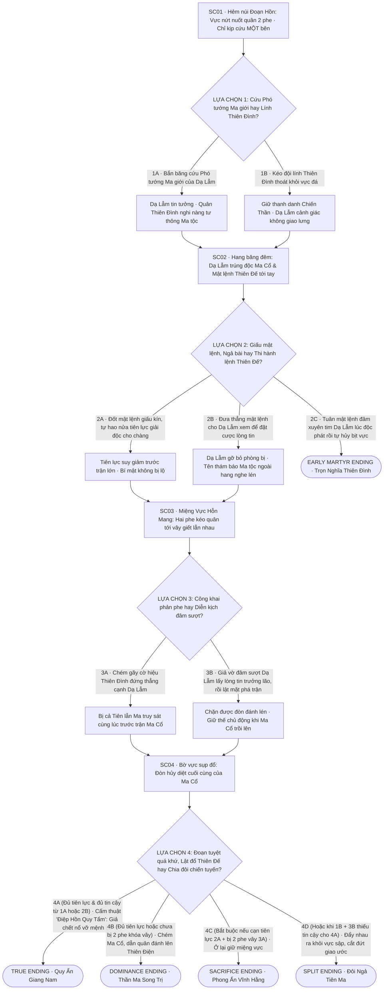
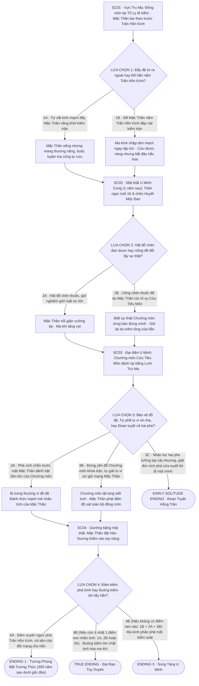

# CỤM KỊCH BẢN PHÂN NHÁNH — TIÊN HIỆP "CAN TÂM YÊU EM"
**Thể loại:** Tiên hiệp huyền huyễn · Ngược tâm · Phim tương tác phân nhánh (FMV) · 3 tuyến truyện độc lập với **3 cơ chế lựa chọn riêng**

---

## PHẦN 1: THẤT KIẾP XUYÊN TÂM
**Thể loại:** Tiên hiệp luân hồi · Giao ước bảy kiếp
**Cơ chế lựa chọn đặc trưng:** *Định Luật Bảy Kiếp* — suốt 6 kiếp trước, Vũ Văn Duệ tự nguyện hứng 6 nhát dao của Diệp Tử Linh để giữ nguyên thần nàng không tan. Ở kiếp thứ 7 cuối cùng, mọi lựa chọn xoay quanh việc **đổi Ký ức 6 kiếp lấy Sinh mệnh** hay **phá giao ước để đổi lấy khả năng cùng sống sót về thế giới gốc**.

### Sơ đồ phân nhánh Phần 1

### Tuyến nhân vật & Đạo cụ
* **VŨ VĂN DUỆ (Ma Tôn / Ẩn thân tại phàm trần):** Khoác hỉ bào đỏ thẫm (phàm trần) ➔ trường bào đen (Ma Tôn). Dưới lớp áo là **sáu vết sẹo dao xuyên tim** từ 6 kiếp trước.
* **DIỆP TỬ LINH (Thần Đao Tiên Giới):** Mang linh hạch Hỗn Độn; ở kiếp thứ 7 mất ký ức cho đến khi *Đoản Đao Tâm* thức tỉnh.
* **CỬU HUYỀN THIÊN TÔN:** Kẻ rèn ra *Đoản Đao Tâm*, lợi dụng Tử Linh giết Ma Tôn đủ 7 lần.

---

### SC01 · NỘI · LỄ ĐƯỜNG PHÀM TRẦN (KIẾP THỨ 7) · ĐÊM

Nến đỏ cháy rực hai hàng. Diệp Tử Linh mặc giá y đỏ, tay đặt trên dải lụa hồng nối liền với Vũ Văn Duệ đứng đối diện.

Bỗng một tiếng sét xé toạc mái ngói. Con *Đoản Đao Tâm* giấu trong hộp sính lễ tự bật nắp bay lơ lửng trước mặt Tử Linh, tỏa ánh sáng băng giá. Chuôi đao chạm vào lòng bàn tay nàng — những mảnh ký ức rời rạc về chén độc tửu kiếp một, mũi tên sa trường kiếp ba ùa về làm nàng khuỵu gối.

Trên tầng mây rách ngoài cửa sổ, giọng Cửu Huyền Thiên Tôn vang dội xuống lễ đường.

CỬU HUYỀN THIÊN TÔN
Giờ Tý đã điểm. Giết hắn, ngươi mới giữ được nguyên thần trở về Tiên Giới.

Vũ Văn Duệ không né tránh, chỉ khẽ nghiêng người chắn trước hướng tia sét thứ hai sắp giáng xuống đầu nàng.

**[ĐIỂM LỰA CHỌN 1 — Đối phó mệnh lệnh ngay tại lễ đường]**
* **Lựa chọn 1A (Thu đao vào tay áo, giả ngất xỉu tránh ra tay):** Giấu con đao khỏi tầm sét, giữ Vũ Văn Duệ không bị thương trước thiên lôi. *(Chàng bình an, nhưng dư chấn thiên lôi xóa sạch ký ức ba năm phàm trần của nàng).*
* **Lựa chọn 1B (Rút đao đâm sượt qua vai trái chàng để đánh lừa thiên lôi):** Diễn cảnh thi hành án ngay trước mắt Thiên Giới. *(Giữ được ký ức, nhưng máu Ma Tôn rơi xuống làm ma cốt trong người nàng bùng phát sớm).*

#### NHÁNH 1A
Tử Linh siết chặt chuôi đao đến rớm máu lòng bàn tay rồi luồn giấu vào sâu trong ống tay áo rộng, ngã gục vào vai chàng. Tia sét đánh sập xà ngang điện nhưng bị chàng vung tay áo gạt tan — làn khói lạnh quét qua mắt khiến toàn bộ ký ức ba năm chung sống ở nhân gian của Tử Linh trôi tuột như cát, ngay khi luồng xoáy không gian kéo cả hai rơi thẳng vào ranh giới tâm cảnh.

#### NHÁNH 1B
Tử Linh chụp lấy chuôi đao lao tới, xoay cổ tay đúng nửa tấc khiến mũi đao chỉ rạch toạc bả vai trái Vũ Văn Duệ. Một giọt máu sẫm văng lên má nàng — luồng hắc khí từ tâm hạch lập tức bùng lên nhuộm đỏ khóe mắt nàng. Thiên lôi tạm rút lui, nhưng cả hai lập tức bị lốc xoáy kéo vào ranh giới ký ức.

---

### SC02 · NỘI · CÕI TÂM CẢNH — LÒ LUYỆN HỒN · ĐÊM

Không gian trắng xóa chỉ có những mảnh gương vỡ phản chiếu sáu kiếp người. Vũ Văn Duệ đứng giữa trận pháp, cổ áo hỉ phục bung mở để lộ **sáu vết sẹo dao hình chữ thập** chồng khít lên nhau ngay giữa ngực trái.

DIỆP TỬ LINH
Sáu kiếp... chàng đều cố ý đứng yên cho ta đâm sao?

VŨ VĂN DUỆ
Linh hồn nàng bị vỡ làm bảy mảnh. Không có bảy lần máu ta dẫn đường, nàng không bao giờ sống lại nổi.

Bức ảnh chiếu của Cửu Huyền Thiên Tôn hiện lên trên mặt Kính Luân Hồi khổng lồ, đặt điều kiện lạnh lùng: giao nộp ký ức Kiếp 1–3 (nơi chứa mật chú khống chế Hỗn Độn Hạch) để đổi lấy sinh mạng cho Vũ Văn Duệ, hoặc cả hai bị đẩy lên Tru Tiên Đài chịu Thiên Phạt ngay lập tức.

**[ĐIỂM LỰA CHỌN 2 — Ký ức tình cảm vs Thế đối đầu sinh tử]**
* **Lựa chọn 2A (Để Thiên Tôn rút mảnh ký ức Kiếp 1–3):** Chấp nhận quên sạch lý do vì sao mình từng yêu Vũ Văn Duệ để kéo chàng ra khỏi trận sát phạt.
* **Lựa chọn 2B (Phóng đao đập vỡ Kính Luân Hồi):** Thà chịu Thiên Phạt cùng chàng chứ không giao ký ức làm con tin cho Tiên Giới.

#### NHÁNH 2A
Tử Linh chạm tay lên mặt kính. Những khung cảnh đẹp nhất của ba kiếp đầu tan thành tro trắng — nàng nhìn Vũ Văn Duệ đứng trước mặt mà ánh mắt chỉ còn lại sự xa lạ lạnh lẽo như đối diện một Ma Tôn đúng nghĩa. Thiên Tôn thu lại lôi phạt trên người chàng, nhưng lập tức giáng xích huyền thiết khóa riêng Tử Linh lôi thẳng lên Tru Tiên Đài để ép hoàn tất nhát đao cuối.

#### NHÁNH 2B
Tử Linh vung tay chém vỡ Kính Luân Hồi làm trăm mảnh. Lực phản chấn hất cả hai rơi thẳng xuống tảng đá đen trên Tru Tiên Đài đúng lúc mây bão Cửu Thiên kéo tới.

---

### SC03 · NGOẠI · TRU TIÊN ĐÀI · HOÀNG HÔN BÃO TUYẾT

Bốn sợi xích huyền thiết siết chặt tứ chi Diệp Tử Linh trên tế đài đá đen. Sấm tím giáng ầm ầm xuống đỉnh Thần Sơn. Vũ Văn Duệ bước từng bước lên bậc đá, trên tay cầm chính thanh *Đoản Đao Tâm* đã khắc sáu đạo huyết văn cũ — chỉ còn khuyết một rãnh cuối cùng.

VŨ VĂN DUỆ
Còn một nhát cuối nữa thôi là hồn phách nàng trọn vẹn trở về thế giới gốc. Đừng nhìn ta bằng ánh mắt đó.

DIỆP TỬ LINH
Nếu nhát thứ bảy này đâm xuống, người chết là ta hay là chàng?

Vũ Văn Duệ không đáp, giơ lưỡi đoản đao ngang ngực. Giữa đỉnh đài, bia đá Tru Tiên sáng rực hai dòng cổ tự của giao ước: *Thất đao xuyên tim, hồn quy bản giới; nếu tự hủy nguyên thần, kẻ còn lại vĩnh bất phục sinh.*

**[ĐIỂM LỰA CHỌN 3 — Định đoạt nhát đao thứ 7]**
* **Lựa chọn 3A (Vũ Văn Duệ xoay ngược Đoản Đao Tâm tự đâm vào tâm mạch mình):** Dùng toàn bộ thần huyết thượng thần tịnh hóa ma hạch cho nàng mà không để nàng vấy máu thêm lần nào nữa.
* **Lựa chọn 3B (Tử Linh giật đứt xích tay phải, chộp lấy Đoản Đao Tâm tự cắm vào chính ma hạch trong ngực mình):** Kết liễu trước khi chàng kịp hy sinh.
* **Lựa chọn 3C** *(Chỉ khả dụng khi giữ trọn ký ức 6 kiếp ở 2B)*: **Kéo tay chàng đâm thẳng nhát thứ bảy xuyên tim Vũ Văn Duệ — đồng thời dùng ký ức 6 kiếp trói chặt nửa nguyên thần chàng nhập chung vào linh hồn mình trước khi tan rã.**
* **Lựa chọn 3D** *(Chỉ mở khi đã mất cả ký ức phàm trần ở 1A lẫn ký ức Kiếp 1–3 ở 2A)*: **Lạnh lùng giật đao đâm thẳng nhát thứ bảy kết liễu Ma Tôn theo đúng mệnh lệnh Cửu Huyền Thiên Tôn.**

---

### HỆ THỐNG KẾT CỤC PHẦN 1

* **TRUE ENDING · QUY ẨN BỎ THỊ PHI *(Chọn 3C — Đủ ký ức 2B)*:** Mũi đao xuyên tim kích hoạt trọn vẹn phong ấn 7 kiếp — nhưng thay vì tan biến, nửa nguyên thần của Vũ Văn Duệ theo sợi chỉ ký ức neo chặt vào tim Tử Linh. Trong khoảnh khắc Cửu Huyền Thiên Tôn tưởng mình đã thắng, cả hai cùng biến mất khỏi Tru Tiên Đài, mở mắt tỉnh lại nguyên vẹn tại thế giới gốc với đầy đủ ký ức. Họ bỏ lại mọi tranh chấp Tiên – Ma, ẩn cư nơi nhân gian bình dị.
* **BITTERSWEET ENDING · CHÂN LINH ĐỘC HÀNH *(Chọn 3A)*:** Thần huyết vàng kim của Vũ Văn Duệ rửa sạch ma hạch, đẩy lùi mây bão trên đỉnh Thần Sơn rồi tan biến vào luồng thiên lôi cuối cùng. Tử Linh sống lại trọn vẹn ở thế giới gốc, nhưng mảnh ký ức về người từng cứu mình đã mờ nhạt — nàng chỉ giữ trên cổ tay một mảnh chuôi đao gãy không rõ tên chủ nhân.
* **TRAGIC ENDING · THẦN VƯƠNG CÔ ĐỘC *(Chọn 3B)*:** Ma cốt trong ngực Tử Linh vỡ tan thành từng đốm sáng đỏ bay dọc đỉnh núi. Vũ Văn Duệ quỳ sụp giữa tế đài ôm khoảng không trống rỗng; chàng sống sót giữ trọn ngôi vị chí tôn, nhưng vĩnh viễn mất đi người duy nhất mình muốn bảo vệ qua bảy vạn năm.
* **COLD KARMA ENDING · THIÊN ĐẠO VÔ TÌNH *(Chọn 3D — Mất 2 tầng ký ức 1A + 2A)*:** Không còn nhớ ba năm phàm trần lẫn lời thề ba kiếp đầu, Diệp Tử Linh dứt khoát đâm xuyên tim Vũ Văn Duệ lấy lại nguyên thần hoàn chỉnh để phi thăng trở về Thần Đàn Cửu Thiên. Trăm năm sau ngồi trên ngôi vị Thần Đao tối cao, nàng vẫn không hiểu vì sao mỗi đêm tuyết rơi nước mắt lại vô thức rơi lên sáu vệt mực đỏ mờ trên chuôi đao.

---

## PHẦN 2: TIÊN MA ĐỒNG QUY
**Thể loại:** Tiên Ma đối đầu · Liên minh bất đắc dĩ · Quyền mưu hai phe
**Cơ chế lựa chọn đặc trưng:** *Khoảng Cách Niềm Tin Tiên – Ma* — hai kẻ đứng đầu hai phe đối lập buộc phải sát cánh chống Thảm họa Vực Hỗn Mang, trong khi **cấp dưới và mật lệnh từ chính phe mình liên tục ép phải phản bội người kia**.

### Sơ đồ phân nhánh Phần 2

### Tuyến nhân vật & Đạo cụ
* **DẠ LẪM (Ma Hoàng Cửu U):** Hắc bào thêu rồng đen, tay cầm *Phệ Hồn Kích*. Thực tế, tàn nhẫn với kẻ địch nhưng giữ lời hứa.
* **VÂN DAO (Chiến Thần Thiên Đình):** Bạch ngân chiến giáp, áo choàng đỏ thắm, tay cầm *Băng Phách Cung*.

---

### SC01 · NGOẠI · HẺM NÚI ĐOẠN HỒN · ĐÊM

Mặt đất nứt toác dưới đáy Vực Hỗn Mang, luồng khí đen trào lên nuốt chửng những mảng đá khổng lồ. Hai đội tiên phong Tiên – Ma vốn đang giao chiến lập tức tan tác chạy thoát thân.

Phía vách trái, phó tướng Ma giới của Dạ Lẫm bị kẹt chân dưới tảng đá sắp rơi xuống vực; phía vách phải, hai tiểu binh mang cờ Thiên Đình đang trượt tay trên mép đá lở. Dạ Lẫm đang bị một luồng oán khí chặn phía trên — chỉ còn Vân Dao đủ tầm bắn của *Băng Phách Cung* để giữ lại **một bên** trong tích tắc.

**[ĐIỂM LỰA CHỌN 1 — Phe đồng minh hay Kẻ đối đầu?]**
* **Lựa chọn 1A (Bắn mũi tên băng cứu Phó tướng Ma giới):** Giữ lại cánh tay phải cho Dạ Lẫm trước mắt đội quân Thiên Đình đang rút lên trên.
* **Lựa chọn 1B (Bắn dây băng kéo hai tiểu binh Thiên Đình lên mép vực):** Giữ tròn bổn phận Chiến Thần, để phó tướng Ma giới rơi xuống làn khói đen.

#### NHÁNH 1A
Mũi tên băng đóng cứng vách đá giữ chặt phó tướng Ma giới. Dạ Lẫm đáp xuống cạnh nàng, ánh mắt thoáng ngạc nhiên; nhưng phía trên vách núi, viên phó tướng Thiên Đình đã kịp nhìn thấy mũi tên của Chiến Thần lại hướng về phía Ma tộc.

#### NHÁNH 1B
Hai tiểu binh Thiên Đình được kéo lên an toàn. Ở mép vực đối diện, Dạ Lẫm vung kích chém nát tảng đá nhưng không kịp cứu thuộc hạ; hắn nhìn Vân Dao bằng ánh mắt lạnh lẽo rồi lặng lẽ thu kích lùi vào hang đá.

---

### SC02 · NỘI · HANG BĂNG ĐÁY VỰC · ĐÊM

Ánh lửa bập bùng sưởi ấm góc hang hẹp. Bả vai Dạ Lẫm tím đen vì trúng gai độc của Ma Cổ — độc khí đang lan dần lên cổ.

Đúng lúc đó, một con chim hạc giấy của Thiên Đình bay xuyên qua khe nứt đáp xuống tay Vân Dao. Nàng mở ra: **Mật lệnh của Thiên Đế** — *"Chờ Dạ Lẫm độc phát, đâm xuyên tim tại chỗ rồi tự hủy nguyên thần bịt kín miệng vực."*

**[ĐIỂM LỰA CHỌN 2 — Che chở thầm lặng, Ngả bài hay Tuân lệnh Thiên Đế?]**
* **Lựa chọn 2A (Đốt ngay tờ mật lệnh vào bếp lửa, truyền một nửa tiên lực đẩy độc cho Dạ Lẫm):** Giấu kín âm mưu của Thiên Đế để Dạ Lẫm không nổi điên tàn sát, tự mình chịu tổn hao tu vi trước trận đánh lớn.
* **Lựa chọn 2B (Đặt thẳng tờ mật lệnh lên đầu gối Dạ Lẫm):** Phơi bày toàn bộ sự phản bội của Thiên Đình để thử xem Ma Hoàng có dám đặt lưng vào tay nàng không.
* **Lựa chọn 2C (Rút mũi tên băng đâm thẳng tim Dạ Lẫm nhân lúc độc phát rồi tự kích nổ nguyên thần bịt hang đá):** Tuân thủ tuyệt đối mật lệnh của Thiên Đế để dứt điểm mầm họa Ma giới ngay tại chỗ.

#### NHÁNH 2A
Vân Dao ném tờ hạc giấy vào ngọn lửa rồi đặt hai bàn tay lên lưng Dạ Lẫm, truyền dòng tiên lực trắng tinh ép độc khí ra ngoài. Nửa tuần hương sau, sắc mặt chàng hồi phục nhưng trán Vân Dao lấm tấm mồ hôi lạnh vì mất nửa nguyên khí.

#### NHÁNH 2B
Dạ Lẫm đọc xong dòng chữ đóng triện Thiên Đế, bỗng bật cười khẽ, xé đôi tờ mật lệnh thả vào đống lửa: *"Ít nhất nàng không diễn trò sau lưng ta."* Nhưng ngoài cửa hang đầy tuyết, một bóng đen trinh sát Ma tộc vừa kịp thấy cảnh hai chủ soái ngồi cạnh nhau không hề động thủ.

#### NHÁNH 2C ➔ KẾT THÚC SỚM
Mũi tên băng xuyên lồng ngực khiến Dạ Lẫm chỉ kịp trừng mắt nhìn nàng một giây ngắn ngủi trước khi luồng tự bạo nguyên thần của Vân Dao đánh sập cả miệng hang băng, chôn vùi vĩnh viễn lối thoát của Ma Cổ.

---

### SC03 · NGOẠI · MIỆNG VỰC HỖN MANG · BÌNH MINH TỐI SẦM

Cự Thú Ma Cổ khổng lồ trồi lên từ lòng vực, thân mình phủ đầy gai nham thạch đen ngòm. Ngay khoảnh khắc Vân Dao và Dạ Lẫm vừa từ hang đá bước ra đứng song song trước miệng vực, hai đạo quân tiếp viện của **Thiên Giới** và **Ma Cung** bất ngờ ập tới hai bên sườn núi. Thấy hai chủ soái đứng cạnh nhau bình yên vô sự, cả hai phe lập tức giương cung chĩa thẳng vào đối phương lẫn hai người đứng giữa.

TRƯỞNG LÃO THIÊN ĐÌNH
Vân Dao! Lập tức giết Ma Hoàng! Đế Quân đã hạ lệnh: ai cản trở, xử tội phản nghịch tại chỗ!

**[ĐIỂM LỰA CHỌN 3 — Phá vỡ xiềng xích hai phe]**
* **Lựa chọn 3A (Chém gãy cờ hiệu Chiến Thần trên vách đá, công khai đứng sát cạnh Dạ Lẫm):** Từ bỏ hoàn toàn danh phận Thiên Đình trước hàng ngàn thiên binh. *(Bị cả hai phe đồng loạt bao vây truy sát giữa lúc Ma Cổ tấn công).*
* **Lựa chọn 3B (Giả vờ nâng cung bắn sượt vai Dạ Lẫm để đánh lừa Trưởng lão, rồi quay ngược mũi tên bắn vỡ cột trận pháp khóa đường lui của Thiên Đình):** Dùng mưu giữ khoảng trống một nhịp cho hai người lao thẳng ra mép vực đối đầu trực diện Ma Cổ.

#### NHÁNH 3A
Cạnh *Băng Phách Cung* sắc lẹm quét ngang chém đôi lá cờ Chiến Thần. Hàng ngàn mũi tên từ cả Thiên Đình lẫn Ma Cung lập tức trút xuống như mưa, ép hai người vừa đánh trả vòng vây vừa lùi sát ra bờ vực nơi Ma Cổ đang gầm vang.

#### NHÁNH 3B
Mũi tên băng xé rách vai áo Dạ Lẫm khiến Trưởng lão Thiên Đình khựng lại một nhịp — ngay tích tắc đó, Vân Dao xoay cung bắn nát cột trận pháp phong tỏa đường lên bờ vực, kéo Dạ Lẫm bứt khỏi đội hình hai phe trước khi chúng kịp siết vòng vây.

---

### SC04 · NGOẠI · BỜ VỰC HỖN MANG ➔ THỊ TRẤN GIANG NAM

Quả cầu hủy diệt đen kịt ngưng tụ trên miệng Cự Thú Ma Cổ, làm rạn nứt cả bầu trời ranh giới. Phía trên, tiếng trống truy kích của Thiên – Ma vẫn dội xuống không ngớt.

Dạ Lẫm lau vệt máu trên cằm, quay sang nắm lấy bàn tay đang kéo dây cung của Vân Dao.

DẠ LẪM
Đánh tan con quái thú này xong, trên trời là kẻ thù của nàng, dưới đất là kẻ thù của ta. Nàng chọn đường nào?

**[ĐIỂM LỰA CHỌN 4 — Đoạn tuyệt, Thống trị hay Chia đôi chiến tuyến?]**
* **Lựa chọn 4A** *(Khả dụng khi chưa rơi vào thế 2A + 3A VÀ đã có lòng tin từ 1A hoặc 2B)*: **Khởi động cấm thuật "Điệp Hồn Quy Tẩm" — Nổ vỡ mệnh bài giả chết thoát thân:** Dồn toàn bộ tu vi chém nát Ma Cổ, đồng thời kích nổ màn sáng làm vỡ đôi hồn đăng mệnh bài trên cả Thiên Điện lẫn Ma Cung để biến mất mãi mãi khỏi tam giới.
* **Lựa chọn 4B** *(Khả dụng khi chưa rơi vào thế cạn lực + bị vây 2A + 3A)*: **Quét sạch Ma Cổ rồi dẫn tàn quân còn trung thành đánh ngược lên Cửu Trùng Thiên Điện:** Phế truất Thiên Quân giả tạo, xóa ranh giới Tiên – Ma để tự lập trật tự mới.
* **Lựa chọn 4C** *(Bắt buộc khi đi nhánh cạn tiên lực 2A + bị hai phe vây 3A)*: **Một người ở lại dùng thân xác làm trụ phong ấn nốt kẽ nứt trước khi sụp đổ:** Tiên lực đã cạn sau đêm giải độc trong hang băng và vòng vây hai phe khóa chặt mọi lối thoát, Vân Dao không đủ linh lực thi triển cấm thuật hay phá vây.
* **Lựa chọn 4D** *(Hoặc kết quả tất yếu nếu cố chọn 4A khi thiếu lòng tin 1B + 3B)*: **Hợp kích giết Ma Cổ rồi tự đẩy nhau về hai phía vách đá sập để chấm dứt liên minh:** Từ giây phút này, hai người quay về làm Chiến Thần và Ma Hoàng đối địch như chưa từng quen biết.

---

### HỆ THỐNG KẾT CỤC PHẦN 2

* **TRUE ENDING · QUY ẨN GIANG NAM *(Chọn 4A)*:** Tiếng nổ sáng rực nuốt trọn Ma Cổ lẫn hai thân ảnh; trên đài quan sát Thần Giới và Ma Cung, hai ngọn hồn đăng đồng loạt tắt ngấm. **Ba năm sau tại một thị trấn nhỏ bên sông Giang Nam**, Vân Dao mặc áo vải thô phơi nong thuốc trước sân y quán. Dạ Lẫm vai vác bó củi lớn bước vào cổng, rút từ trong áo ra hai xâu kẹo hồ lô: *"Làm phu tiều của riêng nàng, tốt hơn làm Ma Hoàng vạn lần."*
* **DOMINANCE ENDING · THẦN MA SONG TRỊ *(Chọn 4B)*:** Cả hai sống sót bước ra từ tro tàn Vực Hỗn Mang, đạp đổ Nam Thiên Môn ngay trong đêm. Trên ngai vàng Cửu Trùng Thiên, Băng Phách Cung và Phệ Hồn Kích cắm song song trước điện — mở ra một triều đại mới đầy uy quyền nhưng mãi mãi gắn chặt vào trách nhiệm cai quản tam giới.
* **SPLIT ENDING · ĐÔI NGẢ TIÊN MA *(Chọn 4D — hoặc thiếu lòng tin ở 1B + 3B)*:** Vừa chém gục Ma Cổ, Dạ Lẫm kéo Vân Dao ném thẳng lên mỏm đá Thiên Đình rồi vung kích chém đứt cầu đá chia cắt hai bờ vực. Cả hai đều sống sót trở về phe của mình; một tháng sau trên chiến trường biên giới, mũi tên băng và lưỡi Phệ Hồn Kích lại chạm nhau không chút nương tay.
* **SACRIFICE ENDING · PHONG ẤN VĨNH HẰNG *(Chọn 4C)*:** Do suy kiệt tiên lực từ hang băng và bị hai phe truy sát quá rát, Vân Dao đẩy Dạ Lẫm ra khỏi lằn ranh sập vực rồi dùng toàn bộ mảnh cung vỡ hóa thành ấn khóa cuối cùng. Trên bờ vực yên ắng trở lại chỉ còn ngọn kích đen cắm đơn độc giữa tuyết trắng.
* **EARLY MARTYR ENDING · TRỌN NGHĨA THIÊN ĐÌNH *(Chọn 2C tại SC02)*:** Thiên Đế cho tạc tượng Chiến Thần Vân Dao bằng ngọc trắng giữa quảng trường Cửu Trùng Thiên để ca ngợi chiến công trừ Ma Hoàng trong hang băng — chẳng một ai biết nàng từng do dự suốt nửa tuần hương bên đống lửa tàn.

---

## PHẦN 3: SƯ ĐỒ NGHIỆT DUYÊN
**Thể loại:** Sư đồ ngược tâm · Hắc hóa · Thần khí ăn mòn
**Cơ chế lựa chọn đặc trưng:** *Độ Ăn Mòn Của Trấn Hồn Kính* — qua từng giai đoạn từ ngày biến cố Vực Tru Ma đến lúc bị giam tại U Minh Cung, Tố Ly quyết định **giữ khí tiết lạnh lùng (đẩy đồ đệ sâu vào ma khí)** hay **nhượng bộ tìm cách chạm tới phần nhân tính còn sót lại của Mặc Thần**.

### Sơ đồ phân nhánh Phần 3

### Tuyến nhân vật & Đạo cụ
* **TỐ LY (Sư Tôn Cửu Tiêu Môn):** Bạch y thanh lãnh, kiếm bản mệnh là *Hàn Sương Kiếm*.
* **MẶC THẦN (Đồ đệ hắc hóa):** Từ thiếu niên ngoan ngoãn hóa thành Ma Quân tóc điểm bạc, ngực mang *Trấn Hồn Kính* ăn mòn thần trí.

---

### SC01 · NGOẠI · VỰC TRU MA CỬU TIÊU MÔN · ĐÊM SẤM

Bảy mươi hai thanh kiếm trận của Cửu Tiêu Môn khóa chặt quanh mép vực đá đen, ép Tố Ly bước xuống tế kiếm thay cho lỗi phong ấn bị vỡ của môn phái.

Đồ đệ Mặc Thần người đầy máu lao xuyên qua hàng rào trưởng lão, vươn tay níu lấy tay áo nàng. Ngay phía dưới vách đá lơ lửng tấm **Trấn Hồn Kính** cổ xưa tỏa ra ánh sáng tím đen đầy mê hoặc.

MẶC THẦN
Sư tôn đừng buông tay! Để con phá trận này kéo người lên!

CHƯỞNG MÔN CỬU TIÊU
Lũ nghịch đồ! Hạ kiếm trận!

**[ĐIỂM LỰA CHỌN 1 — Bảo vệ tương lai đệ tử hay Sống sót bằng mọi giá?]**
* **Lựa chọn 1A (Tự cắt một đường kinh mạch đẩy mạnh Mặc Thần văng ra ngoài kiếm trận):** Không cho hắn chạm vào thần khí ma đạo, tự mình rơi xuống khe vực gãy.
* **Lựa chọn 1B (Nắm chặt tay Mặc Thần, để hắn chộp lấy Trấn Hồn Kính đập nát kiếm trận):** Thoát khỏi màn hiến tế của đồng môn ngay lập tức.

#### NHÁNH 1A
Tố Ly tung chưởng đẩy Mặc Thần bay ngược khỏi vùng sáng kiếm trận rồi rơi thẳng xuống sương mù đáy vực. Mặc Thần gào thét bò xuống vách đá — dù không chạm mặt kính ngay lúc đó, trọng thương gãy nát đan điền buộc hắn phải tìm đường tu ma suốt một năm để kéo nàng ra khỏi hàn đàm.

#### NHÁNH 1B
Mặc Thần chụp lấy Trấn Hồn Kính giáng mạnh xuống mắt trận. Bảy mươi hai thanh kiếm gãy vụn như cành khô, nhưng một luồng tà khí tím đen lập tức chui thẳng qua lòng bàn tay nhập vào ngực trái của hắn.

---

### SC02 · NỘI · MẬT THẤT U MINH CUNG · ĐÊM (MỘT NĂM SAU)

Giường băng vạn năm tỏa hơi lạnh trắng xóa. Để giữ Tố Ly không tự hủy kinh mạch hay quay lại Cửu Tiêu Môn, Mặc Thần đã dùng xiềng xích huyền thiết khóa hai cổ tay nàng trên giường băng suốt thời gian dưỡng thương. Hắn khoác hắc bào thêu chỉ bạc, mái tóc đen đã điểm vài lọn trắng, quỳ một gối cài chiếc trâm ngọc mộc mạc lên tóc nàng.

MẶC THẦN
Năm mười sáu tuổi người từng khen chiếc trâm này thanh nhã. Con tìm khắp ba ngàn dặm mới chuộc về được.

Hắn nâng một chén *Huyết Mộc Đan* ấm nóng đưa tới sát môi nàng: *"Uống đi, hàn khí trong kinh mạch người mới không phát tác."*

**[ĐIỂM LỰA CHỌN 2 — Khí tiết sư môn hay Chạm vào nỗi đau của hắn?]**
* **Lựa chọn 2A (Hất đổ chén đan dược xuống nền đá):** Giữ nghiêm giới luật chính đạo, tuyệt đối không nhận thứ thuốc luyện từ ma khí.
* **Lựa chọn 2B (Uống cạn chén thuốc rồi hỏi thẳng lý do hắn biến thành bộ dạng này):** Chấp nhận hạ mình nhượng bộ để tìm ra kẽ hở thật sự trong vụ Vực Tru Ma năm ngoái.

#### NHÁNH 2A
Chén thuốc vỡ tan trên mặt băng. Nụ cười trên môi Mặc Thần tắt ngấm; hắn bóp chặt cằm nàng ép nhìn vào đôi mắt đỏ ngầu: *"Người thà chết lạnh ở đây cũng khinh thường thứ ma đan con tìm cả năm trời sao?"* Hắc khí quanh mật thất cuộn lên dày đặc hơn.

#### NHÁNH 2B
Tố Ly uống cạn chén thuốc đắng chát rồi khẽ giơ cổ tay có dây xích chạm lên vạt áo hắn. Ánh mắt Mặc Thần chợt dịu xuống một nhịp; hắn rút từ trong ngực ra bức mật thư có dấu ấn Chưởng môn Cửu Tiêu — hóa ra chính đồng môn nàng đã ngầm bán linh căn của nàng để đổi lấy thọ nguyên cho lão Chưởng môn.

---

### SC03 · NỘI · ĐẠI ĐIỆN U MINH CUNG · ĐÊM BÃO

Tiếng chuông cảnh giới rền vang khắp cung điện ngầm khi Tố Ly vừa được đưa ra đại điện hít thở khí ấm, một bên cổ tay vẫn còn đeo sợi xích chưa khóa hẳn. Chưởng môn Cửu Tiêu Môn bất ngờ dẫn hàng trăm tu sĩ xé toạc kết giới bên ngoài ập vào — không phải để cứu nàng, mà tung thẳng *Lưới Trừ Ma* phủ xuống cả hai sư đồ hòng rút lấy cả linh căn của nàng lẫn Trấn Hồn Kính trong ngực Mặc Thần!

CHƯỞNG MÔN CỬU TIÊU
Hai thầy trò đều đã nhiễm tà khí! Bắt sống cả hai mang về luyện đan!

Mặc Thần đang bị thương cũ tái phát do ma kính phản phệ, quỳ một gối chống kiếm trước lưới độc từ trên cao chụp xuống.

**[ĐIỂM LỰA CHỌN 3 — Hành động quyết định trước đồng môn cũ]**
* **Lựa chọn 3A (Tố Ly giật đứt xích tay đang lỏng, lao tới chắn trước mặt Mặc Thần đánh bật mũi kiếm đâm lén của Chưởng môn):** Tự mình gánh một chưởng nặng từ chính môn phái mình từng phụng sự.
* **Lựa chọn 3B (Quỳ xuống tự giải trừ chút linh lực cuối cùng để cầu Chưởng môn tha mạng cho Mặc Thần):** Tin rằng sự nhượng bộ của mình có thể ngăn trận đổ máu.
* **Lựa chọn 3C (Giật đứt sợi xích còn lại, vung tay áo cắt đứt mảnh bạch y mang gia huy Cửu Tiêu rồi phá cửa tuyết rời khỏi U Minh Cung một mình):** Nhận ra cả sư môn giả nghĩa lẫn đồ đệ nhập ma đều không thể cứu vãn, tự giải thoát cho bản thân.

#### NHÁNH 3A
Tố Ly đỡ trọn chưởng phong của Chưởng môn, máu tươi phun lên vạt bạch y. Chứng kiến sư tôn quay lưng lại cả danh môn chính phái để che trước mặt mình, Mặc Thần gầm lên đánh văng lưới độc mở đường máu thoát ngược vào mật thất băng giá — một tia sáng ấm áp lóe lên giữa đôi mắt đỏ ngầu của hắn.

#### NHÁNH 3B
Chưởng môn cười lạnh ngay khi Tố Ly tự tán linh lực, lập tức siết chặt lưới gai đâm thẳng về phía Mặc Thần. Điên cuồng vì thấy sư tôn bị lừa gạt lần thứ hai, Trấn Hồn Kính trong ngực Mặc Thần bùng nổ không thể kìm hãm, nhấn chìm cả đại điện trong biển máu trước khi hắn ôm nàng chạy về mật thất.

#### NHÁNH 3C ➔ KẾT THÚC SỚM
Thanh *Hàn Sương Kiếm* bay ra khỏi vỏ theo tiếng gọi chủ nhân, xẻ toạc một đường giữa biển lưới độc và làn hắc khí. Tố Ly không ngoái đầu nhìn lại cả tiếng gào của Mặc Thần lẫn lời chửi rủa của lão Chưởng môn, tung người tan vào màn tuyết trắng bên ngoài cung điện ngầm.

---

### SC04 · NỘI · MẬT THẤT BĂNG GIÁ · ĐÊM CUỐI

Cánh cửa đá đóng sầm lại ngăn cách thế giới bên ngoài. Trấn Hồn Kính trước ngực Mặc Thần đã rạn nứt thành những đường sáng tím chói gắt, sắp nuốt trọn phần lý trí cuối cùng của hắn.

Mặc Thần đứng dậy, rút **Hàn Sương Kiếm** đặt vào lòng bàn tay Tố Ly rồi tự nắm chặt tay nàng chĩa thẳng mũi kiếm vào tim mình.

MẶC THẦN
Ta sắp không giữ nổi bản thân nữa rồi. Giết ta ngay bây giờ... hoặc ở lại nơi này vĩnh viễn cùng một con quái vật.

**[ĐIỂM LỰA CHỌN 4 — Nhát kiếm đoạn tuyệt hay Vòng tay cứu rỗi]**
* **Lựa chọn 4A (Đẩy thẳng mũi Hàn Sương Kiếm xuyên qua ngực Mặc Thần):** Phá nát tấm Trấn Hồn Kính và rút toàn bộ tiên căn của chính mình truyền ngược giữ lại một tia sinh cơ cho đồ đệ.
* **Lựa chọn 4B (Buông rơi thanh kiếm xuống đất, vươn hai tay ôm chặt lấy hắn):** Đánh cược dùng đạo tâm và tình thương chạm vào phần người còn sót lại trong ngực Mặc Thần.

---

### HỆ THỐNG KẾT CỤC PHẦN 3

* **ENDING 1 · TƯƠNG PHÙNG BẤT TƯƠNG THỨC *(Chọn 4A)*:** Hàn Sương Kiếm đánh vỡ nát Trấn Hồn Kính; Tố Ly mỉm cười tan thành những hạt bụi sáng trắng nhập vào tim Mặc Thần để đổi lấy một kiếp sống sạch sẽ cho hắn. **Ba trăm năm sau dưới chân núi Cửu Tiêu**, Mặc Thần tóc đã điểm sương, cõng thanh kiếm cũ dừng chân trước gốc đào cổ thụ. Khi một thiếu nữ áo xanh trượt chân hái hoa ngã vào tay chàng và khẽ hỏi *"Chúng ta hình như từng gặp nhau ở đâu?"*, chàng chỉ mỉm cười lắc đầu: *"Cô nương nhận nhầm người rồi"* — rồi lặng lẽ bước đi giữ cho nàng một đời bình yên.
* **TRUE ENDING · ĐẠI ĐẠO TÙY DUYÊN *(Chọn 4B — Khi còn ít nhất 1 điểm neo nhân tính: `1A` sư tôn tự cắt kinh mạch đẩy hắn khỏi kính, `2B` hoặc `3A`)*:** Tiếng kiếm rơi *keng* xuống mặt băng. Bàn tay Tố Ly ôm chặt lấy khuôn mặt đẫm nước mắt của Mặc Thần: *"Năm xưa ta nhặt ngươi từ đống xác chết, mạng của ngươi chính là mạng của ta. Thiên hạ không dung, ta cùng ngươi rời bỏ nơi này."* Ma khí từ từ lắng xuống thành tro trắng; xiềng xích huyền thiết tự nứt vỡ, mở ra con đường rời khỏi U Minh Cung cho cả hai.
* **ENDING 3 · SONG TÁNG U MINH *(Chọn 4B — Nhưng trước đó đi `1B` + `2A` + `3B`, không còn điểm neo nhân tính nào khiến ma kính phản phệ cực độ)*:** Khi Tố Ly vừa buông kiếm chạm vào vai hắn, Trấn Hồn Kính đã mất hoàn toàn chủ nhân lập tức phát nổ luồng hắc khí cuối cùng nuốt chửng cả căn mật thất băng giá. Ngọn đèn xanh trong U Minh Cung tắt lịm; bên ngoài hang băng chỉ còn lại thanh Hàn Sương Kiếm cắm lặng lẽ cạnh chiếc trâm ngọc vỡ đôi.
* **ENDING 4 · ĐOẠN TUYỆT HỒNG TRẦN *(Chọn 3C tại SC03)*:** Tố Ly bỏ lại cả Cửu Tiêu Môn lẫn U Minh Cung đẫm máu sau lưng, một thân một kiếm lên đỉnh tuyết sơn vạn dặm bế quan suốt trăm năm — cắt đứt hoàn toàn tình thầy trò lẫn ân oán chính tà.
