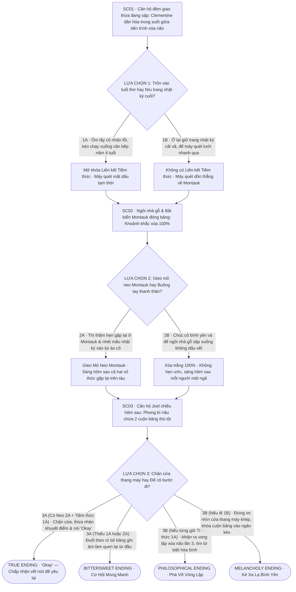
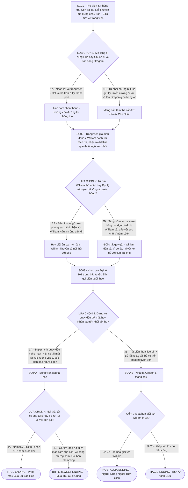
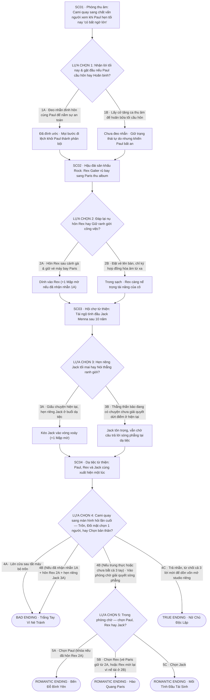

# CỤM KỊCH BẢN PHÂN NHÁNH — TÌNH CẢM KINH ĐIỂN HOLLYWOOD
**Thể loại:** Tâm lý lãng mạn · Phim tương tác phân nhánh (FMV) · 3 kịch bản chuyển thể với **3 cơ chế lựa chọn riêng biệt**

---

## PHẦN 1: KÝ ỨC TÌNH YÊU (*ETERNAL SUNSHINE OF THE SPOTLESS MIND*)
**Thể loại:** Lãng mạn siêu thực · Tâm lý · Ký ức đảo ngược
**Cơ chế lựa chọn đặc trưng:** *Mỏ Neo Ký Ức & Cuộn Băng Thật* — khi cỗ máy xóa não của phòng khám Lacuna quét ngược thời gian từ hiện tại về quá khứ, Joel phải chọn giữa **ẩn náu vào vết thương tuổi thơ để gieo mỏ neo tiềm thức** hay **để ký ức tan biến sạch sẽ**. Quyết định ở trong giấc mơ sẽ trực tiếp quyết định thái độ của anh và Clementine khi cả hai nghe lại cuộn băng ghi âm chửi bới nhau ngoài đời thực.

### Sơ đồ phân nhánh Phần 1

### Tuyến nhân vật & Đạo cụ
* **JOEL BARRISH (30 tuổi):** Chàng họa sĩ/người viết lách sống nội tâm; giữ cuốn nhật ký bìa nâu ghi lại những lần cãi vã.
* **CLEMENTINE KRUCZYNSKI:** Cô gái tóc nhuộm đổi màu theo tâm trạng (xanh lá trong ký ức cũ, cam/xanh dương đậm ngoài đời thực), bộc trực và sợ bị bỏ rơi.
* **ĐỘI NGŨ LACUNA (Howard & Mary):** Công ty tẩy não; trợ lý Mary về sau lén gửi trả toàn bộ phong bì băng ghi âm gốc cho khách hàng.

---

### SC01 · NỘI · CĂN HỘ JOEL / KÝ ỨC ĐÊM GIAO THỪA · ĐÊM

Trên giường ngủ tối mờ, đầu Joel đeo chiếc mũ quét điện não chằng chịt dây cáp. Đột nhiên mảng vôi trần phía trên nứt toác và rã thành bụi trắng.

Joel mở mắt, nhận ra mình đang đứng ngay trong phòng khách căn hộ của hai năm trước. Bên bàn ăn ngổn ngang cọ vẽ, Clementine tóc xanh lá đang bẻ mẩu bánh mì, nhìn thẳng về phía cửa.

CLEMENTINE
Anh lại đứng chôn chân ở ngưỡng cửa rồi, Joel. Qua đây xem màu tóc mới của em đi.

Từ trên trần nhà rách toác, giọng hai kỹ thuật viên ngoài đời thực dội xuống khô khốc: *"Tiến trình quét đạt 45%. Bắt đầu phân rã vùng dữ liệu mang tên Clementine Kruczynski."*

Chiếc tủ sách bên tường mờ dần rồi biến mất vào khoảng trắng. Joel lao tới chộp lấy cổ tay Clementine — bàn tay cô dần trở nên trong suốt, để lộ cả vân gỗ mặt bàn phía sau.

JOEL
Không! Dừng máy lại! Tôi hủy hợp đồng! Tôi không muốn xóa cô ấy nữa!

CLEMENTINE
Joel... anh thuê người xé toạc em ra khỏi đầu anh sao? Anh ghét em đến vậy à?

**[ĐIỂM LỰA CHỌN 1 — Đối diện cơn bão tẩy não]**
* **Lựa chọn 1A (Ôm chặt Clementine nhận phần lỗi về mình trong đêm cãi vã, kéo cô chạy trốn xuống căn bếp tuổi thơ năm 4 tuổi):** Đưa cô vào nơi máy quét chưa lập bản đồ. *(Mở khóa Liên kết Tiềm thức)*.
* **Lựa chọn 1B (Buông tay đứng yên giữa phòng khách, chỉ giật vội cuốn nhật ký trên bàn trước khi bị xóa sạch):** Để máy quét lướt nhanh qua ký ức đau thương thay vì đào bới vết thương cũ.

#### NHÁNH 1A
Joel kéo Clementine chui qua cánh cửa tủ bếp biến dạng. Căn hộ vỡ vụn thành sàn gỗ cũ của năm 1985 — Joel thu nhỏ thành cậu bé bốn tuổi mặc đồ ngủ sọc xanh ngồi co ro dưới gầm bàn ăn, còn Clementine vẫn mang vóc dáng trưởng thành ngồi ôm gối sát bên che chắn cho cậu. Giọng kỹ thuật viên ngoài đời thực vang lên bối rối vì sóng não mất dấu. Một lát sau, tia laser đỏ rực xuyên thủng mặt bàn gỗ, ép cả hai phải chạy ngược ra bờ biển Montauk.

#### NHÁNH 1B
Joel siết cuốn nhật ký vào ngực khi từng mảng tường căn hộ sập xuống đen kịt. Cơn đau đầu dữ dội đẩy thẳng anh lùi ngược về điểm cuối cùng trong bản đồ ký ức — căn nhà gỗ bên bờ biển tuyết trắng Montauk, nơi lần đầu hai người chạm mặt.

---

### SC02 · NGOẠI / NỘI · NGÔI NHÀ GỖ BỜ BIỂN MONTAUK · RẠNG ĐÔNG

Tuyết phủ trắng bờ cát Montauk. Cánh cửa gỗ ngôi nhà bên biển bong từng thanh ván, cửa kính nứt thành ngàn mảnh sáng bay lơ lửng giữa gió lạnh. Toàn bộ vùng ký ức xung quanh đang bị thu hẹp lại chỉ còn bậu cửa trước.

Clementine đứng trên bậc thềm gỗ, một bên vai đã hòa vào màn ánh sáng trắng lạnh.

CLEMENTINE
Chỉ còn vài giây nữa thôi, Joel. Em sắp biến mất khỏi đầu anh thật rồi.

**[ĐIỂM LỰA CHỌN 2 — Lời cuối trước khi ký ức xóa 100%]**
* **Lựa chọn 2A (Ghé sát tai cô thì thầm *"Hãy gặp em ở Montauk"* và nhét vội trang giấy xé từ nhật ký vào túi áo khoác cam):** Gieo một mỏ neo vô thức trước khi sụp đổ hoàn toàn.
* **Lựa chọn 2B (Đặt tay lên má cô nói *"Cảm ơn vì đã từng là một phần đời anh"* rồi lùi lại nhìn ngôi nhà tan biến):** Chấp nhận để mọi ký ức khép lại sạch sẽ, không lưu luyến.

#### NHÁNH 2A
Môi Joel khẽ chạm vành tai cô ngay khoảnh khắc ánh sáng trắng bùng nổ nuốt chửng ngôi nhà gỗ. Sáng hôm sau tỉnh dậy trên giường, anh bỗng bỏ ngang công việc, bắt chuyến tàu sớm ra bờ biển tuyết Montauk và ngồi đối diện đúng cô gái mặc áo khoác cam tóc xanh dương đậm. Trước khi chia tay ở ga tàu, hai người hẹn gặp lại buổi chiều tại căn hộ của anh.

#### NHÁNH 2B
Ánh sáng trắng khép lại nhẹ bẫng, không để lại dư âm. Sáng hôm sau Joel đi làm bình thường; anh không ra Montauk mà chỉ lặng lẽ trở về căn hộ vào buổi chiều — đúng lúc chuông cửa vang lên khi Clementine mang theo một phong bì nâu lạ mặt có tên cả hai đứng đợi ngoài hành lang.

---

### SC03 · NỘI · CĂN HỘ CỦA JOEL · CHIỀU MUỘN

Trên bàn trà phòng khách là phong bì màu nâu do cô trợ lý Mary của phòng khám Lacuna gửi trả để chuộc lỗi, bên trong đựng hai cuộn băng cát-xét. Joel nhấn nút phát chiếc máy cũ.

*BĂNG GHI ÂM CỦA CLEMENTINE:* *"Joel là kẻ nhạt nhẽo, cổ hủ và lúc nào cũng phán xét tôi. Ở cạnh anh ta khiến tôi nghẹt thở!"*

*BĂNG GHI ÂM CỦA JOEL:* *"Cô ấy nông cạn, bốc đồng và chỉ biết dùng ồn ào che đậy sự trống rỗng bên trong..."*

Không gian im phăng phắc. Clementine lùi sát ra cửa, tay nắm chặt tay nắm đồng, mắt đỏ hoe nhìn xuống chiếc máy cát-xét.

CLEMENTINE
Hóa ra chúng ta từng căm ghét nhau đến mức này sao? Nếu quay lại từ đầu, rồi tôi cũng lại làm anh phát chán, còn anh sẽ lại phán xét tôi thôi. Tôi phải đi đây.

Cô mở cửa bước nhanh về phía thang máy cuối hành lang.

**[ĐIỂM LỰA CHỌN 3 — Phán quyết trước cuộn băng sự thật]**
* **Lựa chọn 3A (Lao ra hành lang chặn cửa thang máy, nhìn thẳng mắt cô nói tiếp sự thật):** Chấp nhận mọi vết xước để không bỏ lỡ cô một lần nữa.
* **Lựa chọn 3B (Đứng yên tại ngưỡng cửa phòng khách nhìn cửa thang máy đóng lại):** Tin rằng chia tay khi chưa lặp lại tổn thương mới là điều tử tế nhất.

---

### HỆ THỐNG KẾT CỤC PHẦN 1

* **TRUE ENDING · "OKAY" *(Chọn 3A — Đã có Liên kết Tiềm thức 1A + Mỏ Neo 2A)*:** Joel chặn cửa thang máy, thẳng thắn nhìn cô: *"Em bừa bãi và gắt gỏng."* Clementine bật khóc: *"Còn anh tẻ nhạt và đa nghi! Chúng ta sẽ lại cãi nhau thôi!"* Joel khẽ mỉm cười đáp một từ duy nhất: *"Okay."* Clementine sững lại một nhịp rồi bật cười trong nước mắt: *"Okay."* Cả hai bước vào cuộc tình mới với nhận thức trọn vẹn về những khiếm khuyết của đối phương.
* **BITTERSWEET ENDING · CƠ HỘI MONG MANH *(Chọn 3A — Thiếu 1A hoặc 2A)*:** Joel đuổi theo giật lấy hai cuộn băng ném thẳng vào thùng rác hành lang, đề nghị cả hai thử bắt đầu lại như hai người chưa từng quen. Clementine gật đầu cầm tay anh, nhưng ánh mắt vẫn ngoái nhìn chiếc thùng rác đầy nghi hoặc về quá khứ chưa kịp đối diện.
* **PHILOSOPHICAL ENDING · PHÁ VỠ VÒNG LẶP *(Chọn 3B — Từng giữ Tiềm thức 1A)*:** Khi nghe hết mặt sau cuộn băng, Joel nhận ra mã hồ sơ ghi chú đây đã là lần thứ ba hai người tìm đến Lacuna. Anh bước tới ôm Clementine lần cuối trước cửa thang máy thay lời cảm ơn, rồi mỉm cười nhìn cô rời đi — chính thức giải thoát cho cả hai khỏi vòng lặp yêu rồi xóa trí nhớ.
* **MELANCHOLY ENDING · KẺ XA LẠ BÌNH YÊN *(Chọn 3B — Đi nhánh 1B)*:** Cánh cửa thang máy khép kín. Joel quay vào phòng khách, cất hai cuộn băng vào ngăn kéo khóa chặt. Ngày hôm sau, giữa ngã tư tuyết rơi, hai người lướt qua nhau như hai người xa lạ bình yên chưa từng mang vết sẹo chung.

---

## PHẦN 2: SẮC ĐẸP VĨNH CỬU (*THE AGE OF ADALINE*)
**Thể loại:** Chính kịch lãng mạn · Kỳ ảo thời gian · Xung đột hai thế hệ
**Cơ chế lựa chọn đặc trưng:** *Chu Kỳ Mười Năm Trốn Chạy (Bí Mật vs. Chấp Nhận Lão Hóa)* — Adaline Bowman mang ngoại hình mãi mãi tuổi 29 suốt gần một thế kỷ vì tai nạn sét đánh năm 1937. Mọi quyết định của cô nằm giữa **giữ vỏ bọc an toàn để tiếp tục sống ẩn dật** hay **liều lĩnh bước qua ranh giới hai thế hệ cha con nhà Jones**.

### Sơ đồ phân nhánh Phần 2

### Tuyến nhân vật & Đạo cụ
* **ADALINE BOWMAN / JENNY LARSON (107 tuổi trong hình hài 29 tuổi):** Mang vết sẹo khâu hình chữ V dài hai centimet trên mu bàn tay trái.
* **ELLIS JONES (32 tuổi):** Nhà nghiên cứu lịch sử công nghệ, yêu Adaline say đắm.
* **WILLIAM JONES (70 tuổi):** Cha của Ellis, nhà thiên văn học; 40 năm trước từng tự tay khâu vết thương cho Adaline và suýt cầu hôn cô trước khi cô biến mất.
* **FLEMMING (80 tuổi):** Con gái ruột của Adaline, tóc bạc trắng, sắp chuyển vào viện dưỡng lão.

---

### SC01 · NỘI · THƯ VIỆN LƯU TRỮ SAN FRANCISCO · CHIỀU TÀ

Trên bàn làm việc gỗ sồi là tập hộ chiếu giả mới in dưới cái tên *"Mary"* cùng xấp vé tàu một chiều đi Oregon vào tuần tới — đúng tròn chu kỳ mười năm đổi danh tính.

Con gái ruột của cô, bà lão Flemming tám mươi tuổi chống gậy ngồi đối diện, đặt bàn tay gân guốc lên mu bàn tay căng mịn không nếp nhăn của mẹ mình.

FLEMMING
Con sắp vào viện dưỡng lão rồi, mẹ à. Mẹ định sống kiếp bóng ma đổi tên trốn chạy thế này đến bao giờ nữa?

Đúng lúc đó, Ellis bước vào kho lưu trữ mang theo bó hoa và cuốn lịch thiên văn năm 1930, đề nghị đưa cô về trang viên ngoại ô dự lễ kỷ niệm 40 năm ngày cưới của cha mẹ anh.

**[ĐIỂM LỰA CHỌN 1 — Trước ngưỡng cửa kỳ hạn 10 năm]**
* **Lựa chọn 1A (Xé bỏ tấm vé tàu Oregon trước mắt Flemming, nhận lời cùng Ellis về trang viên):** Lần đầu tiên sau gần một thế kỷ cho phép bản thân thử tin vào một tương lai cố định.
* **Lựa chọn 1B (Từ chối Ellis với lý do chuyển công tác, nhưng không nỡ làm anh đứng đợi suốt đêm ngoài cổng thư viện nên nhận lời đi dự tiệc "lần cuối" rồi sáng Chủ Nhật sẽ bỏ đi):** Giấu sẵn vé tàu Oregon trong túi áo khoác làm đường lùi.

#### NHÁNH 1A
Adaline khóa tập giấy tờ giả vào ngăn bàn, mỉm cười nắm tay Ellis lên xe ra ngoại ô trong ánh nhìn nhẹ nhõm của Flemming.

#### NHÁNH 1B
Dù gật đầu ngồi vào ghế phụ xe Ellis, bàn tay trái của Adaline vẫn giữ chặt chiếc phong bì đựng vé tàu đi Oregon giấu sâu trong túi áo dạ.

---

### SC02 · NỘI / NGOẠI · TRANG VIÊN GIA ĐÌNH JONES · CHIỀU TỚI SÁNG HÔM SAU

Cánh cửa trang viên mở ra. Ông William Jones tóc bạc bước ra thềm đón con trai. Ngay khi ánh mắt ông chạm vào gương mặt Adaline bước xuống xe, khay tách trà sứ trên tay ông rơi xuống vỡ tan trên bậc đá.

WILLIAM
Adaline...? Không thể nào... Đúng là em rồi!

ADALINE
Cháu chào bác Jones. Bác gọi nhầm tên mẹ cháu rồi... Mẹ cháu tên Adaline, nhưng bà mất nhiều năm rồi ạ.

Đêm đó trong trò chơi đố chữ gia đình, Adaline vô tình gọi đúng tên một ngôi sao chổi bằng thuật ngữ cổ mà chỉ riêng cô và William từng dùng năm 1964. Ánh mắt William dán chặt vào cô suốt bữa tối không rời.

**[ĐIỂM LỰA CHỌN 2 — Đối diện bóng ma 40 năm trước]**
* **Lựa chọn 2A (Nửa đêm lén gõ cửa phòng sách của William, chìa vết sẹo mu bàn tay thú nhận toàn bộ sự thật):** Xin người cũ hiểu cho nỗi sợ bị mổ xẻ nghiên cứu suốt nửa thế kỷ.
* **Lựa chọn 2B (Im lặng né tránh ánh nhìn suốt đêm, sáng sớm định lẻn qua vườn hồng ra cổng trước khi nhà Jones thức dậy):** Nhưng cành hồng vướng tay áo lụa làm lộ vết sẹo chữ V đúng lúc William bước ra sân.

#### NHÁNH 2A
William đưa ngón tay run rẩy chạm vào vết khâu cũ do chính tay ông thực hiện năm 1964, đôi mắt đỏ ngầu rồi dịu xuống. Ông đặt tay lên vai cô: *"Suốt bốn mươi năm anh cứ ngỡ mình làm sai điều gì khiến em bỏ trốn. Đừng làm điều tàn nhẫn đó với Ellis, nó yêu em thật lòng."*

#### NHÁNH 2B
Nhìn vết sẹo chữ V hằn rõ trên mu bàn tay trái, William nắm chặt lấy cổ tay cô không buông: *"Không có người mẹ nào di truyền vết chỉ phẫu thuật cho con gái cả! Em định xé nát trái tim thằng bé y hệt như đã từng bóp chết trái tim tôi bốn mươi năm trước sao?!"*

---

### SC03 · NGOẠI · KHÚC CUA ĐẠI LỘ 101 TRONG BÃO TUYẾT · ĐÊM

Không chịu nổi sức ép khi nghe tiếng Ellis bước xuống cầu thang gọi tên *"Jenny"*, Adaline vớ lấy chìa khóa xe lao ra đường đèo giữa cơn bão tuyết mù mịt. Trên ghế phụ, màn hình điện thoại liên tục nhấp nháy cuộc gọi từ *Ellis*.

Cô ngước nhìn vào gương chiếu hậu: gương mặt tuổi 29 không một nếp gấp vẫn nguyên vẹn lạnh lẽo như bức tượng sáp. Bàn tay trái cô chạm vào túi áo khoác — nơi cất sẵn tấm vé Oregon (nếu giữ ở 1B) hoặc chỉ còn khoảng trống sau khi đã tự tay xé vé trước mặt Flemming (nếu chọn 1A).

**[ĐIỂM LỰA CHỌN 3 — Ngã rẽ giữa cơn bão tuyết]**
* **Lựa chọn 3A (Đạp phanh dừng bên lề đường, bắt máy nghe giọng Ellis và đánh lái quay đầu xe trở lại trang viên):** Quyết định đối mặt thay vì chạy trốn.
* **Lựa chọn 3B (Tắt nguồn điện thoại ném ra ghế sau, nhấn ga phóng thẳng về ranh giới bang Oregon):** Giữ trọn bí mật bất tử bằng mọi giá.

#### NHÁNH 3A (➔ SC04A)
Ngay giây chiếc xe vừa quay ngang giữa mặt đường đóng băng, một chiếc xe tải chở gỗ mất lái húc sườn đẩy xe Adaline lao thẳng xuống vực sâu. Thân nhiệt cô tụt dưới 30 độ C, tim ngừng đập — cho đến khi sợi dây điện cao thế đứt quẹt trúng thân xe phóng luồng điện hàng triệu vôn cùng nhịp máy khử rung tim của đội cứu hộ kéo cô sống dậy, vô tình đảo ngược hoàn toàn cơ chế ngừng lão hóa từ năm 1937.

#### NHÁNH 3B (➔ SC04B)
Adaline bẻ lái lách gọn khỏi chiếc xe tải lao ngược chiều trong gang tấc; xe trượt nhẹ xuống rãnh tuyết nông sát mép rừng. Không một vết thương chí mạng, cô mở cửa bỏ lại chiếc xe trống, đón xe khách đêm rời khỏi bang ngay trong màn tuyết.

---

### SC04A · NỘI · BỆNH VIỆN SAN FRANCISCO · HAI NGÀY SAU *(Từ Nhánh 3A)*

Trong phòng hồi sức trắng xóa, Ellis ngồi gục đầu nắm chặt tay Adaline từ lúc cô được khiêng từ đáy vực lên. Ngoài khung kính hành lang, ông William đứng lặng lẽ nhìn vào bên trong.

Adaline mở mắt, chạm nhẹ vào lồng ngực vẫn còn âm ỉ cơn đau ấm áp của một nhịp tim bình thường.

**[ĐIỂM LỰA CHỌN 4 — Lời thú nhận trên giường bệnh]**
* **Lựa chọn 4A (Siết tay Ellis, kể hết sự thật về năm sinh 1908 và bức ảnh chòm sao năm 1964):** Chọn sống thật từ giây phút này.
* **Lựa chọn 4B (Chỉ mỉm cười cảm ơn, lấy cớ tai nạn khiến mình nhớ gia đình để xin rút lui khỏi cuộc đời cha con họ):** Trả lại sự bình yên cho Ellis và William, chọn quay về bên con gái Flemming.

---

### SC04B · NGOẠI · NHÀ GA OREGON · SÁU THÁNG SAU *(Từ Nhánh 3B)*

Dưới mái hiên ga tàu vắng người, cô gái mang thẻ căn cước mới tên *"Mary"* ngồi trên ghế gỗ. Gương mặt trong cửa kính tàu vẫn trẻ trung tuyệt đối ở tuổi 29.

---

### HỆ THỐNG KẾT CỤC PHẦN 2

* **TRUE ENDING · PHÉP MÀU CỦA SỰ LÃO HÓA *(Chọn 3A ➔ 4A)*:** Một năm sau trong phòng ngủ ngập nắng, Adaline soi gương chuẩn bị dự tiệc sinh nhật tuổi 30 cùng Ellis. Giữa mái tóc nâu óng, cô phát hiện một sợi tóc bạc lấp lánh đầu tiên trong đời — cô nhổ xuống, mỉm cười trong nước mắt vì cuối cùng đã có thể già đi cùng người mình yêu.
* **BITTERSWEET ENDING · MÙA THU CUỐI CÙNG *(Chọn 3A ➔ 4B)*:** Adaline từ chối để tránh gây rạn nứt giữa hai cha con nhà Jones. Ba năm sau tại căn nhà nhỏ cạnh viện dưỡng lão, cô chải tóc cho bà lão Flemming rồi lặng lẽ soi mình trong gương thấy những vết chân chim đầu tiên nơi khóe mắt — mãn nguyện được đi hết quãng đời hữu hạn làm mẹ.
* **NOSTALGIA ENDING · NGƯỜI ĐỨNG NGOÀI THỜI GIAN *(Chọn 2A ➔ 3B)*:** Tại nhà ga Oregon, Adaline gửi bưu kiện một tấm bản đồ sao chép tay năm 1964 cho William kèm bức thư cảm ơn ông đã giữ bí mật giúp Ellis được bình yên. Cô lên chuyến tàu xuôi về phía Bắc, mang theo sự bất tử nhẹ nhõm hơn trước.
* **TRAGIC ENDING · BẢN ÁN VĨNH CỬU *(Chọn 2B ➔ 3B)*:** Tại một căn phòng thuê lạnh lẽo ở Oregon, Adaline khóa chặt hai lớp cửa, ngắm bức ảnh đen trắng của Flemming thời thiếu nữ rồi nhìn gương mặt không đổi của chính mình trong kính. Vòng lặp 10 năm trốn chạy lại bắt đầu trong cô độc tuyệt đối.

---

## PHẦN 3: CHỌN TÌNH YÊU (*CHOOSE LOVE*)
**Thể loại:** Hài lãng mạn hiện đại (Rom-Com) · Phá vỡ bức tường thứ 4
**Cơ chế lựa chọn đặc trưng:** *Quân Sư Khán Giả & Sổ Nợ Trung Thực* — Cami liên tục quay thẳng sang màn hình cãi cọ và xin lời khuyên từ người xem. Mọi lời xúi giục trước đó đều được cộng dồn: nếu cô quá tham lam **mập mờ với cả ba người đàn ông cùng lúc**, buổi dạ tiệc từ thiện cuối cùng sẽ nổ tung thành thảm họa mất trắng.

### Sơ đồ phân nhánh Phần 3

### Tuyến nhân vật & Đạo cụ
* **CAMI CONWAY (28 tuổi):** Nữ kỹ sư âm thanh sắc sảo; nhân vật duy nhất nhìn thấy và trò chuyện trực tiếp với khán giả qua màn hình.
* **PAUL:** Luật sư tận tụy, bạn trai 3 năm; luôn mang chiếc hộp nhung đỏ đựng nhẫn cầu hôn.
* **REX GALIER:** Ngôi sao nhạc Rock người Anh, hoang dã; nắm cặp vé hạng thương gia đi Paris.
* **JACK MENNA:** Tình đầu thời trung học, nhà hoạt động môi trường vừa từ châu Phi về; đại diện lý tưởng tuổi trẻ.

---

### SC01 · NỘI · PHÒNG THU ÂM LOS ANGELES · NGÀY

Cami đang gạt cần chỉnh âm trên bàn mixer bỗng khựng lại, xoay ghế 90 độ nhìn thẳng vào màn hình như bắt gặp ánh mắt người xem.

CAMI
Này bạn! Đúng rồi, người đang cầm màn hình kia đấy! Đừng giả vờ không nghe tôi nói. Cuộc đời tôi trông cứ như trúng số đúng không? Việc ổn định, nhà nhìn ra đồi Hollywood, bạn trai luật sư hoàn hảo tên Paul. Vậy tại sao sáng nào tôi cũng thấy thiếu một thứ gì đó điên rồ nhỉ?

Cánh cửa cách âm bật mở. Paul bước vào đặt túi bánh sừng bò hạnh nhân còn nóng lên bàn: *"Tối nay ăn tối ở nhà hàng kỷ niệm nhé, anh có một bất ngờ rất lớn cho em."* Paul nháy mắt rồi khép cửa ra ngoài.

Cami lập tức ôm đầu ghé sát vào màn hình, thì thào hốt hoảng.

CAMI
Nghe thấy chữ "bất ngờ rất lớn" chưa?! Chắc chắn là cầu hôn! Tôi mới 28 tuổi, tôi có nên gật đầu ngay tối nay không?!

**[ĐIỂM LỰA CHỌN 1 — Xúi Cami trước chiếc hộp nhung đỏ]**
* **Lựa chọn 1A (Xúi cô vui vẻ nhận lời ăn tối và gật đầu ngay nếu Paul cầu hôn):** Nắm chặt sự an toàn trước khi đổi ý. *(Đeo nhẫn đính hôn).*
* **Lựa chọn 1B (Xúi cô viện cớ tăng ca gấp tại phòng thu để hoãn bữa tối):** Mua thêm thời gian tự suy nghĩ. *(Giữ tay trống, nhưng Paul nhận ra sự né tránh).*

#### NHÁNH 1A
Tối đó Cami đeo chiếc nhẫn kim cương nhỏ trên ngón áp út, mỉm cười trước ánh nến — nhưng ngay lúc Paul nâng ly chúc mừng, mắt cô lại liếc sang chiếc điện thoại báo tin nhắn điều động đi làm kỹ sư âm thanh cho buổi diễn lớn tối hôm sau.

#### NHÁNH 1B
Paul chậm rãi thu chiếc hộp nhung đỏ vào túi áo vest trong phòng khách vắng. Cami thở phào ngồi xuống sô-pha, vừa mừng vì thoát khỏi cam kết vội vàng vừa thấy hụt hẫng trước ánh mắt thất vọng của anh.

---

### SC02 · NỘI · HẬU ĐÀI SÂN KHẤU ROCK · ĐÊM HÔM SAU

Sau phần diễn guitar bùng nổ, Rex Galier ướt đẫm mồ hôi bước thẳng tới bàn mixer nơi Cami vừa cứu kịp đoạn âm thanh bị nhiễu sóng. Hắn chống hai tay lên bàn điều khiển, cúi sát xuống gương mặt cô.

REX
Em có đôi tai thính nhất cái thành phố này đấy, Cami. Tuần tới tôi bay sang Paris thu đĩa đơn mới rồi lưu diễn khắp châu Âu. Đi cùng tôi nhé?

Cami nín thở, liếc nhanh về phía màn hình, nhăn mặt làm khẩu hình không thành tiếng rồi nói nhỏ hẳn với khán giả: *"Một ngôi sao nhạc Rock vừa rủ tôi bay sang Paris... Các bạn tính giết tôi à?!"*

**[ĐIỂM LỰA CHỌN 2 — Sức hút của ánh hào quang]**
* **Lựa chọn 2A (Đáp lại nụ hôn của Rex ở góc tối hậu đài và nhét cặp vé Paris vào túi áo):** Chơi lớn theo tiếng gọi phiêu lưu.
* **Lựa chọn 2B (Đặt tay chặn ngực Rex giữ khoảng cách, chỉ nhận tấm danh thiếp ghi điều khoản hòa âm từ xa):** Giữ ranh giới công việc sòng phẳng.

#### NHÁNH 2A
Mùi nước hoa và hơi men vương lại trên môi Cami khi cô bước vội ra cửa hậu. Chiếc vé đi Paris nằm nặng trĩu trong túi áo khoác.

#### NHÁNH 2B
Rex sững người một giây rồi bật cười hào hứng trước sự cứng cỏi của cô, rút bút viết thẳng mức thù lao hòa âm độc lập lên mặt sau tấm danh thiếp: *"Càng khó chinh phục tôi càng muốn em giữ lấy sự tự do đó trong âm nhạc."*

---

### SC03 · NGOẠI · HỘI CHỢ TỪ THIỆN NGOẠI Ô · TRƯA HÔM SAU

Đang bê thùng đĩa quyên góp qua bãi cỏ, Cami đâm sầm vào một chàng trai sơ mi xắn tay áo. Quả táo trên tay cô rơi lăn trên cỏ; khi anh ngẩng lên nhặt trả, Cami sững người — đó là Jack Menna, mối tình đầu thời trung học biệt tích suốt mười năm qua ở châu Phi.

JACK
Mười năm đi qua bao nhiêu vùng đất, tớ chưa từng quên buổi tối tụi mình ngồi nóc trường cũ ước hẹn cùng nhau mở quỹ bảo tồn. Tớ vừa về lập chi nhánh mới ở đây... Cậu còn nhớ lời hứa đó không, Cami?

Cami quay phắt mặt sang màn hình, giơ cả hai tay lên trời kêu cứu với khán giả.

CAMI
Đủ rồi đấy biên kịch vũ trụ! Một luật sư hoàn hảo, một ngôi sao Rock bốc lửa, giờ thêm cả tình đầu thanh xuân nữa! Người bấm nút từ đầu tới giờ là các bạn, các bạn tính xúi tôi trả lời cậu ấy thế nào?!

**[ĐIỂM LỰA CHỌN 3 — Thái độ trước người cũ trở về]**
* **Lựa chọn 3A (Không nhắc tới Paul hay Rex, chủ động hẹn riêng Jack tối mai tại buổi dạ tiệc để "nói chuyện riêng"):** Gieo thêm một lời hứa mập mờ.
* **Lựa chọn 3B (Nói thẳng mình đang vướng bận chuyện hiện tại nhưng sẽ giải quyết dứt điểm trước khi trả lời Jack):** Giữ sự trung thực tối thiểu với người cũ.

#### NHÁNH 3A
Jack mỉm cười rạng rỡ siết nhẹ vai cô hẹn gặp tối mai — không hề biết hai người đàn ông khác cũng có tên trong danh sách khách mời của chính buổi tiệc đó.

#### NHÁNH 3B
Jack khẽ gật đầu đầy tôn trọng: *"Tớ chờ câu trả lời rõ ràng của cậu vào tối mai, dù là hướng nào."*

---

### SC04 · NỘI · SẢNH DẠ TIỆC TỪ THIỆN · ĐÊM CUỐI

Giữa sảnh tiệc lấp lánh ánh đèn, Paul đang đứng cạnh bàn tài trợ vẫy tay gọi cô; phía rìa sân khấu, Rex nháy mắt giơ hai ngón tay ra hiệu giờ bay Paris; còn bên quầy sách từ thiện, Jack đang cầm ly nước đợi câu trả lời.

Cami đứng chôn chân giữa phòng, quay hẳn lưng lại phía ba người đàn ông để nhìn thẳng vào màn hình chất vấn người xem lần chót.

CAMI
Được rồi, ba người họ đều đang nhìn tôi chằm chằm kia kìa. Tới lúc dọn mớ hỗn độn do chính tôi và các bạn bày ra rồi. Tôi bước đi hướng nào đây?!

**[ĐIỂM LỰA CHỌN 4 — Quyết định cuối cùng tại buổi tiệc]**
* **Lựa chọn 4A (Lẻn qua cửa bếp tắt điện thoại bỏ chạy khỏi buổi tiệc):** Né tránh đối thoại với tất cả.
* **Lựa chọn 4B (Bước thẳng vào phòng chờ gọi những người liên quan vào nói hết sự thật và chọn một người đồng hành: Paul, Rex hoặc Jack):** Đối mặt sòng phẳng để chốt bến đỗ tình cảm.
* **Lựa chọn 4C (Mời cả ba vào phòng chờ trả nhẫn/từ chối hết các lời mời, dùng toàn bộ tiền tích góp để tự mở phòng thu riêng):** Không chọn người đàn ông nào làm câu trả lời cho cuộc đời mình.

---

### HỆ THỐNG KẾT CỤC PHẦN 3

* **TRUE ENDING · NỮ CHỦ ĐỘC LẬP *(Chọn 4C)*:** Ba tháng sau tại lễ khai trương phòng thu *"Cami Conway Audio"*, Cami diện bộ vest trắng tự tay cắt dải băng khánh thành. Cả Paul, Rex và Jack đều gửi lẵng hoa chúc mừng như những người bạn tôn trọng sự lựa chọn của cô. Cami nâng ly vang hướng thẳng vào màn hình nháy mắt: *"Cảm ơn vì đã không ép tôi chọn một người đàn ông để định nghĩa cuộc đời mình!"*
* **ROMANTIC ENDINGS *(Chọn 4B — Khi không dính đủ cả 3 tầng bắt cá 1A + 2A + 3A — rồi Lựa chọn 5 trong phòng chờ)*:** Cami sòng phẳng nói lời xin lỗi, trả lại sự rõ ràng cho hai người còn lại rồi bước ra sánh vai cùng người được chọn:
  * **Bến Đỗ Bình Yên *(5A · Chọn Paul — khóa nếu đã hôn Rex 2A)*:** Đón nhận tình yêu bền bỉ tại nhà hàng ven biển; Cami quay qua vai Paul nháy mắt với khán giả trước chiếc nhẫn trên tay.
  * **Hào Quang Paris *(5B · Chọn Rex — luôn mở: giữ vé Paris từ 2A, hoặc Rex mời lại vì nể tài ở 2B)*:** Khoác tay Rex sải bước qua rừng đèn flash sân bay Charles de Gaulle, tai nghe vắt ngang cổ, lao vào chuyến lưu diễn châu Âu.
  * **Mối Tình Đầu Tái Sinh *(5C · Chọn Jack)*:** Rời ánh đèn Los Angeles, hai người khoác ba lô cùng trồng những hàng cây đầu tiên cho dự án môi trường như lời hứa năm 17 tuổi.
* **BAD ENDING · TRẮNG TAY VÌ NÉ TRÁNH *(Chọn 4A — Hoặc chọn 4B nhưng trước đó vừa đeo nhẫn 1A, vừa hôn Rex 2A, vừa hẹn riêng Jack 3A)*:** Dù cố chạy trốn hay bước vào phòng chờ khi đã bắt cá ba tay, tin nhắn hẹn gặp và tấm vé Paris bị lộ ngay trước mặt cả ba người đàn ông. Paul đau đớn thu lại chiếc nhẫn, Rex lắc đầu bỏ về sân khấu, còn Jack lặng lẽ rời sảnh tiệc. Cami ngồi lại một mình trong căn hộ trống lúc nửa đêm, ngước nhìn màn hình rồi đặt úp chiếc điện thoại xuống bàn.
