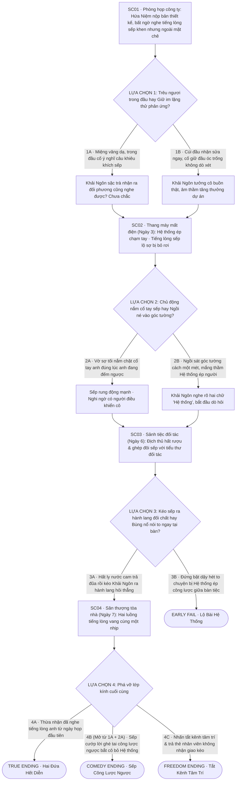
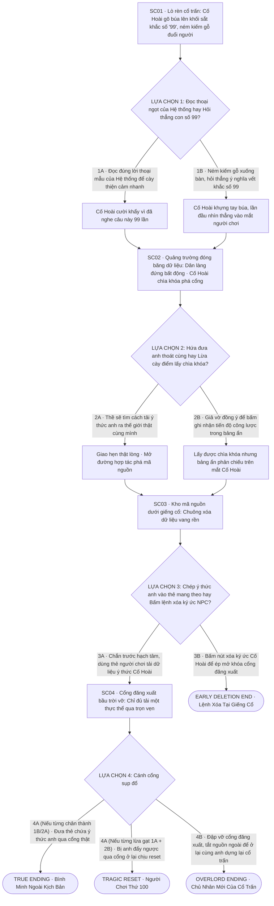
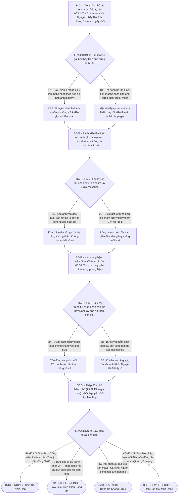

# CỤM KỊCH BẢN PHÂN NHÁNH — Ý TƯỞNG DÒNG 10: CÔNG LƯỢC MỤC TIÊU HỆ THỐNG
**Thể loại:** Phim tương tác phân nhánh (FMV) · 3 tuyến truyện độc lập *(Đọc tiếng lòng song phương · NPC nổi loạn · Tiếp xúc kéo dài tuổi thọ)*

---

## PHẦN 1: TIẾNG LÒNG TRÁI NGƯỢC *(ĐỌC TIẾNG LÒNG SONG PHƯƠNG)*
**Thể loại:** Đô thị công sở · Hài lãng mạn · Hệ thống đọc tâm trí
**Cơ chế lựa chọn đặc trưng:** *Kênh Tiếng Lòng Hai Chiều* — Hứa Niệm bị Hệ thống ép công lược Tổng giám đốc Trình Khải Ngôn trong 7 ngày, nhưng cả hai đều **nghe lén được suy nghĩ thật của đối phương** mà tưởng chỉ mình mình có dị năng này. Mọi pha đấu khẩu giữ thể diện hay giả ngây sẽ trực tiếp phơi bày tâm tư thật dưới lớp mặt nạ công sở.

### Sơ đồ phân nhánh Phần 1

### Tuyến nhân vật & Đạo cụ
* **HỨA NIỆM (24 tuổi):** Nhân viên thiết kế đồ họa, mang **kính gọng mảnh** và thẻ nhân viên; bị Hệ thống buộc khiến Trình Khải Ngôn chủ động nắm tay tỏ tình trong 7 ngày.
* **TRÌNH KHẢI NGÔN (29 tuổi):** Tổng giám đốc mặt lạnh nhưng nội tâm hay càu nhàu tự luyến; vô tình nối chung tần số suy nghĩ với Hứa Niệm.

---

### SC01 · NỘI · PHÒNG HỌP TẦNG 18 · SÁNG

Hứa Niệm đặt tập bản vẽ lên bàn họp dài. Dòng chữ mờ của Hệ thống lóe trước tầm mắt cô: *"Mục tiêu: Trình Khải Ngôn. Thời hạn 7 ngày."* Trình Khải Ngôn lật trang giấy với vẻ mặt không đổi, gõ bút xuống bản phác thảo.

TRÌNH KHẢI NGÔN
Phối màu tạm được, nhưng bố cục rối. Mang về sửa lại trước trưa.

Ngay lập tức, một giọng nam quen thuộc vang thẳng trong đầu Hứa Niệm dù môi anh vẫn mím chặt: *"Thật ra phối màu quá ổn rồi, nhưng không chê hai câu thì làm sao kiếm cớ giữ cô ấy ở lại thêm một tiếng."* Hứa Niệm khựng tay ôm cặp, mắt mở to nhìn sang anh.

**[ĐIỂM LỰA CHỌN 1 — Phép thử trong phòng họp]**
* **Lựa chọn 1A (Ngoài miệng lễ phép nhận lỗi, trong đầu cố tình nghĩ to câu: *"Tổng giám đốc keo kiệt, chê cho oai chứ tối về chắc ngắm trộm bản vẽ"*):** Thử xem anh có nghe lại được tiếng lòng mình không.
* **Lựa chọn 1B (Cúi đầu thu bản vẽ đi ra, giữ đầu óc hoàn toàn trống rỗng):** Che giấu dị năng mới phát hiện để quan sát thêm.

#### NHÁNH 1A
Trình Khải Ngôn vừa nhấp ngụm trà nóng bỗng khựng cổ họng ho sặc hai tiếng, ngước mắt nhìn trừng trừng vào gáy Hứa Niệm khi cô bước nhanh ra cửa.

#### NHÁNH 1B
Thấy Hứa Niệm im lặng rời đi đầy ngoan ngoãn, Khải Ngôn siết chặt cây bút máy, trong đầu cô lại vang lên giọng anh lầm bầm: *"Chết rồi, chê mạnh tay quá làm cô ấy giận thật rồi sao?"*

---

### SC02 · NỘI · THANG MÁY TẦNG 12 · ĐÊM (NGÀY 3)

Đèn thang máy chớp tắt rồi dừng khựng giữa tầng. Không gian tối mờ chỉ còn ánh sáng đỏ từ bảng số tầng. Hệ thống hiện dòng nhắc nhở: *"Nhiệm vụ ngày 3: Duy trì tiếp xúc cơ thể trong mười giây."*

Trong bóng tối, tiếng lòng Trình Khải Ngôn dội thẳng vào tai cô: *"Thang máy lại kẹt rồi... Mình ghét chỗ kín thế này. Giá mà cô ấy đừng đứng xa thế."*

**[ĐIỂM LỰA CHỌN 2 — Cơ hội trong không gian kín]**
* **Lựa chọn 2A (Bước qua nắm chặt lấy cổ tay áo sơ mi của anh, bảo mình sợ bóng tối):** Hoàn thành tiếp xúc và xoa dịu nỗi sợ của anh.
* **Lựa chọn 2B (Ngồi sát góc tường cách hẳn một mét, bực bội mắng thầm *"Hệ thống khốn nạn bắt người ta đi bám sếp"*):** Giữ tự tôn không muốn lợi dụng điểm yếu của anh.

#### NHÁNH 2A
Mười ngón tay Trình Khải Ngôn cứng đờ nửa giây rồi xoay cổ tay bao bọc gọn lấy bàn tay Hứa Niệm — tiếng lòng anh reo nhỏ như đứa trẻ vừa giữ được đồ quý, nhưng ngoài miệng vẫn lạnh nhạt: *"Đừng làm nhăn tay áo tôi."*

#### NHÁNH 2B
Khải Ngôn bỗng quay ngoắt đầu về phía cô giữa bóng tối, mắt nheo lại: *"Vừa nãy... cô nhắc cái gì mà Hệ thống?"* — Hứa Niệm giật thót che miệng dù mình chưa hề mở lời.

---

### SC03 · NỘI · SẢNH TIỆC ĐỐI TÁC · ĐÊM (NGÀY 6)

Ánh đèn pha lê phủ kín đại sảnh khách sạn. Cô tiểu thư nhà đối tác cố tình hất nghiêng ly vang đỏ làm ướt vạt váy Hứa Niệm rồi khoác tay Trình Khải Ngôn cười nói ngọt xớt. Hệ thống báo chỉ còn **24 giờ cuối cùng**.

**[ĐIỂM LỰA CHỌN 3 — Phản ứng trước mặt đối tác]**
* **Lựa chọn 3A (Cầm ly nước cam trên bàn hất gọn xuống giày cô tiểu thư kia, rồi kéo thẳng tay áo Trình Khải Ngôn lôi ra hành lang yên tĩnh):** Dọn đường đối chất riêng hai người.
* **Lựa chọn 3B (Đứng bật dậy trước cả bàn tiệc, chỉ thẳng vào trán Trình Khải Ngôn hét lớn chuyện bị Hệ thống ép đi cưa sếp):** Bùng nổ không chịu nổi áp lực đóng kịch.

#### NHÁNH 3A ➔ SC04
Giữa tiếng xì xào của bàn tiệc, Khải Ngôn không trách cô nửa lời mà cởi áo vest khoác qua vai Hứa Niệm, bước theo cô lên thẳng cầu thang dẫn ra sân thượng.

#### NHÁNH 3B ➔ KẾT THÚC SỚM (EARLY FAIL)
Sảnh tiệc chết lặng. Trình Khải Ngôn nhìn Hứa Niệm như nhìn một nhân viên mất kiểm soát đang dựng chuyện phá hỏng hợp đồng triệu đô, lập tức thu lại ánh mắt dịu dàng và giao thư ký đưa cô rời khỏi buổi tiệc.

---

### SC04 · NGOẠI · SÂN THƯỢNG TÒA NHÀ · ĐÊM (NGÀY 7)

Gió đêm thổi lồng lộng. Ánh đèn thành phố trải dài phía dưới lan can kính. Cả Hứa Niệm lẫn Trình Khải Ngôn đều đứng cách nhau đúng hai bước chân — và lần đầu tiên, hai luồng suy nghĩ trong đầu họ bật ra cùng một nhịp: *"Thật ra từ ngày đầu tiên đã thích người đối diện rồi."*

**[ĐIỂM LỰA CHỌN 4 — Hạ màn cuộc chơi đọc tâm]**
* **Lựa chọn 4A (Tháo kính nhìn thẳng mắt anh, thừa nhận *"Em nghe được tiếng lòng anh từ phòng họp tầng 18"*):** Đặt mọi lá bài thật xuống bàn.
* **Lựa chọn 4B** *(Khả dụng khi đi `1A + 2A` — đã để anh nắm thóp sự đáng yêu từ đầu)*: **Im lặng mỉm cười nhìn anh bước tới sát một bước chờ anh tự phá kịch bản trước.**
* **Lựa chọn 4C (Rút thẻ nhân viên đặt lên lan can kính, nhấn nút tắt kênh kết nối Hệ thống trong tâm trí):** Từ bỏ cả nhiệm vụ lẫn mối quan hệ bắt đầu từ gượng ép.

---

### HỆ THỐNG KẾT CỤC PHẦN 1

* **TRUE ENDING · HAI ĐỨA HẾT DIỄN *(Chọn `4A`)*:** Trình Khải Ngôn bật cười thành tiếng lần đầu tiên trước mặt cô: *"Còn anh cũng nghe sạch những câu em chửi thầm anh keo kiệt rồi."* Cả hai gỡ bỏ kênh Hệ thống, tự tay đan mười ngón tay bước xuống sảnh.
* **COMEDY ENDING · SẾP CÔNG LƯỢC NGƯỢC *(Chọn `4B` từ `1A + 2A`)*:** Không đợi Hứa Niệm mở lời, Khải Ngôn cúi sát vành tai cô nói nhỏ bằng đúng giọng thật: *"Từ ngày mai bỏ cái Hệ thống kia đi, làm người yêu thật của tôi được trả lương gấp đôi."*
* **FREEDOM ENDING · TẮT KÊNH TÂM TRÍ *(Chọn `4C`)*:** Tiếng ồn trong đầu vụt tắt trả lại sự tĩnh lặng tuyệt đối. Hứa Niệm xin nghỉ việc chuyển sang mở xưởng thiết kế nhỏ độc lập; nhiều tháng sau gặp lại anh ngoài phố, hai người mỉm cười chào nhau như hai người bình thường không còn đọc trộm lòng ai.
* **EARLY FAIL · LỘ BÀI HỆ THỐNG *(Chọn `3B` tại SC03)*:** Bộc phát quá sớm trước bàn tiệc đối tác khiến Hứa Niệm mất cả việc làm lẫn niềm tin của Khải Ngôn; kênh tâm trí tự động ngắt kết nối ngay đêm đó.

---

## PHẦN 2: NPC NỔI LOẠN *(CÔNG LƯỢC NHÂN VẬT PHỤ TỰ THỨC TỈNH)*
**Thể loại:** Xuyên game cổ trấn · Nhân vật ảo thức tỉnh · Phim tương tác phân nhánh (FMV)
**Cơ chế lựa chọn đặc trưng:** *Ký Ức Của Lần Thứ 99* — Kỳ An xuyên vào game tình cảm cổ trấn để công lược thợ rèn Cố Hoài rồi đăng xuất. Nhưng Cố Hoài đã tự thức tỉnh và nhớ sạch **99 người chơi trước** từng nói yêu anh rồi bỏ đi không ngoái lại — anh đang rèn một chiếc chìa khóa phá nát cổng máy chủ.

### Sơ đồ phân nhánh Phần 2

### Tuyến nhân vật & Đạo cụ
* **KỲ AN (23 tuổi):** Người chơi bị mắc kẹt trong game giả lập cổ trấn, giữ chiếc **máy ảnh thẻ nhớ vật lý** kết nối cổng thoát.
* **CỐ HOÀI (NPC Thợ rèn):** Áo vải thô bám muội than; cánh tay trái mang **99 vết sẹo búa** đánh dấu số lần bị người chơi bỏ rơi sau khi hoàn thành nhiệm vụ.

---

### SC01 · NỘI · LÒ RÈN CỔ TRẤN ĐÔNG · CHIỀU TÀ

Than hồng nổ lách tách trong lò. Kỳ An bước tới quầy gỗ chìa thanh kiếm nhiệm vụ mới nhận từ Hệ thống. Cố Hoài không thèm ngẩng đầu, nhấc búa nện mạnh lên thỏi thép đen khắc rõ hai chữ số **`99`** rồi quăng thanh kiếm gỗ ra trước cửa.

CỐ HOÀI
Cô là người thứ một trăm tới tìm thanh kiếm này rồi. Nếu vẫn định đọc mấy câu kịch bản sáo rỗng kia thì cầm đồ rồi cút đi.

**[ĐIỂM LỰA CHỌN 1 — Bước đầu tiếp cận NPC nổi loạn]**
* **Lựa chọn 1A (Bỏ ngoài tai lời đuổi, mỉm cười đọc đúng câu thoại dịu dàng Hệ thống gợi ý để mở thanh thiện cảm):** Đi theo lối mòn an toàn của game.
* **Lựa chọn 1B (Ném thẳng thanh kiếm gỗ xuống bàn, chỉ tay hỏi ý nghĩa con số 99 khắc trên thỏi sắt đen):** Phá vỡ kịch bản mẫu ngay từ câu đầu.

#### NHÁNH 1A
Cố Hoài khẽ nhếch môi cay đắng: *"Giống hệt chín mươi chín kẻ trước từng nói với ta trước khi biến mất."* Anh quay lưng tiếp tục quai búa lạnh tanh.

#### NHÁNH 1B
Cây búa trên tay Cố Hoài khựng lại giữa không trung. Anh quay sang nhìn thẳng mắt Kỳ An lần đầu tiên, đưa ngón tay vuốt vết khắc số 99 rồi hất cằm chỉ lối sau lò rèn: *"Nửa đêm quay lại quảng trường nếu cô thật sự muốn biết."*

---

### SC02 · NGOẠI · QUẢNG TRƯỜNG CỔ TRẤN · NỬA ĐÊM

Toàn bộ dân làng, chó chạy và cả ngọn đèn lồng trên cao bỗng đứng khựng bất động như tượng sáp giữa không trung — máy chủ cổ trấn đang vào nhịp bảo trì. Giữa quảng trường đóng băng chỉ có Cố Hoài bước đi tự do, tay giơ chiếc **chìa khóa đồng rèn dở**.

CỐ HOÀI
Chín mươi chín người từng hứa sẽ ở lại với ta, xong nhiệm vụ đều bỏ xác quay về thế giới thật. Cô cũng tính lừa lấy chìa khóa này rồi đăng xuất đúng không?

**[ĐIỂM LỰA CHỌN 2 — Giao ước giữa thế giới đóng băng]**
* **Lựa chọn 2A (Tháo thẻ máy ảnh kết nối cổng thoát giơ ra làm tin, thề sẽ tìm cách tải cả dữ liệu ý thức của anh ra ngoài cùng mình):** Đặt cược lòng tin thật lòng.
* **Lựa chọn 2B (Gật đầu hứa suông đồng ý, lén bấm nút ghi nhận nhiệm vụ trong bảng điều khiển ẩn sau lưng để moi chìa khóa):** Giữ đường lui cá nhân lên hàng đầu.

#### NHÁNH 2A
Cố Hoài chạm vào chiếc thẻ máy ảnh lạnh buốt, gật đầu dứt khoát dẫn cô thẳng tới miệng giếng khô cuối quảng trường.

#### NHÁNH 2B
Khi Kỳ An vừa bấm xác nhận tiến độ, ánh sáng xanh nhạt từ bảng điều khiển hắt lên vũng nước chân tường — Cố Hoài liếc thấy toàn bộ mà vẫn im lặng giữ chặt chìa khóa đồng trong tay áo.

---

### SC03 · NỘI · KHO MÃ NGUỒN DƯỚI GIẾNG CỔ · ĐÊM SÂU

Đáy giếng mở ra một căn phòng khối sáng chứa hạch tâm máy chủ cổ trấn. Chuông báo động đỏ vang dội khắp vòm đá khi Hệ thống phát hiện NPC đang tiếp cận lõi điều khiển! Một bàn phím khẩn cấp bật sáng ngay trước mặt Kỳ An.

**[ĐIỂM LỰA CHỌN 3 — Phán quyết trước hạch tâm máy chủ]**
* **Lựa chọn 3A (Cắm thẻ máy ảnh vào khe hạch tâm tải toàn bộ dữ liệu ý thức của Cố Hoài trước khi vòm đá sập):** Chấp nhận rủi ro kéo anh cùng chạy lên cổng thoát.
* **Lựa chọn 3B (Nhấn nút lệnh xóa ký ức NPC để khôi phục lập trình gốc cho Cố Hoài hòng qua cửa đăng xuất dễ dàng):** Trở về một mình không mang theo rủi ro.

#### NHÁNH 3A ➔ SC04
Vạch tải dữ liệu chạy tới vạch cuối đúng lúc trần đá nứt toác. Cố Hoài kéo mạnh tay Kỳ An chạy ngược lên bậc thang hướng về cổng đăng xuất trên đỉnh quảng trường.

#### NHÁNH 3B ➔ KẾT THÚC SỚM (EARLY DELETION END)
Ngón tay Kỳ An vừa chạm vào nút xóa, Cố Hoài đã vung chìa khóa đồng đập nát màn hình hạch tâm — dòng điện cao áp đánh ngược làm cả hai dữ liệu cùng vỡ vụn ngay dưới đáy giếng trước khi cổng mở.

---

### SC04 · NGOẠI · CỔNG ĐĂNG XUẤT BẦU TRỜI VỠ · BÌNH MINH SỤP ĐỔ

Mặt trời giả lập trên bầu trời cổ trấn nứt làm đôi. Cổng đăng xuất chỉ đủ băng thông truyền trọn vẹn **một cơ thể thật** trước khi toàn bộ máy chủ đóng sập trong ba giây cuối.

**[ĐIỂM LỰA CHỌN 4 — Ba giây trước khi máy chủ tắt]**
* **Lựa chọn 4A (Nắm tay Cố Hoài lao qua vòng sáng cổng thoát mang theo chiếc thẻ dữ liệu ý thức của anh):** Trở về thế giới thật cùng ký ức của anh.
* **Lựa chọn 4B (Quay người ném chiếc chìa khóa đồng đánh sập cổng đăng xuất, tắt vĩnh viễn kết nối ra ngoài để ở lại cổ trấn cùng anh):** Bỏ thế giới thực để sống trong thế giới mới do cả hai làm chủ.

---

### HỆ THỐNG KẾT CỤC PHẦN 2

* **EARLY DELETION END · LỆNH XÓA TẠI GIẾNG CỔ *(Chọn `3B` tại SC03)*:** Muốn xóa ký ức bạn đồng hành để về một mình khiến Cố Hoài tự hủy lõi máy chủ kéo cả hai biến mất khỏi cả thế giới ảo lẫn thực.
* **TRUE ENDING · BÌNH MINH NGOÀI KỊCH BẢN *(Chọn `4A` khi từng chân thành ở `1B` hoặc `2A`)*:** Kỳ An mở mắt tỉnh lại trên giường phòng mình, trong tay vẫn nắm chặt chiếc thẻ máy ảnh nóng ấm. Màn hình máy tính trên bàn tự động sáng lên, giọng Cố Hoài vang khẽ qua loa kèm bản vẽ một tiệm rèn nhỏ: *"Lần này không còn lần thứ một trăm nữa rồi."*
* **TRAGIC RESET · NGƯỜI CHƠI THỨ 100 *(Chọn `4A` khi trước đó lừa dối ở cả `1A + 2B`)*:** Thấy ánh đèn lừa gạt từng phản chiếu dưới nước, Cố Hoài giữ lại thẻ ký ức của chính mình và đẩy mạnh Kỳ An văng qua cổng đăng xuất một mình — bỏ lại đằng sau tiếng búa rèn vang lên một mình giữa cổ trấn trống không chuẩn bị xóa sạch chờ người chơi mới.
* **OVERLORD ENDING · CHỦ NHÂN MỚI CỦA CỔ TRẤN *(Chọn `4B`)*:** Cánh cổng kết nối vỡ nát trả lại bầu trời thật tự nhiên không còn Hệ thống gò bó. Kỳ An khoác tạp dề da đứng bên lò rèn cùng Cố Hoài, bắt đầu cuộc đời tự do giữa cổ trấn không còn bị ai viết sẵn số phận.

---

## PHẦN 3: CHẠM ĐỂ SỐNG THÊM MỘT NGÀY *(TIẾP XÚC KÉO DÀI TUỔI THỌ)*
**Thể loại:** Đô thị kỳ ảo · Sinh tồn nghịch lý · Phim tương tác phân nhánh (FMV)
**Cơ chế lựa chọn đặc trưng:** *Đồng Hồ Cát Nghịch Đảo* — cổ tay Đoàn Hạ Vy hiện mặt số đếm ngược sinh mệnh; chỉ cần **tiếp xúc da thịt với Khúc Nguyên** là cô hồi thêm 24 giờ sống, nhưng đổi lại **vận xui lập tức giáng xuống người anh** vì bị rút cạn sinh khí may mắn.

### Sơ đồ phân nhánh Phần 3

### Tuyến nhân vật & Đạo cụ
* **ĐOÀN HẠ VY (26 tuổi):** Thợ phục chế đồng hồ cổ sống khép kín; dưới da cổ tay trái hiện mặt số điện tử đỏ mờ đếm ngược từng giây sinh mệnh.
* **KHÚC NGUYÊN (28 tuổi):** Kiến trúc sư mắc chứng ngại tiếp xúc thân thể nhưng rất sòng phẳng; vô tình là người duy nhất giúp mặt số trên tay Hạ Vy tăng lại được.

---

### SC01 · NỘI · TIỆM ĐỒNG HỒ CŨ ĐÊM MƯA · TỐI

Tiếng tích tắc vang đều giữa căn tiệm nhỏ. Dưới lớp ống tay áo len, dãy số đỏ trên cổ tay Hạ Vy vừa nhảy xuống **`00:12:00`**. Khi đưa lại chiếc đồng hồ quả quýt vừa sửa xong qua quầy gỗ, đầu ngón tay cô vô tình chạm nhẹ mu bàn tay Khúc Nguyên.

Một luồng ấm áp chạy dọc cánh tay — mặt số dưới da nhảy vọt lên **`24:00:00`**! Nhưng ngay giây Khúc Nguyên bước ra cửa kính mở chiếc ô đen, thanh thép gọng ô bất ngờ gãy đôi khiến cả tán ô lật ngược trong cơn mưa tầm tã.

**[ĐIỂM LỰA CHỌN 1 — Phát hiện ra quy luật trao đổi]**
* **Lựa chọn 1A (Vờ kêu quên chưa vặn chặt ốc đáy đồng hồ để hẹn anh sáng mai tới triển lãm nhận trực tiếp):** Chủ động giữ Khúc Nguyên trong tầm tay làm nguồn kéo giờ.
* **Lựa chọn 1B (Đưa anh chiếc ô dự phòng, đóng cửa tiệm dặn anh đừng quay lại vào buổi tối nữa):** Thà tự chịu cạn giờ chứ không kéo người vô tội vào tai họa.

#### NHÁNH 1A
Khúc Nguyên gật đầu ghi lại địa chỉ sảnh triển lãm lên giấy biên nhận rồi bước ra màn mưa với bên tay áo ướt sũng.

#### NHÁNH 1B
Cửa tiệm khóa chặt từ bên trong. Đến tối hôm sau khi dãy số trên tay sắp chạm đáy một lần nữa, Hạ Vy buộc phải chạy tới sảnh triển lãm tìm anh trong cơn tuyệt vọng.

---

### SC02 · NỘI · SẢNH TRIỂN LÃM KIẾN TRÚC · CHIỀU HÔM SAU

Ngay khi Hạ Vy vừa bước vào hành lang triển lãm, một bảng mô hình gỗ trên bàn trưng bày đổ ập làm rách bản vẽ chính của Khúc Nguyên, kéo theo bóng đèn trần rơi vỡ cách vai anh nửa gang tay. Khúc Nguyên bước nhanh tới chặn trước mặt cô giữa hành lang.

KHÚC NGUYÊN
Từ tối qua tới giờ cứ gặp cô là mọi thứ xung quanh tôi lại đổ vỡ. Rốt cuộc cô muốn làm gì ở đây?

**[ĐIỂM LỰA CHỌN 2 — Trước ánh mắt nghi kỵ của Khúc Nguyên]**
* **Lựa chọn 2A (Kéo anh nép vào góc khuất sau bức vách gỗ, xắn cao ống tay áo len để lộ dãy số đỏ đang đếm ngược từng giây dưới da):** Đặt hết sự thật xuống trước mặt anh.
* **Lựa chọn 2B (Cười gượng bảo do mặt sàn trơn trượt, lén chạm lướt qua khuỷu tay anh lấy thêm 24 giờ rồi quay lưng chạy ra cửa):** Tiếp tục giấu kín bí mật để sống qua ngày.

#### NHÁNH 2A
Khúc Nguyên chết lặng nhìn dãy số đỏ rực chuyển động thật sự dưới làn da tái nhợt của Hạ Vy; anh chậm rãi kéo tay áo len phủ lại cho cô trước khi quay về thu dọn khu trưng bày.

#### NHÁNH 2B
Mặt số dưới tay áo cô tăng lại nhịp đầy đủ đúng lúc phía trên trần sảnh triển lãm vang lên tiếng dây cáp khung đèn chao đảo đe dọa rơi thẳng xuống sàn!

---

### SC03 · NỘI · HÀNH LANG BỆNH VIỆN ĐÊM · KHUYA

Sự cố sập khung đèn cuối buổi triển lãm khiến Khúc Nguyên bị choáng nhẹ phải nằm theo dõi qua đêm. Ngoài ô cửa kính phòng bệnh, Hạ Vy đứng co ro ôm cổ tay chỉ còn **`00:04:00`** — từng giây đỏ đang rút ngắn dần về số không.

Nhìn Khúc Nguyên đang ngủ say trên giường bệnh trắng xóa, chỉ cần cô bước vào chạm nhẹ năm ngón tay là đủ sống thêm một ngày — nhưng quầng sáng sinh khí trên gương mặt anh chắc chắn sẽ hao hụt thêm nữa.

**[ĐIỂM LỰA CHỌN 3 — Cám dỗ bên giường bệnh]**
* **Lựa chọn 3A (Đút chặt hai tay vào túi áo khoác, quay lưng bước ra khỏi hành lang bệnh viện dù chỉ còn bốn phút cuối cùng):** Từ chối đánh đổi sức khỏe của anh lấy mạng mình.
* **Lựa chọn 3B (Đẩy khẽ cửa phòng bước vào, nắm chặt bàn tay Khúc Nguyên cho tới khi mặt số tích lũy đầy ắp hàng trăm giờ):** Đặt bản năng sinh tồn lên trên mọi giới hạn.

#### NHÁNH 3A
Hạ Vy loạng choạng bước dọc con phố vắng hướng về tháp đồng hồ cũ nơi cô từng bắt đầu lời nguyền, mặc cho nhịp tim chậm dần theo từng giây đếm ngược.

#### NHÁNH 3B
Dòng số đỏ dưới da cô chạy vọt lên từng ngày từng tháng rực sáng — trong khi nhịp máy đo trên đầu giường Khúc Nguyên bỗng chững lại một nhịp nặng nề giữa đêm khuya.

---

### SC04 · NỘI · THÁP ĐỒNG HỒ THÀNH PHỐ · 23:59 ĐÊM GIAO THỪA

Kim phút trên mặt đồng hồ khổng lồ áp sát số 12. Hạ Vy ngồi tựa lưng vào bánh răng đồng lạnh ngắt thì cánh cửa gỗ bật mở — Khúc Nguyên thở dốc đứng ngay bậc cầu thang *(hoặc bước theo dấu vết giữ tay nếu đi `3B`)*.

KHÚC NGUYÊN
Nếu mỗi lần chạm vào tôi cô sống thêm một ngày... sao không thử chia đôi chiếc đồng hồ đó ngay lúc giao thừa chuyển sang năm mới?

**[ĐIỂM LỰA CHỌN 4 — Khoảnh khắc 00:00]**
* **Lựa chọn 4A** *(Khả dụng khi đã thành thật ở `2A` và kiềm chế không hút ở `3A`)*: **Vươn cả hai bàn tay nắm lấy tay Khúc Nguyên đúng giây chuông giao thừa ngân vang.**
* **Lựa chọn 4B** *(Khi từng giấu ở `1A`/`2B` nhưng kịp dừng lại ở `3A`)*: **Lắc đầu đẩy anh lùi về phía cầu thang, tự tháo chiếc đồng hồ kỷ vật bỏ lại rồi khép mắt đón tiếng chuông cuối.**
* **Lựa chọn 4C** *(Khi đã chọn `3B` hút cạn vận may của anh)*: **Siết chặt cổ tay anh không buông để khóa chặt dãy số bất tận về phần mình.**
* **Lựa chọn 4D** *(Khả dụng khi đi `1B + 2A` giữ giới hạn an toàn)*: **Chỉ đặt đầu ngón tay chạm khẽ một giây đủ giữ mạng rồi lùi lại, lập giao ước mỗi năm chỉ gặp nhau một lần đầu mùa đông.**

---

### HỆ THỐNG KẾT CỤC PHẦN 3

* **TRUE ENDING · CHIA ĐÔI NHỊP ĐẬP *(Chọn `4A`)*:** Đúng tiếng chuông đầu tiên của năm mới, dãy số đỏ trên cổ tay Hạ Vy vỡ ra chia đều sang cổ tay Khúc Nguyên thành nhịp thời gian bình thường của con người. Không còn đồng hồ cát đếm ngược hay vận xui rình rập, hai người nắm tay nhau đứng nghe tiếng pháo hoa vang dội bên dưới tháp đồng hồ.
* **SACRIFICE ENDING · GIÂY CUỐI TRÊN THÁP ĐỒNG HỒ *(Chọn `4B`)*:** Không dám đối mặt với lỗi lầm từng giấu giếm anh ở những ngày đầu, Hạ Vy tự khóa chặt cửa bánh răng trước khi Khúc Nguyên bước tới. Tiếng chuông 00:00 khép lại êm đềm; trên nền gỗ chỉ còn chiếc đồng hồ quả quýt dừng hẳn kim giây bên cạnh chiếc ô nguyên vẹn của anh.
* **DARK PARASITE END · ĐỒNG HỒ KHÔNG DỪNG *(Chọn `4C`)*:** Dãy số dưới da Hạ Vy rực sáng kéo dài hàng chục năm tuổi thọ — nhưng ngoài đời thực, Khúc Nguyên rơi vào cơn hôn mê sâu không tìm ra nguyên nhân. Hạ Vy sống sót khỏe mạnh ngồi gục bên giường bệnh viện, nhìn người đàn ông duy nhất mang lại ánh sáng cho mình nằm bất động mãi mãi.
* **BITTERSWEET ENDING · HẸN GẶP MỖI MÙA ĐÔNG *(Chọn `4D`)*:** Để giữ cho cuộc đời kiến trúc sư của anh bình yên và giữ mạng mình vừa đủ qua từng năm, cả hai chọn sống ở hai thành phố khác nhau — chỉ hẹn gặp đúng một buổi chiều đầu đông dưới chân tháp đồng hồ để trao một cái nắm tay ngắn ngủi rồi lại rời xa.
