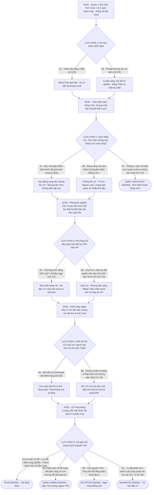

# CỤM KỊCH BẢN PHÂN NHÁNH — Ý TƯỞNG DÒNG 9
**Thể loại:** Phim tương tác phân nhánh (FMV) · 3 tuyến truyện hoàn chỉnh (mỗi tuyến 5 cảnh, 4–5 nút chọn với cơ chế đánh đổi riêng)

---

## PHẦN 1: XUYÊN KHÔNG SỐNG HỘ — CÁI GIÁ CỦA HỆ THỐNG
**Thể loại:** Cổ trang quyền mưu · Xuyên thư · Hệ thống ăn mòn ký ức
**Cơ chế lựa chọn đặc trưng:** *Con dao hai lưỡi của Hệ thống* — mọi sự trợ giúp từ Hệ thống đều phải trả bằng **Ký ức đời thực**; mọi đòn đánh vào Tam hoàng tử đều đặt **tính mạng họ Tô** lên bàn cân.

### Sơ đồ phân nhánh Phần 1

```mermaid
flowchart TD
    S1["SC01 · Yến tiệc Tiêu phủ: Cú cắt từ thế kỷ 21 & chén rượu 'Bách Nhật Tán'"] --> C1{"LỰA CHỌN 1: Bảo vệ Tiêu Dực vs Giữ họ Tô"}
    C1 -->|"1A · Hất vỡ chén lên khay bạc tố giác ngay"| B1A["Tô phụ bị nghi đồng lõa, giam vào thiên lao"]
    C1 -->|"1B · Tự nhấp ngụm rượu giả ngất"| B1B["Họ Tô yên ổn · Thanh Duệ mang nửa liều độc 24h"]

    B1A --> S2["SC02 · Hậu viện Tiêu phủ: Thị nữ mang ấm thuốc & thư diệt khẩu"]
    B1B --> S2

    S2 --> C2{"LỰA CHỌN 2: Đổi 25% ký ức hay Tự giải bằng mẹo hiện đại?"}
    C2 -->|"2A · Đổi 25% ký ức lấy tên mật thám"| B2A["Quên đồng nghiệp cũ · Bắt sống đầu mối hậu đường"]
    C2 -->|"2B · Thử ấm thuốc bằng muối/bạc, giữ ký ức"| B2B["Thị nữ tự sát · Chỉ giữ được lệnh bài đồng"]

    B2A --> S3["SC03 · Mật thất Vương phủ: Tiêu Dực kề kiếm tra hỏi thân phận"]
    B2B --> S3

    S3 --> C3{"LỰA CHỌN 3: Bán nốt 50% ký ức hay Tự đấu sổ sách?"}
    C3 -->|"3A · Bán 50% ký ức (tên mẹ & đường về) lấy mật lệnh tạo phản"| B3A["Nắm thóp Tam hoàng tử · Mất vĩnh viễn tọa độ về nhà"]
    C3 -->|"3B · Từ chối Hệ thống, bóc 3 kho lương lậu Cảng Nam"| B3B["Giữ trọn ký ức · Bị Tiêu Dực giữ làm con tin theo quân"]

    B3A --> S4["SC04 · Đột kích kho Cảng Nam: Biển lửa vây kín hộp chứng từ / giải dược"]
    B3B --> S4

    S4 --> C4{"LỰA CHỌN 4: Cứu đồ sống còn, Đỡ đao cho Tiêu Dực, hay Đào tẩu?"}
    C4 -->|"4A · Lao vào lửa cướp hộp mật thư / giải dược"| B4A["Giữ được vật chứng · Tiêu Dực bị thương vai, thêm dè chừng"]
    C4 -->|"4B · Đẩy Tiêu Dực né đao sau lưng, bỏ hộp lại trong lửa"| B4B["Cánh tay bị bỏng · Tiêu Dực tháo cùm tin tuyệt đối"]
    C4 -->|"4C (Nếu còn đường về ở 3B) · Nhân loạn lửa nhảy thuyền xuôi sông bỏ trốn"| E5(["EARLY DESERTER ENDING · Đào Tẩu Trong Đêm Lửa"])

    B4A --> S5["SC05 · Cổng thành đêm mưa: Tống Cảnh Nghiêm bắt con tin / giữ giải dược"]
    B4B --> S5

    S5 --> C5{"LỰA CHỌN 5: Cứu người thân / giải dược, Bắn phủ đầu, hay Bán nốt 25% ký ức cuối?"}
    C5 -->|"5A · Mở khe cổng cướp người / thuốc"| E_CHECK{"Kiểm tra chứng từ (4A) & ký ức"}
    E_CHECK -->|"Đủ chứng từ 4A (hoặc giải dược) & đã bán ký ức (2A/3A)"| E1(["TRUE ENDING · Giang Sơn Như Họa"])
    E_CHECK -->|"Còn trọn 100% ký ức (2B + 3B)"| E2(["OPEN ENDING · Giấc Mộng Nam Kha"])
    E_CHECK -->|"Đi 1A + 4B (Hộp chứng từ cháy rụi trong kho)"| E4(["STALEMATE ENDING · Bàn Cờ Chưa Tàn"])
    C5 -->|"5B · Bắn phủ đầu dẹp loạn không chừa đường sống"| E3(["DARK ENDING · Cờ Tàn Đoán Mệnh"])
    C5 -->|"5C (Nếu đã bán 2A + 3A = 75%) · Đổi 25% ký ức cuối để Hệ thống đóng băng thời gian cứu cả nhà"| E6(["HOLLOW ENDING · Con Rối Không Tên"])
```

### Tuyến nhân vật
* **TÔ THANH DUỆ (24 tuổi):** Chuyên viên phân tích chiến lược, xuyên vào thân xác Đại tiểu thư phủ Định Quốc Công.
* **TIÊU DỰC (28 tuổi):** Nhiếp Chính Vương nắm nửa binh quyền, đa nghi và tàn quyết.
* **TỐNG CẢNH NGHIÊM (26 tuổi):** Tam hoàng tử, kẻ giăng bẫy độc tửu để diệt cả Tiêu Dực lẫn họ Tô.
* **HỆ THỐNG NGHỊCH MỆNH 07:** Hiển thị chữ nổi trước tầm mắt, thu phí bằng chính ký ức kiếp trước của ký chủ.

---

### SC01 · NỘI · ĐẠI ĐIỆN YẾN TIỆC TIÊU PHỦ · ĐÊM

Tiếng còi xe và tiếng gõ bàn phím văn phòng vụt tắt ngấm giữa màn hình trắng. Chớp mắt sau, tiếng đàn sáo cung đình ùa vào tai. Thanh Duệ mở bừng mắt — trước mặt không còn màn hình máy tính mà là đôi tay thon lạ đeo vòng ngọc nặng trĩu cổ tay áo gấm thêu phượng hoàng, trên khay sơn son là chén rượu còn ấm bám vệt cặn trắng mờ.

`[MÀN HÌNH HỆ THỐNG]`
`Xuyên không thành công · Ký chủ hiện đại -> Thân xác Tô Thanh Duệ (Đêm Trung Thu Vĩnh Hòa 10).`
`Rượu có 'Bách Nhật Tán'. Người dâng rượu: Phủ Định Quốc Công. Nếu Tiêu Dực chết: Họ Tô tru di.`

Bên cạnh, Tống Cảnh Nghiêm ghé sát vành tai nàng, khẽ đẩy khuỷu tay.

TỐNG CẢNH NGHIÊM
Rượu nhà họ Tô dâng, Vương gia mới chịu nể mặt. Đừng để phụ thân nàng chờ.

Trên bục cao, Tiêu Dực mặc trường bào đen thêu huyền hạc, hai ngón tay xoay nhẹ ly không, mắt nhìn thẳng xuống đôi tay Thanh Duệ.

**[ĐIỂM LỰA CHỌN 1 — Đánh đổi tức thì tại bàn tiệc]**
* **Lựa chọn 1A (Đập bàn ngả bài):** Hất chén rượu đổ ập xuống khay bạc của nội thị, vạch trần chất độc ngay trước bá quan. *(Bảo toàn Tiêu Dực tức thì, nhưng bình rượu mang ấn ký phủ Quốc Công sẽ đẩy Tô phụ vào thiên lao trong đêm).*
* **Lựa chọn 1B (Nuốt độc giữ nhà):** Tự nhấp một ngụm nhỏ rồi buông chén ngã gục giả say trúng gió, kéo lùi lệnh bắt họ Tô. *(Họ Tô bình yên, nhưng Thanh Duệ mang nửa liều kịch độc trong người — buộc phải đoạt giải dược từ tay Tống Cảnh Nghiêm trong 24 giờ).*

#### NHÁNH 1A
Thanh Duệ hất cổ tay làm chén rượu văng thẳng vào khay bạc của nội thị. Khói xám bốc lên cùng vệt đen loang lổ khắp mặt khay. Tống Cảnh Nghiêm chỉ tay về chiếc bình ngọc khắc gia huy họ Tô: *"Phong tỏa Tô phủ ngay!"* Tiêu Dực phất tay khóa cửa điện, đưa Thanh Duệ về hậu viện Vương phủ canh giữ.

#### NHÁNH 1B
Thanh Duệ nâng chén chạm môi, nuốt một ngụm nhỏ rồi trượt tay làm khay ngọc úp xuống thảm, ôm cổ họng ngã vật ra sàn. Vị đắng tê buốt lan dọc cuống họng. Tiêu Dực bước xuống bậc thềm, nhìn vệt máu sẫm ở khóe môi nàng rồi giữ cả nàng lẫn bình rượu lại hậu viện Vương phủ để điều tra.

---

### SC02 · NỘI · TÂY SẢNH HẬU VIỆN VƯƠNG PHỦ · SÁNG

Cửa gỗ khóa ngoài có hai cấm quân đứng gác. Một thị nữ mặc áo xanh bưng khay thuốc nóng bước vào, đặt xuống bàn rồi khẽ nhét một mảnh giấy nhỏ dưới đáy bát sứ.

THỊ NỮ
Tiểu thư uống nhanh cho ấm người, Tam Điện hạ dặn nô tỳ hầu hạ chu đáo.

Thanh Duệ liếc mặt nước thuốc đặc quánh — mùi thảo dược nồng gắt che lấp một vị hắc quen thuộc.

`[MÀN HÌNH HỆ THỐNG — GIAO DỊCH NHỎ]`
`Đổi 25% ký ức hiện đại (tên đồng nghiệp, công ty cũ) để nhận danh tính thật của tên nội gián cầm đầu?`

**[ĐIỂM LỰA CHỌN 2 — Dùng Hệ thống hay Tự xoay xở?]**
* **Lựa chọn 2A (Đổi 25% ký ức):** Chấp nhận xóa một mảng ký ức công sở để đọc tên kẻ đứng sau ả thị nữ ngay trước mặt cấm quân.
* **Lựa chọn 2B (Từ chối giao dịch):** Rút chiếc trâm bạc và nhúm muối trên khay đồ ăn sáng nhúng vào bát thuốc để ép ả thị nữ tự lộ mặt.

#### NHÁNH 2A
Một cơn nhói nhẹ qua thái dương — tên căn phòng làm việc cũ ở thế kỷ 21 biến mất khỏi đầu nàng. Đổi lại, Thanh Duệ gọi lớn ra ngoài cửa, đọc rành mạch tên quản sự nội viện của Tam hoàng tử và chỗ giấu lọ thuốc diệt khẩu trong búi tóc thị nữ. Cấm quân lập tức ập vào bắt sống đầu mối.

#### NHÁNH 2B
Thanh Duệ nhấn đầu trâm bạc vào bát thuốc nóng — đầu trâm lập tức chuyển màu xám đen. Nàng hất thẳng bát thuốc vào tay áo ả thị nữ rồi chặn cửa. Thị nữ hoảng loạn cắn vỡ viên thuốc giấu trong răng ngã gục tại chỗ, chỉ kịp làm rơi ra **chiếc lệnh bài đồng khắc số cảng**.

---

### SC03 · NỘI · MẬT THẤT NHIẾP CHÍNH VƯƠNG PHỦ · ĐÊM

Ánh nến hắt bóng lên bản đồ bố phòng kinh thành. Tiêu Dực đặt lưỡi đoản kiếm nằm ngang giữa bàn gỗ lim *(cạnh lệnh giam Tô phụ nếu ở nhánh 1A, hoặc lọ thuốc kìm độc tạm thời nếu ở nhánh 1B)*.

TIÊU DỰC
Tô Thanh Duệ trước kia ngay cả chữ trên khế ước ruộng đất cũng đọc không thông. Một đêm đổi tính, lại dám đánh cược cả mạng mình trước chén rượu Bách Nhật Tán. Nàng muốn gì ở bản vương?

`[MÀN HÌNH HỆ THỐNG — GIAO DỊCH LỚN]`
`Đổi 50% ký ức thế giới hiện đại (tên mẹ, quê quán, tọa độ trở về) để lấy vị trí hầm mật thư tạo phản của Tống Cảnh Nghiêm?`

**[ĐIỂM LỰA CHỌN 3 — Bán ký ức hay Giữ đường về nhà?]**
* **Lựa chọn 3A (Chấp nhận giao dịch):** Đánh đổi nửa phần ký ức quý giá nhất lấy bằng chứng thép kết tội Tống Cảnh Nghiêm. *(Mất vĩnh viễn đường về thế kỷ 21).*
* **Lựa chọn 3B (Từ chối giao dịch):** Tự dùng tư duy phân tích sổ sách hiện đại *(và chiếc lệnh bài đồng nếu có từ 2B)* chỉ ra ba kho lương lậu của Tam hoàng tử tại bến Cảng Nam. *(Giữ nguyên đường về, nhưng Tiêu Dực xích tay nàng bằng dây lụa buộc cổ tay để làm con tin theo quân).*

#### NHÁNH 3A
Giọng nói của mẹ ở đầu dây bên kia thế kỷ 21 tan biến sạch sẽ như sương khói. Thanh Duệ đọc rõ sơ đồ hầm mật thư dưới hậu đường phủ Tam hoàng tử. Tiêu Dực nhìn sâu vào đôi mắt bỗng trống rỗng một nhịp của nàng rồi chậm rãi tra kiếm vào vỏ.

#### NHÁNH 3B
Thanh Duệ rút trâm chấm mực chu sa khoanh ba điểm bên ngoài cửa Nam trên bản đồ: *"Tam hoàng tử ém ba mươi vạn thạch lương cứu tế ở đây để đổi binh phù."* Tiêu Dực thu bản đồ, siết sợi dây lụa vào cổ tay nàng: *"Trước khi việc thành, nàng đi cùng bản vương tới tận kho hàng."*

---

### SC04 · NGOẠI · KHO LƯƠNG BẾN CẢNG NAM · ĐÊM

Lửa bùng lên dữ dội quanh ba dãy kho gạo sau tiếng tù và báo động — Tam hoàng tử đã đánh hơi thấy động tĩnh và ra lệnh đốt sạch kho hòng phi tang. Giữa biển lửa trong kho chính, một hộp đồng đựng **bản sao mật thư** *(hoặc **hộp giải dược Bách Nhật Tán** từ 1B)* nằm trên chiếc bàn gỗ sắp sập.

Ngay lúc Thanh Duệ lao tới bậc cửa, hai thích khách áo đen từ trên xà nhà vung đao chém thẳng xuống gáy Tiêu Dực khi chàng đang quay lưng cản mũi tên.

**[ĐIỂM LỰA CHỌN 4 — Vật cứu mạng, Đồng minh hay Thoát thân?]**
* **Lựa chọn 4A (Lao vào lửa cướp hộp đồng):** Giành bằng được chứng từ / lọ thuốc trước khi mái kho đổ sập.
* **Lựa chọn 4B (Xô Tiêu Dực ngã sang bên, đỡ sượt lưỡi đao):** Bỏ mặc chiếc hộp đồng cháy rụi trong lửa để giữ trọn mạng cho Tiêu Dực.
* **Lựa chọn 4C** *(Khả dụng khi còn đường lui ở 3B)*: **Lợi dụng khói lửa chặt đứt dây lụa nhảy xuống thuyền nhỏ bến Cảng Nam trốn đi biệt tích:** Thoát khỏi cả triều đình lẫn chiến tranh vương vị.

#### NHÁNH 4A
Thanh Duệ ôm chặt hộp đồng nóng rực lăn ra khỏi kho đúng lúc xà ngang sập xuống. Phía sau, Tiêu Dực tự xoay người chém gục thích khách nhưng vai trái rách toạc một đường máu dài; chàng nhìn chiếc hộp trên tay nàng bằng ánh mắt lạnh băng trở lại.

#### NHÁNH 4B
Thanh Duệ đẩy mạnh Tiêu Dực ngã xuống đống bao tải gạo; lưỡi đao sượt qua cánh tay làm bỏng rát da thịt nàng. Hộp đồng chìm trong biển lửa, nhưng Tiêu Dực lập tức cắt đứt sợi dây trói cổ tay nàng *(nếu ở 3B)*, kéo nàng đứng sát sau lưng mình trước vòng vây lửa.

#### NHÁNH 4C ➔ KẾT THÚC SỚM
Thanh Duệ chém đứt sợi dây lụa vào lưỡi đao rơi trên sàn, lăn qua cửa sổ hậu lao thẳng xuống con thuyền chở muối đang xuôi dòng giữa đêm mù sương — bỏ lại tiếng nổ kho lương và định mệnh nhà họ Tô phía sau.

---

### SC05 · NGOẠI · CỔNG THÀNH KINH ĐÔ · ĐÊM MƯA BÃO

Mưa quất rát mặt thành. Tống Cảnh Nghiêm bị dồn tới chân cổng thành khóa kín — tay trái hắn kề dao vào cổ Tô phụ bị bắt làm con tin *(nếu đi 1A)*, hoặc giơ cao lọ ngọc đựng giải dược duy nhất *(nếu đi 1B và hộp lửa ở 4B đã cháy)*.

TỐNG CẢNH NGHIÊM
Mở cổng cho ta rời kinh thành! Nếu không, sáng mai ngươi chỉ còn nhận xác!

Năm trăm cung thủ cấm quân đã kéo căng dây cung chờ lệnh của Tiêu Dực. Nếu đã bán 75% ký ức trước đó (`2A + 3A`), màn hình Hệ thống bỗng chớp đỏ chào giá **25% ký ức cuối cùng** để đóng băng thời gian trong ba nhịp thở.

**[ĐIỂM LỰA CHỌN 5 — Cứu thân nhân / Sinh mạng, Dẹp loạn hay Xóa sạch bản ngã]**
* **Lựa chọn 5A (Trì hoãn lệnh bắn — Mở khe cổng nhỏ phối hợp Tiêu Dực áp sát cướp người / thuốc):** Liều mạng đổi vị trí trên cầu treo trước khi hỗn chiến nổ ra.
* **Lựa chọn 5B (Giật trống ra lệnh bắn phủ đầu ngay lập tức):** Không để kẻ phản nghịch có cơ hội chạy thoát ra biên ải.
* **Lựa chọn 5C** *(Chỉ mở khi đã bán `2A + 3A`)*: **Bán nốt 25% ký ức cuối cùng (tổng 100%) để Hệ thống ngưng đọng thời gian 3 giây bước lên tước dao tay Tam hoàng tử:** Cứu trọn cả cha lẫn Tiêu Dực mà không cần đổ một giọt máu.

---

### HỆ THỐNG KẾT CỤC PHẦN 1

* **TRUE ENDING · GIANG SƠN NHƯ HỌA *(Chọn 5A + có hộp chứng từ/giải dược 4A hoặc đi 1B giữ 4A + đã bán một phần ký ức 2A hoặc 3A)*:** Thanh Duệ cùng Tiêu Dực đoạt lại được người/thuốc ngay giữa làn mưa tên và tung chứng từ khóa cổ phe Tam hoàng tử. Vì đã đánh đổi ký ức hiện đại cho Hệ thống, nàng ném trả lệnh bài hồi quy xuống hào nước, nắm tay Tiêu Dực đứng trên cổng thành đón bình minh.
* **OPEN ENDING · GIẤC MỘNG NAM KHA *(Chọn 5A + giữ trọn 100% ký ức ở 2B + 3B)*:** Khi Tống Cảnh Nghiêm gục ngã và nhiệm vụ bảo toàn họ Tô hoàn tất, cánh cửa hồi quy mở ra đúng lúc Thanh Duệ kiệt sức ngã xuống. Nàng mở mắt trên giường bệnh hiện đại với đầy đủ ký ức — trên ngón áp út còn nguyên chiếc nhẫn ngọc bích khắc chữ *Dực*.
* **STALEMATE ENDING · BÀN CỜ CHƯA TÀN *(Chọn 5A khi đi 1A + 4B làm cháy mất hộp chứng từ)*:** Cha nàng được cứu sống khỏi lưỡi dao của Tam hoàng tử, nhưng vì chứng từ tạo phản đã hóa tro ở bến cảng nên triều đình chỉ giáng Tống Cảnh Nghiêm làm thứ dân giam lỏng. Tiêu Dực giữ Tô phụ lại kinh thành làm con tin chính trị; Thanh Duệ đứng bên chàng trong triều đường, biết rõ ván cờ vẫn chưa hề kết thúc.
* **DARK ENDING · CỜ TÀN ĐOÁN MỆNH *(Chọn 5B)*:** Loạt tên lửa đổ xuống như mưa dẹp tan phản quân trong một canh giờ. Tiêu Dực giữ vững ngai vàng, nhưng dưới chân cổng thành cháy đen chỉ còn lại xác Tô phụ *(hoặc lọ giải dược vỡ tan trong bùn)*. Thanh Duệ sống sót nhưng lặng lẽ rời khỏi hoàng cung giữa đêm mưa.
* **HOLLOW ENDING · CON RỐI KHÔNG TÊN *(Chọn 5C — Đã bán đủ 100% ký ức)*:** Thời gian đứng im ba giây đủ để Thanh Duệ bước lên rút dao khống chế gọn Tống Cảnh Nghiêm, cứu trọn họ Tô lẫn Tiêu Dực. Khi tiếng hô vạn tuế vang lên, ánh mắt nàng trở nên trống rỗng phẳng lặng — không còn nhớ thế kỷ 21, không còn biết mình từng là ai, chỉ còn lại một Vương phi hoàn hảo mỉm cười máy móc theo mỗi bước chân Tiêu Dực.
* **EARLY DESERTER ENDING · ĐÀO TẨU TRONG ĐÊM LỬA *(Chọn 4C tại SC04)*:** Chiếc thuyền muối đưa Thanh Duệ trôi khỏi kinh thành ngay trong đêm kho lương bốc cháy. Ba tháng sau tại một trấn nhỏ phương Nam, nàng dùng kỹ năng phân tích mở một tiệm buôn trà bình lặng — nhưng trên mặt báo kinh thành gửi xuống chỉ vỏn vẹn bốn chữ: *Phủ Quốc Công tru di*.

---

## PHẦN 2: TRÙNG SINH ĐÔI — TRÒ CHƠI ĐỌC VỊ (BLUFFING)
**Thể loại:** Trùng sinh kép · Cung đình đấu trí · Ngụy trang tâm lý
**Cơ chế lựa chọn đặc trưng:** *Mặt nạ song trùng* — cả hai đều mang ký ức kiếp trước nhưng **không biết đối phương đã trùng sinh**. Toàn bộ 5 cảnh là quá trình thử thuốc, đỡ tên và đọc vị lẫn nhau: diễn giống người cũ quá sẽ bị ngộ sát, xé mặt nạ sớm quá sẽ kích động cha mình binh biến!

### Sơ đồ phân nhánh Phần 2

### Tuyến nhân vật
* **HẠ TOÀN YÊN (20 tuổi):** Hoàng hậu kiếp trước bị cha lừa bỏ độc vào canh sen. Sống lại năm Vĩnh Ninh thứ 2, âm thầm tự thử thuốc giải để cứu Trạch Xuyên.
* **THẨM TRẠCH XUYÊN (24 tuổi):** Hoàng đế mang ký ức chết vì bát canh sen kiếp trước — giấu kín thân phận trùng sinh để thử lòng Hoàng hậu.

---

### SC01 · NỘI · BẾP PHỦ HOÀNG HẬU ➔ DƯỠNG TÂM ĐIỆN · ĐÊM

*(Mở màn 3 giây — Ký ức kiếp trước)*: Bàn tay đẫm máu của Toàn Yên bấu chặt lấy gấu long bào lạnh ngắt; chiếc bát sứ vỡ tan dưới ánh đèn đồng đổ sập. Giọng nam trầm khàn đặc vọng lại trong bóng tối: *"Kiếp sau... đừng làm Hoàng hậu của trẫm..."*

Toàn Yên giật mình mở bừng mắt trước bếp than hồng — hai cổ tay trắng trẻo lành lặn không còn vết cùm sắt. Trên án gỗ bên cạnh, tờ chiếu sắc phong ghi rõ **năm Vĩnh Ninh thứ 2** (hai năm trước đêm định mệnh). Nàng cầm ngay **gói thạch tín niêm phong triện Hạ gia** ném thẳng vào lò than đang cháy rực, rồi tự tay bưng khay canh hạt sen sạch bước vào Dưỡng Tâm Điện.

Khói trầm hương quẩn quanh án tấu chương. Thẩm Trạch Xuyên tựa lưng ghế, ngón tay gõ nhịp đều đặn lên mặt bàn, sắc mặt tái nhợt. Toàn Yên đặt bát canh xuống cạnh nghiên mực.

HẠ TOÀN YÊN
Đêm nay sương nặng, thần thiếp tự nấu canh hạt sen an thần, xin Bệ hạ dùng nóng.

Thẩm Trạch Xuyên khẽ đặt một tay lên giữa ngực mình — đúng vị trí từng quặn đau trước khi chết — rồi ánh mắt dừng lại ở hai đầu ngón tay phồng rộp vì lửa bếp của nàng.

THẨM TRẠCH XUYÊN
Hoàng hậu trước nay ghét nhất mùi khói bếp. Nay lại bỏ hai viên đường phèn vào canh cho trẫm?

Toàn Yên khựng lại nửa nhịp — ở thời điểm năm thứ 2 này, chàng chưa từng kể cho bất kỳ ai nghe sở thích hai viên đường phèn. Sau bức bình phong ngoài hiên, bóng một tên thị vệ thân tín của Hạ tướng quân đang đứng rình.

THẨM TRẠCH XUYÊN
Trời lạnh, Hoàng hậu uống trước nửa bát cho ấm bụng rồi trẫm dùng sau.

**[ĐIỂM LỰA CHỌN 1 — Mức độ lộ bài đêm đầu tiên]**
* **Lựa chọn 1A (Giữ mặt nạ cũ che mắt tai mắt ngoài hiên):** Nở nụ cười dịu dàng y hệt kiếp trước, uống cạn nửa bát canh rồi lặp lại câu dỗ ngọt quen thuộc.
* **Lựa chọn 1B (Xé bỏ kịch bản cũ ngay trước mặt chàng):** Hất tay gạt bát canh đổ sập xuống mép khay, đặt thẳng phong thư chưa bóc của cha lên bàn án.

#### NHÁNH 1A
Toàn Yên mỉm cười, uống liền ba thìa canh nóng: *"Thiếp chỉ muốn Bệ hạ ngủ ngon một đêm, sao Bệ hạ lại đề phòng đến vậy?"* Câu hỏi giống hệt kiếp trước khiến đồng tử Trạch Xuyên co rút lại; chàng lặng lẽ giấu chiếc thìa bạc vào tay áo.

#### NHÁNH 1B
Toàn Yên gạt khay làm bát canh đổ ào xuống nền đá, đặt phong thư sáp đỏ của cha lên bàn: *"Phụ thân dặn thiếp khuyên Bệ hạ uống chén này. Nếu Bệ hạ tin thiếp có độc, đêm nay giữ thiếp lại đây đừng cho ra khỏi điện."* Ngoài bình phong, một chiếc bóng vội vã lẻn biến mất vào màn đêm.

---

### SC02 · NỘI · NGỰ DƯỢC PHÒNG · ĐÊM (MỘT THÁNG SAU)

Ánh đèn dầu hắt bóng chiếc ấm đất sôi lục bục. Trên cổ tay trái của Toàn Yên đã hằn ba vết kim bầm tím mới cũ chồng lên nhau — nàng đang tự tiêm và nếm từng vị thảo mộc để tìm ra công thức giải thứ độc mãn tính âm ỉ trong máu Trạch Xuyên từ trước khi thành hôn.

Cánh cửa gỗ đột ngột bật mở. Thẩm Trạch Xuyên bước vào một mình, mắt nhìn thẳng vào chén thuốc đen đặc còn bốc khói trên tay nàng.

THẨM TRẠCH XUYÊN
Nửa đêm không ngủ, Hoàng hậu trốn ở Ngự Dược Phòng bào chế thứ gì?

**[ĐIỂM LỰA CHỌN 2 — Che giấu hay Thử lòng nhau?]**
* **Lựa chọn 2A (Vội giấu chén thuốc, nói dối nấu nước dưỡng nhan):** Nhanh tay đậy khăn gấm lên chén thuốc, kéo tay áo che vết kim rồi mỉm cười thoái thác.
* **Lựa chọn 2B (Không giấu, đẩy chén thuốc qua bàn và uống một ngụm trước mặt chàng):** Kéo cao ống tay áo để lộ vết kim, đặt đơn thuốc xuống bàn.

#### NHÁNH 2A
Toàn Yên kéo tay áo xuống, đẩy chén thuốc vào góc tối: *"Da tay dạo này nứt nẻ, thần thiếp sắc ít nước rễ cỏ rửa tay."* Trạch Xuyên không nói gì, chỉ lặng lẽ bước tới bới nhẹ nắm bã thuốc còn ấm dưới đáy lò cho vào khăn tay mang về.

#### NHÁNH 2B
Toàn Yên không kéo tay áo che vết bầm tím, nâng chén thuốc đắng ngắt uống gọn một ngụm trước mặt chàng rồi đẩy qua bàn: *"Mỗi tháng phải đổi một vị thảo mộc mới biết vị nào hợp tạng người. Bệ hạ sợ độc thì cứ đứng xem thần thiếp thử trước."* Trạch Xuyên nhìn chằm chằm vào vết kim trên cổ tay nàng hồi lâu mới quay người bước ra cửa.

---

### SC03 · NGOẠI · HÀNH LANG CHÙA VẠN THỌ · ĐÊM TUYẾT RƠI (THÁNG THỨ 3)

Đèn lồng trắng treo dọc hành lang đá phủ tuyết. Hôm nay là lễ cầu an hoàng thất — cũng chính là nơi thích khách Hạ gia từng mai phục ám sát từ mái ngói ở kiếp trước.

Một tiếng gió rít sắc lẹm xé toạc màn tuyết. Từ nóc đại điện, mũi tên đen tẩm độc lao thẳng xuống sau lưng Thẩm Trạch Xuyên khi chàng đang châm hương.

**[ĐIỂM LỰA CHỌN 3 — Phản xạ trong tích tắc]**
* **Lựa chọn 3A (Lao tới đẩy chàng ngã xuống tuyết, lấy vai trái đỡ sượt mũi tên):** Chặn đứng mũi tên nhưng mang thêm vết thương độc mới khiến cơ thể suy kiệt nhanh hơn.
* **Lựa chọn 3B (Đạp đổ đỉnh đồng than hồng hất tro mù trời và giật chuông báo động):** Làm thích khách lạc hướng mà không để tên chạm người cả hai, nhưng cha nàng ngoài cổng chùa lập tức biết chính nàng phá hỏng ván cờ.
* **Lựa chọn 3C (Đứng yên giữ nguyên tay cầm nhang để kiểm chứng xem Trạch Xuyên có tự tránh điểm mù kiếp trước không):** Phép thử liều mạng lật tẩy thân phận trùng sinh của Hoàng đế ngay tại sân chùa.

#### NHÁNH 3A
Toàn Yên xô mạnh Trạch Xuyên lăn sang bậc đá; mũi tên đen sượt toạc vai trái nàng làm máu đỏ nhuộm thẫm lớp tuyết trắng. Trạch Xuyên đỡ lấy nàng trong vòng tay — ánh mắt chàng chợt rúng động khi nhìn vết máu trên tuyết khớp từng tấc với ký ức kiếp trước.

#### NHÁNH 3B
Toàn Yên đạp nghiêng đỉnh than khiến tàn lửa bùng lên mù mịt, đồng thời giật mạnh dây chuông đồng trên mái hiên. Mũi tên cắm phập xuống cột gỗ. Thích khách rút lui vào rừng thông, nhưng dưới chân bậc thềm, tên cận vệ của Hạ tướng quân nhìn nàng với ánh mắt đầy sát khí.

#### NHÁNH 3C ➔ KẾT THÚC SỚM
Chưa đợi Toàn Yên nhúc nhích, Trạch Xuyên đã nghiêng đầu đúng nửa tấc né lẹm mũi tên bắn từ góc chết sau lưng — phản xạ mà chỉ kẻ từng chết dưới mũi tên đó một lần mới có. Bốn mắt chạm nhau giữa tuyết trắng; mặt nạ rơi xuống quá sớm khiến Hạ tướng quân ngoài cổng lập tức rút quân trong đêm, mở ra cuộc chiến ngầm dai dẳng không hồi kết giữa đôi vợ chồng trùng sinh chưa kịp tin nhau trọn vẹn.

---

### SC04 · NỘI · NGỰ THƯ PHÒNG · CHIỀU TÀ

Ngoài cổng Tây kinh thành, tiếng vó ngựa của ba ngàn tử sĩ Hạ gia đã rục rịch chuyển quân. Trên bàn long án, chiếc hộp đựng ngọc ấn điều binh mở hé nắp — một cái bẫy lộ liễu.

Toàn Yên bước vào, trên tay nắm chặt lá thư mật cuối cùng của cha ép nàng giao ấn trước giờ Dậu. Thẩm Trạch Xuyên đứng quay lưng cạnh giá sách, không ngoái đầu lại.

THẨM TRẠCH XUYÊN
Hoàng hậu tới lấy ngọc ấn giúp phụ thân nàng sao?

**[ĐIỂM LỰA CHỌN 4 — Hạ màn vở kịch song trùng]**
* **Lựa chọn 4A (Diễn vai kẻ phản bội tới cùng — Nhấc hộp ấn giả bước ra cổng Tây lừa cha vào bẫy):** Không thanh minh lấy một lời, nàng cầm hộp sơn son *(bên dưới án thư đã giấu sẵn ngọc ấn thật và lọ thuốc giải cuối cùng)* xoay người bước ra cửa.
* **Lựa chọn 4B (Đốt thư cha trước mặt chàng — Tung câu hỏi mật khẩu hai kiếp):** Đưa lá thư vào ngọn đèn đồng rồi kéo cao tay áo lộ dày đặc vết kim thử thuốc giải suốt ba tháng qua.
* **Lựa chọn 4C (Rót chén trà an thần làm Trạch Xuyên ngủ thiếp đi nửa canh giờ, một mình cầm ấn giả bước ra cổng Tây):** Tự khóa cửa điện để chàng ở lại an toàn và tự mình gánh trọn mũi tên lẫn tội danh phản nghịch của Hạ gia.

#### NHÁNH 4A
Toàn Yên không ngoái đầu, ôm chặt chiếc hộp sơn son bước thẳng qua ngưỡng cửa Ngự Thư Phòng hướng về cổng Tây. Tiếng bước chân gấp gáp của Thẩm Trạch Xuyên vang lên ngay sau lưng nàng, tay chàng đã đặt lên chuôi kiếm.

#### NHÁNH 4B
Ngọn lửa trên cây đèn đồng nuốt trọn lá thư của Hạ gia. Toàn Yên giơ cổ tay đầy vết kim bầm tím lên nhìn thẳng vào mắt chàng.

HẠ TOÀN YÊN
Đêm tuyết chùa Vạn Thọ, câu cuối thần thiếp nói trước khi nhắm mắt — Bệ hạ có dám thề mình chưa từng nghe thấy?

Thanh kiếm trên tay Thẩm Trạch Xuyên rơi *choang* xuống nền gạch.

#### NHÁNH 4C
Trạch Xuyên nhấp chén trà trước mặt rồi gục xuống bàn án trong cơn mê nhẹ vô hại. Toàn Yên đắp áo choàng lên vai chàng, đặt lọ thuốc giải bên cạnh nghiên mực rồi ôm chiếc hộp rỗng lặng lẽ bước ra cổng Tây.

---

### HỆ THỐNG KẾT CỤC PHẦN 2

* **TRUE ENDING · TRỌNG SINH TƯƠNG TỐ *(Chọn 4B)*:** Thẩm Trạch Xuyên nắm chặt cổ tay nàng, nhận ra mạch tượng suy kiệt do suốt ba tháng nàng tự thử thuốc giải cho mình. Hai người tháo bỏ mọi lớp mặt nạ, cùng mang hộp ngọc ấn giả ra cổng Tây dụ toàn bộ phản quân Hạ gia vào vòng vây dứt điểm.
* **TRAGIC ENDING · HOA RƠI CỬA KHUYẾT *(Chọn 1A + 2A + 4A)*:** Vì giữ vỏ bọc hoàn hảo ở cả `SC01` lẫn `SC02`, Thẩm Trạch Xuyên tin chắc nàng mang ấn chạy đi tiếp tay cho phản loạn. Mũi kiếm xuyên thẳng qua ngực Toàn Yên ngay bậc cửa Ngự Thư Phòng. Khi chàng giật hộp gỗ ra mới thấy bên trong trống rỗng — ngọc ấn thật và lọ giải dược cuối cùng vẫn nằm yên dưới ngăn long án.
* **IRONY ENDING · ĐẾ VƯƠNG CÔ ĐỘC *(Từng bộc lộ ở 1B/2B/3A rồi chọn 4A)*:** Nhớ lại những sơ hở nàng cố tình để lại suốt ba tháng qua, Trạch Xuyên kịp thu kiếm để nàng tiến ra cổng Tây dụ Hạ gia lộ mặt, nhưng không thể tha thứ cho mối huyết thù gia tộc. Toàn Yên nhận hết tội danh về mình rồi bước vào lãnh cung đóng chặt cửa. Hai năm sau, chàng mới tìm thấy bức huyết thư cùng lọ giải dược cạn đáy dưới ngăn án.
* **MARTYR ENDING · MỘT MÌNH GÁNH NGHIỆP *(Chọn 4C)*:** Toàn Yên tự mình đối mặt ba ngàn tử sĩ ngoài cổng Tây, kích hoạt ám tiễn tường thành cùng Hạ tướng quân đồng quy vu tận trước khi cấm quân ập tới. Khi Trạch Xuyên tỉnh dậy trong Ngự Thư Phòng, trên bàn chỉ còn lọ thuốc giải nguyên vẹn và bức thư ba chữ: *"Đừng hận nữa."*
* **EARLY UNMASKING ENDING · PHÁ CỤC GIỮA ĐÊM TUYẾT *(Chọn 3C tại SC03)*:** Nhận ra nhau quá sớm tại Chùa Vạn Thọ khiến Hạ tướng quân rút quân ẩn mình, biến mâu thuẫn triều đình thành cuộc ám sát ngầm dai dẳng thay vì một trận quyết chiến dứt điểm.

---

## PHẦN 3: CHIẾN HẠM TẬN THẾ — NGHỊCH LÝ LÕI QUANG TỬ
**Thể loại:** Hậu tận thế · Dị năng sinh học · Sinh tồn đạo đức
**Cơ chế lựa chọn đặc trưng:** *Lõi Quang Tử Hữu Hạn (3/3)* — năng lượng Loại 3 rút trực tiếp sinh mệnh người dùng **(chỉ phóng được tối đa 3 lần cho toàn tập)**; cứu nhóm này đồng nghĩa mất nhóm kia, và dùng cạn Lõi giữa đường sẽ không còn năng lực phá Tháp ở trận cuối!

### Sơ đồ phân nhánh Phần 3

### Tuyến nhân vật & Hệ thống phân cấp
* **Loại 1 (Dân thường):** Không dị năng, sống tầng đáy trong Vòm An Toàn.
* **Loại 2 (Dị năng nhân tạo):** Cấy tế bào quái vật, phụ thuộc *Huyết Thanh Xanh* hằng tháng.
* **Loại 3 (Dị năng tự nhiên):** Cực hiếm, rút trực tiếp sinh mệnh người dùng mỗi lần phóng thích **(Tổng giới hạn: 3 lần)**.
* **KHƯƠNG DỰC (26 tuổi):** Cựu chỉ huy tử trận, trùng sinh vào xác phế nhân Loại 1, thức tỉnh Dị năng Loại 3.
* **LỤC BĂNG THẦN (28 tuổi):** Đội trưởng Tiên Phong Loại 2, cánh tay phải đã hóa vảy đen cận kề phát điên.

---

### SC01 · NGOẠI · VÙNG ĐẤT CHẾT SECTOR 7 · ĐÊM `(Lõi: 3/3)`

Bụi phóng xạ xanh lục phủ kín đống bê tông vỡ. Ống tiêm *Huyết Thanh Xanh* rỗng không lăn lóc dưới chân Lục Băng Thần. Cánh tay phải của anh đã mọc kín lớp vảy đen, máu sẫm rỉ qua khóe mắt. Cách đó hai mươi bước, một chiếc xe vận tải chở **12 công nhân Loại 1** bị đuôi con Mãng Xà Titan quấn chặt, thùng xe móp méo sắp vỡ nát.

LỤC BĂNG THẦN
Đừng nhìn nữa! Đập nút tự hủy trên ngực ta đi trước khi ta mất trí!

Từ đống xác thiết bị vỡ nát ngoài bãi rác phóng xạ, Khương Dực lảo đảo đứng dậy — trên cổ áo rách đeo lủng lẳng chiếc thẻ đồng khắc chữ **LOẠI 1 — PHẾ THẢI**. Cậu cúi nhìn đôi tay gầy guộc xa lạ của thân xác mới vừa tiếp quản bỗng bùng lên ánh sáng vàng trắng chói lòa; trên mu bàn tay hiện rõ **ba vạch mạch sáng đỏ rực**, chỉ cần nén năng lượng là một vạch lại rỉ máu.

KHƯƠNG DỰC
Thân xác phế phẩm... vậy mà mang lõi thanh tẩy. Nhưng cơ thể này chỉ chịu nổi ba lần rút cạn.

Con Mãng Xà Titan há toang hàm răng bổ xuống xe công nhân — cùng giây đó, vảy đen lan tới cổ họng Băng Thần. Năng lượng Quang Tử trong tay Khương Dực chỉ đủ đánh trúng **một mục tiêu**.

**[ĐIỂM LỰA CHỌN 1 — Cứu 1 chiến binh hay 12 dân thường?]**
* **Lựa chọn 1A (Cứu Lục Băng Thần):** Lao tới áp tay lên vai Băng Thần phóng luồng sáng thanh tẩy. *(Lõi còn 2/3 · Băng Thần phục hồi toàn bộ sức mạnh, nhưng xe 12 công nhân bị nuốt trọn).*
* **Lựa chọn 1B (Cứu 12 dân thường):** Phóng thương ánh sáng xuyên thẳng sọ Mãng Xà Titan cứu chiếc xe. *(Lõi còn 2/3 · 12 dân thường sống sót và gỡ được thẻ mã thí nghiệm trên xác quái, nhưng Băng Thần buộc phải tự vung đao chặt đứt cánh tay phải để ngăn biến dị lan lên tim).*

---

### SC02 · NGOẠI · TRẠM KIỂM DỊCH CỔNG VÒM · SÁNG SỚM `(Lõi: 2/3)`

Ánh đèn pha trắng toát quét qua hàng trăm dân Loại 1 đang xếp hàng xin vào cổng. Ngay khi Băng Thần kéo Khương Dực vào làn ưu tiên, tên sĩ quan kiểm dịch giật phắt tấm thẻ đồng **LOẠI 1 — PHẾ THẢI** trên cổ cậu, lên đạn súng plasma dí thẳng vào trán.

SĨ QUAN KIỂM DỊCH
Phế nhân khu bãi rác dám trà trộn theo đội Tiên Phong? Hoặc là nhiễm dị biến, hoặc là gián điệp — xử lý tại chỗ!

Băng Thần giơ tay chặn nòng súng nhưng lệnh giới nghiêm không cho anh nổ súng vào người giữ cổng. Khương Dực không muốn đốt mất một vạch Lõi quý giá ở đây.

**[ĐIỂM LỰA CHỌN 2 — Đấu trí thầm lặng, Tạo làn sóng dân chúng hay Mở đường máu bằng Lõi?]**
* **Lựa chọn 2A (Giấu năng lực — Đọc mật mã quân đoàn kiếp trước):** Nhìn thẳng vào mắt sĩ quan, đọc chính xác mã hiệu khóa tầng bí mật mà chỉ các chỉ huy đã tử trận của quân đoàn cũ mới biết để buộc hắn áp giải thẳng lên Hội đồng cấp cao.
* **Lựa chọn 2B (Tạo nhân chứng công khai giữa hàng dân thường):** Giơ bàn tay bùng một tia sáng vàng nhỏ đủ hất văng nòng súng trước mặt hàng trăm công nhân Loại 1 đang đứng nhìn, khiến tên sĩ quan không dám thủ tiêu lén trong bóng tối.
* **Lựa chọn 2C (Phóng hẳn 1 vạch Lõi hạ gục tên sĩ quan để cướp xe xông thẳng qua Cổng Vòm):** Từ chối bị trói tay áp giải, dùng bạo lực phá trạm kiểm dịch ngay lập tức. *(Lõi tụt xuống `1/3`)*.

#### NHÁNH 2A
Tên sĩ quan khựng tay súng, tái mặt gọi điện báo thẳng lên Hội đồng tối cao. Khương Dực bị còng tay đưa thẳng vào phòng thí nghiệm trung tâm trong im lặng tuyệt đối — không một người dân nào bên ngoài biết cậu còn sống.

#### NHÁNH 2B
Hàng trăm dân Loại 1 đồng loạt ồ lên khi thấy một phế nhân mang thẻ *Loại 1* phát sáng đẩy lùi súng plasma. Tin đồn *"Người Loại 1 mang ánh sáng thanh tẩy"* lập tức truyền lan xuống các khu ổ chuột đáy Vòm ngay lúc đặc nhiệm Hội đồng ập xuống giải cậu đi.

#### NHÁNH 2C ➔ KẾT THÚC SỚM
Tia sáng Quang Tử đánh bay trạm gác chỉ khiến Khương Dực kiệt sức xuống còn `1/3` Lõi ngay ngoài vành đai ngoài. Còi báo động đỏ vang khắp Vòm An Toàn, ba tiểu đội pháo binh Loại 2 lập tức khóa cửa thép xả đạn phủ đầu vào chiếc xe cướp được, khép lại cuộc nổi dậy ngay trước cửa hầm.

---

### SC03 · NỘI · PHÒNG THÍ NGHIỆM VÒM TRUNG TÂM · TRƯA `(Lõi: 2/3)`

Bốn bức tường kính cường lực khép chặt quanh Khương Dực. Màn hình bên ngoài hiện rõ hai thông số lạnh lẽo: **Lõi Loại 3 — Còn 2/3**; và phía bên cạnh là biểu đồ vận hành của **50.000 dân Loại 1 đang thở bằng màng lọc sinh học nối thẳng tới Lõi Tháp**.

CHỦ TỊCH HỘI ĐỒNG chỉ tay lên màn hình màng lọc khí của cả thành phố.

CHỦ TỊCH HỘI ĐỒNG
Tưởng đập vỡ Tháp Năng Lượng là cứu nhân loại? Toàn bộ không khí sạch trong Vòm lấy từ nhịp thở thanh lọc của Vật Chủ Đầu Nguồn dưới Lõi Tháp. Mày phá tháp bây giờ, năm vạn dân Loại 1 bên dưới chết ngạt trong hai ngày.

Bên ngoài lồng kính, Lục Băng Thần đứng lặng im *(nếu đi 1A, tay anh lành lặn nhưng ánh mắt nặng nề; nếu đi 1B, ống tay áo phải trống không cài ghim sắt)*.

**[ĐIỂM LỰA CHỌN 3 — Nổi dậy tức thì hay Tự hy sinh đổi thời gian?]**
* **Lựa chọn 3A (Phá lồng kính phát xung kích động toàn quân Loại 2 nổi dậy ngay):** Phóng luồng sáng qua ống thông khí kéo các chiến binh Loại 2 phá cửa cướp tháp. *(Lõi còn 1/3 · Nội chiến nổ ra, khí độc bắt đầu rò rỉ khi chưa có phương án sơ tán dân).*
* **Lựa chọn 3B (Chấp nhận để Hội đồng rút một phần tủy sống đổi quyền vào máy chủ lõi):** Nén cơn đau cho máy rút một nhịp năng lượng, nhân lúc bảo vệ sơ hở để tuồn bản vẽ máy lọc khí di động ra ngoài cho Băng Thần và đội cứu hộ. *(Lõi còn 1/3 và cơ thể suy kiệt, nhưng có giải pháp giữ mạng cho 50.000 dân).*

#### NHÁNH 3A
Sóng vàng nổ tung làm vỡ vụn lồng kính, lan qua đường ống gió xuống doanh trại Tiên Phong. Hàng trăm chiến binh Loại 2 giật tung ống tiêm trên tay, nổi dậy đánh chiếm khu trung tâm. Hệ thống điều áp rạn nứt khiến sương độc bắt đầu rò rỉ xuống tầng hầm.

#### NHÁNH 3B
Kim hợp kim cắm thẳng vào đốt sống khiến máu thấm ướt áo tù, **Lõi Quang Tử tụt xuống 1/3**. Đúng lúc kỹ thuật viên quay sang bình huyết thanh vừa chiết, Khương Dực giật thiết bị đầu cuối truyền thẳng bản vẽ máy lọc khí di động xuống cho Băng Thần *(và nhóm thợ 1B / dân chúng 2B)* trước khi phá cửa thoát ra.

---

### SC04 · NỘI · HÀNH LANG NGẦM KHU 4 · CHIỀU `(Lõi: 1/3)`

Khói xanh độc hại từ đường ống vỡ tràn ngập hành lang hẹp dẫn lên Lõi Tháp. Phía sau cánh cửa thép bị kẹt, ba mươi dân thường Loại 1 *(cùng đội thợ từ 1B nếu còn sống)* và một tiểu đội lính Loại 2 đang gào thét đập cửa vì thiếu thuốc ức chế, cận kề hóa điên.

Lục Băng Thần ghìm thanh kiếm trước cửa thang máy dẫn lên đỉnh tháp, mặt đẫm mồ hôi.

LỤC BĂNG THẦN
Khương Dực! Nếu cậu đốt vạch sáng cuối cùng để thanh tẩy hành lang này, lên tới Lõi Tháp cậu không còn bất cứ thứ gì để phá lò phản ứng nữa đâu!

**[ĐIỂM LỰA CHỌN 4 — Đốt nốt Lõi cứu nhóm người trước mắt hay Nhẫn tâm giữ Lõi cho trận cuối?]**
* **Lựa chọn 4A (Đốt vạch Lõi cuối cùng ngay tại hành lang):** Giải phóng toàn bộ `1/3` ánh sáng còn lại quét sạch khói độc và ổn định tiểu đội lính Loại 2. *(Lõi cạn về 0/3 — cứu trọn đoàn người nhưng mất sạch dị năng trước trận cuối).*
* **Lựa chọn 4B (Dùng lựu đạn choáng và thép lạnh mở đường máu):** Chỉ phá khóa cứu nhóm dân công cầm bản vẽ lọc khí *(nếu ở 3B)* rồi đóng sập cửa ngăn khói, bỏ mặc tốp lính đang phát điên phía sau để giữ nguyên `1/3` Lõi cho đỉnh tháp.

---

### SC05 · NỘI · LÕI THÁP NĂNG LƯỢNG · ĐÊM

Lò phản ứng xoay ầm ầm giữa tâm tháp. Dưới chân lò, hàng trăm ống dẫn cắm sâu vào cơ thể **Quái Vật Mẹ khổng lồ** — nguyên mẫu người Loại 1 đầu tiên bị Hội đồng biến đổi năm mươi năm trước để tạo ra khí sạch và dịch bệnh cùng lúc.

Băng Thần đứng bên bảng điều khiển, mũi kiếm kề sát nút ngắt nguồn khẩn cấp. Anh liếc xuống bàn tay rỉ máu của Khương Dực.

LỤC BĂNG THẦN
Tới đây là hết đường lùi rồi. Phá Vòm hay giữ Vòm?

**[ĐIỂM LỰA CHỌN 5 — Định đoạt kỷ nguyên mới]**
* **Lựa chọn 5A** *(Khi còn Lõi `1/3` từ 4B)*: **Chém vỡ lõi lò phản ứng, mở toang cổng Vòm đưa năm vạn dân ra ngoài.**
* **Lựa chọn 5B:** **Khóa xích Quái Vật Mẹ, giữ nguyên Vòm An Toàn và thay thế Hội đồng điều hành.**
* **Lựa chọn 5C:** **Đẩy Băng Thần ra khỏi cửa thép, ôm lấy Quái Vật Mẹ tự đốt sạch phần sinh mệnh cuối cùng của thân xác.**

---

### HỆ THỐNG KẾT CỤC PHẦN 3

* **TRUE ENDING · TÂN BÌNH MINH *(Chọn 5A — Đủ điều kiện: bản vẽ 3B + giữ Lõi 4B + hậu thuẫn dân công 1B/2B)*:** Tia sáng Quang Tử cuối cùng từ `4B` hòa cùng nhát kiếm của Băng Thần phá tan lò phản ứng, quét sạch lớp sương độc quanh Vòm. Nhờ bản vẽ lọc khí từ `3B` và lực lượng dân công `1B`/`2B` kịp lắp ráp dưới đáy Vòm, năm vạn dân bước qua cánh cổng sắt đón ánh mặt trời đầu tiên không còn lệ thuộc Huyết Thanh.
* **DARK KARMA ENDING · BẦU TRỜI KHÔNG NGƯỜI THỞ *(Chọn 5A — Nhưng thiếu bản vẽ 3B hoặc không có dân công 1A+2A)*:** Lò phản ứng vỡ tung trong tiếng reo hò tự do, nhưng không có thiết bị lọc khí chuẩn bị trước, luồng bụi phóng xạ ngoài Vòm tràn ngược vào khu dân cư trống rỗng. Khi bầu trời xanh hiện ra trên đỉnh Tháp, Khương Dực và Băng Thần quỳ giữa thành phố chết lặng năm vạn xác người.
* **DICTATOR ENDING · NGAI VÀNG BĂNG GIÁ *(Chọn 5B)*:** Không dám đánh cược năm vạn sinh mạng khi chưa đủ phương án lọc khí, Khương Dực và Băng Thần tiêu diệt Hội đồng cũ rồi tự mình ngồi vào ghế kiểm soát. Cánh cổng Vòm vẫn khóa chặt; cả hai giữ sự sống cho thành phố bằng chính bí mật tàn nhẫn mà họ từng thề sẽ lật đổ.
* **SACRIFICE ENDING · TRO TÀN BẤT TỬ *(Chọn 5C — hoặc kết cục tất yếu khi đã đốt cạn Lõi về 0/3 ở 4A và Vòm rò khí ở 3A)*:** Không còn Lõi dị năng dự phòng hoặc không còn đường lui cho dân chúng, Khương Dực đẩy Băng Thần ra ngoài cửa sắt rồi ôm chặt lấy Quái Vật Mẹ tự kích nổ toàn bộ sinh mệnh cuối cùng của linh hồn. Quái Vật Mẹ tan biến, tạo ra màn chắn ánh sáng thanh tẩy giữ Vòm an toàn thêm mười năm cho nhân loại di cư — giữa thảm cỏ non mới mọc chỉ còn sót lại chiếc thẻ đồng **LOẠI 1 — PHẾ THẢI** cháy sém.
* **EARLY RECKLESS ENDING · ĐỨT GÁNH GIỮA CỔNG VÒM *(Chọn 2C tại SC02)*:** Dùng Lõi Quang Tử quá sớm trước mắt quân đội khiến Khương Dực kiệt sức và bị pháo kích hạ gục ngay trạm kiểm dịch; Lục Băng Thần buộc phải đứng nhìn xác cậu bị thiêu hủy để bảo toàn danh tính đội Tiên Phong.
