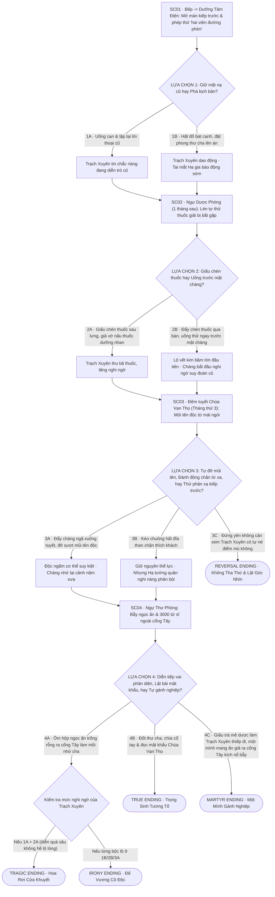
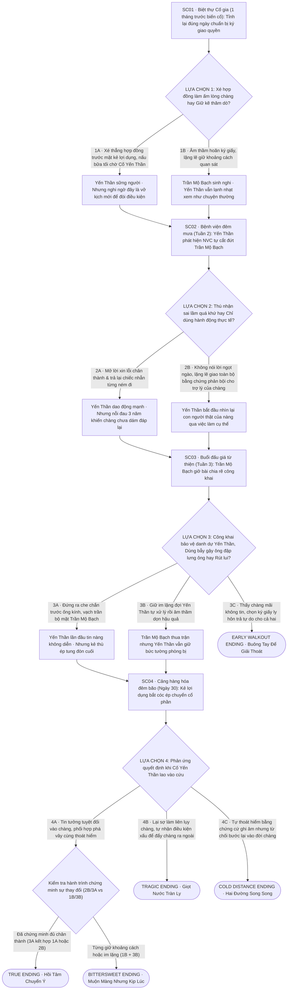

# CỤM KỊCH BẢN PHÂN NHÁNH — Ý TƯỞNG DÒNG 9
**Thể loại:** Phim tương tác phân nhánh (FMV) · 4 tuyến truyện hoàn chỉnh (mỗi tuyến 4–5 cảnh, 4–5 nút chọn với cơ chế đánh đổi riêng)

---

## PHẦN 1: XUYÊN KHÔNG SỐNG HỘ — ĐỒNG HÀNH CÙNG HỆ THỐNG
**Thể loại:** Cổ trang quyền mưu · Xuyên không sống hộ · Hệ thống cộng sinh
**Cơ chế lựa chọn đặc trưng:** *Hệ Thống Cộng Sinh 07* — hệ thống phổ cập ký ức nguyên chủ & kiến thức bối cảnh, đồng hành cùng ký chủ sửa kết cục diệt môn của nhà họ Tô; Thanh Duệ dùng kiến thức hiện đại (lịch sử, hậu cần, tài chính, chiến lược) để phò tá Nhiếp Chính Vương Tiêu Dực đổi đời lên ngôi, làm thay đổi toàn bộ cốt truyện gốc.

### Sơ đồ phân nhánh Phần 1

```mermaid
flowchart TD
    S1["SC01 · Yến tiệc Tiêu phủ: Xuyên không vào giờ khắc n8 ra tay & chén rượu 'Bách Nhật Tán'"] --> C1{"LỰA CHỌN 1: Phá bẫy độc ngay trước mặt Tiêu Dực hay Nuốt độc giữ nhà?"}
    C1 -->|"1A · Hất vỡ chén lên khay bạc ngả bài ngay"| B1A["Tô phụ tạm bị giam điều tra · Tiêu Dực giữ Thanh Duệ lại phủ"]
    C1 -->|"1B · Tự nhấp ngụm rượu giả ngất kéo lùi lệnh bắt"| B1B["Họ Tô tạm yên ổn · Thanh Duệ mang nửa liều độc 24h"]

    B1A --> S2["SC02 · Hậu viện Tiêu phủ: Hệ thống đồng bộ hồ sơ vs Mẹo kiểm độc hiện đại"]
    B1B --> S2

    S2 --> C2{"LỰA CHỌN 2: Phối hợp Hệ thống Cộng Sinh hay Tự bóc trần nội gián?"}
    C2 -->|"2A · Kích hoạt hồ sơ cộng sinh của Hệ thống 07 truy dấu chủ mưu"| B2A["Hệ thống hoàn thành mốc điều tra · Bắt sống đầu mối hậu đường"]
    C2 -->|"2B · Tự dùng trâm bạc & muối ép thị nữ lộ mặt"| B2B["Thị nữ tự sát · Giữ được lệnh bài đồng Cảng Nam"]

    B2A --> S3["SC03 · Mật thất Vương phủ: Quyết định phò tá Tiêu Dực lên ngôi"]
    B2B --> S3

    S3 --> C3{"LỰA CHỌN 3: Phò tá Tiêu Dực tranh ngôi bằng kiến thức hiện đại hay Chỉ dừng ở liên minh ngắn hạn?"}
    C3 -->|"3A · Đưa lộ trình cải cách lương thảo & tài chính phò tá Tiêu Dực lên vua"| B3A["Nắm thóp Tam hoàng tử · Tiêu Dực giao ấn tín tin cậy, tình cảm nảy nở"]
    C3 -->|"3B · Chỉ bóc 3 kho lương lậu để xử lý riêng n8, không dự cuộc đua ngai vàng"| B3B["Giữ khoảng cách an toàn · Đi cùng Tiêu Dực làm nhân chứng theo quân"]

    B3A --> S4["SC04 · Đột kích kho Cảng Nam: Biển lửa vây kín hộp chứng từ / giải dược"]
    B3B --> S4

    S4 --> C4{"LỰA CHỌN 4: Cứu hộp chứng từ, Xô Tiêu Dực né đao hay Rút khỏi ván cờ?"}
    C4 -->|"4A · Lao vào lửa cướp hộp mật thư / giải dược"| B4A["Giữ được vật chứng · Tiêu Dực bị thương vai"]
    C4 -->|"4B · Đẩy Tiêu Dực né đao sau lưng, chịu thương thay chàng"| B4B["Cánh tay bị bỏng · Tiêu Dực rung động thật lòng, quyết bảo vệ nàng tới cùng"]
    C4 -->|"4C (Nếu giữ khoảng cách ở 3B) · Nhân loạn lửa nhảy thuyền xuôi sông rút lui"| E5(["EARLY DESERTER ENDING · Đào Tẩu Trong Đêm Lửa"])

    B4A --> S5["SC05 · Cổng thành đêm mưa: Tống Cảnh Nghiêm giở bài cuối trước giờ Tiêu Dực đăng cơ"]
    B4B --> S5

    S5 --> C5{"LỰA CHỌN 5: Phối hợp cướp người / thuốc, Bắn phủ đầu hay Kích hoạt quyền ở lại?"}
    C5 -->|"5A · Mở khe cổng phối hợp Tiêu Dực cướp người / giải dược & lật mặt n8"| E_CHECK{"Kiểm tra tuyến phò tá (3A/3B) & vật chứng (4A/4B)"}
    E_CHECK -->|"Đã phò tá 3A + giữ đủ vật chứng/tín nhiệm (4A hoặc 4B từ 1B)"| E1(["TRUE ENDING · Đăng Cơ & Giấc Ngủ Trưa"])
    E_CHECK -->|"Chỉ liên minh 3B + còn đủ vật chứng 4A"| E2(["OPEN ENDING · Giấc Mộng Nam Kha"])
    E_CHECK -->|"Đi 1A + 4B (Hộp chứng từ cháy rụi trong kho)"| E4(["STALEMATE ENDING · Bàn Cờ Chưa Tàn"])
    C5 -->|"5B · Bắn phủ đầu dẹp loạn không chừa đường sống"| E3(["DARK ENDING · Cờ Tàn Đoán Mệnh"])
    C5 -->|"5C (Nếu đã phò tá 3A + chắn đao 4B) · Hủy điều khoản hồi quy, ở lại cổ đại làm Hoàng hậu"| E6(["STAY ENDING · Ở Lại Bên Đế Vương"])
```

### Tuyến nhân vật
* **TÔ THANH DUỆ (24 tuổi):** Nhân viên phân tích chiến lược thời hiện đại — tư tưởng tiến bộ, chính trực, thẳng thắn, hiền lành. Xuyên vào thân xác Đại tiểu thư phủ Định Quốc Công (gia thế quyền quý ngang ngửa Tiêu Dực), mang ký ức nguyên chủ từng yêu điên cuồng Tống Cảnh Nghiêm để rồi bị hắn lật mặt hại chết cả nhà.
* **TIÊU DỰC (28 tuổi — N9):** Nhiếp Chính Vương nắm nửa binh quyền, quyền lực khiến cả hoàng đế phải e dè, bá một vùng. Ban đầu đa nghi lạnh lùng, nhưng bị chinh phục bởi sự thẳng thắn và tài chiến lược của Thanh Duệ.
* **TỐNG CẢNH NGHIÊM (26 tuổi — N8):** Tam hoàng tử bề ngoài ôn hòa nhưng tàn độc. Ở thời điểm Thanh Duệ vừa xuyên tới, hắn chỉ mới bắt đầu kế hoạch đổi đời và bày mưu độc tửu đổ vạ cho phủ Định Quốc Công.
* **HỆ THỐNG CỘNG SINH 07:** Hệ thống đồng hành cộng sinh cùng Thanh Duệ (bản thân hệ thống cũng cần hoàn thành nhiệm vụ cân bằng trục thời gian). Ngay khi khởi động, hệ thống phổ cập kiến thức triều đại, truyền toàn bộ ký ức nguyên chủ, giao nhiệm vụ đổi kết cục bi kịch thành kết đẹp và cam kết phần thưởng đưa ký chủ về thế giới thực (toàn bộ thời gian xuyên không ngoài thực tế chỉ bằng một giấc ngủ trưa ngắn).

---

### SC01 · NỘI · ĐẠI ĐIỆN YẾN TIỆC TIÊU PHỦ · ĐÊM

Tiếng điều hòa văn phòng giữa giờ nghỉ trưa vụt tắt ngấm sau một cơn choáng ngắn. Chớp mắt sau, tiếng đàn sáo cung đình ùa vào tai. Thanh Duệ mở bừng mắt — trước mặt là đôi tay đeo vòng ngọc nặng trĩu cổ tay áo gấm thêu phượng hoàng, trên khay sơn son là chén rượu còn ấm bám vệt cặn trắng mờ.

`[HỆ THỐNG CỘNG SINH 07 — KÍCH HOẠT]`
`Đã đồng bộ ký ức nguyên chủ Tô Thanh Duệ & tri thức triều Vĩnh Hòa.`
`Kiếp gốc: Nguyên chủ yêu điên cuồng Tam hoàng tử Tống Cảnh Nghiêm, dốc gia sản phò tá hắn rồi bị lật mặt tru di cả họ Tô.`
`Mốc hiện tại: Hắn mới bắt đầu kế hoạch đổi đời. Nhiệm vụ cộng sinh: Đổi kết cục diệt môn thành kết đẹp — Phần thưởng: Hoàn tất sẽ trở về thế giới thực đúng lúc thức giấc sau giấc ngủ trưa.`

Bên cạnh, Tống Cảnh Nghiêm ghé sát vành tai nàng, khẽ đẩy khuỷu tay với nụ cười giả tạo quen thuộc trong ký ức nguyên chủ.

TỐNG CẢNH NGHIÊM
Rượu nhà họ Tô dâng, Vương gia mới chịu nể mặt. Đừng để phụ thân nàng chờ.

Trên bục cao, Nhiếp Chính Vương Tiêu Dực mặc trường bào đen thêu huyền hạc — người nắm quyền lực khiến cả Kim Loan Điện phải kiêng nể — hai ngón tay xoay nhẹ ly không, ánh mắt lạnh lẽo nhìn thẳng xuống đôi tay Thanh Duệ.

**[ĐIỂM LỰA CHỌN 1 — Đảo ngược bước cờ đầu tiên của n8]**
* **Lựa chọn 1A (Thẳng thắn ngả bài trước bá quan):** Hất chén rượu đổ ập xuống khay bạc của nội thị, vạch trần chất độc *Bách Nhật Tán* ngay tại tiệc. *(Bảo toàn Tiêu Dực tức thì và tránh uống độc, nhưng bình rượu mang ấn ký phủ Quốc Công khiến Tô phụ bị tạm giam điều tra trong đêm).*
* **Lựa chọn 1B (Nuốt nửa độc để giữ nhà họ Tô):** Tự nhấp một ngụm nhỏ rồi buông chén ngã gục giả trúng gió, kéo lùi lệnh bắt họ Tô. *(Họ Tô bình yên, nhưng Thanh Duệ mang nửa liều độc — buộc phải lấy giải dược từ tay Tống Cảnh Nghiêm trong 24 giờ).*

#### NHÁNH 1A
Thanh Duệ hất cổ tay làm chén rượu văng thẳng vào khay bạc của nội thị. Khói xám bốc lên cùng vệt đen loang lổ khắp mặt khay. Tống Cảnh Nghiêm biến sắc nhưng lập tức chỉ tay về bình ngọc khắc gia huy họ Tô: *"Phong tỏa Tô phủ ngay!"* Tiêu Dực phất tay khóa cửa điện, ánh mắt sắc lạnh đánh giá sự bình tĩnh khác thường của nàng rồi đưa Thanh Duệ về hậu viện Vương phủ canh giữ.

#### NHÁNH 1B
Thanh Duệ nâng chén chạm môi, nuốt một ngụm nhỏ rồi trượt tay làm khay ngọc úp xuống thảm, ôm cổ họng ngã vật ra sàn. Vị đắng tê buốt lan dọc cuống họng. Tiêu Dực bước xuống bậc thềm, nhìn vệt máu sẫm ở khóe môi nàng — nhận ra sự liều lĩnh bất thường của cô tiểu thư vốn nổi tiếng si mê Tam hoàng tử — rồi giữ cả nàng lẫn bình rượu lại hậu viện Vương phủ để điều tra.

---

### SC02 · NỘI · TÂY SẢNH HẬU VIỆN VƯƠNG PHỦ · SÁNG

Cửa gỗ khóa ngoài có hai cấm quân đứng gác. Một thị nữ mặc áo xanh bưng khay thuốc nóng bước vào, đặt xuống bàn rồi khẽ nhét một mảnh giấy nhỏ dưới đáy bát sứ.

THỊ NỮ
Tiểu thư uống nhanh cho ấm người, Tam Điện hạ dặn nô tỳ hầu hạ chu đáo.

Thanh Duệ liếc mặt nước thuốc đặc quánh — mùi thảo dược nồng gắt che lấp một vị hắc quen thuộc.

`[HỆ THỐNG CỘNG SINH 07 — PHỐI HỢP NHIỆM VỤ]`
`Hệ thống đã trích xuất xong dữ liệu nội tuyến phủ Tam hoàng tử từ bản đồ bối cảnh. Ký chủ có muốn đồng bộ danh sách mật thám để đẩy nhanh tiến độ nhiệm vụ cộng sinh?`

**[ĐIỂM LỰA CHỌN 2 — Phối hợp Hệ thống hay Tự kiểm chứng bằng kiến thức hiện đại?]**
* **Lựa chọn 2A (Đồng bộ dữ liệu từ Hệ thống Cộng Sinh 07):** Nhận danh sách nội tuyến ngay lập tức, tạo điều kiện cho Hệ thống ghi nhận mốc cộng tác đầu tiên để lật mặt kẻ đứng sau ả thị nữ trước mặt cấm quân.
* **Lựa chọn 2B (Tự xử lý bằng kiến thức hóa học & y lý hiện đại):** Rút chiếc trâm bạc và nhúm muối trên khay đồ ăn sáng nhúng vào bát thuốc kiểm chứng phản ứng sunfua, tự ép ả thị nữ lộ mặt.

#### NHÁNH 2A
Dòng dữ liệu xanh lướt qua đáy mắt Thanh Duệ — hoàn toàn không tổn hại bất cứ mảnh ký ức nào, ngược lại chỉ rõ mối liên hệ giữa Tam hoàng tử và phủ Nội Vụ. Thanh Duệ gọi lớn ra ngoài cửa, đọc rành mạch tên quản sự nội viện của Tống Cảnh Nghiêm và chỗ giấu lọ thuốc diệt khẩu trong búi tóc thị nữ. Cấm quân lập tức ập vào bắt sống đầu mối.

#### NHÁNH 2B
Thanh Duệ nhấn đầu trâm bạc cùng nhúm muối vào bát thuốc nóng — đầu trâm lập tức chuyển màu xám đen. Nàng hất thẳng bát thuốc vào tay áo ả thị nữ rồi chặn cửa. Thị nữ hoảng loạn cắn vỡ viên thuốc giấu trong răng ngã gục tại chỗ, chỉ kịp làm rơi ra **chiếc lệnh bài đồng khắc số cảng**.

---

### SC03 · NỘI · MẬT THẤT NHIẾP CHÍNH VƯƠNG PHỦ · ĐÊM

Ánh nến hắt bóng lên bản đồ bố phòng kinh thành. Tiêu Dực đặt lưỡi đoản kiếm nằm ngang giữa bàn gỗ lim *(cạnh lệnh giam Tô phụ nếu ở nhánh 1A, hoặc lọ thuốc kìm độc tạm thời nếu ở nhánh 1B)*.

TIÊU DỰC
Tô Thanh Duệ trước kia ngay cả chữ trên khế ước ruộng đất cũng không màng nhìn tới. Một đêm đổi tính, lại dám đánh cược trước mặt bản vương. Nàng muốn gì?

Thanh Duệ nhìn thẳng vào mắt người đàn ông nắm quyền lực khuynh đảo triều chính này — trong ký ức nguyên chủ và tri thức lịch sử Hệ thống vừa phổ cập, nếu Tiêu Dực không bước lên ngai vàng, ba năm sau biên ải sẽ vỡ trận vì thiếu lương, còn Tống Cảnh Nghiêm sẽ bán đứng thành trì để đoạt ngôi.

**[ĐIỂM LỰA CHỌN 3 — Phò tá Tiêu Dực lên ngôi hay Chỉ dừng ở liên minh giải cứu?]**
* **Lựa chọn 3A (Quyết tâm phò tá Tiêu Dực đổi đời lên ngôi vua):** Đem toàn bộ kiến thức hiện đại về quản trị chuỗi cung ứng, thuế khóa muối sắt và lịch sử biến cố sắp tới trải thẳng lên bàn án, đề nghị lập minh ước phò tá chàng bước lên đỉnh cao quyền lực.
* **Lựa chọn 3B (Giữ khoảng cách an toàn — Chỉ hợp tác xử lý n8):** Dùng tư duy phân tích sổ sách hiện đại *(và chiếc lệnh bài đồng nếu có từ 2B)* chỉ ra ba kho lương lậu của Tam hoàng tử tại bến Cảng Nam để đổi lấy tự do cho họ Tô, từ chối dấn sâu vào cuộc chiến hoàng vị.

#### NHÁNH 3A
Thanh Duệ cầm bút lông vẽ thẳng sơ đồ kiểm toán quân lương ba tuyến thủy bộ, vạch rõ kẽ hở chi ngân khố mà phe Tống Cảnh Nghiêm đang rút ruột. Tiêu Dực lặng nhìn nét chữ gọn gàng, ánh mắt ngỡ ngàng dần chuyển thành sự trân trọng hiếm thấy; chàng đẩy chiếc lệnh bài điều binh sang trước mặt nàng — từ giây phút đó, hai người trở thành đồng minh chung một chiến tuyến.

#### NHÁNH 3B
Thanh Duệ rút trâm chấm mực chu sa khoanh ba điểm bên ngoài cửa Nam trên bản đồ: *"Tam hoàng tử ém ba mươi vạn thạch lương cứu tế ở đây để đổi binh phù. Việc xong, họ Tô rút lui khỏi triều chính."* Tiêu Dực thu bản đồ, gật đầu lạnh nhạt nhưng giữ nàng đi cùng đoàn quân kiểm tra kho hàng để bảo đảm không có bẫy ngầm.

---

### SC04 · NGOẠI · KHO LƯƠNG BẾN CẢNG NAM · ĐÊM

Lửa bùng lên dữ dội quanh ba dãy kho gạo sau tiếng tù và báo động — Tống Cảnh Nghiêm đã đánh hơi thấy động tĩnh và ra lệnh đốt sạch kho hòng phi tang. Giữa biển lửa trong kho chính, một hộp đồng đựng **bản sao mật thư** *(hoặc **hộp giải dược Bách Nhật Tán** từ 1B)* nằm trên chiếc bàn gỗ sắp sập.

Ngay lúc Thanh Duệ lao tới bậc cửa, hai thích khách áo đen từ trên xà nhà vung đao chém thẳng xuống gáy Tiêu Dực khi chàng đang quay lưng cản mũi tên bảo vệ lối thoát cho nàng.

**[ĐIỂM LỰA CHỌN 4 — Vật chứng sống còn, Người thương hay Thoát thân?]**
* **Lựa chọn 4A (Lao vào lửa cướp hộp đồng):** Giành bằng được chứng từ / lọ thuốc trước khi mái kho đổ sập.
* **Lựa chọn 4B (Xô Tiêu Dực ngã sang bên, đỡ sượt lưỡi đao):** Bỏ mặc chiếc hộp đồng cháy rụi trong lửa để giữ trọn mạng cho Tiêu Dực.
* **Lựa chọn 4C** *(Khả dụng khi giữ khoảng cách ở 3B)*: **Lợi dụng khói lửa nhảy xuống thuyền nhỏ bến Cảng Nam rút khỏi kinh thành:** Thoát khỏi cả triều đình lẫn chiến tranh vương vị.

#### NHÁNH 4A
Thanh Duệ ôm chặt hộp đồng nóng rực lăn ra khỏi kho đúng lúc xà ngang sập xuống. Phía sau, Tiêu Dực tự xoay người chém gục thích khách nhưng vai trái rách toạc một đường máu dài; dù vậy, khi thấy nàng bình an ôm được vật chứng ra ngoài, chàng lập tức cởi áo choàng khoác lên vai nàng tránh gió lạnh.

#### NHÁNH 4B
Thanh Duệ đẩy mạnh Tiêu Dực ngã xuống đống bao tải gạo; lưỡi đao sượt qua cánh tay làm rách toạc tay áo nàng. Hộp đồng chìm trong biển lửa, nhưng Tiêu Dực lập tức ôm chặt lấy nàng lăn qua vòng vây lửa, xé vạt long bào băng bó vết thương với ánh mắt chấn động chưa từng có.

#### NHÁNH 4C ➔ KẾT THÚC SỚM
Thanh Duệ cắt đứt vạt áo vướng vào xà gỗ, lăn qua cửa sổ hậu lao thẳng xuống con thuyền chở muối đang xuôi dòng giữa đêm mù sương — bỏ lại tiếng nổ kho lương và ván cờ hoàng quyền phía sau.

---

### SC05 · NGOẠI · CỔNG THÀNH KINH ĐÔ · ĐÊM MƯA BÃO

Mưa quất rát mặt thành. Sau loạt cải cách quân lương và đòn đánh tài chính của Thanh Duệ, Tống Cảnh Nghiêm bị dồn tới đường cùng tại chân cổng thành khóa kín — tay trái hắn kề dao vào cổ Tô phụ bị bắt làm con tin *(nếu đi 1A)*, hoặc giơ cao lọ ngọc đựng giải dược duy nhất *(nếu đi 1B và hộp lửa ở 4B đã cháy)*.

TỐNG CẢNH NGHIÊM
Mở cổng cho ta rời kinh thành! Nếu không, sáng mai ngươi chỉ còn nhận xác!

Năm trăm cung thủ cấm quân đã kéo căng dây cung chờ lệnh của Tiêu Dực. Trên màn hình trong suốt trước tầm mắt Thanh Duệ, **Hệ Thống Cộng Sinh 07** sáng lên dòng thông báo cuối cùng: *Chỉ tiêu cộng sinh đạt 95% — sẵn sàng mở cổng hồi quy ngay khi Tam hoàng tử bị khuất phục.*

**[ĐIỂM LỰA CHỌN 5 — Cứu thân nhân, Dẹp loạn hay Chọn ở lại?]**
* **Lựa chọn 5A (Trì hoãn lệnh bắn — Mở khe cổng nhỏ phối hợp Tiêu Dực áp sát cướp người / thuốc):** Liều mạng dùng hiệu lệnh phối hợp trên cầu treo trước khi hỗn chiến nổ ra.
* **Lựa chọn 5B (Giật trống ra lệnh bắn phủ đầu ngay lập tức):** Không để kẻ phản nghịch có cơ hội chạy thoát ra biên ải.
* **Lựa chọn 5C** *(Chỉ mở khi đã phò tá `3A` + chắn đao `4B`)*: **Chủ động yêu cầu Hệ thống đóng băng điều khoản hồi quy để ở lại cổ đại trọn đời bên Tiêu Dực.**

---

### HỆ THỐNG KẾT CỤC PHẦN 1

* **TRUE ENDING · ĐĂNG CƠ & GIẤC NGỦ TRƯA *(Chọn 5A + đã phò tá 3A + có vật chứng 4A hoặc tín nhiệm 4B từ 1B)*:** Thanh Duệ cùng Tiêu Dực tung đòn phối hợp đoạt lại con tin / giải dược ngay giữa màn mưa tên, tống Tống Cảnh Nghiêm vào đại lao vĩnh viễn và xóa sạch oan khuất cho nhà họ Tô. Ba tháng sau, Tiêu Dực đăng cơ hoàng đế dưới triều đại cải cách thịnh trị; ngay đêm hai người trao nhau tín vật đính ước dưới hoa đăng, Hệ thống Cộng Sinh 07 hoàn tất nhiệm vụ và đưa Thanh Duệ trở về thế giới thực. Nàng mở mắt trên bàn làm việc văn phòng khi đồng hồ chỉ mới trôi qua đúng **một giấc ngủ trưa bốn mươi phút** — nhưng trong lòng bàn tay vẫn còn nguyên chiếc nhẫn ngọc bích ấm nóng khắc chữ *Dực* cùng tiếng nhắc dịu nhẹ của Hệ thống: *"Cổng xuyên hai chiều đã mở nếu ký chủ muốn quay lại."*
* **OPEN ENDING · GIẤC MỘNG NAM KHA *(Chọn 5A + đi nhánh liên minh 3B + giữ được vật chứng 4A)*:** Tống Cảnh Nghiêm bị lật tẩy, nhà họ Tô được giữ nguyên tước vị nhưng Thanh Duệ chọn rút lui khỏi chốn triều đường. Khi nhiệm vụ cứu nguyên chủ hoàn tất, cơn buồn ngủ kéo nàng trở về giường bệnh hiện đại sau một cơn sốt ngắn — mọi thứ vẹn nguyên như chưa từng rời đi, ngoại trừ vương vấn khó nguôi về vị Nhiếp Chính Vương trong mộng.
* **STALEMATE ENDING · BÀN CỜ CHƯA TÀN *(Chọn 5A khi đi 1A + 4B làm cháy mất hộp chứng từ)*:** Cha nàng được cứu sống khỏi lưỡi dao của Tam hoàng tử, nhưng vì chứng từ tạo phản đã hóa tro ở bến cảng nên triều đình chỉ giáng Tống Cảnh Nghiêm làm thứ dân giam lỏng. Tiêu Dực giữ Tô phụ lại kinh thành theo dõi; Thanh Duệ đứng bên chàng trong triều đường, biết rõ ván cờ vẫn chưa hề kết thúc.
* **DARK ENDING · CỜ TÀN ĐOÁN MỆNH *(Chọn 5B)*:** Loạt tên lửa đổ xuống như mưa dẹp tan phản quân trong một canh giờ. Tiêu Dực giữ vững ngai vàng, nhưng dưới chân cổng thành cháy đen chỉ còn lại xác Tô phụ *(hoặc lọ giải dược vỡ tan trong bùn)*. Nhiệm vụ bảo toàn nguyên chủ thất bại một nửa, Thanh Duệ sống sót nhưng lặng lẽ rời khỏi hoàng cung giữa đêm mưa.
* **EARLY DESERTER ENDING · ĐÀO TẨU TRONG ĐÊM LỬA *(Chọn 4C tại SC04)*:** Chiếc thuyền muối đưa Thanh Duệ trôi khỏi kinh thành ngay trong đêm kho lương bốc cháy. Ba tháng sau tại một trấn nhỏ phương Nam, nàng dùng kỹ năng phân tích mở một tiệm buôn trà bình lặng — nhưng trên mặt báo kinh thành gửi xuống chỉ vỏn vẹn bốn chữ: *Phủ Quốc Công tru di*.
* **STAY ENDING · Ở LẠI BÊN ĐẾ VƯƠNG *(Chọn 5C — Đủ điều kiện 3A + 4B)*:** Ngay khoảnh khắc cổng hồi quy mở ra giữa đại lễ đăng cơ, Thanh Duệ mỉm cười từ chối phần thưởng trở về hiện đại để giữ trọn kiếp người mới. Hệ thống Cộng Sinh 07 tự tách khỏi linh hồn và đóng nhiệm vụ vĩnh viễn; dưới tán dù vàng Kim Loan Điện, Tiêu Dực nắm tay Hoàng hậu Tô Thanh Duệ bước lên bục cao đón vạn dân triều bái.

---

## PHẦN 2: TRÙNG SINH ĐÔI — TRÒ CHƠI ĐỌC VỊ (BLUFFING)
**Thể loại:** Trùng sinh kép · Cung đình đấu trí · Ngụy trang tâm lý
**Cơ chế lựa chọn đặc trưng:** *Mặt nạ song trùng* — cả hai đều mang ký ức kiếp trước nhưng **không biết đối phương đã trùng sinh**. Toàn bộ diễn biến thử thuốc, đỡ tên và đọc vị lẫn nhau có thể rẽ sang hai kết cục đối nghịch: hoặc *Partner nhận ra nhưng không vạch trần, âm thầm an bài mọi thứ*, hoặc *Partner nhận ra nhưng quyết định không tha thứ, lật ngược thế cờ trở thành nhân vật chính nắm quyền sinh sát*.

### Sơ đồ phân nhánh Phần 2

### Tuyến nhân vật
* **HẠ TOÀN YÊN (20 tuổi):** Hoàng hậu kiếp trước bị cha lừa bỏ độc vào canh sen. Sống lại năm Vĩnh Ninh thứ 2, âm thầm tự thử thuốc giải để cứu Trạch Xuyên.
* **THẨM TRẠCH XUYÊN (24 tuổi):** Hoàng đế mang ký ức chết vì bát canh sen kiếp trước — giấu kín thân phận trùng sinh để thử lòng Hoàng hậu và an bài trước toàn bộ bàn cờ. Nếu nhận ra nàng chỉ đang diễn trò thử lòng hoặc chưa đủ thành tâm, chàng sẵn sàng không tha thứ và lật góc nhìn trở thành người định đoạt ván cờ.

---

### SC01 · NỘI · BẾP PHỦ HOÀNG HẬU ➔ DƯỠNG TÂM ĐIỆN · ĐÊM

*(Mở màn 3 giây — Ký ức kiếp trước)*: Bàn tay đẫm máu của Toàn Yên bấu chặt lấy gấu long bào lạnh ngắt; chiếc bát sứ vỡ tan dưới ánh đèn đồng đổ sập. Giọng nam trầm khàn đặc vọng lại trong bóng tối: *"Kiếp sau... đừng làm Hoàng hậu của trẫm..."*

Toàn Yên giật mình mở bừng mắt trước bếp than hồng — hai cổ tay trắng trẻo lành lặn không còn vết cùm sắt. Trên án gỗ bên cạnh, tờ chiếu sắc phong ghi rõ **năm Vĩnh Ninh thứ 2** (hai năm trước đêm định mệnh). Nàng cầm ngay **gói thạch tín niêm phong triện Hạ gia** ném thẳng vào lò than đang cháy rực, rồi tự tay bưng khay canh hạt sen sạch bước vào Dưỡng Tâm Điện.

Khói trầm hương quẩn quanh án tấu chương. Thẩm Trạch Xuyên tựa lưng ghế, ngón tay gõ nhịp đều đặn lên mặt bàn, sắc mặt tái nhợt. Toàn Yên đặt bát canh xuống cạnh nghiên mực.

HẠ TOÀN YÊN
Đêm nay sương nặng, thần thiếp tự nấu canh hạt sen an thần, xin Bệ hạ dùng nóng.

Thẩm Trạch Xuyên khẽ đặt một tay lên giữa ngực mình — đúng vị trí từng quặn đau trước khi chết — rồi ánh mắt dừng lại ở hai đầu ngón tay phồng rộp vì lửa bếp của nàng.

THẨM TRẠCH XUYÊN
Hoàng hậu trước nay ghét nhất mùi khói bếp. Nay lại bỏ hai viên đường phèn vào canh cho trẫm?

Toàn Yên khựng lại nửa nhịp — ở thời điểm năm thứ 2 này, chàng chưa từng kể cho bất kỳ ai nghe sở thích hai viên đường phèn. Sau bức bình phong ngoài hiên, bóng một tên thị vệ thân tín của Hạ tướng quân đang đứng rình.

THẨM TRẠCH XUYÊN
Trời lạnh, Hoàng hậu uống trước nửa bát cho ấm bụng rồi trẫm dùng sau.

**[ĐIỂM LỰA CHỌN 1 — Mức độ lộ bài đêm đầu tiên]**
* **Lựa chọn 1A (Giữ mặt nạ cũ che mắt tai mắt ngoài hiên):** Nở nụ cười dịu dàng y hệt kiếp trước, uống cạn nửa bát canh rồi lặp lại câu dỗ ngọt quen thuộc.
* **Lựa chọn 1B (Xé bỏ kịch bản cũ ngay trước mặt chàng):** Hất tay gạt bát canh đổ sập xuống mép khay, đặt thẳng phong thư chưa bóc của cha lên bàn án.

#### NHÁNH 1A
Toàn Yên mỉm cười, uống liền ba thìa canh nóng: *"Thiếp chỉ muốn Bệ hạ ngủ ngon một đêm, sao Bệ hạ lại đề phòng đến vậy?"* Câu hỏi giống hệt kiếp trước khiến đồng tử Trạch Xuyên co rút lại; chàng lặng lẽ giấu chiếc thìa bạc vào tay áo.

#### NHÁNH 1B
Toàn Yên gạt khay làm bát canh đổ ào xuống nền đá, đặt phong thư sáp đỏ của cha lên bàn: *"Phụ thân dặn thiếp khuyên Bệ hạ uống chén này. Nếu Bệ hạ tin thiếp có độc, đêm nay giữ thiếp lại đây đừng cho ra khỏi điện."* Ngoài bình phong, một chiếc bóng vội vã lẻn biến mất vào màn đêm.

---

### SC02 · NỘI · NGỰ DƯỢC PHÒNG · ĐÊM (MỘT THÁNG SAU)

Ánh đèn dầu hắt bóng chiếc ấm đất sôi lục bục. Trên cổ tay trái của Toàn Yên đã hằn ba vết kim bầm tím mới cũ chồng lên nhau — nàng đang tự tiêm và nếm từng vị thảo mộc để tìm ra công thức giải thứ độc mãn tính âm ỉ trong máu Trạch Xuyên từ trước khi thành hôn.

Cánh cửa gỗ đột ngột bật mở. Thẩm Trạch Xuyên bước vào một mình, mắt nhìn thẳng vào chén thuốc đen đặc còn bốc khói trên tay nàng.

THẨM TRẠCH XUYÊN
Nửa đêm không ngủ, Hoàng hậu trốn ở Ngự Dược Phòng bào chế thứ gì?

**[ĐIỂM LỰA CHỌN 2 — Che giấu hay Thử lòng nhau?]**
* **Lựa chọn 2A (Vội giấu chén thuốc, nói dối nấu nước dưỡng nhan):** Nhanh tay đậy khăn gấm lên chén thuốc, kéo tay áo che vết kim rồi mỉm cười thoái thác.
* **Lựa chọn 2B (Không giấu, đẩy chén thuốc qua bàn và uống một ngụm trước mặt chàng):** Kéo cao ống tay áo để lộ vết kim, đặt đơn thuốc xuống bàn.

#### NHÁNH 2A
Toàn Yên kéo tay áo xuống, đẩy chén thuốc vào góc tối: *"Da tay dạo này nứt nẻ, thần thiếp sắc ít nước rễ cỏ rửa tay."* Trạch Xuyên không nói gì, chỉ lặng lẽ bước tới bới nhẹ nắm bã thuốc còn ấm dưới đáy lò cho vào khăn tay mang về.

#### NHÁNH 2B
Toàn Yên không kéo tay áo che vết bầm tím, nâng chén thuốc đắng ngắt uống gọn một ngụm trước mặt chàng rồi đẩy qua bàn: *"Mỗi tháng phải đổi một vị thảo mộc mới biết vị nào hợp tạng người. Bệ hạ sợ độc thì cứ đứng xem thần thiếp thử trước."* Trạch Xuyên nhìn chằm chằm vào vết kim trên cổ tay nàng hồi lâu mới quay người bước ra cửa.

---

### SC03 · NGOẠI · HÀNH LANG CHÙA VẠN THỌ · ĐÊM TUYẾT RƠI (THÁNG THỨ 3)

Đèn lồng trắng treo dọc hành lang đá phủ tuyết. Hôm nay là lễ cầu an hoàng thất — cũng chính là nơi thích khách Hạ gia từng mai phục ám sát từ mái ngói ở kiếp trước.

Một tiếng gió rít sắc lẹm xé toạc màn tuyết. Từ nóc đại điện, mũi tên đen tẩm độc lao thẳng xuống sau lưng Thẩm Trạch Xuyên khi chàng đang châm hương.

**[ĐIỂM LỰA CHỌN 3 — Phản xạ trong tích tắc]**
* **Lựa chọn 3A (Lao tới đẩy chàng ngã xuống tuyết, lấy vai trái đỡ sượt mũi tên):** Chặn đứng mũi tên nhưng mang thêm vết thương độc mới khiến cơ thể suy kiệt nhanh hơn.
* **Lựa chọn 3B (Đạp đổ đỉnh đồng than hồng hất tro mù trời và giật chuông báo động):** Làm thích khách lạc hướng mà không để tên chạm người cả hai, nhưng cha nàng ngoài cổng chùa lập tức biết chính nàng phá hỏng ván cờ.
* **Lựa chọn 3C (Đứng yên giữ nguyên tay cầm nhang để kiểm chứng xem Trạch Xuyên có tự tránh điểm mù kiếp trước không):** Phép thử lạnh lùng ép Hoàng đế lộ bài ngay tại sân chùa — chạm tới giới hạn chịu đựng cuối cùng của chàng.

#### NHÁNH 3A
Toàn Yên xô mạnh Trạch Xuyên lăn sang bậc đá; mũi tên đen sượt toạc vai trái nàng làm máu đỏ nhuộm thẫm lớp tuyết trắng. Trạch Xuyên đỡ lấy nàng trong vòng tay — ánh mắt chàng chợt rúng động khi nhìn vết máu trên tuyết khớp từng tấc với ký ức kiếp trước.

#### NHÁNH 3B
Toàn Yên đạp nghiêng đỉnh than khiến tàn lửa bùng lên mù mịt, đồng thời giật mạnh dây chuông đồng trên mái hiên. Mũi tên cắm phập xuống cột gỗ. Thích khách rút lui vào rừng thông, nhưng dưới chân bậc thềm, tên cận vệ của Hạ tướng quân nhìn nàng với ánh mắt đầy sát khí.

#### NHÁNH 3C ➔ KẾT THÚC LẬT GÓC NHÌN
Chưa đợi Toàn Yên nhúc nhích, Trạch Xuyên đã nghiêng đầu đúng nửa tấc né lẹm mũi tên bắn từ góc chết sau lưng — rồi chàng đứng thẳng dậy giữa làn tuyết, ánh mắt lạnh băng nhìn thấu sự tính toán trong mắt nàng. Toàn bộ vở kịch song trùng sụp đổ, quyền kể chuyện lập tức đổi chủ sang tay vị Đế vương không còn chút dung thứ.

---

### SC04 · NỘI · NGỰ THƯ PHÒNG · CHIỀU TÀ

Ngoài cổng Tây kinh thành, tiếng vó ngựa của ba ngàn tử sĩ Hạ gia đã rục rịch chuyển quân. Trên bàn long án, chiếc hộp đựng ngọc ấn điều binh mở hé nắp — một cái bẫy lộ liễu.

Toàn Yên bước vào, trên tay nắm chặt lá thư mật cuối cùng của cha ép nàng giao ấn trước giờ Dậu. Thẩm Trạch Xuyên đứng quay lưng cạnh giá sách, không ngoái đầu lại.

THẨM TRẠCH XUYÊN
Hoàng hậu tới lấy ngọc ấn giúp phụ thân nàng sao?

**[ĐIỂM LỰA CHỌN 4 — Hạ màn vở kịch song trùng]**
* **Lựa chọn 4A (Diễn vai kẻ phản bội tới cùng — Nhấc hộp ấn giả bước ra cổng Tây lừa cha vào bẫy):** Không thanh minh lấy một lời, nàng cầm hộp sơn son *(bên dưới án thư đã giấu sẵn ngọc ấn thật và lọ thuốc giải cuối cùng)* xoay người bước ra cửa.
* **Lựa chọn 4B (Đốt thư cha trước mặt chàng — Tung câu hỏi mật khẩu hai kiếp):** Đưa lá thư vào ngọn đèn đồng rồi kéo cao tay áo lộ dày đặc vết kim thử thuốc giải suốt ba tháng qua.
* **Lựa chọn 4C (Rót chén trà an thần làm Trạch Xuyên ngủ thiếp đi nửa canh giờ, một mình cầm ấn giả bước ra cổng Tây):** Tự khóa cửa điện để chàng ở lại an toàn và tự mình gánh trọn mũi tên lẫn tội danh phản nghịch của Hạ gia.

#### NHÁNH 4A
Toàn Yên không ngoái đầu, ôm chặt chiếc hộp sơn son bước thẳng qua ngưỡng cửa Ngự Thư Phòng hướng về cổng Tây. Tiếng bước chân gấp gáp của Thẩm Trạch Xuyên vang lên ngay sau lưng nàng, tay chàng đã đặt lên chuôi kiếm.

#### NHÁNH 4B
Ngọn lửa trên cây đèn đồng nuốt trọn lá thư của Hạ gia. Toàn Yên giơ cổ tay đầy vết kim bầm tím lên nhìn thẳng vào mắt chàng.

HẠ TOÀN YÊN
Đêm tuyết chùa Vạn Thọ, câu cuối thần thiếp nói trước khi nhắm mắt — Bệ hạ có dám thề mình chưa từng nghe thấy?

Thanh kiếm trên tay Thẩm Trạch Xuyên rơi *choang* xuống nền gạch.

#### NHÁNH 4C
Trạch Xuyên nhấp chén trà trước mặt rồi gục xuống bàn án trong cơn mê nhẹ vô hại. Toàn Yên đắp áo choàng lên vai chàng, đặt lọ thuốc giải bên cạnh nghiên mực rồi ôm chiếc hộp rỗng lặng lẽ bước ra cổng Tây.

---

### HỆ THỐNG KẾT CỤC PHẦN 2

* **TRUE ENDING · TRỌNG SINH TƯƠNG TỐ *(Chọn 4B)*:** Thẩm Trạch Xuyên nắm chặt cổ tay nàng, nhận ra mạch tượng suy kiệt do suốt ba tháng nàng tự thử thuốc giải cho mình. Chàng thú nhận mình đã an bài toàn bộ binh lực phục sẵn từ lâu, chỉ chờ nàng buông bỏ lớp mặt nạ. Hai người tháo bỏ mọi phòng bị, cùng mang hộp ngọc ấn giả ra cổng Tây dụ toàn bộ phản quân Hạ gia vào vòng vây dứt điểm.
* **TRAGIC ENDING · HOA RƠI CỬA KHUYẾT *(Chọn 1A + 2A + 4A)*:** Vì giữ vỏ bọc hoàn hảo ở cả `SC01` lẫn `SC02`, Thẩm Trạch Xuyên tin chắc nàng mang ấn chạy đi tiếp tay cho phản loạn. Mũi kiếm xuyên thẳng qua ngực Toàn Yên ngay bậc cửa Ngự Thư Phòng. Khi chàng giật hộp gỗ ra mới thấy bên trong trống rỗng — ngọc ấn thật và lọ giải dược cuối cùng vẫn nằm yên dưới ngăn long án.
* **IRONY ENDING · ĐẾ VƯƠNG CÔ ĐỘC *(Từng bộc lộ ở 1B/2B/3A rồi chọn 4A)*:** Nhớ lại những sơ hở nàng cố tình để lại suốt ba tháng qua, Trạch Xuyên kịp thu kiếm để nàng tiến ra cổng Tây dụ Hạ gia lộ mặt, nhưng không thể tha thứ cho mối huyết thù gia tộc. Toàn Yên nhận hết tội danh về mình rồi bước vào lãnh cung đóng chặt cửa. Hai năm sau, chàng mới tìm thấy bức huyết thư cùng lọ giải dược cạn đáy dưới ngăn án.
* **MARTYR ENDING · MỘT MÌNH GÁNH NGHIỆP *(Chọn 4C)*:** Toàn Yên tự mình đối mặt ba ngàn tử sĩ ngoài cổng Tây, kích hoạt ám tiễn tường thành cùng Hạ tướng quân đồng quy vu tận trước khi cấm quân ập tới. Khi Trạch Xuyên tỉnh dậy trong Ngự Thư Phòng, trên bàn chỉ còn lọ thuốc giải nguyên vẹn và bức thư ba chữ: *"Đừng hận nữa."*
* **REVERSAL ENDING · KHÔNG THA THỨ & LẬT GÓC NHÌN *(Chọn 3C tại SC03)*:** Chứng kiến Toàn Yên đứng yên dò xét xem mình có né mũi tên chết người kiếp trước hay không, Thẩm Trạch Xuyên gạt phăng sự nhân nhượng cuối cùng. Chàng thừa nhận cả hai cùng mang ký ức kiếp trước — nhưng tuyên bố **không tha thứ**, ra lệnh tước phượng ấn và giam lỏng Hạ gia ngay trong đêm. Từ khoảnh khắc này, câu chuyện **lật góc nhìn sang Thẩm Trạch Xuyên trở thành nhân vật chính**: chàng tự tay thanh trừng phản đảng, nắm trọn giang sơn và ép Toàn Yên đứng bên ngoài nhìn vương triều vận hành theo đúng bàn tay sắp đặt của mình.

---

## PHẦN 3: CHIẾN HẠM TẬN THẾ — DỊ NĂNG TỰ NHIÊN & VÙNG Ô NHIỄM
**Thể loại:** Hậu tận thế · Dị năng sinh học · Sinh tồn & Giải mã nguồn ô nhiễm
**Cơ chế lựa chọn đặc trưng:** *Ẩn Thân Loại 3 & Đồng Đội Hóa* — Khương Dực mang kỹ năng quan sát, chiến đấu, chiến lược từ thời đại zombie/quái vật và sở hữu dị năng tự nhiên Loại 3 cực hiếm (**không cần bất kỳ thuốc gì duy trì, sống khỏe re, năng lực siêu mạnh**, hỗ trợ trực tiếp cho người Loại 2 và đồng loại). Sau giai đoạn bị tình nghi, Tổ chức trọng yếu chủ động giấu kín thân phận Loại 3 để cậu gia nhập **Nhóm Chiến Đấu** giành lại đất an toàn và giải mã nguyên nhân vùng ô nhiễm ngày càng lan rộng.

### Sơ đồ phân nhánh Phần 3

```mermaid
flowchart TD
    P3S1["SC01 · Sector 7: Trùng sinh vào xác mới · Thức tỉnh dị năng Loại 3 khỏe re không cần thuốc"] --> P3C1{"LỰA CHỌN 1: Ưu tiên giải vây Nhóm Chiến Đấu hay Cứu xe dân & thu mẫu?"}
    P3C1 -->|"1A · Thanh tẩy phản phệ cho Băng Thần & đội Loại 2"| P3B1A["Đội Tiên Phong nguyên vẹn · Khương Dực bị đưa vào diện tình nghi"]
    P3C1 -->|"1B · Dùng chiến thuật & dị năng cứu xe dân thu mẫu lõi quái"| P3B1B["Cứu được dân & giữ mẫu · Băng Thần bị thương nặng cánh tay phải"]

    P3B1A --> P3S2["SC02 · Trung tâm Thẩm tra Tổ chức: Kiểm tra ra Loại 3 tự nhiên hỗ trợ được Loại 2"]
    P3B1B --> P3S2

    P3S2 --> P3C2{"LỰA CHỌN 2: Nhận vỏ bọc ẩn thân, Tin cậy Băng Thần hay Phá trạm bỏ trốn?"}
    P3C2 -->|"2A · Nhận vỏ bọc nhân viên hậu cần, giấu kỹ chiến thuật đời trước để quan sát nội bộ"| P3B2A["Gia nhập Nhóm Chiến Đấu an toàn · Đồng đội vẫn dè chừng"]
    P3C2 -->|"2B · Nhận vỏ bọc Tổ chức, riêng tư chia sẻ năng lực chiến lược với Băng Thần"| P3B2B["Gia nhập Nhóm Chiến Đấu · Băng Thần trở thành đồng minh tin cậy"]
    P3C2 -->|"2C · Không tin Tổ chức, phá phòng kiểm tra trốn thẳng ra vùng ô nhiễm"| P3E4(["EARLY EXILE ENDING · Đơn Độc Ngoài Vùng An Toàn"])

    P3B2A --> P3S3["SC03 · Chiến dịch Khu Cảng Ô Nhiễm: Hỗ trợ Loại 2 mở đất · Cửa kho mật nhận diện gen"]
    P3B2B --> P3S3

    P3S3 --> P3C3{"LỰA CHỌN 3: Tiến sâu vào kho mật giải mã thân thế hay Giữ đội hình mở rộng ranh giới?"}
    P3C3 -->|"3A · Tách mũi tiến vào kho mật giải mã thân thế & trạm khuếch đại ô nhiễm"| P3B3A["Nắm được dữ liệu gốc về lý do ô nhiễm tăng cao · Hàng phòng tuyến bị hở cánh"]
    P3C3 -->|"3B · Giữ vững đội hình mở rộng đất an toàn, gửi mẫu vật về Tổ chức phân tích"| P3B3B["Chiếm lại trọn Khu Cảng · Chưa giải mã được mã khóa gốc gác"]

    P3B3A --> P3S4["SC04 · Phòng Dữ liệu Viện Khởi Nguyên: Twist dòng máu sáng lập & kẻ kích hoạt dịch"]
    P3B3B --> P3S4

    P3S4 --> P3C4{"LỰA CHỌN 4: Công khai thân thế tập hợp cả đội hay Đánh úp bí mật?"}
    P3C4 -->|"4A · Công khai gốc gác, lập lưới cộng hưởng Loại 3 hỗ trợ toàn đội Loại 2"| P3B4A["Cả Nhóm Chiến Đấu bùng sức mạnh đồng bộ · Lộ diện trước kẻ chủ mưu"]
    P3C4 -->|"4B · Giữ kín gốc gác, cùng Băng Thần đánh thẳng vào tâm trạm khuếch đại"| P3B4B["Tiếp cận bất ngờ Tâm Ô Nhiễm · Lực lượng yểm trợ mỏng"]

    P3B4A --> P3S5["SC05 · Tâm Vùng Ô Nhiễm: Đối mặt Lõi Khuếch Đại & Quái Vật đầu đàn"]
    P3B4B --> P3S5

    P3S5 --> P3C5{"LỰA CHỌN 5: Quyết định số phận vùng đất bị ô nhiễm"}
    P3C5 -->|"5A · Dùng quyền gốc gác & cộng hưởng Loại 3 đảo ngược Lõi Khuếch Đại"| P3CHECK{"Kiểm tra dữ liệu 3A & độ tin cậy 2B/4A"}
    P3CHECK -->|"Có dữ liệu 3A + đồng minh 2B hoặc lưới cộng hưởng 4A"| P3E1(["TRUE ENDING · Khai Mở Vùng Đất Mới"])
    P3CHECK -->|"Thiếu dữ liệu 3A hoặc thiếu phối hợp 2A + 4B"| P3E5(["COSTLY VICTORY · Chiến Thắng Đắt Giá"])
    P3C5 -->|"5B · Khóa tạm trạm phát để giữ hiện trạng, tiếp tục truy lùng mạng lưới ngầm"| P3E2(["STALEMATE ENDING · Ván Cờ Hậu Tận Thế"])
    P3C5 -->|"5C · Đẩy đồng đội ra ngoài, tự kích hoạt quá tải mã gốc gác cô lập vĩnh viễn vùng nhiễm"| P3E3(["SACRIFICE ENDING · Ngọn Hải Đăng Khởi Nguyên"])
```

### Tuyến nhân vật & Hệ thống phân cấp
* **Loại 1 (Người bình thường):** Không có năng lực siêu nhiên, sinh sống trong các khu an toàn cố định.
* **Loại 2 (Năng lực nhân tạo):** Được bơm/truyền huyết thanh kích hoạt dị năng, phải duy trì định kỳ bằng *Huyết Thanh Xanh* nếu không sẽ suy kiệt hoặc phát cuồng.
* **Loại 3 (Năng lực tự nhiên):** Cực hiếm, không cần bất kỳ thứ gì duy trì, **sống khỏe re và sở hữu dị năng thuần khiết siêu mạnh** (vượt trội về khả năng thanh tẩy, điều phối trường năng lượng và **hỗ trợ trực tiếp cho người Loại 2 lẫn đồng loại** — không dựa vào sức mạnh cơ bắp).
* **KHƯƠNG DỰC (26 tuổi — NVC):** Cựu chiến binh tinh nhuệ từ thời đại quái vật/zombie (giỏi quan sát, chiến đấu, chiến lược). Sau khi tử trận ở thế giới cũ, linh hồn cậu trùng sinh vào một thân xác mới vừa chết sau biến cố tại thế giới hậu tận thế — cơ thể mới mang sẵn dị năng **Loại 3** hiếm có nhưng cậu không nắm hết ký ức cũ của nó *(twist: thân xác này mang dòng máu gốc gác cực lớn liên quan trực tiếp tới nguyên nhân vùng ô nhiễm lan rộng)*.
* **LỤC BĂNG THẦN (28 tuổi):** Đội trưởng Nhóm Chiến Đấu **Loại 2** thuộc Tổ chức trọng yếu bảo vệ khu an toàn — người luôn dè chừng biến dị nhưng sẵn sàng đặt niềm tin vào chiến hữu thực thụ.

---

### SC01 · NGOẠI · VÙNG RANH GIỚI SECTOR 7 · ĐÊM

Bụi bào tử xám phủ kín dãy nhà đổ nát. Cơn đau xé ngực từ trận chiến zombie ở thế giới cũ vừa dứt, Khương Dực mở mắt trong một thân xác xa lạ nằm giữa đống bê tông vỡ — không có chút ký ức nào của chủ nhân cũ, chỉ còn bản năng quan sát chiến trường sắc bén. Ngay khi cậu cử động bàn tay, một quầng sáng thanh tẩy thuần khiết bùng lên êm ru quanh đầu ngón tay: **cơ thể hoàn toàn khỏe khoắn, không hề có cảm giác rút cạn sinh lực**.

Cách đó hai mươi bước, Đội trưởng Loại 2 Lục Băng Thần đang kiệt sức vì đứt nguồn *Huyết Thanh Xanh*, vảy ô nhiễm lan dọc cánh tay phải; bên cạnh là chiếc xe bọc thép chở nhóm dân Loại 1 bị con Mãng Xà Ô Nhiễm chặn đường rút.

LỤC BĂNG THẦN
Đừng tới gần! Huyết thanh hết rồi, tôi sắp mất kiểm soát!

Khương Dực thoáng liếc quỹ đạo đuôi quái vật và kết cấu địa hình — trong tích tắc, cậu nhận ra năng lượng tự nhiên trong cơ thể mới này đủ mạnh để xử lý dứt điểm một hướng ngay lập tức.

**[ĐIỂM LỰA CHỌN 1 — Giải cứu đầu tiên tại vùng ranh giới]**
* **Lựa chọn 1A (Thanh tẩy phản phệ cho Lục Băng Thần và đội Loại 2):** Phóng luồng sáng cộng hưởng vào ngực Băng Thần để đẩy lùi biến dị nhân tạo, lập tức khôi phục sức chiến đấu cho Nhóm Chiến Đấu đánh bật quái vật. *(Đội Tiên Phong nguyên vẹn, nhưng xe dân phía sau bị quái vật cướp mất mẫu vật).*
* **Lựa chọn 1B (Dùng chiến thuật đời trước kết hợp dị năng mở đường cứu xe dân & thu mẫu lõi quái):** Nhắm chuẩn điểm mù đốt sống Mãng Xà cứu trọn nhóm dân thường và giữ được lõi ô nhiễm làm bằng chứng. *(Lục Băng Thần bị thương nặng cánh tay phải vì phản phệ trước khi viện binh tới).*

#### NHÁNH 1A
Dưới ánh mắt kinh ngạc của cả tiểu đội, luồng sáng dịu mát từ tay Khương Dực quét sạch vệt vảy đen trên người Băng Thần chỉ trong ba giây mà Khương Dực vẫn thở đều nhẹ bẫng. Đội Tiên Phong rút lui an toàn — nhưng ngay khi đặt chân vào cổng khu an toàn, Khương Dực bị tổ an ninh cô lập đưa thẳng vào danh sách tình nghi đặc biệt.

#### NHÁNH 1B
Khương Dực tận dụng góc khuất dãy cột bê tông như từng làm hàng trăm lần trước bầy zombie, tung đòn dị năng chính xác hạ gục con Mãng Xà, cứu chiếc xe dân thường cùng mảnh lõi ô nhiễm bất thường. Băng Thần giữ được mạng nhưng cánh tay phải bị nẹp cố định, ra lệnh áp giải cậu về Tổ chức thẩm tra nguồn gốc dị năng.

---

### SC02 · NỘI · TRUNG TÂM THẨM TRA TỔ CHỨC TRỌNG YẾU · SÁNG

Cửa kính một chiều khóa kín. Trên màn hình xét nghiệm sinh học, các bác sĩ quân y nhìn chằm chằm vào biểu đồ năng lượng của Khương Dực: **Không dấu vết huyết thanh nhân tạo, chỉ số ổn định tuyệt đối, phản ứng cộng hưởng tương thích trực tiếp với tế bào Loại 2.**

TỔNG CHỈ HUY TỔ CHỨC
Cậu bị liệt vào diện tình nghi vì thân phận cũ ở Sector 7 vừa xóa sạch sau biến cố, nhưng kết quả kiểm tra cho thấy cậu là người **Loại 3 tự nhiên** — khỏe mạnh tuyệt đối, lại có thể hỗ trợ ổn định cho chiến binh Loại 2 và đồng loại.

Ông ta gõ nhẹ ngón tay lên hồ sơ mật, hạ giọng: *"Nếu tin cậu là Loại 3 lan ra, cả phe đầu cơ Huyết Thanh lẫn ổ gián điệp vùng ô nhiễm sẽ săn lùng cậu bằng mọi giá. Tổ chức quyết định giấu kín thân phận này — cậu dùng vỏ bọc người hỗ trợ gia nhập Nhóm Chiến Đấu cùng Lục Băng Thần để mở rộng đất an toàn."*

**[ĐIỂM LỰA CHỌN 2 — Cách nhập cuộc trong Nhóm Chiến Đấu]**
* **Lựa chọn 2A (Nhận vỏ bọc của Tổ chức — Giấu cả năng lực chiến lược đời trước):** Chỉ thể hiện vai trò trợ chiến kỹ thuật bình thường để lặng lẽ quan sát ai là người thật sự đáng tin trong Tổ chức.
* **Lựa chọn 2B (Nhận vỏ bọc với bên ngoài — Riêng tư chia sẻ năng lực chiến lược với Lục Băng Thần):** Chủ động bộc lộ khả năng phân tích đội hình quái vật từ kiếp trước để kết thành cặp bài trùng với Băng Thần.
* **Lựa chọn 2C (Nghi ngờ Tổ chức đang giấu bí mật về cơ thể gốc — Phá phòng thẩm tra trốn ra ngoài):** Khước từ sự bảo hộ, tự một mình lao ra vùng ô nhiễm tìm câu trả lời.

#### NHÁNH 2A
Khương Dực ký vào hồ sơ mật dưới danh nghĩa nhân viên tiếp vận Loại 1 được đặc cách theo đội. Cậu bước vào doanh trại Nhóm Chiến Đấu với vẻ ngoài điềm tĩnh kín kẽ; đồng đội kính nể sự bình tĩnh của cậu nhưng chưa ai thực sự mở lòng.

#### NHÁNH 2B
Khi chỉ còn hai người ở hành lang huấn luyện, Khương Dực vẽ lại sơ đồ tập kích của bầy quái vật cấp cao theo kinh nghiệm trận mạc đời trước. Băng Thần nhìn bản vẽ chính xác đến rợn người rồi khẽ gật đầu — từ giây phút đó, đội trưởng Loại 2 chính thức đứng ra che chắn cho bí mật của cậu.

#### NHÁNH 2C ➔ KẾT THÚC SỚM
Khương Dực dùng kỹ năng cận chiến khống chế hai vệ binh, nhảy qua cửa thông gió thoát khỏi khu an toàn. Dù mạnh về dị năng tự nhiên, việc đơn độc giữa vùng ô nhiễm không có mạng lưới hậu cần lẫn thông tin khiến cậu kiệt sức giữa bầy quái tiến hóa cấp cao, không bao giờ chạm tới chân tướng về thân xác mới.

---

### SC03 · NGOẠI · KHU CẢNG Ô NHIỄM · CHIỀU TÀ

Nhóm Chiến Đấu tiến vào Khu Cảng — mục tiêu trọng điểm để mở rộng ranh giới đất an toàn thêm năm cây số. Tuy nhiên, mật độ quái vật ở đây cao gấp ba lần dự báo, khiến hàng loạt chiến binh Loại 2 bắt đầu rung lắc vì tác dụng phụ của huyết thanh.

Khương Dực đứng sau tuyến đầu, lặng lẽ phóng trường năng lượng Loại 3 bao phủ toàn đội — sắc mặt cả nhóm lập tức dịu lại, hỏa lực mạnh lên rõ rệt mà bản thân cậu vẫn tỉnh táo hoàn toàn. Đúng lúc áp sát tòa nhà điều hành cảng, một cánh cửa hợp kim phủ bụi bỗng bật sáng đèn xanh khi nhận diện **vân tay và mống mắt của chính Khương Dực** kèm dòng chữ: *Chào mừng Người Thừa Kế Mã Khởi Nguyên.*

LỤC BĂNG THẦN
Khoan đã! Khu cảng này bỏ hoang hai mươi năm rồi — tại sao hệ thống an ninh tối mật lại nhận diện khuôn mặt cậu? Và nhìn cột khí bên dưới kìa: vùng ô nhiễm không tự sinh ra, có người đang bơm máy khuếch đại!

**[ĐIỂM LỰA CHỌN 3 — Giải mã thân thế ngay hay Ưu tiên chiếm giữ vùng đất an toàn?]**
* **Lựa chọn 3A (Tách mũi tiến sâu vào kho mật giải mã lý do ô nhiễm tăng cao):** Tranh thủ cánh cửa vừa mở để truy cập dữ liệu gốc về nguồn ô nhiễm và thân thế cơ thể mới trước khi hệ thống tự hủy.
* **Lựa chọn 3B (Ưu tiên giữ đội hình hoàn tất việc chiếm lại Khu Cảng cho dân cư):** Đóng cửa kho mật tạm thời, tập trung đẩy lùi quái vật dựng hàng rào an toàn rồi mới chuyển mẫu vật về Tổ chức phân tích.

#### NHÁNH 3A
Khương Dực lao xuống tầng hầm kho mật, kịp tải toàn bộ nhật ký hoạt động của trạm khuếch đại ô nhiễm về thiết bị đeo tay — phát hiện sự thật chấn động về thế lực ngầm đang cố tình nuôi lớn vùng nhiễm. Phía trên bến cảng, do thiếu cậu hỗ trợ tuyến sau, hàng phòng ngự phải vất vả rút lui giữ một nửa ranh giới.

#### NHÁNH 3B
Khương Dực đặt chiến thắng của toàn đội lên trên cơn tò mò cá nhân, tiếp tục điều phối trường cộng hưởng Loại 3 giúp Nhóm Chiến Đấu quét sạch quái vật, giành lại toàn bộ Khu Cảng an toàn. Tuy nhiên, khi đội quay lại, kẻ nội gián đã kịp xóa sạch dấu vết trong kho mật.

---

### SC04 · NỘI · PHÒNG DỮ LIỆU VIỆN KHỞI NGUYÊN · ĐÊM

Tài liệu mật được giải mã phơi bày **chân tướng gốc gác lớn nhất của câu chuyện**: thân xác hiện tại Khương Dực đang sống chính là **hậu duệ trực hệ duy nhất của Viện trưởng Khởi Nguyên** — người đã tạo ra cả *Huyết Thanh Xanh* lẫn mạng lưới lọc khí hậu tận thế. Kẻ phản bội cấp cao đứng sau tập đoàn độc quyền Huyết Thanh đang lợi dụng mã khóa di truyền cũ để kích hoạt các trạm khuếch đại, đẩy vùng ô nhiễm lan rộng nhằm buộc loài người mãi mãi quỳ gối xin thuốc duy trì.

Tiếng còi báo động vang khắp căn cứ khi kẻ chủ mưu phát hiện thân xác người thừa kế đã "sống lại" và mang dị năng Loại 3 khắc tinh của chúng.

LỤC BĂNG THẦN
Nếu để chúng khởi động Lõi Khuếch Đại tổng ngoài vành đai, toàn bộ đất an toàn vừa giành lại sẽ sụp đổ trong một đêm. Cậu tính đánh thế nào?

**[ĐIỂM LỰA CHỌN 4 — Công khai gốc gác tập hợp lực lượng hay Đột kích bí mật?]**
* **Lựa chọn 4A (Công khai thân thế gốc gác trước toàn bộ Nhóm Chiến Đấu):** Nói rõ sự thật về nguồn gốc ô nhiễm và khả năng hỗ trợ tự nhiên của mình để lập lưới cộng hưởng tổng lực giữa Loại 3 và toàn đội Loại 2.
* **Lựa chọn 4B (Giữ kín thân thế với bên ngoài — Cùng riêng Băng Thần đánh úp thẳng vào tâm trạm khuếch đại):** Tận dụng yếu tố bất ngờ từ kỹ năng chiến lược đời trước, luồn qua cống ngầm tiếp cận trực tiếp Lõi Khuếch Đại.

#### NHÁNH 4A
Cả Nhóm Chiến Đấu bàng hoàng khi biết lý do thực sự khiến họ phải tiêm thuốc sống qua ngày — và bùng lên ý chí chiến đấu chưa từng có khi được luồng năng lượng Loại 3 của Khương Dực trực tiếp nâng đỡ. Toàn đội đồng loạt xuất kích đánh thẳng vào phòng tuyến kẻ phản bội.

#### NHÁNH 4B
Khương Dực tin rằng càng ít người biết càng tránh lộ đường đi. Cậu cùng Băng Thần xuyên qua tuyến đường hầm bỏ hoang với đội hình tinh gọn nhất, tiếp cận ngay dưới chân Lõi Khuếch Đại trước khi kẻ địch kịp đóng cửa thép.

---

### SC05 · NGOẠI · TÂM VÙNG Ô NHIỄM · BÌNH MINH

Tháp khuếch đại ô nhiễm khổng lồ sừng sững giữa vùng đất chết, xung quanh là bầy quái vật dị biến được điều khiển bởi tín hiệu sóng trầm. Giữa tâm đài điều khiển, bảng mạch gốc hiện dòng xác nhận: *Nhận diện mã di truyền Khởi Nguyên — sẵn sàng nhận lệnh ghi đè.*

Kẻ phản bội vừa bị Băng Thần khống chế nhưng bàn phím trung tâm đã kích hoạt đếm ngược tự nổ để nhấn chìm toàn bộ vùng đất mới giành lại vào mây độc.

**[ĐIỂM LỰA CHỌN 5 — Định đoạt tương lai vùng đất an toàn]**
* **Lựa chọn 5A (Dùng quyền gốc gác kết hợp năng lượng Loại 3 đảo ngược Lõi Khuếch Đại thành máy thanh tẩy):** Giải mã sóng gốc để chuyển hóa toàn bộ vùng ô nhiễm thành đất sạch.
* **Lựa chọn 5B (Khóa tạm trạm phát về chế độ ngủ đông, giữ nguyên ranh giới hiện tại):** Không mạo hiểm ghi đè toàn phần khi chưa truy hết mạng lưới đứng sau.
* **Lựa chọn 5C (Đẩy đồng đội ra khỏi cửa thép, tự kích hoạt quá tải mã gốc gác để cô lập vĩnh viễn vùng nhiễm):** Tự mình khóa chết trung tâm phát tán ngay từ bên trong.

---

### HỆ THỐNG KẾT CỤC PHẦN 3

* **TRUE ENDING · KHAI MỞ VÙNG ĐẤT MỚI *(Chọn 5A — Đủ dữ liệu 3A + đồng minh 2B hoặc lưới cộng hưởng 4A)*:** Nhờ bản giải mã thuật toán khuếch đại lấy được từ kho mật (`3A`) và sự hậu thuẫn trọn vẹn của Băng Thần cùng toàn thể Nhóm Chiến Đấu, Khương Dực truyền trường năng lượng Loại 3 thuần khiết qua mã khóa Khởi Nguyên. Lõi Khuếch Đại đảo chiều rực sáng, quét sạch màn sương ô nhiễm trải dài hàng chục cây số; hàng rào khu an toàn mở toang đón người dân bước ra vùng đất xanh mới mà không còn lệ thuộc Huyết Thanh.
* **COSTLY VICTORY · CHIẾN THẮNG ĐẮT GIÁ *(Chọn 5A — Nhưng thiếu dữ liệu 3A hoặc đi hướng 2A + 4B)*:** Khương Dực vẫn dùng mã gốc gác đảo ngược được Lõi Khuếch Đại để cứu sống thành phố và giành lại vùng đất đầu tiên, nhưng vì thiếu thuật toán giải mã hoàn chỉnh nên sóng phản chấn đánh sập một nửa khu cảng và làm nhiều chiến binh Loại 2 bị thương nặng mới dứt được sự phụ thuộc thuốc.
* **STALEMATE ENDING · VÁN CỜ HẬU TẬN THẾ *(Chọn 5B)*:** Cả nhóm khóa cứng công tắc trạm khuếch đại kịp thời trước khi mây độc tràn về, giữ vững vùng an toàn vừa chiếm lại nhưng chưa thanh tẩy được tận gốc nguồn ô nhiễm. Khương Dực chính thức trở thành đội phó ẩn danh của Nhóm Chiến Đấu, tiếp tục hành trình thu hồi từng tấc đất và săn tìm những kẻ còn lại của tổ chức ngầm.
* **SACRIFICE ENDING · NGỌN HẢI ĐĂNG KHỞI NGUYÊN *(Chọn 5C)*:** Không chấp nhận rủi ro làn sóng ô nhiễm phản ngược vào khu dân cư, Khương Dực đẩy Lục Băng Thần ra ngoài cửa hợp kim rồi tự kích hoạt cơ chế phong ấn bằng chính mã di truyền gốc gác của cơ thể. Toàn bộ tháp khuếch đại hóa thành cột ánh sáng thanh tẩy đứng sừng sững giữa vùng đất chết — trở thành ranh giới bất khả xâm phạm bảo vệ nhân loại mở rộng lãnh thổ suốt nhiều thập kỷ sau.
* **EARLY EXILE ENDING · ĐƠN ĐỘC NGOÀI VÙNG AN TOÀN *(Chọn 2C tại SC02)*:** Tự tách mình khỏi Tổ chức khiến Khương Dực trở thành kẻ không danh phận giữa vùng đất chết; dẫu sống khỏe mạnh với dị năng tự nhiên Loại 3, cậu mất hoàn toàn sự phối hợp của Nhóm Chiến Đấu lẫn manh mối giải mã nguồn ô nhiễm đang ngày càng phình to.

---

## PHẦN 4: TRÙNG SINH MỘT PHÍA — PHÉP THỬ LÒNG NGƯỜI THẬT LÒNG
**Thể loại:** Trùng sinh hiện đại · Tâm lý tình cảm · Góc nhìn Partner bán tín bán nghi
**Cơ chế lựa chọn đặc trưng:** *Ánh Nhìn Người Ở Lại* — chỉ một mình NVC sống lại trong chính cơ thể mình tại thời điểm còn cứu vãn được tất cả; Partner **không hề trùng sinh**. Suốt 3 năm trước đó NVC sống lỗi, lạnh nhạt và mù quáng nghe lời kẻ lợi dụng, nên nay thấy NVC đột ngột thay tính đổi nết, Partner vẫn **bán tín bán nghi, chưa dám tin hay đáp lại tình cảm**.

### Sơ đồ phân nhánh Phần 4

### Tuyến nhân vật
* **LÂM VÃN KHANH (25 tuổi — NVC):** Tiểu thư kiếp trước ngu si, tin lời người bạn thanh mai Trần Mộ Bạch mà suốt 3 năm sống hãm, lạnh nhạt và bòn rút lòng tin của chồng hợp đồng Cố Yến Thần — để rồi bị Mộ Bạch đẩy xuống biển ngay sau khi ký chuyển nhượng tài sản. Sống lại đúng 1 tháng trước đêm định mệnh ấy.
* **CỐ YẾN THẦN (28 tuổi — Partner KHÔNG trùng sinh):** Chủ tịch tập đoàn Cố Thị, người duy nhất thật lòng bảo vệ Vãn Khanh ở kiếp trước tới phút cuối. Vì không trùng sinh nên trong mắt chàng, sự thay đổi 180 độ của Vãn Khanh hiện tại vừa lạ lẫm vừa đáng ngờ — nửa muốn tin, nửa sợ lại bị tổn thương thêm một lần nữa.
* **TRẦN MỘ BẠCH (26 tuổi):** Kẻ lợi dụng đội lốt tri kỷ, chuyên dùng sự nhu nhược giả tạo để thao túng Vãn Khanh lấy tài nguyên nhà họ Cố.

---

### SC01 · NỘI · PHÒNG KHÁCH BIỆT THỰ CỐ GIA · CHIỀU TÀ

Ánh nắng chiều hắt lên bản **hợp đồng chuyển nhượng cổ phần** đặt trên bàn trà pha lê — đúng một tháng trước ngày Vãn Khanh bị đẩy xuống vực biển ở kiếp trước. Trước mặt nàng, Trần Mộ Bạch đang đẩy cây bút máy sang, giọng ngọt ngào quen thuộc: *"Khanh Khanh, ký nhanh kẻo Yến Thần về lại gây khó dễ cho anh."*

Ở góc hành lang lầu trên, Cố Yến Thần vừa tan làm về sớm hơn thường lệ, tay nắm chặt tay vịn cầu thang nhìn xuống — ánh mắt bình thản nhưng mang sẵn vẻ mệt mỏi của người đã quá quen cảnh vợ mình hết lần này tới lần khác mang tài sản nhà ra dâng cho kẻ khác.

**[ĐIỂM LỰA CHỌN 1 — Bước ngoặt đầu tiên trước ánh mắt ngờ vực của Partner]**
* **Lựa chọn 1A (Xé toạc hợp đồng ngay trước mặt Trần Mộ Bạch, tự tay xuống bếp nấu bữa tối chờ Cố Yến Thần):** Dứt khoát cắt đứt ngay lập tức và chủ động làm ấm căn nhà lạnh lẽo suốt ba năm.
* **Lựa chọn 1B (Gấp hợp đồng cất vào ngăn kéo lấy cớ chờ luật sư xem lại):** Hoãn giao dịch nhưng chưa vội tỏ thái độ thân mật đột ngột với Yến Thần để tránh làm chàng thêm nghi kỵ.

#### NHÁNH 1A
Vãn Khanh rút bản hợp đồng xé đôi ngay trước mặt Trần Mộ Bạch rồi mời thẳng hắn ra khỏi cổng. Tối đó, Cố Yến Thần bước vào phòng ăn đầy ánh đèn vàng ấm và mâm cơm nóng — món canh xương củ sen chàng thích nhất. Chàng dừng lại ở cửa hồi lâu, giọng trầm thấp đầy cảnh giác: *"Hôm nay em lại muốn xin anh phê duyệt dự án nào cho cậu ta?"*

#### NHÁNH 1B
Vãn Khanh đóng cặp tài liệu lại, khiến nụ cười của Trần Mộ Bạch cứng đờ. Cố Yến Thần trên lầu lặng lẽ quay về phòng làm việc; từ góc nhìn của chàng, đây có lẽ chỉ là một chiêu trì hoãn giá mới giữa hai người kia mà thôi.

---

### SC02 · NỘI · HÀNH LANG BỆNH VIỆN · ĐÊM MƯA (TUẦN THỨ 2)

Cơn mưa đêm làm Cố Yến Thần tái phát cơn đau dạ dày cũ sau cuộc họp khuya. Khi chàng vừa bước ra khỏi phòng khám VIP, bất ngờ bắt gặp Vãn Khanh đứng ở góc hành lang — không phải đi thăm Trần Mộ Bạch như mọi lần, mà đang ném thẳng chiếc thẻ phụ ngân hàng cùng toàn bộ quà cáp cũ trả lại vào tay hắn và quay lưng bỏ đi không ngoái lại.

Lúc quay người, Vãn Khanh chạm mặt Cố Yến Thần đang cầm dù đứng lặng dưới ánh đèn hành lang trắng lạnh. Trong mắt chàng thoáng qua tia ngỡ ngàng, rồi lập tức thu lại thành vẻ dò xét quen thuộc.

CỐ YẾN THẦN
Trời mưa thế này, diễn kịch cãi nhau giữa bệnh viện cho ai xem?

**[ĐIỂM LỰA CHỌN 2 — Cách đối diện với bức tường phòng bị của chàng]**
* **Lựa chọn 2A (Thẳng thắn nhận lỗi quá khứ, đưa chiếc nhẫn cưới từng tháo bỏ về lại tay chàng):** Bỏ hết tự tôn, xin chàng một cơ hội sửa sai cho ba năm sống lỗi trước đây.
* **Lựa chọn 2B (Không giải thích dài dòng, đưa thẳng túi hồ sơ chứng cứ Trần Mộ Bạch rút ruột công ty cho chàng):** Dùng hành động thực tế bảo vệ lợi ích của chàng thay vì lời hứa suông.

#### NHÁNH 2A
Vãn Khanh bước tới đặt hộp nhẫn nhung vào lòng bàn tay lạnh của Cố Yến Thần, mắt đỏ hoe: *"Ba năm qua là em mù quáng, em thật sự hối hận rồi."* Ngón tay Yến Thần khẽ siết lại quanh hộp nhẫn một nhịp — nhưng vết thương lòng quá lâu khiến chàng vẫn lùi lại nửa bước: *"Đừng nói những lời anh từng chờ suốt ba năm nay chỉ để rồi lại làm anh thất vọng."*

#### NHÁNH 2B
Vãn Khanh bình tĩnh đặt túi hồ sơ sao kê mật lên tay chàng: *"Đây là danh sách công ty sân sau của Trần Mộ Bạch. Em không cần anh tin ngay, chỉ cần anh kiểm tra kỹ trước cuộc họp hội đồng tuần tới."* Yến Thần nhìn sâu vào đôi mắt bình tĩnh khác hẳn trước kia của nàng, lần đầu tiên cất hộp hồ sơ vào áo vest một cách nghiêm túc.

---

### SC03 · NỘI · SẢNH TIỆC ĐẤU GIÁ TỪ THIỆN · ĐÊM (TUẦN THỨ 3)

Dưới ánh đèn chùm pha lê, Trần Mộ Bạch bị cắt sạch nguồn tiền nên liều lĩnh tung tin đồn trước giới truyền thông rằng Cố Yến Thần dùng hôn nhân ép buộc Vãn Khanh để thâu tóm gia sản nhà họ Lâm, thậm chí đưa ra đoạn ghi âm cắt ghép từ nửa năm trước lúc Vãn Khanh từng lỡ lời chê bai chàng.

Cả khán phòng rì rầm quay ống kính về phía Cố Yến Thần. Ánh mắt chàng tối sầm lại, xoay người nhìn sang Vãn Khanh — thầm chờ xem lần này nàng sẽ lại im lặng hùa theo kẻ kia như mọi khi hay không.

**[ĐIỂM LỰA CHỌN 3 — Lời đáp trước đám đông và nỗi sợ của Partner]**
* **Lựa chọn 3A (Bước lên sân khấu cầm micro, công khai vạch trần đoạn ghi âm cắt ghép và đứng hẳn về phía Yến Thần):** Bảo vệ danh dự người chồng trước toàn bộ giới thượng lưu, chấp nhận đẩy Trần Mộ Bạch vào thế đường cùng.
* **Lựa chọn 3B (Giữ im lặng đợi Yến Thần tự dùng pháp lý dẹp loạn, sau đó lặng lẽ gửi lời xin lỗi riêng):** Tránh ồn ào dư luận nhưng vô tình khiến chàng nghĩ nàng vẫn còn nể tình cũ.
* **Lựa chọn 3C (Mệt mỏi vì ánh mắt nghi kỵ không dứt, đặt đơn ly hôn lên bàn VIP rồi rời tiệc):** Tin rằng tội lỗi quá khứ không thể xóa bằng sự níu kéo, quyết định trả tự do cho chàng.

#### NHÁNH 3A
Vãn Khanh bước thẳng lên bục đứng sát bên Cố Yến Thần, nắm chặt bàn tay đang siết lạnh của chàng trước hàng chục ống kính rồi bật bản ghi âm gốc không cắt ghép, vạch trần từng câu Trần Mộ Bạch xúi giục nàng. Giữa tiếng xôn xao của cả khán phòng, Yến Thần sững sờ nhìn sườn mặt kiên định của người vợ bên cạnh — lần đầu tiên lớp băng phòng bị trong mắt chàng nứt ra một đường rõ rệt.

#### NHÁNH 3B
Vãn Khanh đứng yên dưới hàng ghế khách mời nhìn đội ngũ pháp chế của Cố Thị khóa miệng Trần Mộ Bạch trong mười phút. Tiệc tan, Yến Thần bước qua nàng với ánh nhìn lạnh nhạt: *"Không lên tiếng bênh cậu ta đã là tiến bộ của em rồi."*

#### NHÁNH 3C ➔ KẾT THÚC SỚM
Vãn Khanh đặt phong bì đơn ly hôn đã ký sẵn cạnh ly rượu vang: *"Những năm qua em nợ anh quá nhiều, không dám đòi anh tin lại từ đầu. Chúc anh bình an."* Yến Thần nhìn bóng lưng nàng khuất sau cửa kính khách sạn, ngón tay siết chặt tờ giấy nhưng không bước ra giữ lại.

---

### SC04 · NGOẠI · CẢNG HÀNG HÓA ĐÊM BÃO · ĐÊM (NGÀY THỨ 30)

Đúng vào đêm tròn một tháng kể từ ngày trùng sinh, Trần Mộ Bạch mất hết đường sống đã thuê người chặn xe đưa Vãn Khanh tới nhà kho bỏ hoang sát bến cảng — đúng nơi kiếp trước nàng bị đẩy xuống nước. Hắn chĩa thanh sắt vào cửa kho, ép nàng ký giấy chuyển nhượng cuối cùng trước khi phóng hỏa.

Tiếng phanh xe gấp rít lên ngoài màn mưa. Cố Yến Thần một mình chạy xộc vào nhà kho đầy mùi xăng dầu, đứng chắn ngay trước mũi thanh sắt bất chấp nguy hiểm — nhưng sâu trong đáy mắt chàng vẫn còn một thoáng chờ xem phản ứng cuối cùng của nàng.

CỐ YẾN THẦN
Lâm Vãn Khanh, đi ra sau lưng anh!

**[ĐIỂM LỰA CHỌN 4 — Khoảnh khắc sinh tử xóa tan mọi nghi ngờ]**
* **Lựa chọn 4A (Tin tưởng tuyệt đối vào chàng — Ném hợp đồng vào vũng nước, phối hợp đá văng thanh đèn dầu chặn đường Trần Mộ Bạch để cùng chàng phá vây):** Đứng chung một chiến tuyến, không giấu giếm hay tự ôm nguy hiểm một mình.
* **Lựa chọn 4B (Sợ làm liên lụy chàng như kiếp trước — Giả vờ đẩy chàng ra cửa rồi tự mình chịu đòn giữ chân Trần Mộ Bạch):** Tự hy sinh nhưng vô tình tái diễn cảnh tự quyết định khiến chàng hiểu lầm tới phút cuối.
* **Lựa chọn 4C (Tự kích hoạt định vị cảnh sát và thoát qua cửa hậu trước khi chàng kịp chạm vào tay mình):** Tự cứu bản thân trọn vẹn nhưng giữ mãi khoảng cách không bước lại vào đời chàng.

---

### HỆ THỐNG KẾT CỤC PHẦN 4

* **TRUE ENDING · HỒI TÂM CHUYỂN Ý *(Chọn 4A — Đã chứng minh chân thành qua 3A kết hợp 1A hoặc 2B)*:** Vãn Khanh không lùi bước mà phối hợp ăn ý cùng Cố Yến Thần khống chế gọn Trần Mộ Bạch trước khi cảnh sát ập tới. Dưới ánh đèn cứu hộ giữa cơn mưa tạnh dần, Cố Yến Thần ôm chặt lấy nàng vào lòng — mọi nghi ngờ suốt một tháng qua tan biến hoàn toàn: *"Anh không biết điều gì đã làm em thay đổi, nhưng từ hôm nay, anh tin em."*
* **BITTERSWEET ENDING · MUỘN MÀNG NHƯNG KỊP LÚC *(Chọn 4A — Nhưng từng dè dặt ở 1B + 3B)*:** Cả hai bình an thoát khỏi đêm bão và tống Trần Mộ Bạch vào tù. Trên đường về biệt thự, Yến Thần đưa khăn ấm cho nàng nhưng giọng vẫn trầm tĩnh giữ khoảng cách an toàn: *"Cảm ơn em đã không đứng về phía hắn. Nhưng lòng tin vỡ ba năm rồi, cho anh thêm thời gian."* Cả hai bắt đầu lại chậm rãi từ vạch xuất phát.
* **TRAGIC ENDING · GIỌT NƯỚC TRÀN LY *(Chọn 4B)*:** Vì sợ Yến Thần bị thương như ký ức kiếp trước, Vãn Khanh đẩy mạnh chàng ra ngoài khe cửa thép đang sập xuống và tự lãnh trọn cú đánh của tên côn đồ trước khi ngọn lửa bùng lên. Khi đội cứu hộ phá cửa đưa được nàng ra, nàng rơi vào hôn mê dài ngày; Cố Yến Thần thức trắng bên giường bệnh, cuối cùng mới hiểu toàn bộ nỗi hối hận nàng chưa kịp nói thành lời.
* **COLD DISTANCE ENDING · HAI ĐƯỜNG SONG SONG *(Chọn 4C)*:** Vãn Khanh thoát nạn hoàn toàn nhờ sự chuẩn bị kỹ lưỡng và đưa Trần Mộ Bạch ra ánh sáng pháp luật, trả trọn vẹn bình yên cho tập đoàn Cố Thị. Sáng hôm sau, nàng chuyển ra khỏi biệt thự với nụ cười nhẹ nhõm; Cố Yến Thần đứng nhìn từ ban công, hiểu rằng người con gái ấy đã thật sự trưởng thành nhưng cũng không còn cần tới vòng tay của chàng nữa.
* **EARLY WALKOUT ENDING · BUÔNG TAY ĐỂ GIẢI THOÁT *(Chọn 3C tại SC03)*:** Kết thúc cuộc hôn nhân đầy tổn thương bằng sự thành thật muộn màng; một năm sau gặp lại ở sảnh sân bay, cả hai mỉm cười chào nhau như hai người bạn cũ không còn nợ nần.
