# KỊCH BẢN PHÂN NHÁNH — CUỘC GỌI CUỐI CÙNG

| Thẻ tập | |
|---|---|
| Thị trường | TP.HCM, Việt Nam · tiền VND (bản sản xuất viết tiếng Anh, giữ tên An / Minh / Vy) |
| Thể loại · cơ chế | Psychological Thriller · Mystery · Time-loop · *Lời tiên tri tự ứng nghiệm*: mỗi lần An cố cứu ai đó, chính cô kéo người đó ra ngã tư lúc 2:47. Muốn thoát vòng lặp, cô phải hiểu ai đã dựng nên nỗi nghi ngờ của mình, rồi chấp nhận **không gọi** cuộc gọi cảnh báo |
| Chế độ trạng thái | `free` (truyện vòng lặp, không theo khung điều tra `house`) |
| Bối cảnh chính | A: Căn hộ An tầng 9 (bàn dựng podcast, cửa sổ nhìn xuống ngã tư) · B: Phòng thu podcast "GIỜ THỨ 25" tầng trệt (cách âm, đèn ON AIR đỏ, không có sóng điện thoại) · C: Sảnh kính tầng trệt + ngã tư mưa trước tòa nhà (đèn giao thông chớp vàng, trạm xe buýt bên kia đường) · D: Mái hiên tiệm cà phê 24h (chỉ cho cảnh Minh gọi điện) |
| Nhân vật | `an_nguyen` An (27, biên tập viên podcast; hoodie xám, tai nghe kiểm âm màu cam quàng cổ, **máy ghi âm cầm tay đỏ** kẹp cổ áo) · `minh_tran` Minh (29, người yêu cũ, điều dưỡng cấp cứu ca đêm; áo khoác đồng phục xanh navy, mũ bảo hiểm trắng) · `vy_le` Vy (27, bạn thân, kỹ sư âm thanh, đồng sáng lập podcast; tóc ngắn nhuộm bạc, dây chuyền mặt hình micro) |
| Cờ | `vong_lap=true`: đặt ở **1B**, đọc ở **8B** — gợi ý khóa: "Bạn chưa nghe những cuốn băng — chưa biết cuộc gọi này là gì." / "You never heard the tapes — you don't know what this call is." · `file_goc=true`: đặt ở **4B** hoặc **6B**, đọc ở kiểm tra sau **8B** — gợi ý khi thiếu: "Bạn chưa có bản ghi gốc — sự thật vẫn nằm trong tay Vy." / "You never got the original recording — the truth is still Vy's." |
| Kết cục | `END_TRUE_GIONG_THAT` (True, cần cả 2 cờ, chọn 9B) · `END_PHAT_SONG` (bittersweet — An thành người dùng băng ghi âm làm vũ khí, 9A) · `END_BINH_MINH` (bittersweet — thoát vòng lặp nhưng mất bằng chứng) · `END_VONG_42` (vòng lặp — Karma, quay về `S01`, xóa cờ) · `END_XOA_BANG` (tối — đập máy ghi âm, quên sạch) · `END_NGA_TU` (chết — Minh) · `END_MUA_DEM` (chết — Vy) |

### Sự thật phía sau (cho biên kịch — người chơi lần ra dần)
* **6 tháng trước:** An chia tay Minh vì một đoạn ghi âm Minh "thú nhận phản bội". Đoạn đó do **Vy cắt ghép** từ câu thật *"Anh chưa bao giờ phản bội em"*. Vy còn dùng mô hình giọng nói nhân bản của An (`AN_VOICE_MODEL`, dựng để đọc quảng cáo podcast) gửi cho Minh tin nhắn thoại *"Đừng liên lạc với em nữa"*. Động cơ: An sắp nhận việc ở Singapore cùng Minh — Vy sợ bị bỏ lại.
* **Đêm nay, 1:50:** Minh tìm thấy thư mục gốc trên ổ chung của podcast, nhắn Vy: *"Tối nay tôi sẽ nói hết với An."*
* **Vòng 0 (chưa ai cảnh báo):** 2:16 Minh gọi, An từ chối không nói một lời. Minh phóng xe tới trong mưa. 2:47 một chiếc xe tải không đèn vượt đèn vàng ở ngã tư — Minh chết ngay dưới cửa sổ nhà An. Lúc đó An bấm gọi số của chính mình, nức nở: *"Ba mươi phút nữa, một người sẽ chết…"* — và cuộc gọi đến lúc 2:17. Vòng lặp bắt đầu.
* **Luật của vòng lặp:** ai đứng trên ngã tư lúc 2:47 sẽ chết. Lời cảnh báo khiến An hành động, và hành động đó luôn đẩy ai đó ra ngã tư. Chỉ **máy ghi âm đỏ** giữ được ký ức qua các vòng (41 tệp). Vòng lặp chỉ dừng khi lúc 2:47 An **không** gọi cho chính mình.
* **Lớp đánh lạc hướng:** thấy `AN_VOICE_MODEL` trên máy Vy, người chơi sẽ tưởng Vy giả giọng An để gọi lúc 2:17. Nhật ký cuộc gọi cho thấy cuộc gọi đến từ chính SIM của An.

### Sơ đồ phân nhánh

```mermaid
flowchart TD
    S1["S01 · A · 2:17: Điện thoại reo, người gọi hiện tên AN — giọng chính cô: 30 phút nữa một người sẽ chết · 1 cuộc gọi nhỡ của Minh lúc 2:16 · máy ghi âm đỏ hiện REC 041"] --> C1{"LỰA CHỌN 1: Gọi lại cho Minh hay nghe máy ghi âm?"}
    C1 -->|"1A · Gọi lại ngay cho Minh"| S2M["S02_MINH · D/A · 2:22: Minh dưới mái hiên mưa: anh tìm được một thứ về Vy, muốn tới ngay"]
    C1 -->|"1B · Bật máy ghi âm đỏ nghe tệp mới nhất (đặt vong_lap)"| S2B["S02_BANG · A · 2:20: 41 tệp do chính An thu, ghi lại 41 lần có người chết lúc 2:47 · Minh lại gọi tới"]

    S2B --> C2{"LỰA CHỌN 2: Nghe máy Minh hay làm theo cuốn băng cuối?"}
    C2 -->|"2A · Nghe máy Minh"| S2M
    C2 -->|"2B · Nhắn Minh đừng tới, sáng mai nói — rồi xuống phòng thu"| S3S["S03_STUDIO · B · 2:30: Vy đang dựng âm, vội gập laptop · trên màn hình thoáng hiện AN_VOICE_MODEL"]

    S2M --> C3{"LỰA CHỌN 3: Cho Minh tới hay giữ anh ở yên?"}
    C3 -->|"3A · Anh tới đi, em xuống sảnh chờ"| S3H["S03_SANH · C · 2:38: Chờ Minh ở sảnh · Vy cầm ô từ phòng thu đi ra, nói ra đầu ngõ mua cà phê"]
    C3 -->|"3B · Đừng tới, sáng mai nói — rồi xuống tìm Vy"| S3S

    S3S --> C4{"LỰA CHỌN 4: Chất vấn Vy hay lén mở laptop?"}
    C4 -->|"4A · Hỏi thẳng: cậu làm giả giọng mình?"| S4V["S04_VY_CHAY · B→C · 2:40: Vy chỉ vào nhật ký cuộc gọi — cuộc gọi 2:17 đến từ chính SIM của An · Vy cầm ô lao ra cửa kính để gặp Minh trước"]
    C4 -->|"4B · Giả vờ không thấy, đợi Vy ra máy bán nước rồi mở laptop (đặt file_goc)"| S4L["S04_LAPTOP · B · 2:36: MINH_RAW và MINH_EDIT · tin nhắn thoại giọng An mà An chưa từng nói · Vy quay lại với 2 ly cà phê"]

    S3H --> C5{"LỰA CHỌN 5: Để Vy đi hay giữ Vy lại?"}
    C5 -->|"5A · Để Vy đi mua cà phê"| E_VY(["ENDING · Mưa Đêm (Vy chết ở ngã tư)"])
    C5 -->|"5B · Giữ Vy lại chờ Minh cùng"| S4M["S04_MUA · C · 2:44: Đèn xe Minh bên kia ngã tư · đèn vàng chớp · một chiếc xe tải tắt đèn đỗ ở góc đường"]

    S4M --> C6{"LỰA CHỌN 6: Ra đón Minh hay bắt anh dừng lại?"}
    C6 -->|"6A · Cầm ô chạy ra ngã tư đón Minh"| E_MINH(["ENDING · Ngã Tư (Minh chết)"])
    C6 -->|"6B · Gọi bảo Minh tấp vào trạm xe buýt bên kia đường, đứng yên (đặt file_goc)"| S5["S05_247 · C · 2:46: An sau cửa kính sảnh · 2:47 xe tải lao qua ngã tư trống · điện thoại tự gọi số AN, máy ghi âm tự nhảy REC 042"]

    S4V --> C6B{"LỰA CHỌN 6': Đuổi theo hay chặn Vy lại?"}
    C6B -->|"6C · Đuổi theo Vy ra màn mưa"| E_VY
    C6B -->|"6D · Chặn cửa kính, giữ Vy lại — Vy lén xóa thư mục gốc trên ổ chung"| S5

    S4L --> C7{"LỰA CHỌN 7: Ép Vy thú nhận ngay hay giữ Vy trong tòa nhà?"}
    C7 -->|"7A · Ép Vy gọi cho Minh thú nhận ngay"| E_VY
    C7 -->|"7B · Đêm nay không ai ra khỏi tòa nhà này"| S5

    S5 --> C8{"LỰA CHỌN 8: Cuộc gọi cuối cùng — 2:47"}
    C8 -->|"8A · Áp máy lên tai, nói câu đã thuộc lòng: Ba mươi phút nữa"| E_LOOP(["ENDING · Vòng Thứ 42"])
    C8 -->|"8B · (cần vong_lap) Hủy cuộc gọi, để 2:47 trôi qua"| CHK{"Kiểm tra: có file_goc (đi 4B hoặc 6B)?"}
    C8 -->|"8C · Đập vỡ máy ghi âm đỏ"| E_XOA(["ENDING · Xóa Băng"])

    CHK -->|"Có file_goc"| S6["S06_SANG · C · 5:40: Bình minh, hết mưa · Minh bước vào sảnh · Vy ngồi ở bậc cửa phòng thu · An cầm máy ghi âm chứa bản gốc"]
    CHK -->|"Chưa có file_goc (đi 6D)"| E_BM(["ENDING · Bình Minh Không Lời Giải"])

    S6 --> C9{"LỰA CHỌN 9: Phát bản gốc lên podcast hay để Vy tự nói?"}
    C9 -->|"9A · Phát toàn bộ bản gốc lên tập podcast sáng nay"| E_PS(["ENDING · Phát Sóng"])
    C9 -->|"9B · Đưa máy ghi âm cho Vy: tự nói với anh ấy, bằng giọng thật của cậu"| E_TRUE(["TRUE ENDING · Giọng Thật"])
```

---

### S01 · Bối cảnh A · NỘI · CĂN HỘ AN · 2:17 SÁNG
**Nhân vật:** An · **Đạo cụ neo:** điện thoại hiện người gọi **"AN"**, máy ghi âm đỏ

An ngủ gục trên bàn dựng podcast, tai nghe cam còn trên cổ. Điện thoại rung: người gọi là **"AN"** — số của chính cô. Cô bắt máy. Một giọng nói giống hệt cô, khàn đặc như vừa khóc:

GIỌNG AN (qua điện thoại): "Ba mươi phút nữa, một người sẽ chết. Lần này đừng—"

Cuộc gọi tắt. Màn hình còn một dòng: **cuộc gọi nhỡ — Minh — 2:16**. Trên cổ áo, máy ghi âm đỏ tự sáng, bộ đếm hiện **REC 041** — An chưa từng thu tệp nào tối nay.

**[LỰA CHỌN 1 — Bắt đầu từ đâu?]**
* **1A (Bấm gọi lại ngay cho Minh)** → `S02_MINH`: người yêu cũ vừa gọi một phút trước cuộc gọi kỳ lạ.
* **1B (Tháo máy ghi âm đỏ, bật tệp mới nhất)** → `S02_BANG` · đặt `vong_lap`: An nghe giọng chính mình kể lại những đêm cô không nhớ.

### S02_BANG · Bối cảnh A · NỘI · CĂN HỘ AN · 2:20
**Nhân vật:** An · **Đạo cụ neo:** máy ghi âm đỏ (danh sách REC 001 → REC 041, giờ thu đều là 2:47)

An tua qua từng tệp. Giọng cô, mỗi lần một mệt hơn:
REC 001: "Minh chết ở ngã tư dưới nhà. Mình đã không nghe máy anh ấy."
REC 003: "Mình bảo anh ấy tới. Anh ấy vẫn chết."
REC 017: "Lần này là Vy."
REC 040 (thì thầm): "Mỗi lần mình cảnh báo, mình lại kéo ai đó ra ngã tư. Phòng thu… laptop của Vy… và đừng gọi lại."

An nhìn qua cửa sổ: đèn giao thông dưới ngã tư chớp vàng. Điện thoại rung: **Minh đang gọi**.

**[LỰA CHỌN 2 — Nghe Minh hay nghe cuốn băng?]**
* **2A (Nghe máy Minh)** → `S02_MINH`.
* **2B (Từ chối, nhắn "Đừng tới. Sáng mai nói", rồi xuống phòng thu)** → `S03_STUDIO`: lần đầu An không im lặng với anh — Minh trả lời "Ừ. Sáng mai."

### S02_MINH · Bối cảnh D (Minh) / A (An) · NỘI/NGOẠI · 2:22
**Nhân vật:** An (căn hộ), Minh (mái hiên tiệm cà phê 24h, cắt xen qua điện thoại) · **Đạo cụ neo:** mũ bảo hiểm trắng trên yên xe máy ướt mưa

Minh đứng dưới mái hiên, tay cầm mũ bảo hiểm, nói gấp:

MINH: "Anh tìm được một thứ. Về Vy. Về chuyện mình chia tay. Anh phải cho em xem tận mắt."

Tiếng mưa át cả hơi thở hai người. An nhớ câu cuối cùng cô nói với anh sáu tháng trước: "Đừng bao giờ gọi lại."

**[LỰA CHỌN 3 — Cho Minh tới?]**
* **3A ("Anh tới đi, em xuống sảnh chờ")** → `S03_SANH`: Minh đội mũ, nổ máy.
* **3B ("Đừng tới. Ở yên đó, sáng mai nói")** → `S03_STUDIO`: Minh im một lúc rồi đồng ý. An xuống phòng thu tìm Vy.

### S03_STUDIO · Bối cảnh B · NỘI · PHÒNG THU "GIỜ THỨ 25" · 2:30
**Nhân vật:** An, Vy · **Đạo cụ neo:** laptop của Vy (trước khi gập: dạng sóng có nhãn **"AN_VOICE_MODEL"**)

Đèn ON AIR vẫn sáng dù không ai lên sóng. Vy đeo tai nghe, đang dựng âm. Thấy An ở cửa, Vy giật mình gập laptop — nhưng An đã kịp thấy dòng chữ **AN_VOICE_MODEL** trên màn hình.

VY: "Mất ngủ à? Mình cũng vậy. Ngồi đi, mình đi lấy nước."

Phòng cách âm, điện thoại An mất sóng.

**[LỰA CHỌN 4 — Giọng nói trên máy Vy]**
* **4A (Hỏi thẳng: "Cậu làm giả giọng mình?")** → `S04_VY_CHAY`.
* **4B (Giả vờ không thấy, đợi Vy ra máy bán nước ngoài hành lang rồi mở laptop)** → `S04_LAPTOP` · đặt `file_goc`.

### S03_SANH · Bối cảnh C · NỘI · SẢNH KÍNH TẦNG TRỆT · 2:38
**Nhân vật:** An, Vy · **Đạo cụ neo:** chiếc ô đen của Vy

An đứng sau cửa kính chờ Minh. Ngoài kia đèn chớp vàng trên mặt đường loang nước. Cửa phòng thu mở: Vy cầm ô đi ra, mắt dán vào điện thoại.

VY: "Ngủ không được. Mình ra đầu ngõ mua cà phê, cậu uống gì?"

Vy nói không nhìn An. Màn hình điện thoại Vy vừa tắt — An chỉ kịp thấy tên người gửi: **Minh**.

**[LỰA CHỌN 5 — Vy muốn ra ngoài]**
* **5A (Để Vy đi)** → `END_MUA_DEM`.
* **5B (Nắm tay Vy: "Ở lại. Minh sắp tới, anh ấy nói có chuyện về cậu")** → `S04_MUA`: Vy cụp ô, ngồi xuống băng ghế sảnh.

### S04_MUA · Bối cảnh C · NGOẠI · NGÃ TƯ TRƯỚC TÒA NHÀ · 2:44
**Nhân vật:** An + Vy (sảnh), Minh (bên kia ngã tư, cắt xen) · **Đạo cụ neo:** đèn giao thông chớp vàng, chiếc xe tải tắt đèn đỗ ở góc đường

Đèn pha xe Minh hiện ra bên kia ngã tư. Ở góc đường, một chiếc xe tải tắt hết đèn, máy vẫn nổ — An nhìn thấy khói xả. Đồng hồ sảnh: 2:44. Vy đứng dậy, siết quai túi.

VY: "An… trước khi anh ấy nói gì, cậu nghe mình đã."

**[LỰA CHỌN 6 — Minh sắp vào ngã tư]**
* **6A (Cầm ô chạy ra ngã tư đón Minh)** → `END_NGA_TU`.
* **6B (Gọi bảo Minh tấp vào trạm xe buýt bên kia đường, đứng yên)** → `S05_247` · đặt `file_goc`: Minh dừng xe. Đứng dưới mái trạm, anh gửi An đường link thư mục gốc trên ổ chung. An bật loa: *"Anh chưa bao giờ phản bội em, An."* Vy ngồi sụp xuống băng ghế.

### S04_VY_CHAY · Bối cảnh B → C · NỘI · PHÒNG THU → SẢNH KÍNH · 2:40
**Nhân vật:** An, Vy · **Đạo cụ neo:** điện thoại An (nhật ký cuộc gọi: **2:17 — AN (máy này)**)

VY: "Cậu nghĩ mình gọi cho cậu lúc 2:17? Mở nhật ký cuộc gọi ra."

An mở máy: cuộc gọi đến từ chính SIM của cô. Vy chộp chiếc ô, đi thẳng ra sảnh.

VY: "Minh nhắn mình tối nay anh ấy sẽ nói hết với cậu. Mình phải gặp anh ấy trước."

Vy đã đặt tay lên cửa kính. Ngoài kia, đèn vàng chớp.

**[LỰA CHỌN 6' — Vy sắp ra màn mưa]**
* **6C (Đuổi theo Vy ra ngoài)** → `END_MUA_DEM`.
* **6D (Lách lên chặn cửa kính, giật chiếc ô: "Ở lại. Nói hết với mình")** → `S05_247`: Vy ở lại nhưng không nói gì. An thấy ngón cái Vy lướt trên điện thoại: **"Xóa thư mục MINH_06 khỏi ổ chung?" — Đồng ý.** Bản gốc mất.

### S04_LAPTOP · Bối cảnh B · NỘI · PHÒNG THU · 2:36
**Nhân vật:** An, Vy · **Đạo cụ neo:** laptop của Vy (thư mục **"MINH_06"**: `MINH_RAW.wav`, `MINH_EDIT.wav`, `AN_gui_Minh.wav`), 2 ly cà phê giấy

An mở laptop. `MINH_RAW`: *"Anh chưa bao giờ phản bội em, An."* `MINH_EDIT`: *"Anh… phản bội em, An."* — chính đoạn khiến cô chia tay. Tệp thứ ba phát giọng An, rõ từng chữ: *"Đừng liên lạc với em nữa."* An chưa từng nói câu đó. Cô chép cả thư mục vào máy ghi âm đỏ.

Cửa mở. Vy đứng đó, hai tay hai ly cà phê.

VY: "Cậu định sang Singapore với anh ta. Rồi mình còn ai?"

**[LỰA CHỌN 7 — Vy đã bị lộ]**
* **7A (Ép Vy gọi ngay cho Minh thú nhận)** → `END_MUA_DEM`: Vy giật điện thoại, lao ra mưa để nói trực tiếp với Minh.
* **7B (Chặn cửa: "Ngồi xuống. Đêm nay không ai ra khỏi tòa nhà này")** → `S05_247`: Vy đặt hai ly cà phê xuống, ngồi bệt trên sàn phòng thu.

### S05_247 · Bối cảnh C · NỘI · SẢNH KÍNH TẦNG TRỆT · 2:46 → 2:47
**Nhân vật:** An · **Đạo cụ neo:** máy ghi âm đỏ, điện thoại (lịch hẹn **"2:47 · Gọi cho chính mình — tạo bởi: An"**)

An đứng sát cửa kính sảnh, nơi duy nhất trong tầng trệt có sóng. 2:47: chiếc xe tải không đèn vượt đèn vàng, lao qua ngã tư **trống trơn**. Không ai đứng trên đường. Một giây sau, máy ghi âm đỏ tự bấm thu, bộ đếm nhảy **REC 042**. Điện thoại tự gọi tới số **AN**. Đầu bên kia đang đổ chuông.

**[LỰA CHỌN 8 — Cuộc gọi cuối cùng]**
* **8A (Áp máy lên tai, nói câu đã thuộc lòng: "Ba mươi phút nữa…")** → `END_VONG_42`.
* **8B (Cần `vong_lap` — hủy cuộc gọi, úp điện thoại xuống, để 2:47 trôi qua)** → kiểm tra `file_goc`: có → `S06_SANG`; chưa có → `END_BINH_MINH`. *Khóa khi thiếu cờ: "Bạn chưa nghe những cuốn băng — chưa biết cuộc gọi này là gì."*
* **8C (Đập máy ghi âm đỏ xuống sàn đá)** → `END_XOA_BANG`.

### S06_SANG · Bối cảnh C · NỘI · SẢNH KÍNH · 5:40 BÌNH MINH
**Nhân vật:** An + Minh, An + Vy (quay theo cặp, không để cả ba trong một khung) · **Đạo cụ neo:** máy ghi âm đỏ (chứa bản gốc), đồng hồ sảnh 5:40

Mưa tạnh. Đồng hồ sảnh đã qua 2:48 từ lâu — lần đầu tiên sau 41 vòng. Minh đẩy cửa kính bước vào, áo còn ướt. Vy ngồi ở bậc cửa phòng thu, mắt sưng. An cầm máy ghi âm đỏ: trong đó có cả ba tệp gốc. Tập podcast sáng nay lên sóng lúc 7:00.

MINH: "Em muốn làm gì với nó, là quyền của em."

**[LỰA CHỌN 9 — Sự thật thuộc về ai?]**
* **9A (Phát toàn bộ bản gốc lên tập podcast sáng nay)** → `END_PHAT_SONG`.
* **9B (Đặt máy ghi âm vào tay Vy: "Tự nói với anh ấy. Bằng giọng thật của cậu")** → `END_TRUE_GIONG_THAT`.

---

### HỆ THỐNG KẾT CỤC
* **`END_TRUE_GIONG_THAT` · TRUE · GIỌNG THẬT** *(cần `vong_lap` + `file_goc`, chọn 9B)*: Vy bấm thu, nói với Minh bằng giọng của chính mình: "Là mình cắt. Cả hai đoạn." An xóa `AN_VOICE_MODEL` trước mặt cả hai. Hình cuối: máy ghi âm đỏ về **REC 001**, An nói vào micro: "Đây là tập đầu tiên tôi thu sau đêm dài nhất đời mình." · chơi lại từ `S06_SANG`.
* **`END_PHAT_SONG` · BITTERSWEET · PHÁT SÓNG** *(cần cả 2 cờ, chọn 9A)*: Tập podcast lên top. Vy biến mất khỏi thành phố. Minh nhắn: "Em cũng cắt ghép, chỉ là cắt bằng sự thật." Hình cuối: đèn ON AIR sáng trong phòng thu trống, ghế của Vy đẩy sát tường · chơi lại từ `S06_SANG`.
* **`END_BINH_MINH` · BITTERSWEET · BÌNH MINH KHÔNG LỜI GIẢI** *(có `vong_lap`, thiếu `file_goc`, chọn 8B — chỉ tới từ 6D)*: 2:48 trôi qua. Không ai chết. Sáng ra, Minh nói anh đã thấy tận mắt bản gốc, nhưng đường link chỉ còn báo "Thư mục không tồn tại". Vy gõ cửa nhà An với hai ly cà phê, cười như mọi buổi sáng. Hình cuối: An nhìn hai ly cà phê, không biết phải tin ai · chơi lại từ `S03_STUDIO` (gợi ý: "Laptop của Vy vẫn còn mở…").
* **`END_VONG_42` · KARMA · VÒNG THỨ 42** *(chọn 8A)*: An nói vào điện thoại đúng câu cô đã nghe lúc 2:17. Màn hình tối. 2:17 — điện thoại reo, người gọi: **AN**. Máy ghi âm đỏ: **REC 042** · chơi lại từ `S01` (xóa toàn bộ cờ).
* **`END_XOA_BANG` · TỐI · XÓA BĂNG** *(chọn 8C)*: Máy ghi âm vỡ tung trên sàn đá, chỉ còn mảnh vỏ đỏ và bo mạch (không có máy nguyên vẹn thứ hai). 2:17 — điện thoại reo, người gọi: **AN**. Lần này không còn cuốn băng nào nhắc cô đã từng sống đêm này · chơi lại từ `S05_247`.
* **`END_NGA_TU` · CHẾT · NGÃ TƯ** *(chọn 6A)*: Minh thấy An giữa đường, bẻ lái tránh cô — đúng lúc chiếc xe tải không đèn vượt đèn vàng. Hình cuối: chiếc mũ bảo hiểm trắng lăn tới chân An dưới ánh đèn chớp vàng; tay cô đã bấm gọi số **AN** · chơi lại từ `S04_MUA`.
* **`END_MUA_DEM` · CHẾT · MƯA ĐÊM** *(chọn 5A, 6C hoặc 7A)*: Vy băng qua ngã tư lúc 2:47. Tiếng phanh rít. Hình cuối: chiếc ô đen lật ngửa giữa mặt đường, nước mưa đọng trong lòng ô; An đứng ở mép vỉa hè, máy ghi âm đỏ tự nhảy REC 042 · chơi lại từ lựa chọn vừa rồi (`S03_SANH`, `S04_VY_CHAY` hoặc `S04_LAPTOP`).

### Ước lượng thời lượng (cảnh ~35s, kết ~22s)
| Đường | Cảnh | Ước lượng |
|---|---|---|
| Ngắn nhất: `S01 → S02_MINH → S03_SANH → END_MUA_DEM` | 3 | ~127s |
| True qua laptop: `S01 → S02_BANG → S03_STUDIO → S04_LAPTOP → S05_247 → S06_SANG → END_TRUE` | 6 | ~232s |
| Dài nhất: `S01 → S02_BANG → S02_MINH → S03_SANH → S04_MUA → S05_247 → S06_SANG → END` | 7 | ~267s |

### Ghi chú lệch chuẩn
* **Thời lượng:** trung vị ~3,5–4 phút (gợi ý 5 phút); đường ngắn nhất ~2 phút (gợi ý ≥3 phút) vì 3 kết chết là các "vòng thất bại" của truyện vòng lặp — giữ nguyên, không độn cảnh. Nếu muốn kéo dài: thêm 1 cảnh hồi tưởng vòng 0 (Minh gọi, An từ chối) sau `S02_BANG`, hoặc tách `S04_LAPTOP` thành 2 cảnh (phát hiện / đối chất).
* **Nhân vật:** 3 nhân vật có tên (gợi ý 4) — truyện tâm lý buồng kín, không cần thêm.
* **Bối cảnh:** 4 bối cảnh chính (`A`–`D`); `D` chỉ dùng cho các shot Minh gọi điện ở `S02_MINH`, có thể bỏ nếu cho Minh gọi từ trạm xe buýt ở `C`.
* **Ba người cùng cảnh** (`S04_MUA`, `S06_SANG`): luôn quay theo cặp (An+Vy / An+Minh), Minh bên kia đường chỉ cắt xen.
* **Kết cục:** 7 kết, không có Karma kiểu `house`; `END_VONG_42` đóng vai Karma (quay về `S01`, xóa cờ).
* **Đạo cụ đổi trạng thái:** máy ghi âm đỏ (nguyên → vỡ ở `END_XOA_BANG`); bộ đếm REC 041 / REC 042 / REC 001 cần khóa chính tả chữ trên màn hình.
