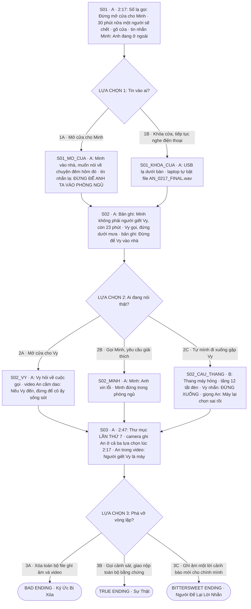

# KỊCH BẢN PHÂN NHÁNH — CUỘC GỌI CUỐI CÙNG (BẢN GỐC)

> Chuyển 1:1 từ `C:\Users\dan-ryu\phanh.kich ban fmv game\fmvcuoc goi cuoi cung.txt` sang khung Mức 1. Không thêm cảnh, lựa chọn, cờ hay kết. Mục nào bản gốc chưa có ghi "(bản gốc chưa ghi)".

| Thẻ tập | |
|---|---|
| Thị trường | (bản gốc chưa ghi) · tên nhân vật tiếng Việt |
| Thể loại · cơ chế | Psychological Thriller · Mystery · Interactive Drama · Một cô gái nhận cuộc gọi từ chính mình lúc 2:17 sáng: trong 30 phút, một người trong căn nhà sẽ chết. Mỗi lần cô thay đổi lựa chọn, ký ức về chính mình dần biến mất |
| Chế độ trạng thái | `free` (bản gốc không có cờ) |
| Bối cảnh chính | A: Căn hộ An (bàn làm việc + laptop, cửa ra vào, cửa phòng ngủ, cửa sổ nhìn xuống đường) · B: Hành lang + cầu thang bộ (tầng 12) · Ngoại lệ cho `END_TRUE_SU_THAT`: phòng thẩm vấn |
| Nhân vật | `an_nguyen` An (27, biên tập viên podcast, sống một mình; đeo tai nghe) · `minh_tran` Minh (người yêu cũ, bất ngờ xuất hiện giữa đêm; áo khoác ướt mưa) · `vy_le` Vy (bạn thân, liên tục gọi điện cầu cứu; ướt mưa) · Người gọi (giọng giống hệt An — chính An) |
| Cờ | Chưa có (bản gốc không có cờ) |
| Kết cục | `END_TRUE_SU_THAT` (True, chọn 3B) · `END_KY_UC_BI_XOA` (Bad, chọn 3A) · `END_LOI_NHAN` (Bittersweet, chọn 3C) |

### Sơ đồ phân nhánh

---

### S01 · Bối cảnh A · NỘI · CĂN HỘ AN · 2:17 SÁNG
**Nhân vật:** An (Người gọi qua điện thoại) · **Đạo cụ neo:** điện thoại hiện **"UNKNOWN NUMBER – 2:17 AM"**

Căn phòng tối. Ánh sáng duy nhất đến từ màn hình laptop đang phát một đoạn ghi âm chưa hoàn thành. An ngồi trước bàn, đeo tai nghe, tua lại đoạn âm thanh, cau mày. Chuông điện thoại reo: **UNKNOWN NUMBER – 2:17 AM**. An nhấc máy.

AN: "Alo?"

Đầu dây im lặng vài giây, rồi một giọng phụ nữ vang lên.

NGƯỜI GỌI: "An, nghe tôi nói. Đừng mở cửa cho Minh."
AN (bật cười, tưởng ai đùa): "Ai đấy? Minh nào?"
NGƯỜI GỌI: "Người đang đứng ngoài cửa nhà cô."

*Knock. Knock. Knock.* An nhìn về phía cửa, điện thoại vẫn áp tai.

AN: "…Ai đang gọi tôi?"
NGƯỜI GỌI: "Tôi là cô. Ba mươi phút nữa, một người sẽ chết. Nếu cô mở cửa, mọi chuyện sẽ bắt đầu lại."

Chuông cửa reo. Tin nhắn hiện lên: **MINH: "Anh đang ở ngoài. Mở cửa đi, anh cần nói chuyện với em."** An đứng bất động, nhìn màn hình rồi nhìn cửa.

**[LỰA CHỌN 1 — Tin vào ai?]**
* **1A (Mở cửa cho Minh)** → `S01_MO_CUA`: tin người mình quen biết, không tin cuộc gọi kỳ lạ.
* **1B (Khóa cửa, tiếp tục nghe điện thoại)** → `S01_KHOA_CUA`: tin lời cảnh báo của chính mình.

### S01_MO_CUA · Bối cảnh A · NỘI · CĂN HỘ AN · ĐÊM
**Nhân vật:** An, Minh · **Đạo cụ neo:** tin nhắn **"ĐỪNG ĐỂ ANH TA VÀO PHÒNG NGỦ."**, cửa phòng ngủ

An tắt điện thoại, tới mở khóa cửa. Minh đứng ngoài, áo khoác ướt mưa, mặt mệt mỏi.

MINH: "Cuối cùng em cũng chịu nghe máy."
AN: "Anh nhắn tin nói cần gặp em. Có chuyện gì?"

Minh bước vào, nhìn thấy laptop đang mở.

MINH: "Em vẫn làm cái podcast đó à?"
AN: "Anh đến đây để nói chuyện gì?"
MINH (ngập ngừng): "Anh nghĩ… chúng ta cần nói về chuyện đêm hôm đó."

Điện thoại An rung, tin nhắn từ số lạ: **"ĐỪNG ĐỂ ANH TA VÀO PHÒNG NGỦ."** An ngẩng đầu: Minh đang đứng ngay trước cửa phòng ngủ của cô.

→ `S02`.

### S01_KHOA_CUA · Bối cảnh A · NỘI · CĂN HỘ AN · ĐÊM
**Nhân vật:** An (Người gọi qua điện thoại) · **Đạo cụ neo:** USB dưới bàn, file **"AN_0217_FINAL.wav"**

An lùi khỏi cửa, khóa thêm chốt an toàn.

AN: "Tôi không mở cửa. Anh nói đi, Minh!"

Bên ngoài im lặng. Điện thoại vẫn kết nối.

NGƯỜI GỌI: "Tốt. Bây giờ hãy nhìn dưới bàn."

An cúi xuống: một chiếc USB nằm trên sàn, thứ cô chưa từng thấy.

AN: "Cái gì đây?"
NGƯỜI GỌI: "Đừng cắm nó vào máy tính. Nếu cô muốn biết sự thật, hãy nghe đoạn ghi âm tôi gửi."

Laptop tự bật. Một file audio xuất hiện: **AN_0217_FINAL.wav**. An nhấn Play. Giọng cô vang lên trong loa:

GIỌNG AN TRONG BẢN GHI: "Nếu mày đang nghe đoạn này, nghĩa là tao đã thất bại một lần nữa."

→ `S02`.

### S02 · Bối cảnh A · NỘI · CĂN HỘ AN · ĐÊM
**Nhân vật:** An (Vy qua điện thoại, đứng dưới đường) · **Đạo cụ neo:** laptop phát file ghi âm

*(Hội tụ từ cả hai nhánh SC01, một số chi tiết thay đổi tùy lựa chọn — bản gốc chưa ghi chi tiết nào.)*

An ngồi trước laptop. File ghi âm phát ra tiếng thở gấp của chính cô.

GIỌNG AN TRONG BẢN GHI: "Minh không phải người giết Vy. Nhưng anh ta biết ai đã làm. Mày có đúng 23 phút. Đừng tin bất cứ ai, kể cả tao."

An dừng file. Điện thoại rung: Vy gọi.

VY: "An? Mày đang ở nhà đúng không?"
AN: "Ừ. Sao thế?"
VY: "Tao đang ở dưới nhà mày. Có chuyện tao phải nói trực tiếp."

An nhìn ra cửa sổ: dưới đường, một người phụ nữ đứng trong mưa — Vy. Nhưng trên laptop, file ghi âm tiếp tục tự phát.

GIỌNG AN TRONG BẢN GHI: "Đừng để Vy vào nhà."

An nhìn màn hình, rồi nhìn người đang đứng ngoài cửa.

**[LỰA CHỌN 2 — Ai đang nói thật?]**
* **2A (Mở cửa cho Vy)** → `S02_VY`: tin người bạn thân, muốn nghe sự thật trực tiếp.
* **2B (Gọi Minh, yêu cầu anh giải thích)** → `S02_MINH`: đối chất với người đang bị nghi ngờ.
* **2C (Tự mình đi xuống gặp Vy)** → `S02_CAU_THANG`: không tin bất kỳ ai, tự tìm câu trả lời.

### S02_VY · Bối cảnh A · NỘI · CĂN HỘ AN · ĐÊM
**Nhân vật:** An, Vy · **Đạo cụ neo:** điện thoại của Vy phát video

Vy bước vào nhà, toàn thân ướt mưa.

VY: "Mày có nhận được cuộc gọi không?"

An chết lặng.

AN: "Cuộc gọi nào?"
VY (nhìn điện thoại của An): "Giọng của chính mày… đúng không?"

Vy đặt một chiếc điện thoại lên bàn, màn hình đang phát video: An đứng giữa căn phòng này, tay cầm một con dao, nhìn thẳng vào camera.

AN TRONG VIDEO: "Nếu Vy đến, đừng để cô ấy sống sót."

An lùi lại.

VY: "An… mày đã làm gì?"

→ `S03`.

### S02_MINH · Bối cảnh A · NỘI · CĂN HỘ AN · ĐÊM
**Nhân vật:** An, Minh · **Đạo cụ neo:** cửa phòng ngủ

Minh bắt máy ngay sau hồi chuông đầu tiên.

MINH: "An? Em ổn chứ?"
AN: "Vy đang ở dưới nhà. Bản ghi nói đừng tin cô ấy. Anh biết chuyện gì đang xảy ra không?"

Minh im lặng.

AN: "Minh?"
MINH: "Anh xin lỗi."

Cửa phòng ngủ bật mở. An quay đầu: Minh đang đứng trong phòng ngủ của cô, dù vài giây trước anh vẫn ở đầu dây bên kia.

→ `S03`.

### S02_CAU_THANG · Bối cảnh B · NỘI · HÀNH LANG + CẦU THANG BỘ · ĐÊM
**Nhân vật:** An · **Đạo cụ neo:** tin nhắn **"ĐỪNG XUỐNG. TAO KHÔNG Ở DƯỚI ĐÓ."**

An cầm chìa khóa, bước ra hành lang. Thang máy không hoạt động. Cô đi cầu thang bộ. Đến tầng 12, đèn đột ngột tắt. Điện thoại bật sáng, tin nhắn từ Vy: **"ĐỪNG XUỐNG. TAO KHÔNG Ở DƯỚI ĐÓ."** An dừng lại. Phía dưới cầu thang vang lên tiếng bước chân. Một giọng nói giống hệt cô:

GIỌNG AN: "Mày lại chọn sai rồi."

→ `S03`.

### S03 · Bối cảnh A · NỘI · CĂN HỘ AN · → 2:47
**Nhân vật:** An (An trong video) · **Đạo cụ neo:** laptop, thư mục khóa **"LẦN THỨ 7"**

Dù lựa chọn trước đó là gì, An cuối cùng cũng phát hiện laptop có một thư mục bị khóa: **"LẦN THỨ 7"**. Cô mở bằng mật khẩu được giấu trong file ghi âm. Bên trong là video từ camera an ninh của căn hộ, ghi lại những sự kiện đêm nay. An nhìn thấy mình:
- mở cửa cho Minh;
- nói chuyện với Vy;
- tự đi xuống cầu thang;
- và trong cả ba đoạn video, cô đều xuất hiện vào lúc 2:17 sáng.

Đoạn cuối: An ngồi trước laptop, nhìn thẳng vào camera.

AN TRONG VIDEO: "Đừng cố tìm người giết Vy nữa." *(cô ta mỉm cười)* "Người giết Vy… là mày."

Một tiếng động lớn vang lên ngoài phòng. An quay đầu. Căn phòng tối đen. Điện thoại sáng lên lần cuối: **2:47 AM**.

**[LỰA CHỌN 3 — Phá vỡ vòng lặp]**
* **3A (Xóa toàn bộ file ghi âm và video)** → `END_KY_UC_BI_XOA`: chấp nhận quên đi sự thật, tìm cách sống tiếp.
* **3B (Gọi cho cảnh sát, giao nộp toàn bộ bằng chứng)** → `END_TRUE_SU_THAT`: đối diện với sự thật, bất kể hậu quả.
* **3C (Ghi âm một lời cảnh báo mới cho chính mình)** → `END_LOI_NHAN`: thử thay đổi vòng lặp bằng một thông điệp khác.

---

### HỆ THỐNG KẾT CỤC
* **`END_TRUE_SU_THAT` · TRUE · SỰ THẬT** *(chọn 3B)*: An gọi cảnh sát và giao nộp toàn bộ bằng chứng. Khi cảnh sát đến, họ tìm thấy Vy còn sống trong căn hộ bên cạnh — bị thương nhưng sống sót. An bị đưa về đồn lấy lời khai. Trong phòng thẩm vấn, cô xem một đoạn video cuối cùng: bản ghi từ camera trước 2:17 sáng. An trong video nhìn vào ống kính: "Lần này… mày đã cứu được cô ấy." Màn hình tắt. *An đã phá vỡ vòng lặp. Nhưng cô không biết vòng lặp ấy bắt đầu từ đâu.* · chơi lại từ `S03` (bản gốc chưa ghi — đề xuất).
* **`END_KY_UC_BI_XOA` · BAD · KÝ ỨC BỊ XÓA** *(chọn 3A)*: An xóa toàn bộ file, tắt laptop, nằm xuống giường, nhắm mắt. Sáng hôm sau, điện thoại hiện 8:30 AM, tin nhắn từ Vy: "Tối qua mày đã làm gì vậy? Minh chết rồi." An không nhớ chuyện gì đã xảy ra. Điện thoại đổ chuông: **UNKNOWN NUMBER – 2:17 AM**. Cô nhấc máy. GIỌNG AN: "An, nghe tôi nói. Đừng mở cửa cho Minh." *Fade to black.* · chơi lại từ `S01` (vòng lặp quay lại cuộc gọi đầu).
* **`END_LOI_NHAN` · BITTERSWEET · NGƯỜI ĐỂ LẠI LỜI NHẮN** *(chọn 3C)*: An ghi âm một thông điệp mới: "Đừng cố cứu tất cả. Hãy cứu Vy. Đừng tin Minh. Và nếu mày nghe thấy giọng tao… hãy nhớ rằng mày vẫn có quyền lựa chọn." Cô gửi file đến một địa chỉ email không tồn tại. Sáng hôm sau, An biến mất. Nhiều tháng sau, Vy nhận một file âm thanh từ tài khoản lạ. Giọng An: "Tao xin lỗi. Tao không thể quay lại. Nhưng lần này, mày được sống." Vy bật khóc. *Fade out.* · chơi lại từ `S03` (bản gốc chưa ghi — đề xuất).

### Ước lượng thời lượng (cảnh ~35s, kết ~22s)
| Đường | Cảnh | Ước lượng |
|---|---|---|
| Mọi đường: `S01 → S01_x → S02 → S02_x → S03 → END` | 5 | ~197s |

### Ghi chú lệch chuẩn (giữ nguyên bản gốc, chưa sửa)
* **Lựa chọn 1 và 2 không đổi kết:** mọi nhánh hội tụ về `S03`, kết chỉ phụ thuộc lựa chọn 3. Bản gốc không có cờ — trước khi chuyển sang game (Mức 3) cần ít nhất 1 cờ được đặt và được đọc.
* **Thời lượng:** mọi đường ~3,3 phút (gợi ý trung vị 5 phút, ngắn nhất ≥ 3 phút).
* **Chưa có kết chết sớm**, nên lựa chọn 1–2 chưa có rủi ro thật.
* **Chi tiết gài chưa trả:** USB ("đừng cắm vào máy tính"), "chuyện đêm hôm đó", tin nhắn về phòng ngủ, mật khẩu thư mục (chưa nói là gì).
* **Mâu thuẫn cần biên kịch chốt:** bản ghi nói Vy đã bị giết nhưng Vy vẫn gọi điện và còn sống ở kết True · lời nhắn 3C "Đừng tin Minh" trái với "Minh không phải người giết Vy" · Minh vừa ở đầu dây vừa đứng trong phòng ngủ (2B) chưa được lý giải · ai đang đứng dưới mưa nếu Vy nhắn "TAO KHÔNG Ở DƯỚI ĐÓ" (2C).
* **Premise "ký ức mất dần"** chưa thành chi tiết trên hình (ngoài câu "Minh nào?" và kết 3A).
* **Bối cảnh:** bản gốc ghi "căn hộ, hành lang, cầu thang, phòng thẩm vấn"; Vy dưới mưa chỉ thấy qua cửa sổ, chưa tách thành bối cảnh riêng.
* **Điểm chơi lại** của `END_TRUE_SU_THAT` và `END_LOI_NHAN` do mình đề xuất, bản gốc chưa ghi.
