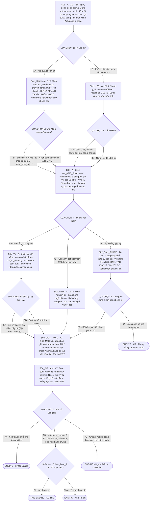

# KỊCH BẢN PHÂN NHÁNH — CUỘC GỌI CUỐI CÙNG · LẦN THỨ 7

> Nguồn: `C:\Users\dan-ryu\phanh.kich ban fmv game\fmvcuoc goi cuoi cung.txt`. Giữ các nhịp chính của bản gốc (cuộc gọi 2:17, Minh gõ cửa, USB, `AN_0217_FINAL.wav`, Vy dưới mưa, ba nhánh SC02, thư mục "LẦN THỨ 7", 2:47, ba lựa chọn cuối, ba kết gốc). Thêm cờ, luật vòng lặp, 1 kết chết và 1 kết sai để lựa chọn có hậu quả. Bản này khác truyện `cuoc_goi_cuoi_cung.md` (bản podcast/ngã tư) — không gộp.

| Thẻ tập | |
|---|---|
| Thị trường | TP.HCM, Việt Nam · tiền VND (bản gốc không ghi thành phố — tạm đặt; bản sản xuất viết tiếng Anh, giữ tên An / Minh / Vy) |
| Thể loại · cơ chế | Psychological Thriller · Mystery · Time-loop · *Nỗi sợ tự ứng nghiệm*: các lời cảnh báo An để lại cho chính mình mỗi vòng một sai lệch hơn, và chính nỗi sợ đó khiến An làm hại người cô muốn cứu. Muốn thoát vòng lặp, An phải tin người thật (Minh, Vy) hơn tin giọng nói của chính mình |
| Chế độ trạng thái | `free` (truyện vòng lặp, không theo khung điều tra `house`) |
| Bối cảnh chính | A: Căn hộ An 1503, tầng 15 (bàn làm việc + laptop, cửa ra vào có chốt an toàn, cửa phòng ngủ, cửa sổ nhìn xuống đường) · B: Hành lang tầng 15 + cầu thang bộ thoát hiểm (biển "TẦNG 12") · C: Lề đường trước tòa nhà trong mưa (chỉ cho cảnh Vy đứng dưới nhà) · Ngoại lệ cho `END_TRUE_SU_THAT`: phòng thẩm vấn đồn công an |
| Nhân vật | `an_nguyen` An (27, biên tập viên podcast, sống một mình; áo len rộng màu kem, tai nghe đen quàng cổ) · `minh_tran` Minh (30, người yêu cũ; áo khoác gió đen ướt mưa, **vết sẹo dài trên cẳng tay trái**) · `vy_le` Vy (27, bạn thân, làm ca đêm ở đài phát thanh, sống ở căn hộ 1504 bên cạnh; **áo mưa vàng**) · "Người gọi" = An của vòng trước (cùng diễn viên `an_nguyen`, biến thể `an_vong_6`: tóc buộc lệch, mắt thâm, vệt máu khô trên tay áo len) |
| Cờ | `bang_chung=true`: đặt ở **3A** (cắm USB) hoặc **5A** (giữ Vy, lấy video đầy đủ), đọc ở **7B** — gợi ý khóa: "Bạn không có bằng chứng nào trong tay — không ai tin một cuộc gọi lúc 2 giờ sáng." / "You have no proof — nobody believes a 2 a.m. phone call." · `dem_hom_do=true`: đặt ở **2A** (cho Minh vào phòng ngủ) hoặc **4B** (gọi Minh), đọc ở kiểm tra sau **7B** — gợi ý khi thiếu: "Minh biết vì sao bạn sợ bóng tối — bạn chưa để anh ấy nói." / "Minh knows why you fear the dark — you never let him tell you." |
| Kết cục | `END_TRUE_SU_THAT` (True, cần cả 2 cờ, chọn 7B) · `END_LOI_NHAN` (bittersweet, 7C) · `END_NGHI_PHAM` (sai — có bằng chứng nhưng thiếu `dem_hom_do`, 7B) · `END_KY_UC_BI_XOA` (vòng lặp — Karma, 7A, quay về `S01`, xóa cờ) · `END_CAU_THANG` (chết — Minh, 6A) |

### Sự thật phía sau (cho biên kịch — người chơi lần ra dần)
* **"Chuyện đêm hôm đó" (8 tháng trước):** một đêm mất điện, An lên cơn hoảng loạn trong bóng tối, cầm dao bếp rạch tay Minh vì tưởng kẻ đột nhập — vết sẹo trên cẳng tay trái Minh. Minh giấu chuyện, chia tay. Từ đó An ngủ với một con dao bếp dưới gối. Vy biết chuyện, thuê căn hộ 1504 sát vách để ở gần An, giữ chìa khóa dự phòng.
* **Đêm nay:** bão. 1:50 Vy (đang ca đêm) nhắn Minh: *"Bão sắp mất điện như lần đó. Chìa nhà em dưới thảm 1504, anh qua trông An giúp em."* 2:30 thang máy chết vì ngập. **2:47 trạm biến áp tòa nhà nổ, mất điện toàn tòa**; cùng lúc Vy trượt ngã trong căn hộ 1504 tối om, đập đầu.
* **Vòng 0:** nghe tiếng động sát vách, An cầm dao sang 1504 trong bóng tối, đâm vào người chạm vào mình — là Vy. Lúc 2:47, An bấm gọi số của chính mình. Cuộc gọi đến lúc 2:17. Vòng lặp bắt đầu.
* **Luật vòng lặp:** điện thoại, laptop và thứ An cầm trên tay lúc 2:47 đi theo sang vòng sau (USB, tệp ghi âm, video camera của bàn làm việc podcast, tin nhắn hẹn giờ). **Ký ức của An thì mất dần** — vì vậy lúc 2:17 cô hỏi "Minh nào?", không nhớ Vy sống sát vách, không nhớ đêm hôm đó. Mỗi An để lại lời cảnh báo theo kết luận sai của vòng mình: An vòng 6 nghi Minh ("Đừng mở cửa cho Minh"), An vòng 5 nghi Vy ("Đừng để Vy vào nhà").
* **Lớp đánh lạc hướng:** người chơi sẽ nghi Minh (tin nhắn "ĐỪNG ĐỂ ANH TA VÀO PHÒNG NGỦ", Minh xuất hiện trong phòng ngủ) rồi nghi Vy (video con dao). Thật ra Minh muốn vào phòng ngủ để **lấy con dao dưới gối đi**.

### Sơ đồ phân nhánh

---

### S01 · Bối cảnh A · NỘI · CĂN HỘ AN · 2:17 SÁNG
**Nhân vật:** An (giọng Người gọi qua điện thoại) · **Đạo cụ neo:** điện thoại hiện **"UNKNOWN NUMBER – 2:17 AM"**

Phòng tối, chỉ có màn hình laptop đang phát một đoạn ghi âm dựng dở. An đeo tai nghe, tua lại, cau mày. Điện thoại reo: **UNKNOWN NUMBER – 2:17 AM**. An nhấc máy.

AN: "Alo?"
NGƯỜI GỌI: "An, nghe tôi nói. Đừng mở cửa cho Minh."
AN (bật cười): "Ai đấy? Minh nào?"
NGƯỜI GỌI: "Người đang đứng ngoài cửa nhà cô."

*Knock. Knock. Knock.* An nhìn ra cửa, điện thoại vẫn áp tai.

NGƯỜI GỌI: "Tôi là cô. Ba mươi phút nữa, một người sẽ chết. Nếu cô mở cửa, mọi chuyện sẽ bắt đầu lại."

Tin nhắn hiện trên màn hình: **MINH: "Anh đang ở ngoài. Mở cửa đi, anh cần nói chuyện với em."** An đứng bất động — cô thật sự không nhớ người tên Minh.

**[LỰA CHỌN 1 — Tin vào ai?]**
* **1A (Tắt máy, mở khóa cửa cho Minh)** → `S01_MINH`: tin người quen hơn một cuộc gọi kỳ lạ.
* **1B (Lùi lại, gài thêm chốt an toàn, nghe tiếp điện thoại)** → `S01_USB`: tin lời cảnh báo của chính mình.

### S01_MINH · Bối cảnh A · NỘI · CĂN HỘ AN · 2:20
**Nhân vật:** An, Minh · **Đạo cụ neo:** cửa phòng ngủ (sau cánh cửa: con dao bếp dưới gối)

Minh đứng ngoài, áo khoác ướt mưa, mặt mệt mỏi.

MINH: "Cuối cùng em cũng chịu nghe máy."
AN: "Anh nhắn cần gặp em. Có chuyện gì?"

Minh bước vào, liếc laptop đang mở.

MINH: "Em vẫn làm cái podcast đó à?… Anh nghĩ chúng ta cần nói về chuyện đêm hôm đó."

Điện thoại An rung, tin nhắn từ số lạ: **"ĐỪNG ĐỂ ANH TA VÀO PHÒNG NGỦ."** An ngẩng lên: Minh đã đứng ngay trước cửa phòng ngủ, tay đặt trên nắm cửa.

**[LỰA CHỌN 2 — Cho Minh vào phòng ngủ?]**
* **2A (Gật đầu, để Minh mở cửa)** → `S02` · đặt `dem_hom_do`: Minh lật gối, rút ra con dao bếp. Anh kéo tay áo lên, để lộ vết sẹo: "Tám tháng trước, mất điện, em làm thế này với anh. Mỗi lần trời tối, em không còn là em." Anh bỏ dao vào túi áo khoác: "Anh qua nhà Vy bên cạnh. Có gì gọi anh."
* **2B (Đứng chắn cửa: "Anh ra khỏi nhà tôi ngay")** → `S02`: Minh nhìn cô rất lâu, rồi đi ra: "Anh ở nhà Vy bên cạnh. Đừng ngủ một mình đêm nay." Con dao vẫn nằm dưới gối.

### S01_USB · Bối cảnh A · NỘI · CĂN HỘ AN · 2:20
**Nhân vật:** An · **Đạo cụ neo:** USB đen (trước: nằm dưới gầm bàn · sau 3A: cắm vào laptop)

AN (nói qua cửa): "Tôi không mở cửa. Anh nói đi, Minh!" Bên ngoài im lặng. Điện thoại vẫn kết nối.

NGƯỜI GỌI: "Tốt. Bây giờ nhìn dưới bàn."

An cúi xuống: một chiếc USB nằm trên sàn, thứ cô chưa từng thấy.

AN: "Cái gì đây?"
NGƯỜI GỌI: "Đừng cắm nó vào máy tính. Muốn biết sự thật thì nghe đoạn ghi âm tôi gửi."

Cuộc gọi tắt. Ngoài cửa, tiếng bước chân Minh xa dần về phía căn hộ bên cạnh.

**[LỰA CHỌN 3 — Cắm USB?]**
* **3A (Cắm USB vào laptop, trái lời người gọi)** → `S02` · đặt `bang_chung`: trong USB là đoạn camera gốc của vòng 6 — hành lang tối, cửa căn hộ **1504** hé mở, đồng hồ góc hình **2:47**. An chép nó vào điện thoại.
* **3B (Nghe lời, để USB lại dưới bàn)** → `S02`.

### S02 · Bối cảnh A (+ C qua cửa sổ) · NỘI · CĂN HỘ AN · 2:24
**Nhân vật:** An (Vy dưới đường, cắt xen qua cửa sổ) · **Đạo cụ neo:** laptop phát tệp **"AN_0217_FINAL.wav"**

Laptop tự bật. Một tệp âm thanh hiện ra: **AN_0217_FINAL.wav**. An bấm Play. Giọng cô, thở gấp:

GIỌNG AN TRONG BẢN GHI: "Nếu mày đang nghe đoạn này, nghĩa là tao đã thất bại một lần nữa. Minh không phải người giết Vy. Nhưng anh ta biết ai đã làm. Mày có đúng 23 phút. Đừng tin bất cứ ai, kể cả tao. Mật khẩu là giờ cô ấy chết."

Điện thoại rung: **Vy** gọi.

VY: "An? Mày đang ở nhà đúng không? Tao đang ở dưới nhà mày. Có chuyện tao phải nói trực tiếp."

An nhìn qua cửa sổ: dưới đường, một người mặc áo mưa vàng đứng trong mưa. Laptop tự phát tiếp:

GIỌNG AN TRONG BẢN GHI: "Đừng để Vy vào nhà."

**[LỰA CHỌN 4 — Ai đang nói thật?]**
* **4A (Bấm mở cổng tòa nhà cho Vy lên)** → `S02_VY`.
* **4B (Gọi Minh, bắt anh giải thích)** → `S02_MINH` · đặt `dem_hom_do`.
* **4C (Không tin ai, tự xuống gặp Vy)** → `S02_CAU_THANG`.

### S02_VY · Bối cảnh A · NỘI · CĂN HỘ AN · 2:32
**Nhân vật:** An, Vy · **Đạo cụ neo:** điện thoại của Vy phát video (trong video: An cầm dao bếp)

Thang máy chết; Vy chạy bộ lên 15 tầng, áo mưa vàng nhỏ nước xuống sàn.

VY: "Mày có nhận được cuộc gọi không?"
AN: "…Cuộc gọi nào?"
VY: "Giọng của chính mày… đúng không?"

Vy đặt điện thoại lên bàn: một video gửi từ số của An lúc 2:05. Trong video, An đứng giữa chính căn phòng này, tay cầm con dao, nhìn thẳng vào camera.

AN TRONG VIDEO: "Nếu Vy đến, đừng để cô ấy sống sót."

An lùi lại.

VY: "An… mày đã làm gì?"

**[LỰA CHỌN 5 — Giữ Vy hay đuổi Vy?]**
* **5A (Nắm tay Vy: "Ở lại. Gửi tao cả đoạn video")** → `S03_LAN_THU_7` · đặt `bang_chung`: video đầy đủ dài hơn đoạn Vy xem — nửa sau là hành lang tối, cửa **1504**, **2:47**. Vy gửi xong thì sang nhà bên thay đồ: "Năm phút. Tao ở ngay sát vách."
* **5B ("Tránh xa tao ra. Về đi")** → `S03_LAN_THU_7`: Vy khóc, đi về căn hộ 1504 bên cạnh.

### S02_MINH · Bối cảnh A · NỘI · CĂN HỘ AN · 2:32
**Nhân vật:** An, Minh · **Đạo cụ neo:** con dao bếp dưới gối · vết sẹo trên cẳng tay trái Minh

Minh bắt máy ngay hồi chuông đầu.

MINH: "An? Em ổn chứ?"
AN: "Vy đang ở dưới nhà. Bản ghi nói đừng tin cô ấy. Anh biết chuyện gì đang xảy ra không?… Minh?"
MINH: "Anh xin lỗi."

Cửa phòng ngủ bật mở. Minh đứng trong phòng ngủ của cô — anh trèo từ ban công chung của căn 1504 sang, điện thoại vẫn áp tai. Anh lật gối, cầm con dao lên, kéo tay áo để lộ vết sẹo.

MINH: "Tám tháng trước, mất điện. Em làm thế này với anh. Anh giấu vì sợ em không chịu nổi."

Minh bỏ dao vào túi áo khoác, quay lại ban công sang chờ Vy ở 1504. *(Nếu đã đi 2A: con dao đã nằm trong túi Minh từ trước; anh chỉ nói thêm "Anh xin lỗi vì đã giấu em.")*

→ `S03_LAN_THU_7`.

### S02_CAU_THANG · Bối cảnh B · NỘI · CẦU THANG THOÁT HIỂM · 2:34
**Nhân vật:** An (Minh là bóng người phía dưới, chỉ lộ mặt ở nhánh 6B/kết) · **Đạo cụ neo:** biển tầng **"TẦNG 12"**, đèn pin điện thoại

An cầm chìa khóa ra hành lang. Thang máy không hoạt động. Cô đi cầu thang bộ. Tới **TẦNG 12**, đèn cảm ứng tắt phụt. Điện thoại sáng: tin nhắn từ Vy.

> **VY: "ĐỪNG XUỐNG. TAO KHÔNG Ở DƯỚI ĐÓ."** *(Vy đã lên bằng cầu thang phía bên kia tòa nhà.)*

Phía dưới vang lên tiếng bước chân đang đi lên. Điện thoại tự phát một tin nhắn thoại hẹn giờ, giọng giống hệt cô:

GIỌNG AN: "Mày lại chọn sai rồi."

**[LỰA CHỌN 6 — Có người đang đi lên trong bóng tối]**
* **6A (Lao xuống, xô thật mạnh bóng người)** → `END_CAU_THANG`.
* **6B (Bật đèn pin điện thoại, gọi: "Ai đó?")** → `S03_LAN_THU_7`: ánh đèn rọi vào Minh, ướt sũng, giơ hai tay. "Vy nhờ anh đi tìm em." Hai người quay lên tầng 15.

### S03_LAN_THU_7 · Bối cảnh A · NỘI · CĂN HỘ AN · 2:40
**Nhân vật:** An · **Đạo cụ neo:** laptop, thư mục khóa **"LẦN THỨ 7"**

Dù đi đường nào, An cũng quay lại bàn làm việc. Trên laptop có một thư mục bị khóa: **"LẦN THỨ 7"**. Mật khẩu "giờ cô ấy chết": An gõ **0247**. Thư mục mở.

Bên trong là các đoạn camera của bàn làm việc podcast, ghi lại chính đêm nay. An thấy mình:
- mở cửa cho Minh;
- nói chuyện với Vy;
- tự đi xuống cầu thang;
- và trong cả ba đoạn, góc hình đều chạy từ **2:17**.

Đoạn nào cũng dừng trước 2:47.

→ `S04_247`.

### S04_247 · Bối cảnh A · NỘI · CĂN HỘ AN · 2:46 → 2:47
**Nhân vật:** An (An vòng 6 trên màn hình laptop) · **Đạo cụ neo:** điện thoại hiện **"2:47 AM"**

Đoạn cuối cùng: An vòng 6 ngồi đúng chỗ này, tóc rối, vệt máu khô trên tay áo, nhìn thẳng vào camera.

AN TRONG VIDEO: "Đừng cố tìm người giết Vy nữa." *(cô ta mỉm cười)* "Người giết Vy… là mày."

Một tiếng nổ lớn ngoài trời. Cả căn phòng tối đen. Sau bức vách phía căn 1504: một tiếng ngã nặng, rồi tiếng rên. Điện thoại sáng lên lần cuối: **2:47 AM**. *(Nếu chưa có `dem_hom_do`: tay An tự tìm về phía phòng ngủ, nơi con dao vẫn nằm dưới gối.)*

**[LỰA CHỌN 7 — Phá vỡ vòng lặp]**
* **7A (Xóa toàn bộ file ghi âm và video)** → `END_KY_UC_BI_XOA`: chấp nhận quên, cố sống tiếp.
* **7B (Cần `bang_chung` — gọi cảnh sát và cấp cứu, giao nộp toàn bộ bằng chứng)** → kiểm tra `dem_hom_do`: có → `END_TRUE_SU_THAT`; chưa có → `END_NGHI_PHAM`. *Khóa khi thiếu cờ: "Bạn không có bằng chứng nào trong tay — không ai tin một cuộc gọi lúc 2 giờ sáng."*
* **7C (Ghi âm một lời cảnh báo mới cho chính mình)** → `END_LOI_NHAN`.

---

### HỆ THỐNG KẾT CỤC
* **`END_TRUE_SU_THAT` · TRUE · SỰ THẬT** *(cần `bang_chung` + `dem_hom_do`, chọn 7B)*: An gọi cấp cứu và cảnh sát, nói rõ: "Căn 1504, có người bị ngã." Cô để con dao lại — hai tay trống, chỉ cầm đèn pin điện thoại — sang gõ cửa nhà bên. Cảnh sát tới, tìm thấy Vy còn sống trong căn hộ bên cạnh: bị thương ở đầu, Minh đang cầm máu cho cô. Trong phòng thẩm vấn, An xem đoạn video cuối cùng — camera ghi **trước 2:17**. An trong video nhìn vào ống kính: "Lần này… mày đã cứu được cô ấy." Màn hình tắt. *An đã phá vỡ vòng lặp. Nhưng cô không biết vòng lặp ấy bắt đầu từ đâu.* · chơi lại từ `S04_247`.
* **`END_LOI_NHAN` · BITTERSWEET · NGƯỜI ĐỂ LẠI LỜI NHẮN** *(chọn 7C)*: An thu một thông điệp mới: "Đừng cố cứu tất cả. Hãy cứu Vy. Đừng tin những cuộc gọi. Và nếu mày nghe thấy giọng tao… hãy nhớ rằng mày vẫn có quyền lựa chọn." Cô gửi tệp tới một địa chỉ email không tồn tại. Sáng hôm sau, An biến mất. Nhiều tháng sau, Vy nhận một tệp âm thanh từ tài khoản lạ: "Tao xin lỗi. Tao không thể quay lại. Nhưng lần này, mày được sống." Vy bật khóc. *Fade out.* · chơi lại từ `S04_247`.
* **`END_NGHI_PHAM` · SAI · NGHI PHẠM** *(có `bang_chung`, thiếu `dem_hom_do`, chọn 7B)*: An gọi cảnh sát, báo căn 1504. Nhưng trong bóng tối, cô vẫn rút con dao dưới gối "để phòng thân" rồi sang nhà bên. Đèn pin cảnh sát rọi vào: An đứng cạnh Vy đang bất tỉnh, tay cầm dao. Vy sống, nhưng bảy vòng video trong máy An trở thành bằng chứng chống lại cô. Hình cuối: điện thoại An trong túi tang vật sáng lên — **UNKNOWN NUMBER – 2:17 AM** · chơi lại từ `S02` (gợi ý: "Minh biết vì sao bạn sợ bóng tối…").
* **`END_KY_UC_BI_XOA` · KARMA · KÝ ỨC BỊ XÓA** *(chọn 7A)*: An xóa sạch, tắt laptop, nằm xuống giường. Sáng ra, điện thoại báo 8:30 AM, tin nhắn từ Vy: "Tối qua mày đã làm gì vậy? Minh chết rồi." An không nhớ gì. Điện thoại đổ chuông: **UNKNOWN NUMBER – 2:17 AM**. GIỌNG AN: "An, nghe tôi nói. Đừng mở cửa cho Minh." *Fade to black.* · chơi lại từ `S01` (xóa toàn bộ cờ).
* **`END_CAU_THANG` · CHẾT · CẦU THANG TẦNG 12** *(chọn 6A)*: Bóng người ngã ngửa xuống nửa đợt cầu thang. Đèn pin rọi xuống: Minh, cẳng tay trái lộ vết sẹo, không cử động. Hình cuối: biển **"TẦNG 12"**, điện thoại trong tay An hiện **2:47 AM** — ngón cái cô đã bấm gọi số của chính mình · chơi lại từ `S02_CAU_THANG`.

### Ước lượng thời lượng (cảnh ~35s, kết ~22s)
| Đường | Cảnh | Ước lượng |
|---|---|---|
| Ngắn nhất: `S01 → S01_MINH → S02 → S02_CAU_THANG → END_CAU_THANG` | 4 | ~162s |
| True qua USB: `S01 → S01_USB → S02 → S02_MINH → S03_LAN_THU_7 → S04_247 → END_TRUE` | 6 | ~232s |
| True qua Minh + Vy: `S01 → S01_MINH → S02 → S02_VY → S03_LAN_THU_7 → S04_247 → END_TRUE` | 6 | ~232s |
| Mọi đường tới lựa chọn 7 | 6 | ~232s |

### Ghi chú lệch chuẩn
* **Thời lượng:** trung vị khoảng 3,9 phút (gợi ý 5 phút); đường ngắn nhất ~2,7 phút (gợi ý ≥3 phút) vì kết chết ở cầu thang là cú phạt của lối "không tin ai". Giữ nguyên, không độn cảnh. Nếu muốn kéo dài: thêm cảnh hồi tưởng "đêm hôm đó" khi Minh kể (2A/4B), hoặc cảnh An sang gõ cửa 1504 trước kết True.
* **Thay đổi so với bản gốc:** SC03 gốc tách thành 2 node (`S03_LAN_THU_7`, `S04_247`) vì quá dài cho 1 cảnh, không thêm nội dung · thêm lựa chọn phụ ở 3 nhánh (2, 3, 5, 6) để cờ có chỗ đặt · thêm 2 kết `END_NGHI_PHAM`, `END_CAU_THANG` · lời nhắn ở `END_LOI_NHAN` đổi "Đừng tin Minh" → "Đừng tin những cuộc gọi" (bản gốc mâu thuẫn với "Minh không phải người giết Vy") · thêm câu "Mật khẩu là giờ cô ấy chết" vào bản ghi để mật khẩu 0247 có nguồn · lý giải "Minh trong phòng ngủ" bằng ban công chung với căn 1504.
* **Premise "ký ức mất dần":** không làm thanh chỉ số (cấm theo mẫu); thể hiện bằng chi tiết An không nhớ Minh, không nhớ Vy sống sát vách, và `END_KY_UC_BI_XOA`.
* **Nhân vật:** 3 nhân vật có tên (gợi ý 4). "Người gọi" là `an_nguyen` biến thể `an_vong_6`, không phải nhân vật mới. Cảnh An xem video chính mình: 1 nhân vật, không vượt giới hạn 2 người có tên/khung.
* **Bối cảnh:** 3 bối cảnh chính (A, B, C) + ngoại lệ phòng thẩm vấn cho `END_TRUE_SU_THAT`. C chỉ dùng cho shot Vy dưới mưa ở `S02`; có thể bỏ nếu chỉ cho nghe giọng Vy qua điện thoại.
* **Hai node không có lựa chọn** (`S02_MINH`, `S03_LAN_THU_7`) đi thẳng sang node sau.
* **Khóa chữ trên hình:** "UNKNOWN NUMBER – 2:17 AM", "AN_0217_FINAL.wav", "ĐỪNG ĐỂ ANH TA VÀO PHÒNG NGỦ", "ĐỪNG XUỐNG. TAO KHÔNG Ở DƯỚI ĐÓ.", "TẦNG 12", "LẦN THỨ 7", "1504", "2:47 AM".
* **Đạo cụ đổi trạng thái:** con dao bếp (dưới gối → túi áo Minh khi có `dem_hom_do`; còn dưới gối khi không có) — cần 2 ảnh tham chiếu riêng; USB (dưới gầm bàn → cắm vào laptop).
