# KỊCH BẢN PHÂN NHÁNH — ĐÊM THỨ 7 TRONG TÒA NHÀ BỎ HOANG

> Nguồn: `C:\Users\dan-ryu\kich_ban_ai_ma\Đêm thứ 7 trong tòa nhà bỏ hoang.docx`. Giữ nguyên 10 nút thắt, 20 lựa chọn, 4 kết cục (A, B, C, Ẩn), character bible và lời thoại của bản gốc. Phần thêm vào: lý giải tên truyện "Đêm thứ 7", "sự thật phía sau", 3 cờ đúng/sai thay cho "% ký ức", các đạo cụ cần cài trước cho cao trào. Mọi thay đổi ghi ở cuối file.

| Thẻ tập | |
|---|---|
| Thị trường | Ngoại ô TP.HCM, Việt Nam · tiền VND (bản sản xuất viết tiếng Anh, giữ tên Minh / Lan) |
| Thể loại · cơ chế | Kinh dị tâm linh · Ngôi nhà ăn ký ức · *Mỗi lối thoát đều có giá*: tòa nhà muốn ký ức của Minh và giả giọng người cậu thương để lấy được nó. Chỉ khi Minh biết sự thật (Lan đã mất, chính cậu đã mất) và không đánh động tòa nhà, cậu mới được thấy toàn bộ sự thật |
| Chế độ trạng thái | `free` (truyện kinh dị theo hành trình, không dạng "điều tra 2 manh mối" của `house`) |
| Bối cảnh chính | A: Hành lang chung cư (tầng 6 chỉ có ánh đèn flash điện thoại; tầng 7 có đèn Exit đỏ, tấm gương nứt, tủ cứu hỏa, cửa thang máy kẹt, cầu thang bộ chất xà bần; cùng một kiến trúc, hai trạng thái ánh sáng) · B: Tầng trệt (sảnh, cửa sắt có hốc đen, phòng bảo vệ, phòng kỹ thuật có bình gas, đáy giếng trời) · C: Tầng hầm giữ xe ngập nước · D: Sân thượng tầng 12 + phòng máy thang máy · Ngoại lệ cho `END_KE_VO_DANH` và cảnh toàn của `END_GIAI_THOAT`: vỉa hè trước tòa nhà lúc bình minh |
| Nhân vật | `minh_tran` Trần Hoàng Minh (22, SV năm cuối Kiến trúc, POV; hoodie xám chì sờn cổ tay, quần cargo màu rêu, **sẹo chữ V ở mu bàn tay trái**, nhẫn bạc ngón trỏ phải, DSLR có dây thêu **"M.H"**) · `lan_bach` Lan (22, bạn thân; họ tạm đặt. Ngoài đời: cardigan kem, tóc nâu hạt dẻ buộc nửa đầu bằng scrunchie, **nốt ruồi son dưới khóe môi trái**, **vết hằn dây truyền dịch ở cổ tay trái**. Bản ma: cùng bộ đồ nhưng ướt bẩn, xám tro, chân trần) · `ong_bao_ve` Ông Tư bảo vệ (khoảng 68; đồng phục xanh dương bạc màu cài lệch cúc, **nửa mặt phải mục như vỏ cây**, chùm chìa khóa rỉ sét, đèn pin vỏ kim loại ánh vàng) · Vai phụ không tên `cu_dan_tang_7` (bóng người không mặt, cao lêu nghêu, pijama sọc xanh rách, ngón tay dài đen muội; hiện nguyên hình là một cô gái trẻ đang khóc) |
| Cờ là gì? | Cờ là điều người chơi đã biết hoặc đã làm. Game tự nhớ để mở hoặc khóa lựa chọn về sau, không hiện thanh điểm. **LAN ĐÃ MẤT** (`lan_da_mat`): Minh biết người gọi không thể là Lan thật. **TÒA NHÀ NỔI GIẬN** (`toa_nha_noi_gian`): Minh đã dùng bạo lực ở tầng 7, tòa nhà bịt kín mọi cửa sổ. **THẺ SINH VIÊN** (`the_sinh_vien`): Minh đang cầm tấm thẻ ghi ngày mất của chính mình |
| Cờ | `lan_da_mat=true`: đặt ở **1B** (tin nhắn chia buồn) hoặc **4B** (cư dân tầng 7: "Lan chết rồi"), đọc ở **9B**. Gợi ý khi khóa: "Bạn vẫn tin đây là Lan — chưa có gì cho bạn biết cô ấy đã mất." / "You still believe this is Lan — nothing has told you she is gone." · `toa_nha_noi_gian=true`: đặt ở **4A**, đọc ở **10A**. Gợi ý khi khóa: "Cửa sổ đã bị bê tông bịt kín — tòa nhà chưa quên đòn tấn công ở tầng 7." / "The window is sealed in concrete — the building remembers the attack on floor 7." · `the_sinh_vien=true`: đặt ở **6B**, đọc ở kiểm tra sau **10A** (có → kết Ẩn, không có → kết A) |
| Kết cục | `END_TRUE_VONG_LAP` (True · Kết thúc Ẩn, cần `the_sinh_vien`, chọn 10A) · `END_KE_VO_DANH` (Kết thúc A · thoát giả, mất ký ức, chọn 10A khi thiếu thẻ) · `END_GIAI_THOAT` (Kết thúc C · bittersweet, 8B hoặc 9B) · `END_CU_DAN_MOI` (Kết thúc B · Karma, 9A hoặc 10B) |

### Sự thật phía sau (cho biên kịch — người chơi lần ra dần)
* **Tòa nhà:** chung cư 12 tầng ở ngoại ô Sài Gòn, bị niêm phong chờ phá dỡ. Nó là một thực thể ký sinh, sống nhờ **ký ức** của những người chết bên trong. Ai trả hết ký ức sẽ không còn mặt, ở lại làm "cư dân" và thì thầm trong tường để dụ người mới vào.
* **Lan:** mất **7 ngày trước** (07/11/2026) ở bệnh viện, nên cổ tay còn vết hằn dây truyền dịch. Hồi nhỏ Lan sống ở **phòng 704** của tòa nhà này. Trước khi mất, Lan nhờ Minh chụp lại căn 704 trước khi tòa nhà bị phá. **Đêm nay là đêm thứ 7 (đầu thất) của Lan:** theo tín ngưỡng, hồn người mất về thăm nhà. Lan trở về căn 704 thì bị tòa nhà giữ lại. Từ đó tòa nhà chiếm giọng Lan để gọi cho Minh. Giọng qua điện thoại là giọng Lan thật nhưng lời nói là của tòa nhà, nên lúc ấm áp, lúc van nài quá mức, lúc gắt gỏng.
* **Minh:** vào tòa nhà lúc chiều tối 14/11/2026 để chụp đồ án tốt nghiệp và giữ lời hứa với Lan. **21:00, Minh trượt chân rơi xuống giếng trời từ tầng 12 và chết.** Mọi chuyện từ 23:59 trở đi là hồn Minh mắc kẹt trong tòa nhà. Minh không biết mình đã chết. Các dấu hiệu: xe máy phủ bụi như đã nằm đó nhiều năm (thời gian trong tòa nhà không trôi như bên ngoài), câu hỏi của ông bảo vệ, tấm thẻ sinh viên ghi ngày mất.
* **Dòng chữ máu "ĐỪNG NGHE MÁY NẾU CÔ ẤY GỌI":** do chính Minh viết ở một vòng trước. Chỉ kết Ẩn mới cho thấy điều này.
* **Ông Tư bảo vệ:** người gác cuối cùng, chết trong tòa nhà. Ông vẫn giữ trật tự và giữ "bến đò": ai muốn đi qua cửa sắt phải trả ký ức.
* **Cư dân tầng 7:** một nạn nhân cũ đã trả hết ký ức, giờ không còn mặt. Nếu bị đối xử bằng bạo lực, cô bị tòa nhà điều khiển. Nếu được đối diện bằng sự bình tĩnh, cô nói thật.
* **Các lối ra:** `END_KE_VO_DANH` là ảo ảnh tòa nhà dựng cho người đã quên hết: tưởng mình thoát ra nắng nhưng thật ra vẫn ở trong, nên bóng không mặt ở tầng 7 vẫy chào. `END_TRUE_VONG_LAP` là sự thật đằng sau ảo ảnh đó. `END_GIAI_THOAT` là cách duy nhất giải phóng mọi linh hồn, kể cả Lan. `END_CU_DAN_MOI` là cái giá của việc buông xuôi.

### Sơ đồ phân nhánh

```mermaid
flowchart TD
    S1["S01 · A · Tầng 6 · 23:59: Tối đen, tiếng thở dốc · flash bật, tường cào cấu, chữ máu ĐỪNG NGHE MÁY NẾU CÔ ẤY GỌI · điện thoại rung: LAN (Bạn thân)"] --> C1{"LỰA CHỌN 1: Lan gọi lúc nửa đêm. Nghe hay không?"}
    C1 -->|"1A · Nghe máy: Lan bảo chạy lên tầng 7, Minh quên mất mình đến đây làm gì"| S2["S02 · A · Cầu thang bộ: Tiếng bước chân nặng nề kéo lê chùm chìa khóa đi lên từ tầng 5"]
    C1 -->|"1B · Tắt máy, bật chế độ máy bay (đặt cờ LAN ĐÃ MẤT: tin nhắn Chia buồn cùng gia đình Lan)"| S2

    S2 --> C2{"LỰA CHỌN 2: Chạy đi đâu?"}
    C2 -->|"2A · Chạy lên tầng 7"| S3["S03 · A · Tầng 7: Đèn Exit đỏ, cửa sắt sập sau lưng · tường thì thầm: Đưa kỷ niệm cho bọn tao, tao chỉ đường ra"]
    C2 -->|"2B · Lách xuống tầng hầm trốn tiếng chìa khóa"| SH["S02_HAM · C · Hầm xe ngập nước: Xe máy của Minh phủ bụi và mạng nhện như đã nằm đó nhiều năm"]

    S3 --> C3{"LỰA CHỌN 3: Nghe theo tiếng thì thầm?"}
    C3 -->|"3A · Lắng nghe và làm theo: tường nứt mở lối vào phòng 704, Minh quên mặt mẹ"| S4["S04 · A · Tầng 7: Bóng người không mặt mặc pijama sọc quay lại, giơ tay chỉ về phía thang máy"]
    C3 -->|"3B · Bịt tai, đập tủ cứu hỏa lấy rìu: giữ được ký ức nhưng đánh thức thứ ở cuối hành lang"| S4

    S4 --> C4{"LỰA CHỌN 4: Đối mặt Cư dân tầng 7"}
    C4 -->|"4A · Lao tới tấn công (đặt cờ TÒA NHÀ NỔI GIẬN: bê tông bịt kín mọi cửa sổ)"| S5["S05 · A · Tầng 7: Điện thoại reo lại dù đang tắt hoặc ở chế độ máy bay · Lan gào: Ném cái điện thoại đi"]
    C4 -->|"4B · Giơ máy ảnh lên chụp (đặt cờ LAN ĐÃ MẤT: cô gái trong ảnh nói Lan chết rồi, đừng tin điện thoại)"| S5

    S5 --> C5{"LỰA CHỌN 5: Vật tế ký ức"}
    C5 -->|"5A · Ném vỡ điện thoại: nhẹ nhõm, nhưng quên tên mình"| S6["S06 · A · Tầng 7: Cửa thang máy kẹt cứng · cầu thang bộ bị xà bần chặn"]
    C5 -->|"5B · Giữ chặt điện thoại: mặt Lan trong ảnh nền biến dạng, máy nóng ran hút một phần hồn"| S6

    S6 --> C6{"LỰA CHỌN 6: Lối xuống"}
    C6 -->|"6A · Cạy cửa thang máy, đu dây cáp xuống tầng trệt"| S7["S07 · B · Sảnh tầng trệt: Ông bảo vệ nửa mặt mục rữa, đèn pin vàng, chùm chìa khóa · phòng kỹ thuật hé cửa, mùi gas · Cậu không thuộc về nơi này, hay là cậu đã ở đây lâu rồi?"]
    C6 -->|"6B · Bới xà bần (đặt cờ THẺ SINH VIÊN: Trần Hoàng Minh, Ngày mất 14/11/2026)"| S7

    SH --> S7

    S7 --> C7{"LỰA CHỌN 7: Tin người gác đêm?"}
    C7 -->|"7A · Tin ông, tiến lại xin chìa khóa"| S8["S08 · B · Cửa sắt: Ổ khóa không có lỗ chìa, chỉ là một hốc đen · Tòa nhà: Đưa thứ quý giá nhất của ngươi đây"]
    C7 -->|"7B · Hoảng sợ, chạy ngược lên sân thượng"| S9["S09 · D · Sân thượng tầng 12: Gió rít, mép vực · bóng ma Lan đưa tay: Ở lại đây với tao đi Minh"]

    S8 --> C8{"LỰA CHỌN 8: Cái giá của tự do"}
    C8 -->|"8A · Đặt tay vào hốc, hy sinh ký ức về người thân và Lan"| S10["S10 · B · Phòng bảo vệ · bình minh: Bước qua cửa sắt lại vào phòng bảo vệ · nắng đầu ngày hắt qua cửa sổ bám bụi, ngoài kia tiếng xe Sài Gòn"]
    C8 -->|"8B · Từ chối, xông vào phòng kỹ thuật phá lõi tòa nhà"| E_C(["ENDING · Sự Giải Thoát"])

    S9 --> C9{"LỰA CHỌN 9: Lời mời trên sân thượng"}
    C9 -->|"9A · Nắm lấy tay Lan"| E_B(["ENDING · Tiếng Thì Thầm Mới"])
    C9 -->|"9B · (cần cờ LAN ĐÃ MẤT: đi 1B hoặc 4B) Đẩy Lan ra: Mày không phải Lan! Đu cáp thang máy xuống phá lõi"| E_C

    S10 --> C10{"LỰA CHỌN 10: Ánh sáng ngoài kia"}
    C10 -->|"10A · (cần chưa có cờ TÒA NHÀ NỔI GIẬN: không đi 4A) Đập vỡ cửa sổ, lao ra nắng"| CHK{"Kiểm tra: có cờ THẺ SINH VIÊN (đi 6B)?"}
    C10 -->|"10B · Khóa chặt cửa sổ, kéo rèm che nắng"| E_B

    CHK -->|"Có cờ THẺ SINH VIÊN"| E_TRUE(["TRUE ENDING · Vòng Lặp Định Mệnh (Kết thúc Ẩn)"])
    CHK -->|"Chưa có cờ THẺ SINH VIÊN"| E_A(["ENDING · Kẻ Vô Danh Dưới Ánh Mặt Trời"])
```

---

### S01 · Bối cảnh A · NỘI · HÀNH LANG TẦNG 6 · 23:59
**Nhân vật:** Minh (POV), Lan (giọng qua điện thoại nếu chọn 1A) · **Đạo cụ neo:** điện thoại hiện cuộc gọi đến **"LAN (Bạn thân)"** · Đạo cụ cài trước: **bật lửa** trong túi quần cargo

Màn hình tối đen. Tiếng thở dốc dồn dập. Đèn flash điện thoại bật sáng lóa, chiếu thẳng vào bức tường bê tông ẩm mốc đầy vết cào. Trên tường, chữ máu khô: **"ĐỪNG NGHE MÁY NẾU CÔ ẤY GỌI"**. Flash chập chờn. Minh lôi bật lửa trong túi cargo ra, bật lên soi cho rõ dòng chữ. Nét chữ in hoa đều tăm tắp như chữ trên bản vẽ. Điện thoại rung bần bật trên nền bê tông: **LAN (Bạn thân)**.

Chữ trên màn hình (glitch): **Bạn đang ở tầng 6 một chung cư bỏ hoang. 23:59. Bạn làm gì?**

**[LỰA CHỌN 1 — Cuộc gọi lúc nửa đêm]**
* **1A (Nghe máy)** → `S02`: LAN (rè như qua một lớp nước): "Minh… Minh hả? Nghe tao nói đi, đừng xuống tầng trệt! Ông bảo vệ khóa cổng rồi… Lên tầng 7 đi, ban công bên đó thông qua nhà kế bên. Nhanh lên…" Đầu Minh nhói lên. MINH (nội tâm): "Khoan… mình vô đây làm gì ấy nhỉ? Chụp ảnh đồ án… ờ, đồ án gì ta?"
* **1B (Tắt máy, bật chế độ máy bay)** → `S02` · đặt cờ `lan_da_mat` (LAN ĐÃ MẤT): MINH (lẩm bẩm): "Đêm hôm khuya khoắt gọi cái gì… Tắt máy cho yên chuyện." Màn hình tự sáng lại, mở ra một tin nhắn nháp chưa từng gửi, đề ngày 7 ngày trước: **"Chia buồn cùng gia đình Lan…"**. Minh rùng mình. Có thứ gì đó đang giả giọng Lan.

### S02 · Bối cảnh A · NỘI · ĐẦU CẦU THANG BỘ TẦNG 6
**Nhân vật:** Minh (POV) · **Đạo cụ neo:** chùm chìa khóa (chỉ nghe tiếng, chưa thấy người)

Cuối hành lang là cầu thang bộ tối om. Từ tầng 5 vọng lên tiếng bước chân nặng nề, tiếng chùm chìa khóa kéo lê leng keng trên từng bậc. Ánh đèn pin vàng vọt quét qua chiếu nghỉ bên dưới. Nếu đi 1A thì lời Lan vẫn còn vang trong đầu: *lên tầng 7*. Lối xuống hầm là một khe hở trên lan can, đen ngòm và có mùi nước tù.

**[LỰA CHỌN 2 — Ngã rẽ sinh tử]**
* **2A (Chạy lên tầng 7)** → `S03`: MINH (thở dốc): "Lên tầng 7 trước đã. Đừng có ngoái lại." Cánh cửa sắt hành lang tầng 7 tự đóng sầm sau lưng. "Chết tiệt… kẹt rồi!"
* **2B (Lách qua khe lan can, chạy xuống tầng hầm)** → `S02_HAM`: MINH (thì thầm): "Xuống hầm trốn tiếng chìa khóa. Yên tĩnh chút nào…"

### S02_HAM · Bối cảnh C · NỘI · TẦNG HẦM GIỮ XE NGẬP NƯỚC
**Nhân vật:** Minh (POV) · **Đạo cụ neo:** xe máy của Minh (dán decal đồ án **"M.H"** ở yếm xe, phủ bụi dày và mạng nhện)

Nước ngập tới mắt cá chân, lạnh buốt. Flash quét qua hàng xe mục nát rồi dừng lại ở một chiếc rất quen: xe của chính Minh, decal **"M.H"** vẫn còn, nhưng bụi phủ dày cả đốt ngón tay và mạng nhện giăng kín tay lái, như đã nằm đây hàng năm trời. Minh mới dựng nó ở đây lúc chiều.

MINH: "Xe tao… sao lại đóng bụi như mấy năm rồi vậy?"

Trên đầu, tiếng chìa khóa đã dừng ở miệng hầm. Lối duy nhất còn lại là đường dốc dẫn lên sảnh tầng trệt. → `S07`.

### S03 · Bối cảnh A · NỘI · HÀNH LANG TẦNG 7
**Nhân vật:** Minh (POV), "Tường" (đồng thanh, chỉ có tiếng) · **Đạo cụ neo:** tủ cứu hỏa có rìu (kính nguyên)

Hành lang tầng 7 chìm trong ánh đèn Exit đỏ quạch. Ban công "thông sang nhà bên" mà Lan nói tới đã bị xây kín bằng gạch. Minh áp tai vào tường và nghe hàng chục giọng người thì thầm cùng một lúc.

TƯỜNG (đồng thanh, trầm thấp): "Đưa tao một mảnh ký ức… tao mở cửa cho… chỉ một chút thôi…"

**[LỰA CHỌN 3 — Tiếng thì thầm trong tường]**
* **3A (Lắng nghe và làm theo)** → `S04`: bức tường nứt toác, lộ lối đi bí mật vào **phòng 704**, nơi chỉ còn một tấm ảnh gia đình bạc màu dán trên tủ lạnh, là nhà cũ của Lan. Đổi lại, MINH (ngơ ngác): "Mẹ… mẹ tên gì ấy nhỉ? Gương mặt… sao mờ thế?"
* **3B (Bịt tai, đập vỡ tủ cứu hỏa lấy rìu)** → `S04`: kính tủ vỡ vụn, Minh cầm chiếc rìu nặng trịch (tủ sau đó: kính vỡ, trống rỗng). MINH (nghiến răng): "Đừng có lừa tao. Có rìu trong tay thì đỡ sợ hơn chút." Cuối hành lang vang lên tiếng gầm. "Chết rồi, ồn quá!"

### S04 · Bối cảnh A · NỘI · HÀNH LANG TẦNG 7
**Nhân vật:** Minh (POV), Cư dân tầng 7 (vai phụ không tên) · **Đạo cụ neo:** máy ảnh DSLR dây thêu **"M.H"**

Giữa hành lang, một bóng người cao lêu nghêu mặc pijama sọc xanh rách tươm từ từ quay lại. Không có mắt, không có mũi, không có miệng, chỉ là một mảng da xám láng như vữa chưa khô, rỉ ra vệt dịch sẫm màu. Nó giơ một ngón tay dài, đen muội, chỉ về phía thang máy. Lồng ngực nó phập phồng, khò khè, lệch nhịp với cử động.

**[LỰA CHỌN 4 — Cư dân tầng 7]**
* **4A (Lao tới tấn công: bằng rìu nếu đi 3B, bằng chân máy ảnh nếu đi 3A)** → `S05` · đặt cờ `toa_nha_noi_gian` (TÒA NHÀ NỔI GIẬN): MINH (gào): "Tránh ra!" Đòn đánh xuyên qua không khí, bóng đen tan thành khói, rít lên "KHHHHHH—!" Cả tòa nhà rung chuyển. TÒA NHÀ (tiếng bê tông rạn nứt trầm đục): "Kẻ xâm nhập… phá vỡ trật tự…" Ở cuối hành lang, bê tông mọc ra như rễ cây, bịt kín từng ô cửa sổ.
* **4B (Bình tĩnh, giơ máy ảnh lên chụp)** → `S05` · đặt cờ `lan_da_mat` (LAN ĐÃ MẤT): MINH (giọng run nhưng giữ nhịp): "Cô… cô là ai? Đừng lại gần." Flash lóe lên. Trên màn hình máy ảnh, bóng đen hiện nguyên hình là một cô gái trẻ đang khóc. CƯ DÂN TẦNG 7 (nức nở): "Lan chết rồi… đừng tin điện thoại… nhìn xuống hố thang máy đi…"

### S05 · Bối cảnh A · NỘI · HÀNH LANG TẦNG 7
**Nhân vật:** Minh (POV), Lan (giọng qua điện thoại) · **Đạo cụ neo:** điện thoại, ảnh nền Minh và Lan chụp chung

Điện thoại lại đổ chuông, vẫn là Lan, dù trước đó nó đã bị tắt máy hay đang ở chế độ máy bay. Lần này giọng Lan gào lên.

LAN (giận dữ): "Sao mày không nghe lời tao?! Ném cái điện thoại đi, nó đang hút hồn mày đấy! NÉM NGAY!"

**[LỰA CHỌN 5 — Vật tế ký ức]**
* **5A (Ném vỡ điện thoại)** → `S06`: chiếc điện thoại vỡ nát trên nền gạch (sau: màn hình vỡ, tắt hẳn). Minh thấy nhẹ nhõm lạ thường. MINH (nhìn xuống bàn tay có vết sẹo chữ V): "Tên mình là… ủa, mình là ai?" Cậu chỉ còn biết mình phải sống.
* **5B (Giữ chặt điện thoại)** → `S06`: LAN (ngọt ngào ma mị, lệch tông): "Ở lại với tao đi, đừng ném tao đi mà… ấm lắm…" Trên ảnh nền, mặt Lan biến dạng, miệng ngoác tới mang tai. Máy nóng ran, pin tụt về 0% (sau: màn hình đen, vỏ nóng chảy méo). MINH (đau đớn): "Nóng quá… máy bỏng rát luôn rồi!"

### S06 · Bối cảnh A · NỘI · CUỐI HÀNH LANG TẦNG 7
**Nhân vật:** Minh (POV) · **Đạo cụ neo:** đống xà bần chặn cầu thang (bên dưới vùi tấm thẻ sinh viên)

Hai lối xuống. Cửa thang máy kẹt cứng, khe cửa hở một gang tay, bên trong thòng những sợi cáp đen bóng dầu. Cầu thang bộ bị lấp kín bởi một đống gạch vữa. Có một góc nhựa xanh lấp ló dưới đống gạch.

**[LỰA CHỌN 6 — Lối xuống địa ngục]**
* **6A (Cạy cửa thang máy, đu dây cáp xuống)** → `S07`: MINH (gồng sức): "Cạy ra đi… một chút nữa thôi!" Cậu tụt theo dây cáp, tiếng kim loại rít vang khắp tòa nhà. Lúc lướt qua khe hở tầng trệt, Minh thoáng thấy ở sân giếng trời bên cạnh có một tia sáng phản chiếu, như ống kính máy ảnh.
* **6B (Bới đống xà bần)** → `S07` · đặt cờ `the_sinh_vien` (THẺ SINH VIÊN): tay Minh bật máu. Dưới đống gạch là một thẻ sinh viên: **"TRẦN HOÀNG MINH — NGÀY MẤT: 14/11/2026"**. MINH (chết lặng): "Trần Hoàng Minh… Ngày mất: 14/11/2026… Hôm nay là 14/11 mà?!" Cậu nhét tấm thẻ vào túi rồi lách qua khe vừa bới để xuống cầu thang.

### S07 · Bối cảnh B · NỘI · SẢNH TẦNG TRỆT
**Nhân vật:** Minh (POV), Ông Tư bảo vệ · **Đạo cụ neo:** chùm chìa khóa rỉ sét · Đạo cụ cài trước: **phòng kỹ thuật** hé cửa, bên trong có bình gas công nghiệp rỉ sét, mùi gas nồng

Ánh đèn pin vàng vọt chiếu thẳng vào mặt Minh. Ông bảo vệ già đứng giữa sảnh. Nửa mặt phải mục rữa, nứt nẻ như vỏ cây khô. Tay ông siết chùm chìa khóa cổng chính, lách cách đều đặn. Sau lưng ông, cửa phòng kỹ thuật hé mở, mùi gas xộc ra.

ÔNG TƯ (khàn giọng): "Cậu không thuộc về nơi này… hay là cậu đã ở đây lâu rồi?"

**[LỰA CHỌN 7 — Người gác đêm]**
* **7A (Tin ông bảo vệ, tiến lại xin chìa khóa)** → `S08`: MINH: "Bác mở cửa giúp cháu… cháu cần ra ngoài." ÔNG TƯ (mỉm cười hiền hậu, đưa chìa khóa): "Đêm khuya không có khách. Nhưng nếu cậu muốn ra… phải trả tiền đò."
* **7B (Hoảng sợ, bỏ chạy ngược lên sân thượng)** → `S09`: MINH (chạy gấp): "Xin lỗi bác, cháu không ở lại đâu!" Cậu chạy thục mạng lên tầng 12.

### S08 · Bối cảnh B · NỘI · CỬA SẮT TẦNG TRỆT
**Nhân vật:** Minh (POV), "Tòa nhà" (chỉ có tiếng) · **Đạo cụ neo:** ổ khóa cửa sắt chỉ là một hốc đen ngòm (chìa khóa của ông Tư không có chỗ tra)

Cánh cửa sắt ra thế giới bên ngoài chỉ còn cách một ổ khóa. Nhưng ổ khóa không có lỗ chìa, chỉ có một cái hốc đen ngòm vừa một bàn tay. Chiếc chìa trong tay Minh trở nên vô dụng.

TÒA NHÀ (giọng trầm vọng): "Thứ quý giá nhất. Đưa đây."

**[LỰA CHỌN 8 — Cái giá của tự do]**
* **8A (Đặt tay vào hốc, hy sinh ký ức về người thân và Lan)** → `S10`: một luồng điện chạy dọc sống lưng. Những thước phim về gia đình, bạn bè, nụ cười có lúm đồng tiền của Lan vụt qua rồi tan thành tro. MINH (nhói tim): "Lan… cười đẹp thật… Khoan, ai đang cười vậy?" Cánh cửa sắt bật mở.
* **8B (Từ chối, xông vào phòng kỹ thuật)** → `END_GIAI_THOAT`: Minh nhận ra tòa nhà là một thực thể ký sinh. MINH: "Tao không trả cho mày cái gì nữa! Nếu không ra được, thì sập hết đi!"

### S09 · Bối cảnh D · NGOẠI · SÂN THƯỢNG TẦNG 12
**Nhân vật:** Minh (POV), Lan (bóng ma) · **Đạo cụ neo:** cửa phòng máy thang máy (chốt rỉ), sát mép **giếng trời**

Gió rít. Minh bị dồn ra sát mép giếng trời, lan can đã gãy. Bóng ma Lan đứng đó, cardigan kem ướt sũng nước bẩn, chân trần, bước đi không có tiếng động. Lan mỉm cười và đưa tay ra.

LAN (dịu dàng, lạnh lẽo): "Ở lại đây với tao đi Minh. Ở dưới kia cô đơn lắm, ở đây tụi mình sẽ không bao giờ phải chia xa… Nắm tay tao đi. Ở đây không ai làm hại mày nữa đâu."

Trên cổ tay trái Lan có vết hằn dây truyền dịch.

**[LỰA CHỌN 9 — Lời mời gọi trên sân thượng]**
* **9A (Nắm lấy tay Lan)** → `END_CU_DAN_MOI`: MINH: "Ừ… mệt quá rồi." Bóng tối nuốt chửng lấy cậu.
* **9B (Cần `lan_da_mat` — đẩy Lan ra, lao vào phòng máy thang máy, đu cáp tụt thẳng xuống phòng kỹ thuật dưới đáy giếng thang)** → `END_GIAI_THOAT`: MINH: "Không! Mày không phải Lan!" *Khóa khi thiếu cờ: "Bạn vẫn tin đây là Lan — chưa có gì cho bạn biết cô ấy đã mất."*

### S10 · Bối cảnh B · NỘI · PHÒNG BẢO VỆ TẦNG TRỆT · BÌNH MINH
**Nhân vật:** Minh (POV) · **Đạo cụ neo:** khung cửa sổ kính bám bụi (nếu có `toa_nha_noi_gian`: bị bê tông bịt kín, chỉ còn một khe sáng)

Minh bước qua cánh cửa sắt nhưng lại thấy mình đứng trong phòng bảo vệ tầng trệt. Sổ trực đêm để mở, ghế của ông Tư trống. Nắng đầu ngày hắt qua khung cửa sổ bám đầy bụi. Ngoài kia là tiếng xe cộ Sài Gòn nhộn nhịp, tiếng còi, tiếng rao. *(Nếu đã đi 4A: bê tông đã mọc kín ô cửa, nắng chỉ lọt qua một khe nứt mảnh như sợi chỉ.)*

**[LỰA CHỌN 10 — Bình minh đỏ]**
* **10A (Cần chưa có `toa_nha_noi_gian` — đập vỡ cửa sổ, lao ra ngoài ánh nắng)** → kiểm tra `the_sinh_vien`: có → `END_TRUE_VONG_LAP`; chưa có → `END_KE_VO_DANH`. *Khóa khi có cờ: "Cửa sổ đã bị bê tông bịt kín — tòa nhà chưa quên đòn tấn công ở tầng 7."*
* **10B (Khóa chặt cửa sổ, kéo rèm che nắng)** → `END_CU_DAN_MOI`: MINH (thì thầm trong bóng tối): "Nắng chói quá… đóng lại đi." Cậu nhận ra bóng tối mới là nhà.

---

### HỆ THỐNG KẾT CỤC
* **`END_TRUE_VONG_LAP` · TRUE · VÒNG LẶP ĐỊNH MỆNH (Kết thúc Ẩn)** *(cần `the_sinh_vien`, không có `toa_nha_noi_gian`, chọn 10A)*: Minh lao xuyên qua cửa sổ, nhưng thay vì chạm đất, cậu rơi tự do trong khoảng không vô tận. Hình tua ngược rất nhanh về lúc Minh bước vào tòa nhà, rồi tới **21:00 tối qua**: Minh chụp ảnh bên mép giếng trời tầng 12, trượt chân, rơi. Xác Minh nằm dưới đáy giếng trời, bên cạnh là chiếc DSLR **"M.H"** vỡ nát và chiếc điện thoại sáng màn hình. Từ điện thoại vang lên giọng Lan, không còn ma mị mà đầy nước mắt (đêm thứ 7, hồn Lan thật về nhà): "Minh ơi… tại sao mày lại vào đó… tao mới đi có 7 ngày, sao mày cũng bỏ đi luôn vậy…" Hình cuối: lại là màn hình tối, tiếng thở dốc, flash bật. Bức tường tầng 6, và lần này người chơi thấy rõ ngón tay có sẹo chữ V của Minh đang viết dòng chữ máu **"ĐỪNG NGHE MÁY NẾU CÔ ẤY GỌI"**. Chữ trên màn hình: **BẠN CHƯA BAO GIỜ RỜI KHỎI ĐÓ. VÌ BẠN ĐÃ CHẾT TỪ ĐẦU.** · chơi lại từ `S01` (xóa toàn bộ cờ).
* **`END_KE_VO_DANH` · KẺ VÔ DANH DƯỚI ÁNH MẶT TRỜI (Kết thúc A)** *(không có `the_sinh_vien`, không có `toa_nha_noi_gian`, chọn 10A)*: Minh ngã nhào ra vỉa hè đầy nắng. Người đi đường vây quanh. NGƯỜI QUA ĐƯỜNG: "Ê cậu kia! Sao bê bết thế? Cậu tên gì? Nhà ở đâu?" Minh ngước nhìn tòa chung cư 12 tầng sừng sững phía sau. Ở tầng 7, một bóng người không mặt đứng vẫy tay chào. Minh mở miệng định trả lời nhưng đầu óc trống rỗng: không nhớ mình tên Minh, không nhớ mình học kiến trúc, càng không nhớ Lan là ai. MINH: "…" Chữ trên màn hình: **BẠN ĐÃ SỐNG SÓT. NHƯNG NGƯỜI BƯỚC RA KHÔNG CÒN LÀ BẠN NỮA.** · chơi lại từ `S06` (gợi ý: "Dưới đống xà bần ở tầng 7 có thứ mang tên bạn.").
* **`END_GIAI_THOAT` · BITTERSWEET · SỰ GIẢI THOÁT (Kết thúc C)** *(chọn 8B, hoặc 9B khi có `lan_da_mat`)*: Trong phòng kỹ thuật, Minh dùng rìu (nếu đi 3B) hoặc thanh sắt nhặt dưới sàn đập vỡ van bình gas công nghiệp đang rò rỉ, rồi bật chiếc bật lửa đã soi chữ trên tường lúc đầu đêm. Một tiếng nổ lớn. Cảnh toàn từ vỉa hè: tòa chung cư 12 tầng rung chuyển rồi đổ sập trong biển lửa và khói bụi lúc bình minh. Giữa làn khói, hàng chục đốm sáng trắng bay vút lên bầu trời: ông Tư, cư dân tầng 7, và Lan. MINH (VO): "Bê tông đè xuống. Tôi mỉm cười. Những gì còn lại trong tôi, tòa nhà không lấy thêm được nữa." Chữ trên màn hình: **BẠN ĐÃ CHẾT. NHƯNG TẤT CẢ ĐỀU ĐƯỢC TỰ DO.** · chơi lại từ lựa chọn gần nhất (`S08` hoặc `S09`).
* **`END_CU_DAN_MOI` · KARMA · TIẾNG THÌ THẦM MỚI (Kết thúc B)** *(chọn 9A hoặc 10B)*: Màn hình chuyển sang tông đỏ của đèn Exit. Minh đứng ở hành lang tầng 7, trước tấm gương nứt. Khuôn mặt cậu trong gương mờ dần rồi biến mất, chỉ còn một mảng xám láng như vữa (bóng trong gương khớp đúng tư thế Minh). Tiếng bước chân vang lên từ cầu thang bộ: một sinh viên trẻ đang giơ điện thoại quay phim. Minh mỉm cười (dù không còn miệng), áp sát vào tường và bắt đầu thì thầm: "Lên đây đi… tao chỉ đường ra cho…" Chữ trên màn hình: **TÒA NHÀ ĐÃ CÓ CƯ DÂN MỚI.** · chơi lại từ lựa chọn gần nhất (`S09` hoặc `S10`).

### Ước lượng thời lượng (cảnh ~35s, kết ~22s)
| Đường | Cảnh | Ước lượng |
|---|---|---|
| Ngắn nhất: `S01 → S02 → S02_HAM → S07 → S09 → END_CU_DAN_MOI / END_GIAI_THOAT` | 5 | ~197s |
| Qua hầm, ra cửa sắt: `S01 → S02 → S02_HAM → S07 → S08 → S10 → END` | 6 | ~232s |
| Tầng 7, lên sân thượng hoặc 8B: `S01 → S02 → S03 → S04 → S05 → S06 → S07 → S08/S09 → END` | 8 | ~302s |
| Dài nhất, tới kết Ẩn: `S01 → S02 → S03 → S04 → S05 → S06 → S07 → S08 → S10 → END_TRUE_VONG_LAP` | 9 | ~337s |
| Trung vị (mỗi lựa chọn 50/50) | — | ~267s |

### Ghi chú lệch chuẩn
* **Thời lượng:** trung vị khoảng 4,5 phút (gợi ý 270–330s, hụt nhẹ) vì nhánh hầm 2B bỏ qua 4 cảnh tầng 7, đúng như bản gốc ("bỏ qua Nút 3, 4"). Đường ngắn nhất ~3,3 phút, dài nhất ~5,6 phút, đều trong mốc. Không độn cảnh. Nếu muốn kéo dài: thêm một cảnh ngắn ở hầm (Minh soi biển số, thấy lịch đăng kiểm hết hạn từ nhiều năm trước).
* **Bỏ "% ký ức" của bản gốc** (mất 10% ký ức, quên mặt mẹ, quên tên…): mẫu cấm thanh chỉ số. Các mất mát này giữ nguyên dưới dạng lời thoại và hình ảnh tại chỗ, không tính điểm. Ba điều thật sự thay đổi đường đi được chuyển thành cờ: `lan_da_mat`, `toa_nha_noi_gian`, `the_sinh_vien`.
* **"Khóa vĩnh viễn Kết thúc A" (4A)** được làm thành cờ `toa_nha_noi_gian` khóa 10A, nên khóa luôn cả kết Ẩn (cùng là lựa chọn 10A, cửa sổ đã bị bê tông bịt). Người đi 4A rồi 7A và 8A sẽ chỉ còn 10B ở `S10`. Đây là hậu quả có chủ đích, nút khóa vẫn hiện kèm lý do.
* **Thêm cờ `lan_da_mat` khóa 9B:** bản gốc cho 9B luôn mở, nên lựa chọn 1 và lời cảnh báo ở 4B không ảnh hưởng gì. Giờ phải biết Lan đã mất mới đẩy được bóng ma ra. Người đi 1A và 2B lên sân thượng chỉ còn 9A.
* **Thay đổi để truyện khớp:** Lan mất **7 ngày** trước (bản gốc ghi 3 ngày) để ra "đêm thứ 7", tức đầu thất, khớp tên truyện. Phòng 704 thành nhà cũ của Lan. Giờ chết của Minh ghi rõ là 21:00 cùng ngày 14/11, khớp với thẻ sinh viên "Ngày mất 14/11 — hôm nay" (bản gốc ghi "21:00 tối qua", mâu thuẫn với thẻ). Giọng Lan ở kết Ẩn là hồn Lan thật về nhà, giải thích được vì sao người đã chết lại khóc qua điện thoại. Câu "giữ trọn vẹn ký ức" ở kết C đổi thành "những gì còn lại trong tôi", vì người chơi có thể đã mất ký ức ở 3A/5A mà vẫn tới kết C. Dòng chữ máu ở hook được trả lời trong kết Ẩn (Minh tự viết ở vòng trước).
* **Đạo cụ cài trước cho cao trào:** bật lửa (S01, dùng ở kết C), mùi gas và bình gas trong phòng kỹ thuật (S07, dùng ở 8B/9B), hố thang máy (S04 chỉ tới, S06 và 9B dùng), giếng trời (S06 thoáng thấy, S09, kết Ẩn). Bản gốc nhắc "trạm biến áp" ở 8B nhưng kết C lại là bình gas, nên gộp về bình gas. 8B ở nhánh không có rìu (đi 3A hoặc 2B) dùng thanh sắt.
* **Kết C có hai lối vào từ hai tầng:** 9B từ sân thượng đu cáp xuống đáy giếng thang, nối vào phòng kỹ thuật tầng trệt. Hai lối dùng chung một bộ ảnh phòng kỹ thuật.
* **Nhịp và đồng hồ của bản gốc (Phần 4):** "mỗi nút 15–20s, đồng hồ đếm ngược 3 giây" trái quy định §3.3 (mặc định không đếm ngược; nếu bật thì ≥10s). Bỏ đồng hồ, cảnh để ~28–40s. Âm thanh vòm (tường thì thầm tai trái, bước chân tai phải) và tông màu teal/crimson giữ làm ghi chú hậu kỳ và style cho Mức 3.
* **Góc máy:** bản gốc là POV (Minh không lộ mặt, chỉ thấy tay có sẹo chữ V và nhẫn bạc). Khi lên Mức 3 nên khai `narrative_camera_mode: hybrid_pov_storyteller` (tay POV ở cảnh cầm điện thoại, máy ảnh, rìu, xà bần), không phải `cinematic_storyteller` mặc định. Lời Minh là lẩm bẩm nội tâm (VO).
* **Nhân vật:** 3 nhân vật có tên + 1 vai phụ không tên (gợi ý 4). Mỗi cảnh ≤ 2 nhân vật trong khung. "Tòa nhà" và "Tường" chỉ có tiếng.
* **Bối cảnh:** 4 bối cảnh chính (A–D, mức tối đa khuyến nghị) + ngoại lệ vỉa hè lúc bình minh (kết A, cảnh toàn kết C). Hai tầng 6/7 chung một bộ kiến trúc, khác ánh sáng.
* **Node không có lựa chọn:** `S02_HAM` đi thẳng sang `S07`.
* **Khóa chữ trên hình:** "ĐỪNG NGHE MÁY NẾU CÔ ẤY GỌI", "LAN (Bạn thân)", "23:59", "Chia buồn cùng gia đình Lan…", "M.H", "704", "TRẦN HOÀNG MINH — NGÀY MẤT: 14/11/2026".
* **Đạo cụ đổi trạng thái (mỗi trạng thái 1 ảnh tham chiếu):** tủ cứu hỏa (kính nguyên → vỡ, trống) · điện thoại (nguyên → vỡ nát ở 5A / cháy méo ở 5B) · cửa sổ phòng bảo vệ (kính bụi → bê tông bịt kín khi có `toa_nha_noi_gian`) · tòa nhà (nguyên → đổ sập ở kết C) · mặt Minh trong gương (có mặt → không mặt ở kết B).
