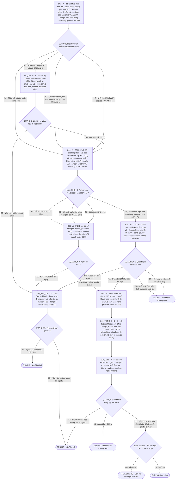

# KỊCH BẢN PHÂN NHÁNH — ĐỪNG YÊU NGƯỜI ĐÓ

> Nguồn: sườn 5 cảnh người dùng gửi trong chat (26/11/2026): "Màn hình xanh lúc nửa đêm", "Vết sẹo dưới ánh đèn vàng", "Bản thảo của kẻ du hành", "Ngã tư định mệnh", "Kết thúc bí mật – Bên kia đường chân trời". Giữ nguyên các nhịp chính, toàn bộ lựa chọn A–D, 3 kết của cảnh 4 và gần như nguyên văn lời tin nhắn, nhật ký và cảnh kết. Phần thêm: các nhánh mà bản gốc chưa giả lập, 2 cờ, 3 kết mới và phần lý giải để các mốc ngày giờ khớp nhau. Mọi thay đổi ghi ở cuối file.
>
> **Bản 2 (26/11/2026):** làm theo các đề xuất ở báo cáo bản 1: thêm cảnh hồi tưởng `S04_VONG_0`, cảnh `S05_BEN_XE` có lựa chọn quay lại ngã tư, và cho 3B một hậu quả riêng (nước chập vào đồng hồ, lộ bí mật lõi máy). Không cắt phương án nào. Giữ tên Minh.

| Thẻ tập | |
|---|---|
| Thị trường | Hà Nội, Việt Nam · tiền VND (bản sản xuất viết tiếng Anh, giữ tên Hạ / Minh) |
| Thể loại · cơ chế | Romance · Sci-fi time-loop · Thriller · motif gần nhất `SD-M9` (Trùng sinh). *Nghịch lý của tình yêu*: định mệnh lúc 00:00 ngày 14/11 luôn đòi một người ở ngã tư. Nếu Hạ ở bên Minh thì cô chết thay anh. Nếu cô rời anh thì anh chết. Lối thoát thứ ba chỉ mở khi Hạ biết điều Minh cố giấu, và khi cô chưa vứt đi tấm ảnh không ai chụp |
| Chế độ trạng thái | `free` (truyện vòng lặp, không theo khung điều tra `house`) |
| Bối cảnh chính | A: Phòng trọ 204, tầng 2 (bàn học kê sát **bức tường vôi trống**, laptop, giường đơn, cửa ra hành lang, cửa sổ + ban công sắt nhỏ nhìn thẳng xuống ngã tư, đồng hồ treo tường, mái tôn) · B: Ngã tư trường đại học ngay dưới khu trọ (đèn giao thông nhấp nháy vàng, trạm chờ xe buýt, đèn đường vàng) · C: Bến xe khách liên tỉnh lúc gần nửa đêm + trong xe khách lúc rạng sáng (cho `S05_BEN_XE`, `END_NGUOI_O_LAI`) · D: Phòng thí nghiệm lượng tử năm 2031 đang cháy (chỉ cho hồi tưởng ở `S04_VONG_0`) · Ngoại lệ cho `END_TRUE_BEN_KIA` / `END_LAC_NHAU`: quán cà phê nhỏ ven biển buổi sáng |
| Nhân vật | `ha_nguyen` Hạ (22, sinh viên năm cuối đang chạy khóa luận; áo hoodie len xám tro rộng, tóc búi lỏng, kẹp tóc càng cua xanh lá) · `minh_dang` Minh (24, nghiên cứu sinh vật lý cùng trường, người yêu 3 tháng; sơ mi trắng xắn tay, tóc ướt mưa, mắt trũng sâu; **đồng hồ đen mặt tròn có vòng lõi hình lưỡi liềm phát sáng xanh** = thiết bị lượng tử, tối nay đeo ở **cổ tay phải**; **vết sẹo bỏng hình lưỡi liềm dọc cổ tay trái**) · Biến thể `minh_2031` (cùng diễn viên `minh_dang`, chỉ trong hồi tưởng: 29 tuổi, gầy hốc hác, tóc dài chấm cổ, áo blouse trắng cháy sém, cổ tay trái chưa có sẹo) · Vai phụ: tên cướp ở vòng 0 (áo mưa đen trùm mũ, không lộ mặt) |
| Cờ là gì? | Cờ = điều người chơi đã biết hoặc còn giữ trong tay. Game tự nhớ để mở/khóa lựa chọn về sau, không hiện thanh điểm. **BÍ MẬT LÕI** (`bi_mat_loi`): Hạ đã biết điều Minh giấu: lõi máy chỉ quá tải khi có hai ngón tay cái cùng ấn, và cần một điểm đến. Biết được bằng hai cách: đọc nhật ký trong điện thoại Minh, hoặc đọc dòng cảnh báo hiện trên chiếc đồng hồ bị chập nước. **TẤM ẢNH** (`anh_chup`): Hạ còn giữ tấm ảnh chụp từ phía bức tường trống, chính là điểm đến đó |
| Cờ | `bi_mat_loi=true`: đặt ở **3B** (làm đổ nước, đồng hồ chập) hoặc **3C** (chờ Minh ngủ, đọc điện thoại anh), đọc ở **6C** — gợi ý khóa: "Bạn không biết lõi máy cần gì — câu trả lời nằm trong điện thoại của Minh, hoặc trong chính chiếc đồng hồ." / "You don't know what the core needs — the answer is on Minh's phone, or inside the watch itself." · `anh_chup=true`: đặt ở **1B**, **1C**, **1D** (không xóa tin nhắn), đọc ở kiểm tra sau **6C** — gợi ý khi thiếu: "Bạn đã xóa tấm ảnh chụp từ sau bức tường — thứ duy nhất chỉ đường sang bên kia." / "You deleted the photo taken from behind the wall — the only way to the other side." |
| Kết cục | `END_TRUE_BEN_KIA` (True · bí mật, cần `bi_mat_loi` + `anh_chup`, 6C) · `END_LAC_NHAU` (sai: có `bi_mat_loi`, thiếu `anh_chup`, 6C) · `END_QUEN_NHAU` (bittersweet, 6B) · `END_LAN_THU_48` (Karma: vòng lặp mới, 6A hoặc 7B, quay về `S01`, xóa cờ) · `END_NGUOI_O_LAI` (bittersweet: Hạ sống, Minh chết; 7A sau 2B / 4A / 5C) · `END_NUA_DEM` (chết, 5B / 5D) |

### Sự thật phía sau (cho biên kịch — người chơi lần ra dần)
* **Vòng 0 (dòng thời gian gốc):** đêm 13/11/2026, Minh đi bộ đưa Hạ từ thư viện về. Đúng 00:00 ngày 14/11, ở ngã tư trường đại học, một tên cướp rút dao đâm Minh. Hạ lao vào đỡ và chết. Nhát dao vốn dành cho Minh.
* **Năm 2031:** Minh làm ở phòng thí nghiệm lượng tử. Ngày 14/11/2031, đúng 5 năm ngày Hạ mất, anh tự phóng hỏa phòng thí nghiệm để lấy trộm thiết bị. Vòng lõi hình lưỡi liềm của máy còn nóng in vào cổ tay trái anh. Đó là vết sẹo "do vụ hỏa hoạn ngày 14/11/2031", và cũng là vết sẹo "anh tự gây ra".
* **Luật quay về:** mỗi lần kích hoạt, máy đưa Minh về ngày 13/08/2026, ngày hai người quen nhau (mật khẩu điện thoại **1308**). Thứ đi theo anh chỉ có chiếc máy và vết bỏng trên da. Mỗi lần, máy lấy đi vài năm tuổi thọ của anh, nên Minh 24 tuổi mà mắt trũng sâu như người không ngủ nhiều năm. Ba tháng mỗi vòng, anh ghi lại từng thói quen, từng bước đi của Hạ.
* **Luật của định mệnh:** 00:00 ngày 14/11 luôn đòi một người ở ngã tư, theo hình thức khác nhau ở mỗi vòng (chập điện, xe khách mất phanh, xe tải mất lái). Người bị nhắm là Minh. Nếu Hạ ở bên anh, cô luôn chết thay. 46 vòng trước, Hạ chưa từng rời anh. Vòng 47, Minh đổi cách: anh nhắn tin dọa để cô sợ anh, ghét anh và bỏ đi, còn anh định một mình ra ngã tư.
* **Che vết sẹo:** suốt 3 tháng, chiếc đồng hồ (thiết bị) đeo ở cổ tay trái che kín vết sẹo. Sáng nay vẫn vậy. Tối nay Minh cố ý chuyển đồng hồ sang tay phải để Hạ nhìn thấy vết sẹo đúng lúc tin nhắn tới.
* **Tin nhắn:** gửi từ thiết bị qua mạng của năm 2031, nên hiện số ẩn danh không mã vùng. Máy chỉ gửi được chữ.
* **Tấm ảnh không ai chụp:** góc chụp đặt ở bức tường vôi trống sau lưng Hạ, góc ảnh ghi giờ **14/11 · 00:00**, một thời điểm chưa tới. Minh không chụp. Lúc 00:00, nếu lõi máy quá tải, vết rách thời gian mở ra đúng ở bức tường đó. Tấm ảnh được gửi ngược về từ dòng thời gian mà hai người đã thoát ra: nó là "điểm đến" mà lõi máy cần.
* **Lõi quá tải:** cần hai ngón tay cái ấn cùng lúc, của người đi và của người được cứu, ngay khoảnh khắc va chạm. Không có điểm đến thì hai người tan vào các dòng thời gian khác nhau. Minh biết điều này nhưng không bao giờ nói, vì anh không muốn kéo Hạ ra khỏi cuộc đời cô.
* **Nút hủy:** phá máy thì mọi lần quay về coi như chưa từng có, kể cả lần hai người quen nhau. Không ai đưa ai về qua ngã tư đêm đó, nên cả hai cùng sống và không nhớ gì về nhau.

### Sơ đồ phân nhánh

---

### S01 · Bối cảnh A · NỘI · PHÒNG TRỌ 204 · 22:41
**Nhân vật:** Hạ (Minh chỉ có giọng ngoài cửa) · **Đạo cụ neo:** điện thoại của Hạ: tin nhắn **"Đừng yêu người đó."** + ảnh chụp lén, góc ảnh ghi **"14/11 · 00:00"**

Căn phòng trọ chật hẹp chìm trong ánh xanh lạnh hắt ra từ laptop đầy chữ khóa luận tốt nghiệp. Mưa rào gõ đều trên mái tôn. Chiếc điện thoại cạnh cốc cà phê nguội ngắt bỗng rung bần bật: số ẩn danh, không mã vùng. Tin nhắn vỏn vẹn bốn chữ: **"Đừng yêu người đó."**

Kèm theo là một bức ảnh chụp chính Hạ đang gục đầu bên bàn học ngay lúc này. Góc máy đặt sau lưng cô, nơi chỉ có bức tường vôi trống trơn. Hạ quay lại nhìn bức tường. Không có gì. Cô phóng to góc ảnh: **14/11 · 00:00**, một giờ chưa tới.

HẠ (VO): "Bức tường đó chưa từng có cửa sổ. Vậy ai đang đứng ở đó?"

*Cốc, cốc.* Tiếng gõ cửa nhẹ.

MINH (ngoài hành lang): "Anh mang cháo nóng qua cho em đây."

**Mục tiêu:** xử lý tin nhắn kỳ lạ trước khi mở cửa gặp Minh.

**[LỰA CHỌN 1 — Xử lý tin nhắn trước khi mở cửa?]**
* **1A (Chặn số lạ, xóa tin nhắn rồi ra mở cửa)** → `S02`: Hạ xóa cả tin nhắn lẫn tấm ảnh, cố giữ cho buổi tối bình thường. Màn hình điện thoại tối đi. Nhưng trên laptop, giữa trang kết luận khóa luận, con trỏ tự gõ một dòng: **"Đừng yêu người đó."** Hạ gập laptop lại.
* **1B (Khóa màn hình, giấu điện thoại vào túi, mở cửa và lén quan sát)** → `S02` · đặt cờ `anh_chup` (TẤM ẢNH): giữ nguyên tin nhắn và tấm ảnh.
* **1C (Nhắn lại "Mày là ai?" rồi mới ra mở cửa)** → `S02` · đặt cờ `anh_chup` (TẤM ẢNH): đúng giây Hạ bấm gửi, ngay sau cánh cửa vang lên một tiếng rung rất khẽ. Tin trả lời tới liền: **"Người đã nhìn em chết 46 lần."** Hạ đứng sững trước cửa.
* **1D (Vơ vội đồ, trèo qua ban công bỏ trốn khỏi khu trọ)** → `S01_TRON` · đặt cờ `anh_chup` (TẤM ẢNH): điện thoại vẫn trong túi, ảnh vẫn còn.

### S01_TRON · Bối cảnh B · NGOẠI · NGÃ TƯ TRƯỜNG ĐẠI HỌC · 22:50
**Nhân vật:** Hạ, Minh · **Đạo cụ neo:** đèn giao thông nhấp nháy vàng · vết sẹo trên cổ tay trái Minh

Hạ tụt xuống theo ban công sắt, chạy dưới mưa ra con đường duy nhất rời khu trọ: ngã tư trường đại học. Đèn giao thông nhấp nháy vàng, trạm xe buýt vắng tanh. Điện thoại rung: **"Đừng ra ngã tư. Chưa phải lúc."**

Tiếng chân chạy phía sau. Minh, không áo khoác, cầm ô, thở dốc. Dưới ngọn đèn đường vàng, tay áo sơ mi ướt dính sát vào da, lộ một vết sẹo bỏng hình lưỡi liềm dọc cổ tay trái. Hạ chưa từng thấy vết sẹo này.

MINH: "Em chạy đi đâu giữa đêm mưa thế này?"

Một chiếc taxi trống đèn xanh chậm lại bên lề.

**[LỰA CHỌN 2 — Đi với Minh hay đi một mình?]**
* **2A (Nắm lấy tay Minh, theo anh về phòng)** → `S02`: hai người ướt sũng quay về phòng 204, cặp lồng cháo vẫn để trước cửa.
* **2B (Vẫy taxi ra bến xe, đi một mình)** → `S05_BEN_XE`: Minh đứng dưới mưa, không đuổi theo. Anh khẽ nói: "Đúng rồi. Đi đi em."

### S02 · Bối cảnh A · NỘI · PHÒNG TRỌ 204 · 22:55
**Nhân vật:** Hạ, Minh · **Đạo cụ neo:** cặp lồng cháo · vết sẹo lưỡi liềm cổ tay trái · đồng hồ đen đeo ở tay phải

Hạ hít sâu, khóa màn hình điện thoại rồi ra mở cửa. *(Nếu đi 2A: hai người vừa từ ngoài mưa về.)* Minh đứng đó, tóc ướt nước mưa, nụ cười hiền lành quen thuộc nhưng đôi mắt trũng sâu đầy mệt mỏi. Anh đặt cặp lồng cháo xuống bàn. Tay áo sơ mi xắn cao để lộ vết sẹo bỏng hình lưỡi liềm dọc cổ tay trái, một vết sẹo Hạ chưa từng thấy sáng nay. Chiếc đồng hồ đen anh vẫn đeo tay trái suốt 3 tháng giờ nằm ở cổ tay phải.

Điện thoại trong túi Hạ rung hai nhịp ngắn. Nhân lúc Minh quay lưng lấy thìa, cô liếc xuống: **"Nhìn cổ tay trái của anh ấy. Vết sẹo đó là do vụ hỏa hoạn ngày 14/11 năm 2031."** *(Nếu đi 1A, số đã bị chặn: dòng chữ tự hiện trên màn hình laptop vừa mở lại.)*

Màn hình khóa điện thoại hiện ngày: **13/11/2026**.

HẠ (VO): "Tim tôi hẫng một nhịp. Năm 2031 còn chưa tới."

MINH (quay lại, cười): "Ăn đi em, nguội mất."

**Mục tiêu:** tìm hiểu sự thật về vết sẹo và năm 2031.

**[LỰA CHỌN 3 — Tìm sự thật về vết sẹo bằng cách nào?]**
* **3A (Nắm chặt cổ tay trái Minh, hỏi thẳng)** → `S02_LO_DIEN`: Minh giật tay lại: "Bỏng nồi cháo thôi." Hạ nói: "Ngày 14/11 năm 2031." Chiếc đồng hồ trên tay phải anh rung lên, vòng lưỡi liềm sáng xanh. Minh tái mặt.
* **3B (Giả vờ làm đổ cốc nước lên người Minh, ép anh cởi áo)** → `S02_LO_DIEN` · đặt cờ `bi_mat_loi` (BÍ MẬT LÕI): Minh cởi chiếc sơ mi ướt. Người anh gầy rộc, xương sườn lộ rõ như người ốm nhiều năm. Nước thấm vào chiếc đồng hồ, mặt đồng hồ chập chờn hiện số **"47"**, rồi nháy lên một dòng cảnh báo: **"LÕI QUÁ TẢI: CẦN 2 VÂN TAY · CẦN ĐIỂM ĐẾN"**. Minh vội úp bàn tay lên mặt đồng hồ, nhưng Hạ đã kịp đọc.
* **3C (Im lặng ăn cháo, chờ Minh ngủ say rồi lén xem điện thoại anh)** → `S03` · đặt cờ `bi_mat_loi` (BÍ MẬT LÕI).
* **3D (Gửi định vị của hai người cho số lạ)** → `S02_LO_DIEN`: Hạ bấm gửi **"Phòng 204, ngõ 17"**. Ngay lập tức, chiếc đồng hồ trên tay phải Minh rung lên, mặt đồng hồ hiện chấm định vị của chính căn phòng này.

### S02_LO_DIEN · Bối cảnh A · NỘI · PHÒNG TRỌ 204 · 23:10
**Nhân vật:** Hạ, Minh · **Đạo cụ neo:** đồng hồ đen, vòng lõi lưỡi liềm sáng xanh

Minh nhìn chiếc đồng hồ, rồi nhìn Hạ. Anh không chối nữa.

MINH: "Là anh nhắn."
HẠ: "Anh dọa em làm gì?"
MINH: "Em phải rời xa anh trước 00:00. Càng xa càng tốt."
HẠ: "Còn nếu em không đi?"
MINH: "Thì em chết. Như 46 lần trước."

Đồng hồ treo tường: **23:12**. Ngoài cửa sổ, mưa đã ngớt.

**[LỰA CHỌN 4 — Nghe lời Minh?]**
* **4A (Nghe lời, xách túi ra bến xe ngay)** → `S05_BEN_XE`: Minh tiễn Hạ ra cửa, không giữ lại.
* **4B (Kéo Minh ngồi xuống: "Anh kể hết đi")** → `S04`.

### S03 · Bối cảnh A · NỘI · PHÒNG TRỌ 204 · 23:40
**Nhân vật:** Hạ, Minh (ngủ) · **Đạo cụ neo:** điện thoại Minh: ghi chú **"LẦN THỨ 47"**

Mưa đã tạnh. Hơi thở của Minh đều đặn trên chiếc giường đơn. Ánh trăng xuyên qua rèm, hắt lên gương mặt thanh tú mà đượm buồn của anh. Hạ rón rén rút điện thoại từ túi áo khoác của Minh. Mật khẩu vẫn là ngày hai đứa quen nhau: **1308**.

Không có ứng dụng mạng xã hội nào. Chỉ có một ứng dụng ghi chú mở sẵn, hàng trăm dòng ghi từng thói quen, từng bước đi của Hạ suốt 3 tháng qua. Xen giữa là những dòng khác:

> **"Lần 3: giữ cô ấy trong phòng. 00:00 chập điện."**
> **"Lần 19: cùng cô ấy rời thành phố. 00:00 xe khách mất phanh, cô ấy đỡ cho mình."**
> **"Lần 46: cô ấy vẫn chọn ở lại."**

Dòng cuối cùng, chữ như nhòe đi:

> **"Lần thứ 47 quay ngược về năm 2026. Nếu lần này cô ấy vẫn chọn ở bên mình, đúng 00:00 ngày 14/11, chiếc xe tải mất lái ở ngã tư trường đại học sẽ lại cướp mất cô ấy. Mình không thể để cô ấy chết thêm lần nữa."**

Bên dưới là một dòng đã bị gạch, vẫn đọc được:

> **"Lõi chỉ quá tải khi có hai ngón tay cái cùng ấn. Phải có một điểm đến, không thì tan biến. Không bao giờ để cô ấy biết."**

HẠ (VO): "Anh ấy đã xem tôi chết 46 lần. Và lần nào tôi cũng chọn anh ấy."

**Mục tiêu:** quyết định số phận của cả hai trước 00:00 ngày 14/11.

**[LỰA CHỌN 5 — Quyết định trước 00:00?]**
* **5A (Đánh thức Minh, thú nhận đã đọc hết, cùng anh đối mặt)** → `S04`.
* **5B (Đặt điện thoại về chỗ cũ, giả vờ không biết, định sáng mai đề nghị chia tay)** → `END_NUA_DEM`: Hạ nằm xuống cạnh Minh, nhẩm câu chia tay cho buổi sáng. Cô quên rằng sáng mai đến sau 00:00.
* **5C (Lén rời phòng ngay trong đêm, ra bến xe chờ chuyến xe khách đầu tiên)** → `S05_BEN_XE`.
* **5D (Xóa toàn bộ ghi chú, chặn số lạ, quyết ở bên anh bất chấp cái chết)** → `END_NUA_DEM`: màn hình hiện **"Không có ghi chú"**. Hạ nằm xuống, đan tay vào tay Minh.

### S04 · Bối cảnh A · NỘI · PHÒNG TRỌ 204 · 23:48
**Nhân vật:** Hạ, Minh · **Đạo cụ neo:** đồng hồ thiết bị (vòng lõi lưỡi liềm, nút hủy nhỏ bên hông)

*(Nếu đi 5A:)* Hạ lay vai Minh. Anh giật mình tỉnh dậy, ánh mắt hoảng loạn khi thấy điện thoại của mình sáng trên tay cô. *(Nếu đi 4B: hai người ngồi bệt dưới chân giường, Minh đã nhận mình là người nhắn tin.)* Không còn vẻ thư sinh hiền lành, Minh khuỵu xuống bên mép giường, đôi vai run lên.

MINH: "Chiếc máy này anh lấy trộm từ phòng thí nghiệm, năm 2031."
MINH: "Anh tự phóng hỏa để lấy nó. Vết sẹo là từ đêm đó."
MINH: "Lần đầu tiên, em đỡ cho anh một nhát dao. Ngay ngã tư dưới kia."

*(Hồi tưởng ở `S04_VONG_0`, rồi quay lại phòng.)*

MINH: "Mỗi lần quay về, máy lấy của anh vài năm. Anh chỉ muốn em ghét anh, rồi bỏ đi."

Hạ đưa tấm ảnh chụp từ bức tường ra *(nếu còn `anh_chup`)*, hoặc hỏi về tấm ảnh *(nếu đi 1A)*. Minh lắc đầu:

MINH: "Máy anh chỉ gửi được chữ. Tấm ảnh đó không phải anh chụp."

Anh chỉ vào nút nhỏ bên hông đồng hồ:

MINH: "Nút này hủy máy. Mọi lần quay về sẽ chưa từng có. Kể cả việc mình quen nhau."

*(Nếu có `bi_mat_loi`:)* HẠ: "Còn lõi quá tải? Cần hai ngón tay cái." *(đi 3C: "Anh viết thế." · đi 3B: "Đồng hồ của anh hiện thế.")* Minh nhìn cô rất lâu: "Không có điểm đến, mình sẽ tan biến."

→ `S04_VONG_0`.

### S04_VONG_0 · Bối cảnh B + D · HỒI TƯỞNG · 00:00 NGÀY 14/11 (VÒNG 0) → 14/11/2031
**Nhân vật:** Hạ, Minh (tên cướp không lộ mặt) · sau đó `minh_2031` một mình · **Đạo cụ neo:** thiết bị (vòng lõi lưỡi liềm nóng đỏ)

Màu hình nhạt đi. Ngã tư trường đại học, đêm không mưa. Hạ ôm chồng sách thư viện, Minh đi bên cạnh, cổ tay trái còn lành lặn. Đèn giao thông nhảy sang vàng. Một bóng người áo mưa đen trùm mũ bước ra từ trạm xe buýt, lưỡi dao lóe lên nhắm vào Minh. Hạ lao vào giữa. Chồng sách rơi xuống mặt đường.

MINH (VO, hiện tại): "Nhát dao đó là của anh."

Cắt: phòng thí nghiệm năm 2031 chìm trong lửa. Minh 29 tuổi, gầy hốc hác, đập vỡ lồng kính, giật chiếc thiết bị ra. Vòng lõi còn nóng đỏ. Anh siết nó vào cổ tay trái, nghiến răng khi da cháy xèo. Trên màn hình phòng thí nghiệm: **"14/11/2031"**.

MINH (VO, hiện tại): "Năm năm sau, anh đốt cả phòng thí nghiệm để quay lại."

Cắt về: căn phòng trọ, Minh đang ngồi trước mặt Hạ, ngón cái xoa lên vết sẹo.

→ `S04_2355`.

### S04_2355 · Bối cảnh A (+ B qua cửa sổ) · NỘI · PHÒNG TRỌ 204 · 23:55 → 00:00
**Nhân vật:** Hạ, Minh · **Đạo cụ neo:** đồng hồ treo tường **23:55** · cửa sổ tầng hai (trước: nguyên · ở các kết va chạm: vỡ)

Đồng hồ treo tường điểm **23:55**. Dưới ngã tư, còi xe tải rú lên điên cuồng. Ánh đèn pha chói lòa rọi thẳng qua khung cửa sổ tầng hai, quét qua mặt hai người. Phía sau bàn học, bức tường vôi trống bắt đầu gợn lên một vệt sáng xanh rất mờ.

MINH: "Lần này nó đến sớm hơn."

**Mục tiêu:** chọn cái kết cho vòng lặp trước khi chiếc xe tải lao tới.

**[LỰA CHỌN 6 — Kết thúc vòng lặp thế nào?]**
* **6A (Đẩy Minh vào góc tường an toàn, lao ra ngã tư thay anh)** → `END_LAN_THU_48`.
* **6B (Ấn nút hủy thiết bị trên tay Minh, xóa sạch ký ức của cả hai về nhau)** → `END_QUEN_NHAU`.
* **6C (Cần `bi_mat_loi` — nắm chặt tay Minh, cùng ấn quá tải lõi máy đúng khoảnh khắc va chạm)** → kiểm tra `anh_chup`: còn → `END_TRUE_BEN_KIA`; đã xóa → `END_LAC_NHAU`. *Khóa khi thiếu cờ: "Bạn không biết lõi máy cần gì — câu trả lời nằm trong điện thoại của Minh."*

### S05_BEN_XE · Bối cảnh C · NỘI · BẾN XE KHÁCH LIÊN TỈNH · 23:52
**Nhân vật:** Hạ (Minh chỉ có trong tin nhắn) · **Đạo cụ neo:** đồng hồ điện tử bến xe **"23:52"** · bảng giờ **"CHUYẾN ĐẦU: 05:00"**

Sảnh chờ gần như trống, đèn tuýp nhấp nháy. Hạ ngồi ôm túi trên ghế sắt, vé xe khách chuyến 5:00 trong tay. *(Đi 2B: cô đã ngồi đây cả tiếng, quần áo vẫn ướt.)* Điện thoại rung, số không mã vùng: **"Đừng quay lại. Anh ổn."**

Bên ngoài, một bác xe ôm nổ máy chờ khách. Đồng hồ bến xe nhảy sang **23:53**.

HẠ (VO): "Anh ấy chưa bao giờ nói dối giỏi."

**[LỰA CHỌN 7 — Lên xe hay quay lại?]**
* **7A (Ngồi yên chờ chuyến xe đầu tiên)** → `END_NGUOI_O_LAI`.
* **7B (Nhảy lên xe ôm, quay lại ngã tư)** → `END_LAN_THU_48`: Hạ về tới ngã tư đúng 00:00. Minh đứng một mình giữa đường. Cô lao ra kéo anh vào lề.

---

### HỆ THỐNG KẾT CỤC
* **`END_TRUE_BEN_KIA` · TRUE · BÊN KIA ĐƯỜNG CHÂN TRỜI** *(cần `bi_mat_loi` + `anh_chup`, chọn 6C)*: Hạ không buông tay. Cô đan chặt những ngón tay lạnh ngắt vào bàn tay đầy sẹo của Minh. Cô giơ điện thoại lên, tấm ảnh sáng trên màn hình, và vệt sáng trên bức tường trống mở rộng đúng ở góc tấm ảnh được chụp. Giữa tiếng kính vỡ choang và ánh đèn pha trắng xóa, Minh mỉm cười, giọt nước mắt cuối cùng rơi xuống. Ngón cái của cả hai cùng ấn mạnh vào lõi máy. Một vụ nổ ánh sáng xanh thẫm bẻ cong cả căn phòng.
  Ở dòng thời gian năm 2026 này, lực lượng cứu hộ chỉ tìm thấy một căn phòng trọ trống rỗng, không một dấu vết của hai sinh viên sau vụ tai nạn. Ở một chiều không gian khác, nơi không có những vòng lặp đau đớn, nắng sớm rọi xuống một quán cà phê nhỏ ven biển. Hạ tỉnh dậy, tựa đầu lên vai Minh. Trên cổ tay trái của cả hai hằn một vết sẹo hình lưỡi liềm mờ nhạt. Trong máy Hạ có một tấm ảnh cô chưa từng chụp, và một tin chờ gửi tới số không mã vùng. Cô mỉm cười, bấm gửi.
  **Danh hiệu: Kẻ Phá Vỡ Vòng Lặp (kết bí mật).** *Tình trạng: đã biến mất khỏi dòng thời gian gốc, tái sinh trọn vẹn ký ức ở dòng thời gian mới.* · chơi lại từ `S04_2355`.
* **`END_LAC_NHAU` · SAI · LẠC NHAU** *(có `bi_mat_loi`, thiếu `anh_chup`, chọn 6C)*: Hai ngón cái cùng ấn xuống. Hạ lục điện thoại tìm tấm ảnh nhưng thùng rác đã trống. Vệt sáng trên tường vỡ tan thành trăm mảnh. Sáng hôm sau, ở một quán cà phê ven biển, Hạ tỉnh dậy một mình, trên cổ tay trái có một vết sẹo lưỡi liềm mà cô không biết từ đâu ra. Chiếc ghế bên cạnh trống. Xa tít cuối bãi biển, một người đàn ông có cùng vết sẹo đang đi ngược hướng · chơi lại từ `S01` (gợi ý: "Bạn đã xóa tấm ảnh chụp từ sau bức tường…").
* **`END_QUEN_NHAU` · BITTERSWEET · HẠNH PHÚC KHÔNG TÊN** *(chọn 6B)*: Hạ ấn nút hủy. Chiếc đồng hồ vỡ vụn thành bụi sáng, căn phòng như tua ngược. Nhiều năm sau, một buổi sáng nắng ở ngã tư trường đại học, Hạ đứng chờ đèn đỏ. Bên cạnh là một người đàn ông cầm cặp lồng cháo, cổ tay lành lặn. Đèn xanh bật. Hai người cùng khựng lại một giây như vừa nhớ ra điều gì, mỉm cười lịch sự rồi đi về hai phía · chơi lại từ `S04_2355`.
* **`END_LAN_THU_48` · KARMA · LẦN THỨ 48** *(chọn 6A hoặc 7B — bản gốc: "Bi kịch lặp lại")*: Hạ dồn hết sức đẩy Minh vào góc tường, chạy xuống ngã tư *(đi 7B: Hạ đẩy Minh vào lề, chính cô đứng lại giữa vạch qua đường)*. Chiếc xe tải bẻ lái, lao về phía cô. Ánh đèn trắng nuốt chửng ngã tư. Minh bò ra giữa đường, quỳ bên đống kính vỡ, vừa khóc vừa ấn lõi máy: "Lần thứ 48." Cắt về: mưa trên mái tôn, điện thoại cạnh cốc cà phê nguội rung lên, **"Đừng yêu người đó."** · chơi lại từ `S01` (xóa toàn bộ cờ).
* **`END_NGUOI_O_LAI` · BITTERSWEET · NGƯỜI Ở LẠI** *(chọn 7A, sau 2B, 4A hoặc 5C)*: 00:00, ngã tư trường đại học. Minh đứng một mình giữa vạch qua đường, tay áo xắn cao, vết sẹo lộ dưới đèn vàng nhấp nháy. Đèn pha xe tải rọi tới. Anh nhắm mắt, mỉm cười. 5:00 sáng, trên chuyến xe khách đầu tiên rời thành phố, điện thoại Hạ hiện một tin hẹn giờ gửi lúc 00:00 từ số không mã vùng: **"Lần này em sống. Vậy là đủ."** Hạ áp trán vào cửa kính, xe đi ngang một tấm biển "TRƯỜNG ĐẠI HỌC" phía sau lưng · chơi lại từ `S05_BEN_XE`.
* **`END_NUA_DEM` · CHẾT · NỬA ĐÊM KHÔNG QUA** *(chọn 5B hoặc 5D)*: 00:00. Còi xe tải rú, đèn pha trắng xóa ập qua cửa sổ. Kính vỡ. Trong đống đổ nát, tay Hạ vẫn đan trong tay Minh. Minh sống sót, ôm cô, ngón tay run run tìm lõi máy. Hình cuối: điện thoại Minh giữa mảnh kính, màn hình sáng *(5D: **"Không có ghi chú"**; 5B: dòng chữ mới **"Lần 47: cô ấy định đợi tới sáng mai."**)* · chơi lại từ `S03`.

### Ước lượng thời lượng (cảnh ~35s, `S04` ~40s, kết ~22s, kết True ~30s)
| Đường | Cảnh | Ước lượng |
|---|---|---|
| Ngắn nhất: `S01 → S01_TRON → S05_BEN_XE → END_NGUOI_O_LAI / END_LAN_THU_48` | 3 | ~127s |
| `S01 → S02 → S03 → END_NUA_DEM` | 3 | ~127s |
| `S01 → S02 → S02_LO_DIEN → S05_BEN_XE → END_*` | 4 | ~162s |
| `S01 → S02 → S03 → S05_BEN_XE → END_*` | 4 | ~162s |
| `S01 → S02 → S02_LO_DIEN → S04 → S04_VONG_0 → S04_2355 → END_*` | 6 | ~237–245s |
| True: `S01 → S02 → S03 → S04 → S04_VONG_0 → S04_2355 → END_TRUE_BEN_KIA` | 6 | ~245s |
| Dài nhất: `S01 → S01_TRON → S02 → S03 → S04 → S04_VONG_0 → S04_2355 → END_TRUE_BEN_KIA` | 7 | ~280s |

### Ghi chú lệch chuẩn
* **Thời lượng (bản 2):** đường tới lựa chọn 6 dài ~4 phút, dài nhất ~4,7 phút; đường ngắn nhất ~2,1 phút (gợi ý ≥3 phút), trung vị theo kết khoảng 3,5–4 phút (gợi ý 5 phút). Đã thêm `S04_VONG_0` và `S05_BEN_XE`. **Không thêm** `S03_NHAT_KY`: `S03` đã có đủ các dòng nhật ký, tách thêm một cảnh đọc chữ sẽ chỉ là độn. Đường ngắn vẫn ngắn vì luật của truyện là cứ rời Minh trước 00:00 thì kết.
* **Số lựa chọn:** `S01`, `S02`, `S03` giữ đủ 4 phương án như bản gốc (gợi ý tối đa 3, validator chỉ cảnh báo). Bản 2 không rút phương án nào (quy tắc 2026-11-25: không cắt chỉ để đạt số). 3B giờ có hậu quả riêng (đặt `bi_mat_loi`), không còn trùng với 3A/3D. Nếu vẫn muốn rút còn 3: **1C** là ứng viên (gần giống 1B, chỉ khác tiếng rung sau cửa), còn `S03` phải gộp 5B với 5D (cùng dẫn tới `END_NUA_DEM`).
* **Thêm vào bản gốc:** node `S01_TRON` (cho 1D), `S02_LO_DIEN` (cho 3A, 3B, 3D), `S05_BEN_XE` (cho 2B, 4A, 5C, bản 2), hồi tưởng `S04_VONG_0` (bản 2); tách cảnh 4 gốc thành `S04` (thú nhận) và `S04_2355` (ngã tư) vì quá dài cho 1 cảnh; thêm 3 kết `END_NGUOI_O_LAI`, `END_NUA_DEM`, `END_LAC_NHAU` để những phương án bản gốc chưa giả lập đều có hậu quả. "Ending 3/3" của bản gốc giờ là 1 trong 6 kết; giữ danh hiệu "Kẻ Phá Vỡ Vòng Lặp".
* **Sửa chỗ mâu thuẫn trong bản gốc:**
  - Cái chết gốc: nhật ký ghi xe tải, lời thú nhận ghi nhát dao. Giờ vòng 0 là nhát dao, các vòng sau định mệnh đổi cách (nhật ký liệt kê).
  - Vết sẹo "do hỏa hoạn 2031" và "anh tự tạo": Minh tự phóng hỏa phòng thí nghiệm để lấy máy.
  - "Chưa từng thấy sáng nay" mà nhật ký ghi 3 tháng: mỗi vòng Minh quay về ngày quen nhau 13/08, và suốt 3 tháng đồng hồ đeo tay trái che vết sẹo; tối nay anh cố ý chuyển đồng hồ sang tay phải.
  - Mưa rào ở cảnh 1 và ánh trăng ở cảnh 3: mưa tạnh trước 23:40.
  - "Lúc nửa đêm" ở cảnh 1 đổi thành 22:41, vì cảnh 4 diễn ra lúc 23:55.
  - 5C "rời phòng lúc rạng sáng" đã quá 00:00, nên đổi thành rời ngay trong đêm, chờ chuyến xe đầu tiên ở bến xe. 5B "chia tay sáng mai" giữ nguyên vì chính nó là cái bẫy.
  - Bản gốc không giải thích tấm ảnh chụp từ bức tường. Nay giải thích bằng điểm đến của lõi máy, và trả lời ở kết True.
* **Ngôi kể:** bản gốc gọi nhân vật chính là "bạn". Bản này đặt tên Hạ để có nhân vật trên hình (`cinematic_storyteller`), lời dẫn ngôi thứ nhất "Tôi". Lựa chọn vẫn viết theo hành động của người chơi.
* **Trùng với truyện đã có:** time-loop + người yêu tên Minh có sẹo cổ tay trái + ngã tư giống `cuoc_goi_cuoi_cung.md` và `cuoc_goi_cuoi_cung_lan_thu_7.md` (GM40, `minh_tran`). Đặt ID `minh_dang` để không dùng nhầm ảnh tham chiếu. Bản 2 giữ tên Minh theo bản gốc (chưa có quyết định đổi tên).
* **Nhân vật:** 2 nhân vật có tên (gợi ý 4) + biến thể `minh_2031` cho hồi tưởng. Tài xế xe tải, tên cướp vòng 0 không lộ mặt; cứu hộ, bác xe ôm, người qua đường là vai phụ.
* **Bối cảnh:** 4 bối cảnh chính A, B, C, D (mức tối đa khuyến nghị) + 1 ngoại lệ quán cà phê biển (dùng chung cho `END_TRUE_BEN_KIA` và `END_LAC_NHAU`). `END_QUEN_NHAU` và hồi tưởng vòng 0 dùng lại B. D chỉ xuất hiện trong 1 nhịp hồi tưởng; có thể bỏ nếu muốn bớt 1 bộ ảnh tham chiếu (chỉ giữ cảnh ngã tư).
* **Node không có lựa chọn:** `S04` → `S04_VONG_0` → `S04_2355`.
* **Khóa chữ trên hình:** "Đừng yêu người đó.", "14/11 · 00:00", "13/11/2026", "Nhìn cổ tay trái của anh ấy. Vết sẹo đó là do vụ hỏa hoạn ngày 14/11 năm 2031.", "Người đã nhìn em chết 46 lần.", "Đừng ra ngã tư. Chưa phải lúc.", "Phòng 204, ngõ 17", "47", "1308", "LẦN THỨ 47" + các dòng nhật ký, "Không có ghi chú", "23:55", "Lần này em sống. Vậy là đủ.", "TRƯỜNG ĐẠI HỌC", "LÕI QUÁ TẢI: CẦN 2 VÂN TAY · CẦN ĐIỂM ĐẾN", "14/11/2031", "Đừng quay lại. Anh ổn.", "23:52", "CHUYẾN ĐẦU: 05:00". Bản sản xuất dịch sang tiếng Anh.
* **Đạo cụ đổi trạng thái:** đồng hồ thiết bị (nóng đỏ ở hồi tưởng 2031 → tắt → lõi sáng xanh → chập nước hiện cảnh báo ở 3B → vỡ thành bụi ở `END_QUEN_NHAU`) · cửa sổ tầng hai (nguyên → vỡ ở các kết va chạm) · điện thoại Hạ (còn ảnh / đã xóa) · điện thoại Minh (nhật ký đầy / "Không có ghi chú" ở 5D). Mỗi trạng thái cần ảnh tham chiếu riêng.
