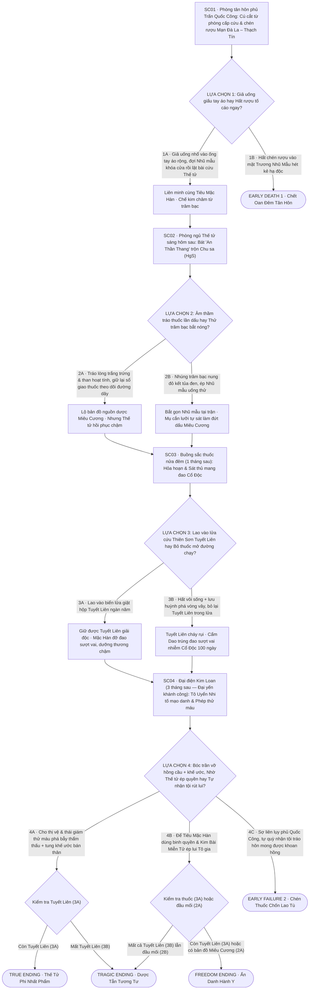

# KỊCH BẢN PHÂN NHÁNH — DƯỢC PHI THẾ THÂN
**Thể loại:** Cổ trang y khoa · Xuyên không cung đấu · Phim tương tác phân nhánh (FMV)
**Cơ chế lựa chọn đặc trưng:** *Y Đạo Thực Nghiệm & Dấu Vết Độc Dược* — mọi quyết định đều cân đo giữa **phá giải bằng chứng cứ khoa học – y lý** (giữ nhân chứng, bảo toàn dược liệu, bóc trần ngụy khoa học) với **hành động nóng vội hoặc ỷ quyền thế**; mất cả đầu mối dược liệu lẫn thuốc giải sẽ kích hoạt cái chết chậm sau 100 ngày của Cổ Độc Miêu Cương.

---

### Sơ đồ phân nhánh toàn truyện

---

### Tuyến nhân vật & Chuẩn y dược – lễ nghi
* **TÔ CẨM DAO / A SỬU (25 tuổi):** Bác sĩ cấp cứu hiện đại xuyên vào thân xác thứ nữ nhà họ Tô bị ép gả thay đích tỷ. Nhờ kiến thức độc chất học và giải phẫu để sống sót.
* **TIÊU MẶC HÀN (27 tuổi):** Thế tử phủ Trấn Quốc Công. Nhiễm độc **Chu sa (thủy ngân sunfua — HgS)** mãn tính trộn trong *An Thần Thang* suốt ba năm khiến **hai chân tê liệt mất cảm giác, ngọn chi run giật, khí huyết ứ trệ** nhưng tay vẫn kiểm soát được đoản đao.
* **TRƯƠNG NHŨ MẪU:** Người nâng khay rượu độc tuẫn táng đêm tân hôn và trực tiếp sắc *An Thần Thang*.
* **TÔ UYỂN NHI:** Đích tỷ áo trắng bỏ trốn hôn ước, xuất hiện tại đại yến tố cáo Cẩm Dao tráo thân.
* **Đạo cụ cốt lõi:** *Trâm bạc rỗng ruột* (chế kim châm cứu ba đại huyệt **Hợp Cốc, Khúc Trì, Thủ Tam Lý**), *Thiên Sơn Tuyết Liên ngàn năm* (thuốc giải Cổ Độc Miêu Cương), *Khế ước bán thân 50 lượng bạc*, *Kim Bài Miễn Tử*.

---

### SC01 · NỘI · PHÒNG TÂN HÔN PHỦ TRẤN QUỐC CÔNG · ĐÊM

*(Mở màn 3 giây)*: Ánh đèn phẫu thuật phòng cấp cứu hiện đại chói lòa trên trần trắng cùng tiếng máy đo nhịp tim kéo dài một đường thẳng buốt tai — vụt tắt ngấm trong làn khói thảo mộc cay nồng.

Tô Cẩm Dao mở bừng mắt giữa ánh nến đỏ chập chờn. Trên người nàng là hỷ phục đỏ thẫm, hai cổ tay bị trói lỏng sau lưng bằng dải lụa cưới. Phía trên giường gấm, Tiêu Mặc Hàn sắc mặt tái nhợt nằm dựa gối. Giữa phòng, Trương Nhũ Mẫu quay lưng rót hai chén rượu trên chiếc khay bạc chạm hoa văn sắc cạnh.

Nhân lúc Nhũ Mẫu cúi đầu rót chén thứ hai, Cẩm Dao lùi sát mép bàn trang điểm, cọ mạnh dải lụa đỏ vào gờ khay bạc sắc nhọn. Sợi lụa đứt phựt; nàng giữ hai tay gọn dưới ống tay áo cưới rộng.

TRƯƠNG NHŨ MẪU
Tô nhị tiểu thư, Thế tử thân mang trọng bệnh — đêm nay qua được là phúc, không qua được thì phủ Quốc Công cũng không để người lẻ bóng. Uống chén hợp cẩn này cho trọn nghĩa phu thê.

Chén rượu đưa sát môi. Hơi rượu không mang mùi gạo ủ mà sực lên vị hăng gắt của thảo dược lẫn cặn khoáng không tan dưới đáy chén. Nàng khẽ chạm đầu lưỡi — vị đắng buốt làm tê rát tức thì niêm mạc lưỡi: **Mạn Đà La trộn Thạch Tín liều cao** để ép cô dâu tuẫn táng cùng Thế tử!

**[ĐIỂM LỰA CHỌN 1 — Đối phó chén rượu tuẫn táng]**
* **Lựa chọn 1A (Ngửa cổ giả vờ uống, ngậm trọn ngụm rượu rồi vờ ho sặc nhổ thấm hết vào lớp khăn lụa dày giấu trong ống tay áo rộng):** Đợi Nhũ Mẫu lui ra khóa cửa mới lật bài với Thế tử.
* **Lựa chọn 1B (Hất tung chén rượu vào mặt Trương Nhũ Mẫu, hô lớn vạch trần kẻ hạ độc ngay tại chỗ):** Tấn công phủ đầu khi chưa rõ ai đứng sau bà ta.

#### NHÁNH 1A
Cẩm Dao ngửa cổ nuốt khan rồi gập người ho rũ, ép sạch ngụm rượu thấm vào lớp lót dày trong ống tay áo cưới. Trương Nhũ Mẫu hài lòng thu khay lui ra ngoài, kéo then sắt cài khóa cửa phòng tân hôn.

Ngay khoảnh khắc đó, Tiêu Mặc Hàn rút đoản đao thép đen dưới gối chĩa thẳng vào cổ họng Cẩm Dao, mũi đao khẽ rung theo đầu ngón tay run giật của chàng.

TIÊU MẶC HÀN
Người của ai cài vào? Uống rượu tuẫn táng của Lão phu nhân mà chưa tắt thở?

TÔ CẨM DAO
Thế tử nhìn kỹ đôi chân mình đi! Ba năm ngài uống Chu sa trộn trong An Thần Thang, thủy ngân tích tụ tạng phủ làm liệt hai chân và run ngọn chi. Rượu vừa rồi là Mạn Đà La với Thạch Tín. Giết ta, đêm mai ngài chết theo.

Tiêu Mặc Hàn nhìn chằm chằm vào vết rượu thẫm trên tay áo nàng hồi lâu rồi hạ đoản đao xuống mép gối.

#### NHÁNH 1B ➔ KẾT THÚC SỚM (EARLY DEATH 1)
Chén rượu hất văng làm ướt sũng ngực áo Trương Nhũ Mẫu. Bà ta lập tức hét vang: *"Tân nương phát điên hành thích Thế tử!"* Năm tên gia đinh lực lưỡng xô cửa ập vào giữ chặt hai tay Cẩm Dao, cạy hàm đổ thẳng nguyên bình rượu độc vào cổ họng nàng ngay trước mắt Thế tử bất động trên giường.

---

### SC02 · NỘI · PHÒNG NGỦ THẾ TỬ · SÁNG HÔM SAU

Nắng sớm lọt qua rèm cửa. Cẩm Dao bẻ chiếc trâm bạc rỗng ruột chế thành kim châm cứu dài, chỉ cho Tiêu Mặc Hàn cách dùng lòng trắng trứng gà và than hoạt tính lấy từ bếp để trung hòa thủy ngân cấp, kết hợp lưu huỳnh liều thấp bài độc dần qua tạng phủ.

Đúng lúc đó, then cửa bật mở. Trương Nhũ Mẫu bưng bát *"Sâm Quy An Thần Thang"* bốc khói nghi ngút bước vào, ánh mắt sắc lẻm dừng lại khi thấy Thế tử vẫn còn tỉnh táo.

**[ĐIỂM LỰA CHỌN 2 — Xử lý bát thuốc độc trước mắt Nhũ Mẫu]**
* **Lựa chọn 2A (Tươi cười nhận bát thuốc bảo để tự tay đút cho Thế tử, bí mật tráo bằng nước lọc lòng trắng trứng – than hoạt tính sau bình phong và giữ lại bát độc theo dõi kẻ tiếp tế):** Giữ Nhũ Mẫu sống để lần ra nguồn dược liệu phía sau. *(Lộ sổ nguồn dược Miêu Cương, nhưng Thế tử mất nhiều ngày hơn để đào thải độc cũ).*
* **Lựa chọn 2B (Đoạt bát thuốc, rút chiếc trâm bạc vừa hơ lửa cắm thẳng xuống đáy bát làm đầu trâm đen sẫm vì kết tủa sunfua, ép Nhũ Mẫu uống thử):** Bắt gọn nội gián ngay tại trận. *(Cắt đứt nguồn độc tức thì, nhưng Nhũ Mẫu cắn lưỡi tự sát trong mật thất làm đứt dấu gốc).*

#### NHÁNH 2A
Cẩm Dao nhận khay thuốc, khéo léo đổ chén thuốc độc vào bình gốm giấu sau bình phong và thay bằng nước lọc lòng trắng trứng ấm cho Thế tử uống. Ba đêm sau theo dõi hướng đi của Nhũ Mẫu ở hậu viện, ám vệ thu được mảnh sổ ghi chép tuyến đường buôn **Cổ Độc và Thiên Sơn Tuyết Liên từ vùng núi Miêu Cương** trước khi bà ta bị giam lỏng.

#### NHÁNH 2B
Đầu trâm bạc nung chuyển đen ngòm ngay trong bát thuốc trước mặt Trương Nhũ Mẫu. Bà ta giật mình đánh rơi vỡ tan bát sứ trên nền gạch. Tiêu Mặc Hàn gõ nhẹ thành giường — hai ám vệ từ xà nhà đáp xuống khóa tay Nhũ Mẫu giải vào mật thất, nhưng chưa tới canh ba mụ đã cắn lưỡi tự vẫn sạch bóng không để lại nửa dòng manh mối nguồn thuốc.

---

### SC03 · NỘI · BUỒNG SẮC THUỐC PHỦ QUỐC CÔNG · ĐÊM (MỘT THÁNG SAU)

Suốt một tháng liền, Cẩm Dao ngày đêm châm kim vào **ba đại huyệt Hợp Cốc, Khúc Trì và Thủ Tam Lý** trên cánh tay Tiêu Mặc Hàn để triệt chứng run giật cơ, kết hợp giải phong kinh lạc hai chi dưới. Tiêu Mặc Hàn đã tự chống gậy sắt đi vững quanh phòng kín.

Nửa đêm, khói đen bất ngờ cuồn cuộn bốc lên từ chân tường buồng sắc thuốc — lửa bùng lên bao vây chiếc tủ gỗ đựng nhánh **Thiên Sơn Tuyết Liên ngàn năm**, dược liệu quý duy nhất giải được các kịch độc mạnh. Ngoài cửa sổ vỡ toang, ba tên sát thủ bịt mặt vung đơn đao lóe ánh xanh tím của **Cổ Độc Miêu Cương** lao thẳng vào phòng!

**[ĐIỂM LỰA CHỌN 3 — Thuốc quý ngàn năm hay Đường thoát thân?]**
* **Lựa chọn 3A (Bảo Tiêu Mặc Hàn cầm gậy sắt cản cửa một nhịp, một mình lao ngược vào biển lửa giật bằng được hộp gỗ đựng Thiên Sơn Tuyết Liên trước khi phá cửa sổ):** Giữ nguyên vị thuốc tối thượng.
* **Lựa chọn 3B (Bỏ lại hộp Tuyết Liên trong biển lửa, ném thẳng túi bột vôi sống trộn lưu huỳnh vào mắt tên đi đầu rồi kéo Mặc Hàn nhảy qua cửa sổ thoát thân):** Đặt mạng sống trước mắt lên hàng đầu.

#### NHÁNH 3A
Cẩm Dao bọc vạt áo ướt lao xuyên qua màn lửa ôm gọn hộp Thiên Sơn Tuyết Liên vào ngực. Phía cửa, một tên sát thủ vung đao chém sượt qua bả vai Tiêu Mặc Hàn trước khi bị chàng điểm gậy gãy xương sườn. Hai người nhảy thoát ra vườn tuyết; Tuyết Liên còn nguyên vẹn, nhưng vết thương vai khiến Tiêu Mặc Hàn phải dưỡng sức thêm nửa tháng mới cầm quân bình định biên ải.

#### NHÁNH 3B
Túi vôi sống trộn lưu huỳnh nổ tung làm tên sát thủ đi đầu ôm mặt gào thét. Tiêu Mặc Hàn vung gậy sắt quật ngã tên thứ hai rồi kéo Cẩm Dao phóng qua khung cửa sổ. Trong tích tắc bật người ra ngoài, lưỡi đao Cổ Độc của tên thứ ba sượt rách vai áo Cẩm Dao, thấm một vệt tím đen vào da thịt ngay lúc mái buồng thuốc sập xuống thiêu rụi nhánh Tuyết Liên duy nhất. Cẩm Dao tự bấm huyệt phong tỏa độc mạch — biết rõ nếu không có Tuyết Liên hoặc phương thuốc thay thế từ nguồn Miêu Cương, kịch độc sẽ phát tác sau đúng một trăm ngày.

---

### SC04 · NỘI · ĐẠI ĐIỆN KIM LOAN · ĐÊM (BA THÁNG SAU — ĐẠI YẾN KHÁNH CÔNG BÌNH ĐỊNH BIÊN ẢI PHÍA BẮC)

Đèn cung điện sáng rực. Tiêu Mặc Hàn mặc ngân giáp sải bước vững chãi vào đại điện trước ánh nhìn kinh ngạc của bá quan văn võ; bên cạnh chàng, Tô Cẩm Dao vận trang phục phu nhân uy nghi.

Hoàng đế vừa nâng ngọc tỷ chuẩn bị ban thưởng thì từ ngoài cửa điện, Đích tỷ **Tô Uyển Nhi** mặc tang phục trắng lao vào quỳ rạp giữa thảm đỏ.

TÔ UYỂN NHI
Khởi bẩm Hoàng thượng! Nữ tử bên cạnh Thế tử là nha hoàn hèn kém A Sửu, nhân lúc thần nữ lâm bệnh đã trộm hỷ phục lên kiệu hoa! Xin Hoàng thượng cho trích máu thần nữ và phụ thân Tô Thượng thư vào bát nước lã thử thân — máu cốt nhục ắt hòa làm một, kẻ giả mạo tuyệt đối không tan!

Cả triều đường xôn xao. Hoàng đế đặt chén rượu xuống, ánh mắt lạnh lẽo quét thẳng xuống giữa điện.

**[ĐIỂM LỰA CHỌN 4 — Phản công giữa đại điện Kim Loan]**
* **Lựa chọn 4A (Bước xuống thềm ngọc dùng thí nghiệm hai người xa lạ bóc trần quy luật vỡ hồng cầu trong nước lã, đồng thời tung tờ khế ước bán thân 50 lượng bạc có điểm chỉ của Tô Uyển Nhi):** Phá án triệt để bằng y lý và chứng cứ sắt đá.
* **Lựa chọn 4B (Giữ im lặng không đôi co trò thử máu, ra hiệu để Tiêu Mặc Hàn quỳ dâng Kim Bài Miễn Tử tâu xin Thánh thượng bãi bỏ đơn kiện vì công lao biên ải):** Dùng chiến công quân sự đè bẹp dư luận.
* **Lựa chọn 4C (Quỳ xuống nhận tội mạo danh thay thế để giữ thanh danh cho Tiêu Mặc Hàn và xin Hoàng thượng tha cho phủ Quốc Công):** Tự nhận hết trách nhiệm vào mình.

#### NHÁNH 4A
Tô Cẩm Dao đứng giữa điện yêu cầu thái giám bưng một bát nước lã mới, gọi một thị vệ và một thái giám không hề có quan hệ huyết thống cùng nhỏ một giọt máu vào bát — hai giọt máu lập tức vỡ màng hồng cầu và hòa tan vào nhau không chút dấu vết trước hàng trăm cặp mắt! Nàng giơ cao tờ giấy ố vàng: *"Huyết tương vào nước lã khác áp suất thẩm thấu đều tự vỡ hồng cầu mà tan! Còn đây là khế ước năm mươi lượng bạc do chính Tô Uyển Nhi điểm chỉ bán muội muội đi thế thân vì sợ làm góa phụ!"* Tiêu Mặc Hàn bước ra quỳ một gối, hai tay nâng cao Kim Bài Miễn Tử dâng thẳng lên Hoàng đế cầu xin phân xử tội khi quân đào hôn của Tô Uyển Nhi.

#### NHÁNH 4B
Tiêu Mặc Hàn bước lên trước mặt Cẩm Dao, quỳ một gối hai tay dâng cao Kim Bài Miễn Tử tâu thẳng lên Hoàng đế xin dùng toàn bộ quân công bình định biên ải để bảo vệ thê tử. Hoàng đế nể công thần đập bàn bãi miễn lời tố của Tô Uyển Nhi — nhưng khắp hành lang triều thần vẫn râm ran tiếng xì xào *"Thế tử dung túng kẻ không rõ gốc gác"*. Đêm đó trở về phủ, Cẩm Dao tự tay xếp lại bộ trang phục quý tộc vào hòm gỗ.

#### NHÁNH 4C ➔ KẾT THÚC SỚM (EARLY FAILURE 2)
Ngay khi Cẩm Dao vừa cúi đầu thừa nhận việc tráo hôn, Tô Thượng thư lập tức hô lớn quy tội khi quân lừa gạt thánh chỉ. Dù Tiêu Mặc Hàn dâng Kim Bài Miễn Tử giữ lại mạng sống cho nàng khỏi án chém đầu, Hoàng đế vẫn hạ lệnh tống giam Cẩm Dao vào thiên lao vĩnh viễn để giữ thể diện hoàng gia.

---

### HỆ THỐNG KẾT CỤC TOÀN TRUYỆN

* **EARLY DEATH 1 · CHẾT OAN ĐÊM TÂN HÔN *(Chọn 1B tại SC01)*:** Manh động vạch trần khi chưa có đồng minh khiến Cẩm Dao bị gia đinh phủ Quốc Công khống chế, ép uống cạn bình rượu Mạn Đà La – Thạch Tín ngay trong đêm hợp cẩn.
* **EARLY FAILURE 2 · CHÉN THUỐC CHỐN LAO TÙ *(Chọn 4C tại SC04)*:** Nhận tội thay để tránh liên lụy phủ Quốc Công khiến Cẩm Dao đánh mất mọi chứng cứ khoa học, khép lại phần đời còn lại sau song sắt thiên lao.
* **TRUE ENDING · THẾ TỬ PHI NHẤT PHẨM *(Chọn 3A + 4A)*:** Hoàng đế hạ lệnh bắt giam Tô Uyển Nhi đày ra biên ải, cách chức Tô Thượng thư và ban chỉ sắc phong Tô Cẩm Dao làm **Chính Nhất Phẩm Cáo Mệnh Phu Nhân**, chính danh **Thế Tử Phi** phủ Trấn Quốc Công. Trên tường thành kinh đô đêm pháo hoa, Tiêu Mặc Hàn trao vào tay nàng con dấu vàng mở rộng chuỗi y quán cứu tế khắp thiên hạ.
* **FREEDOM ENDING · ẨN DANH HÀNH Y *(Chọn 3A + 4B — Hoặc 2A + 3B + 4B)*:** Để giữ trọn thanh danh quân thần cho Tiêu Mặc Hàn trước lời đàm tiếu sau đại yến *(hoặc lên đường tới vùng núi Miêu Cương tìm vị thuốc thay thế từ mảnh sổ `2A` để kìm hãm Cổ Độc)*, Cẩm Dao quỳ xin thánh chỉ cho phép xuất phủ tự do hành y. Giữa thung lũng dược liệu Tây Bắc ngập nắng, nàng khoác áo vải cứu người bệnh nghèo — phía sườn núi xa xa luôn có bóng kỵ sĩ áo đen lặng lẽ cưỡi ngựa dõi theo bảo vệ.
* **TRAGIC ENDING · DƯỢC TẪN TƯƠNG TƯ *(Chọn 3B + 4A, hoặc 2B + 3B + 4B)*:** Đủ một trăm ngày sau đêm hỏa hoạn, kịch độc Cổ Độc Miêu Cương phát tác khi không còn nhánh Thiên Sơn Tuyết Liên (`3A`) mà cũng không kịp tự mình lên núi tìm nguồn thay thế *(do ở lại kinh thành chờ lễ sắc phong ở `4A`, hoặc đã mất đầu mối Miêu Cương từ `2B`)*. Dù đã rửa sạch danh phận trước triều (`4A`), Cẩm Dao dùng những ngày cuối đời chép lại trọn bộ y thư giải phẫu và độc chất học hiện đại. Dưới tán hoa mai phủ tuyết trắng, nàng trút hơi thở cuối cùng trong vòng tay Tiêu Mặc Hàn; chàng giữ trọn đời không lập thiếp, dùng thanh danh chiến thần bảo vệ y quán mang tên nàng trường tồn cùng non sông.
