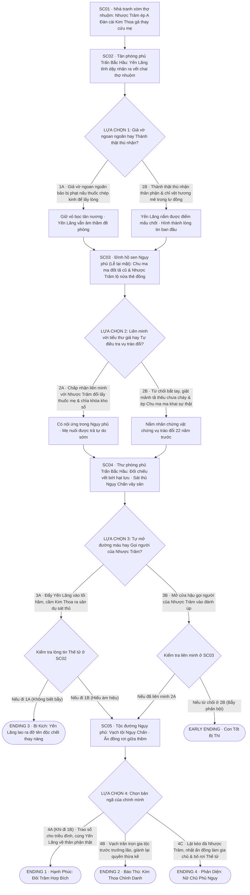

# KỊCH BẢN PHÂN NHÁNH — GẢ KIM THOA
**Thể loại:** Cổ trang thế thân · Chân – giả thiên kim · Trạch đấu quyền mưu · Phim tương tác phân nhánh (FMV)
**Cơ chế lựa chọn đặc trưng:** *Cán Cân Bản Ngã (Người Vợ · Chính Danh · Nữ Chủ Nhân)* — A Đàn bước lên kiệu hoa thế thân để cứu mẹ nuôi, rồi phát hiện mình mới là con gái ruột bị tráo từ nhỏ. Mọi quyết định xoay quanh việc **giữ chữ tín với Thế tử**, **bắt tay hay lật đổ tiểu thư giả**, và **chọn làm người vợ, tiểu thư chính danh hay nữ chủ nhân đầy tham vọng**.

---

### Sơ đồ phân nhánh toàn truyện

---

### Tuyến nhân vật & Đạo cụ cốt lõi
* **A ĐÀN / NGỤY QUÂN ĐÀN (22 tuổi):** Cô gái nghèo xóm thợ nhuộm, gương mặt giống hệt tiểu thư Ngụy phủ; cổ tay trái mang **vết bớt đỏ hình hạt lựu** dưới vòng chỉ đen, đầu ngón tay hằn chai thuốc nhuộm.
* **NGỤY NHƯỢC TRÂM (22 tuổi):** Tiểu thư giả đang chiếm thân phận Ngụy gia, cài cây **Kim Thoa chạm phượng gãy một cánh**. Biết rõ bí mật tráo con từ lâu nên đẩy A Đàn thế thân vào phủ Trấn Bắc Hầu.
* **YẾN LÃNG (26 tuổi):** Thế tử phủ **Trấn Bắc Hầu**, hôn mê ba tháng sau trận phục kích biên ải. Nhớ rõ vị hôn thê thật có vết chai dây đàn cầm ở ngón trỏ phải.
* **NGỤY CHẤN & CHU MA MA:** Cha nuôi (Lão gia Ngụy phủ) và bà vú thực hiện vụ tráo hai đứa trẻ sơ sinh trong đêm lụt 22 năm trước.
* **Đạo cụ:** *Kim Thoa gãy cánh*, *Nửa thẻ đồng khắc ngày sinh*, *Mảnh tã thêu gia huy*, *Ấn đồng gia chủ Ngụy phủ*.

---

### SC01 · NỘI · NHÀ TRANH XÓM THỢ NHUỘM · ĐÊM

Trên bàn gỗ nứt đặt hộp thuốc bổ đang thiếu và bọc bạc vụn. Bên giường, bà Trần ho khan không dứt. Ngụy Nhược Trâm giơ chiếc gương đồng áp sát má A Đàn — hai gương mặt phản chiếu trong gương giống hệt nhau từng đường nét.

Nhược Trâm rút cây **Kim Thoa chạm phượng gãy một cánh** cắm vào búi tóc A Đàn.

NHƯỢC TRÂM
Hôn lễ Trấn Bắc Hầu định vào sáng mai. Thế tử hôn mê ba tháng rồi, ta không vào làm quả phụ thay ngươi được. Giữ lấy bọc thuốc này cho mẹ ngươi, rồi ngoan ngoãn trèo lên kiệu hoa.

A Đàn sờ lên đầu ngón tay nhuốm chàm, quay nhìn mẹ đang thoi thóp rồi gật đầu nhận lấy túi thuốc.

---

### SC02 · NỘI · TÂN PHÒNG PHỦ TRẤN BẮC HẦU · ĐÊM HÔM SAU

Nến đỏ cháy gần tàn. Khi A Đàn khom người kéo lại chăn gấm cho Thế tử đang nằm bất động, cổ tay phải của cô bỗng bị bàn tay rắn rỏi siết chặt không nhúc nhích! Yến Lãng mở mắt tự lúc nào, ngón tay cái lướt qua vết chai dày màu chàm trên lòng bàn tay cô.

YẾN LÃNG
Ngụy Nhược Trâm gảy đàn bảy năm, vết chai nằm ở ngón trỏ phải. Bàn tay nhuộm chàm này không phải của nàng ta. Ngươi là ai?

A Đàn liếc nhanh sang chiếc lư đồng góc giường — làn khói nhạt bốc lên có lẫn mùi ngải đắng khiến đầu óc nặng trĩu.

**[ĐIỂM LỰA CHỌN 1 — Đối diện Thế tử vừa tỉnh lại]**
* **Lựa chọn 1A (Cúi đầu giả vờ ngoan ngoãn, đáp mình bị đích mẫu phạt làm việc tay chân trong phủ để lấy lòng chàng):** Giữ kín thân phận thế thân để tránh rắc rối trước mắt.
* **Lựa chọn 1B (Kéo tay áo thú nhận mình là A Đàn bị ép gả thay cứu mẹ, đồng thời hất nắp lư đồng chỉ vệt bột hương mê lẫn bên trong):** Đặt cược lòng tin ngay đêm đầu tiên.

#### NHÁNH 1A
Yến Lãng thả lỏng ngón tay nhưng ánh mắt không rời nét mặt cô. Chàng xoay người quay lưng về phía trong giường, khẽ đặt thanh đoản kiếm dưới gối mà không nói thêm nửa lời.

#### NHÁNH 1B
Yến Lãng bật dậy mở tung cửa sổ cho gió thổi tan làn khói ngải. Nhìn vết chai thợ nhuộm và ánh mắt thẳng thắn của cô, chàng gỡ chiếc ngọc bội bên hông đặt vào tay A Đàn: *"Ngày mai lễ lại mặt Ngụy phủ, cứ bám sát sau lưng ta."*

---

### SC03 · NGOẠI · ĐÌNH HỒ SEN NGỤY PHỦ · TRƯA LỄ LẠI MẶT

Sau hòn giả sơn vắng người, Chu ma ma đang vội vã đốt một bọc vải cũ trong chậu đồng. A Đàn bước tới định ngăn lại thì Ngụy Nhược Trâm từ sau cột đình chắn ngang lối đi, rút trong tay áo ra **nửa thẻ đồng khắc ngày sinh** rỉ sét.

NHƯỢC TRÂM
Đừng đụng vào đống tro đó nếu muốn mẹ nuôi ngươi sống qua đêm nay. Ngụy Chấn sắp xóa sạch dấu vết năm xưa, kể cả ta lẫn ngươi đều nằm trong danh sách bịt miệng. Hay là cùng ta chia đôi sổ sách Ngụy phủ?

Phía mép chậu lửa, một góc **mảnh tã lụa thêu gia huy** vẫn còn cháy dở chưa thành tro.

**[ĐIỂM LỰA CHỌN 2 — Lời đề nghị bên chậu lửa]**
* **Lựa chọn 2A (Gật đầu nhận lấy chìa khóa kho sổ phụ từ Nhược Trâm, chấp nhận liên minh lật Ngụy Chấn):** Dùng kẻ chiếm thân phận làm đòn bẩy đổi tự do cho mẹ nuôi.
* **Lựa chọn 2B (Hất tay Nhược Trâm, nhào tới giật mảnh tã thêu chưa cháy hết và khóa cổ tay Chu ma ma ép khai tại chỗ):** Tự tay nắm lấy nhân chứng vật chứng vụ tráo đổi.

#### NHÁNH 2A
Nhược Trâm thả chiếc chìa khóa đồng vào lòng bàn tay A Đàn rồi sai người lén thả bà Trần ra cổng sau: *"Đêm nay giờ Hợi, nếu cần người ứng cứu bên phủ Hầu, thắp đèn lồng đỏ ở cửa hậu."*

#### NHÁNH 2B
A Đàn giật được góc tã lụa mang chữ **Quân Đàn**. Dưới áp lực đối chất, Chu ma ma khuỵu gối khai sạch chuyện đêm lụt 22 năm trước bà đã đánh tráo tiểu thư thật vào giỏ nhà thợ nhuộm.

---

### SC04 · NỘI · THƯ PHÒNG PHỦ TRẤN BẮC HẦU · ĐÊM

Dưới ánh đèn dầu, A Đàn tháo vòng chỉ đen trên cổ tay trái lộ **vết bớt đỏ hình hạt lựu** khớp trọn với ký hiệu trên mảnh tã lụa *(hoặc nửa thẻ đồng Nhược Trâm vô tình lộ ra)*. Cô sững người nhận ra sự thật: chính cô mới là Ngụy Quân Đàn ruột thịt, còn Nhược Trâm biết bí mật từ lâu nên đẩy cô thế thân vào cửa tử!

Đúng lúc đó, tiếng ngói vỡ vang rền ngoài mái hiên — đám sát thủ áo đen của Ngụy Chấn ập xuống sân trong để diệt khẩu. Yến Lãng rút kiếm đứng chắn ngay bậu cửa thư phòng, cánh tay vẫn hơi run vì dư độc hương mê.

**[ĐIỂM LỰA CHỌN 3 — Vòng vây sát thủ trong đêm]**
* **Lựa chọn 3A (Đẩy Yến Lãng lùi về lối hầm sau kệ sách, tự mình cầm Kim Thoa lao ra sân làm mồi nhử báo tin cấm vệ):** Tự gánh nguy hiểm để mở đường cho chàng.
* **Lựa chọn 3B (Đốt đèn lồng đỏ bên cửa hậu phát tín hiệu gọi nội ứng của Nhược Trâm tới đánh úp sát thủ):** Mượn tay Nhược Trâm phá vòng vây.

#### NHÁNH 3A
* *(Nếu đi `1B` — Yến Lãng hiểu ám hiệu tin tưởng)*: Yến Lãng lập tức theo lối hầm vòng sau lưng dẫn đội hộ vệ ập vào khống chế toàn bộ sát thủ Ngụy Chấn, giữ chặt A Đàn lành lặn bước tới ngày đối chất.
* *(Nếu đi `1A` — Yến Lãng còn nghi kỵ nên tưởng cô ra sân nộp mạng)*: Chàng lao vọt ra chắn ngang trước người cô, lãnh trọn mũi tên độc tẩm tên nỏ bắn từ trên mái xuống ➔ **ENDING 3 (Bi kịch)**.

#### NHÁNH 3B
* *(Nếu đi `2A` — đã liên minh)*: Toán người của Nhược Trâm ập vào từ cửa hậu đánh tan sát thủ của Ngụy Chấn, giao nộp toàn bộ chứng từ sổ sách Ngụy phủ ➔ sang **SC05**.
* *(Nếu đi `2B` — từng từ chối liên minh)*: Cửa hậu mở ra nhưng người của Nhược Trâm lập tức nổ pháo hiệu vu cho A Đàn dẫn thích khách vào hại Thế tử ➔ **EARLY ENDING**.

---

### SC05 · NỘI · TỘC ĐƯỜNG NGỤY PHỦ · SÁNG HÔM SAU

Trước mặt các trưởng lão Ngụy tộc, A Đàn đặt mảnh tã thêu gia huy *(hoặc sổ sách mật của Nhược Trâm)* lên bàn hương án và xắn tay áo lộ **vết bớt hình hạt lựu**. Ngụy Chấn mặt cắt không còn giọt máu, làm rơi chiếc **ấn đồng gia chủ** lăn cạch xuống thềm đá ngay trước mũi giày cô.

Phía ngoài cửa tộc đường, Yến Lãng đứng đợi dưới nắng sớm; bên trái, Nhược Trâm lùi sát góc cột chuẩn bị chuồn êm nếu bị lật mặt.

**[ĐIỂM LỰA CHỌN 4 — Bước chọn bản ngã cuối cùng]**
* **Lựa chọn 4A** *(Khả dụng khi đi `1B` — Thế tử đồng hành trọn vẹn)*: **Giao toàn bộ vụ án cho hình bộ phân xử, nắm tay Yến Lãng bước ra khỏi tộc đường với thân phận Ngụy Quân Đàn chính danh.**
* **Lựa chọn 4B (Chỉ tay vạch trần trọn tội ác của cả Ngụy Chấn lẫn Nhược Trâm trước toàn tộc, đòi lại toàn bộ gia sản thuộc về mình):** Đòi công đạo và quyền thừa kế chính danh.
* **Lựa chọn 4C (Nhặt chiếc ấn đồng lên tay, gạt cả Nhược Trâm khỏi sổ tộc lẫn trao lại tờ từ hôn vào tay Yến Lãng):** Trở thành nữ chủ nhân duy nhất của Ngụy phủ, không đứng dưới bóng ai.

---

### HỆ THỐNG KẾT CỤC (5 ENDINGS)

* **EARLY ENDING · CON TỐT BỊ THÍ *(Đi `2B` rồi gọi Nhược Trâm ở `3B`)*:** Không bắt tay trước nhưng lại mở cửa hậu đón người của Nhược Trâm khiến A Đàn bị gán tội phản bội ngay trong sân phủ Hầu, mất sạch cả cơ hội tự minh oan.
* **ENDING 1 · HẠNH PHÚC: ĐÔI TRÂM HỢP BÍCH *(Chọn `4A` khi đi `1B`)*:** Thân phận Ngụy Quân Đàn được khôi phục trong sự bảo hộ vững chắc của Trấn Bắc Hầu. Yến Lãng đặt chiếc trâm mới chạm đôi phượng lên bàn trang điểm thay cây Kim Thoa gãy cánh, cùng cô mở trang mới bên mẹ nuôi khỏe mạnh.
* **ENDING 2 · BÁO THÙ: KIM THOA CHÍNH DANH *(Chọn `4B`)*:** Trưởng lão tuyên phạt Ngụy Chấn và trục xuất Nhược Trâm khỏi gia phả ngay trước từ đường. A Đàn thu hồi toàn bộ ruộng đất cửa hiệu Ngụy gia, đường hoàng kế thừa vị trí đích nữ thật sự.
* **ENDING 3 · BI KỊCH: BÓNG HẦU TRONG ĐÊM SƯƠNG *(Đi `1A` rồi chọn `3A`)*:** Vì không biết cô chỉ giả làm mồi nhử, Yến Lãng lao ra đỡ trọn mũi tên độc giữa sân thư phòng. Chàng mỉm cười chạm khẽ vào vết chai thợ nhuộm trên tay cô trước khi khép mắt mãi mãi; A Đàn giữ lại danh vị Thế tử phi góa bụa cùng cây Kim Thoa gãy suốt phần đời còn lại.
* **ENDING 4 · PHẢN DIỆN: NỮ CHỦ PHỦ NGỤY *(Chọn `4C`)*:** A Đàn tự tay đeo ấn đồng gia chủ, ép Nhược Trâm ký giấy bán đứt phần sản nghiệp cuối cùng rồi đặt tờ từ hôn lên ngực áo Yến Lãng giữa hành lang nắng gắt. Đứng trên bậc thềm phủ Ngụy rộng lớn một mình, cô nắm trọn quyền lực gia tộc mà không cần bất kỳ người đàn ông nào che chở.
