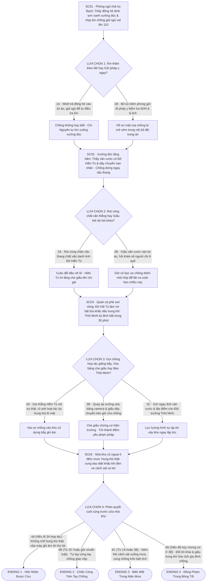

# KỊCH BẢN PHÂN NHÁNH — HOA CỦA QUỶ
**Thể loại:** Tâm lý hình sự · Điều tra gia đình · Phim tương tác phân nhánh (FMV)
**Cơ chế lựa chọn đặc trưng:** *Ranh Giới Cảnh Sát & Người Vợ* — Trà Chi Nguyên bí mật điều tra người chồng mẫu mực đang sống dưới danh tính giả. Giấu bằng chứng kéo dài thời gian dễ đẩy cô thành **đồng phạm**, còn hợp tác đúng lúc sẽ vạch trần **hung thủ thật chính là người mà chồng cô đổi tên để che chở**.

---

### Sơ đồ phân nhánh toàn truyện

---

### Tuyến nhân vật & Đạo cụ cốt lõi
* **TRÀ CHI NGUYÊN (31 tuổi):** Nữ cảnh sát đội trọng án, vợ của Bạch Hi Thành. Sắc sảo nhưng giằng xé giữa thẻ ngành và gia đình.
* **BẠCH HI THÀNH / ĐÔ HIỀN TÚ (33 tuổi):** Nghệ nhân đúc kim loại hiền lành; suốt 15 năm dùng danh tính giả để nhận tội thay và che chở cho chị gái ruột.
* **ĐÔ HẢI TÚ (36 tuổi):** Chị gái ruột của Hiền Tú — người em trai hết lòng bảo vệ, thực chất nắm giữ chiếc bật lửa khắc ký hiệu trùng khớp hung khí sát nhân liên hoàn.
* **ĐỘI TRƯỞNG THÔI MINH (42 tuổi):** Cấp trên trực tiếp tại đội trọng án, phụ trách lệnh bắt "Đô Hiền Tú".
* **Đạo cụ:** *Đồng hồ dây da dính sơn xanh xưởng đúc*, *Thẻ căn cước cũ tên Đô Hiền Tú*, *Sợi dây chuyền bạc*, *Chiếc bật lửa khắc ký hiệu hung khí*, *Thẻ ngành cảnh sát*.

---

### SC01 · NỘI · PHÒNG NGỦ NHÀ HỌ BẠCH · NỬA ĐÊM

Chi Nguyên vừa bước vào phòng sau ca khám nghiệm vụ án bắt chước tên sát nhân 15 năm trước. Khi nhấc chiếc áo khoác của chồng treo bên giá để cất vào tủ, một chiếc **đồng hồ dây da dính vệt sơn xanh xưởng đúc** rơi ra thảm — màu sơn khớp hệt mẫu vật thu tại hiện trường tối nay!

Cô quay sang nhìn người chồng đang nằm quay lưng nhắm mắt trên giường. Trên cổ tay anh, chiếc đồng hồ đo sức khỏe điện tử nhấp nháy vọt từ nhịp 62 lên thẳng **110 nhịp một phút** — Bạch Hi Thành đang hoàn toàn tỉnh táo giả ngủ.

**[ĐIỂM LỰA CHỌN 1 — Bước điều tra đầu tiên]**
* **Lựa chọn 1A (Nhặt chiếc đồng hồ nhét trả gọn vào túi áo khoác chồng rồi tắt đèn lên giường):** Giữ im lặng để tự theo dõi hành tung chồng từ bên trong.
* **Lựa chọn 1B (Gắp chiếc đồng hồ bỏ vào túi niêm phong, nhắn tin gửi thẳng tổ pháp y kiểm tra ADN và lý lịch Bạch Hi Thành):** Khởi động quy trình điều tra chính thức.

#### NHÁNH 1A
Chi Nguyên nhẹ nhàng nhét lại chiếc đồng hồ vào túi áo khoác, nằm xuống cạnh lưng anh. Chỉ đến khi hơi thở giả ngủ của anh giãn ra sau mười phút, mắt cô mới mở trừng nhìn lên trần nhà tối.

#### NHÁNH 1B
Túi niêm phong được giấu gọn vào túi xách công vụ. Sáng sớm hôm sau, phòng dữ liệu nội bộ nhắn tin hẹn gặp gấp vì phát hiện dấu vân tay của Bạch Hi Thành không khớp hồ sơ hộ khẩu gốc.

---

### SC02 · NỘI · XƯỞNG ĐÚC KIM LOẠI TẦNG HẦM · TRƯA HÔM SAU

Tranh thủ giờ nghỉ trưa, Chi Nguyên mở cửa xuống tầng hầm xưởng kim loại của chồng. Bên dưới ngăn bàn nguội nguội lạnh, cô bật khóa một chiếc hộp thiếc rỉ sét — bên trong đặt **thẻ căn cước ố vàng mang tên Đô Hiền Tú**, vài bức thư cũ nét chữ phụ nữ và **sợi dây chuyền bạc** giống hệt món đồ bị mất của nạn nhân mới nhất!

Tiếng khóa cửa sắt tầng hầm xoay *cạch*. Đô Hiền Tú đứng ngay đầu cầu thang, ánh mắt dừng lại đúng trên tấm thẻ căn cước trong bàn tay Chi Nguyên.

**[ĐIỂM LỰA CHỌN 2 — Đối diện ngay tại xưởng đúc]**
* **Lựa chọn 2A (Rút chiếc còng tay khỏi thắt lưng chặn ngay bậc thang cuối, giơ thẳng tấm thẻ hỏi tên thật của anh):** Phá vỡ lớp mặt nạ gia đình ngay lập tức.
* **Lựa chọn 2B (Nhanh tay nhét tấm thẻ vào túi áo khoác, giả vờ đi tìm chìa khóa dự phòng rồi hỏi khéo về "người chị gái ở quê"):** Giữ bình tĩnh tiếp tục khai thác đầu mối phía sau.

#### NHÁNH 2A
Đô Hiền Tú không bước xuống thêm cũng không bỏ chạy, chỉ đứng lặng trên bậc gỗ: *"Anh không giết ai cả. Nếu em còng anh bây giờ, toàn bộ dấu vết kẻ thật sự sẽ đứt sạch."*

#### NHÁNH 2B
Hiền Tú khựng lại nửa nhịp khi nghe nhắc tới người chị ở quê, ánh mắt thoáng qua vẻ cảnh giác rồi đưa cô tách trà ấm: *"Chị ấy mất liên lạc lâu rồi, em hỏi làm gì?"* Ngay khi anh quay lưng ra cửa, Chi Nguyên kịp chép lại địa chỉ người gửi trên bì thư.

---

### SC03 · NỘI · QUÁN CÀ PHÊ VEN SÔNG · CHIỀU MUỘN

Theo địa chỉ trên phong bì *(hoặc theo vết định vị điện thoại của chồng)*, Chi Nguyên chặn bước **Đô Hải Tú** ngay tại góc quán cà phê vắng khách cạnh bờ sông.

Thấy tấm thẻ căn cước cũ trên tay cô cảnh sát, Đô Hải Tú tái mặt thú nhận Hiền Tú đã thay tên đổi họ suốt 15 năm để gánh tiếng oan bảo vệ gia đình — nhưng đúng lúc với tay lấy túi xách định rời đi, Hải Tú làm rơi **chiếc bật lửa đồng khắc ký hiệu ngôi sao năm cánh**, trùng khớp tuyệt đối với dấu ấn hung khí gây án vừa thu hôm qua! Chính người được bảo vệ đang che giấu hoặc tiếp tay cho hung thủ thật!

Điện thoại Chi Nguyên rung liên hồi: Đội trưởng **Thôi Minh** báo lệnh bắt khẩn cấp "Đô Hiền Tú" đã ký và tổ đặc nhiệm sẽ ập tới trong 30 phút.

**[ĐIỂM LỰA CHỌN 3 — 30 phút trước khi lệnh bắt có hiệu lực]**
* **Lựa chọn 3A (Gọi thẳng cho Hiền Tú kể sạch sự thật về Đô Hải Tú, hẹn anh gặp tại kho ngoại ô dựng bẫy ghi âm ép hung thủ thật lộ mặt):** Tin tưởng hợp tác cùng chồng lật ngược ván cờ.
* **Lựa chọn 3B (Lao về xưởng đúc xóa toàn bộ băng camera an ninh hôm qua và giấu sợi dây chuyền bạc đi trước khi đội khám xét tới):** Dùng nghiệp vụ che chắn cho chồng.
* **Lựa chọn 3C (Chụp ảnh chiếc bật lửa lẫn vị trí hai chị em gửi thẳng cho Đội trưởng Thôi Minh điều quân vây bắt ngay lập tức):** Chọn đứng hoàn toàn về phía pháp luật.

---

### SC04 · NỘI · NHÀ KHO CŨ NGOẠI Ô · ĐÊM MƯA

Mưa tạt rát mái tôn nhà kho bỏ hoang. Bị dồn tới đường cùng, hung thủ thật *(kẻ đồng phạm bám theo Đô Hải Tú tới diệt khẩu)* rút dao lao thẳng về phía Chi Nguyên khi đèn pha xe cảnh sát của Đội trưởng Thôi Minh vừa sáng rực ngoài cửa sắt!

Hiền Tú không chút chần chừ lao chắn trước lưỡi dao, một tay ghìm chặt cổ tay hung thủ ngay giữa khoang đèn pha chói lòa. Tiếng còi xe đặc nhiệm vang dội sát bậc cửa.

**[ĐIỂM LỰA CHỌN 4 — Lựa chọn cuối cùng khi cửa kho bật tung]**
* **Lựa chọn 4A** *(Khả dụng khi đi `3A` hợp tác dựng bẫy và không hủy bằng chứng ở `3B`)*: **Cùng Hiền Tú quật ngã hung thủ thật, chìa chiếc máy ghi âm trọn vẹn lời thú tội ra trước mặt Đội trưởng Thôi Minh.**
* **Lựa chọn 4B (Bước tới khóa chiếc còng thép lên cổ tay Hiền Tú, chính thức đọc lệnh bắt giữ tội tráo danh tính và che giấu 15 năm):** Đặt cán cân công lý lên trên tình cảm vợ chồng.
* **Lựa chọn 4C** *(Khả dụng từ `1A` hoặc `3B` khi còn đường lui)*: **Tháo thẻ ngành cảnh sát ném xuống vũng nước mưa, kéo Hiền Tú leo lên chiếc xe tải hàng nổ máy trốn khỏi thành phố.**
* **Lựa chọn 4D** *(Chỉ mở khi đã xóa băng và giấu chứng cứ ở `3B`)*: **Nhanh tay đá chiếc bật lửa hung khí vào gầm máy cũ, tự sửa lời khai hiện trường để giữ trọn bình yên cho cả gia đình chồng.**

---

### HỆ THỐNG KẾT CỤC (4 ENDINGS)

* **ENDING 1 · HÔN NHÂN ĐƯỢC CỨU *(Chọn `4A` từ nhánh `3A`)*:** Hung thủ thật sa lưới với đầy đủ băng ghi âm thú tội, Hiền Tú được minh oan án sát nhân 15 năm trước và chỉ chịu án nhẹ về giấy tờ. Rời khỏi trại giam vào buổi sáng nắng nhẹ, anh giơ bàn tay không còn che giấu nắm chặt lấy tay Chi Nguyên trở về nhà.
* **ENDING 2 · CHIẾC CÒNG TRÊN TAY CHỒNG *(Chọn `4B`)*:** Chi Nguyên tự tay trao chồng cho tổ công tác của Thôi Minh giữa cơn mưa tầm tã. Hiền Tú không oán trách nửa lời, chỉ lặng lẽ quay nhìn theo bóng áo cảnh sát của cô lần cuối qua khung cửa xe đặc chủng.
* **ENDING 3 · BIẾN MẤT TRONG MÀN MƯA *(Chọn `4C`)*:** Tiếng còi cảnh sát xa dần sau gương chiếu hậu. Trên cung đường đèo hướng ra cảng biển lúc rạng sáng, hai người vứt bỏ toàn bộ thẻ ngành lẫn giấy tờ giả xuống khe vực, cùng nhau biến mất khỏi cuộc đời cũ không ngày trở lại.
* **ENDING 4 · ĐỒNG PHẠM TRONG BÓNG TỐI *(Chọn `4D` từ nhánh `3B`)*:** Hồ sơ hiện trường được Chi Nguyên hợp thức hóa gọn ghẽ để khép lại cuộc điều tra. Đêm trở về nhà họ Bạch dưới ánh đèn vàng ấm áp, hai vợ chồng ngồi đối diện nhau bên mâm cơm — giữa họ là chiếc hộp thiếc khóa chặt vĩnh viễn dưới đáy hầm.
