# KỊCH BẢN PHÂN NHÁNH — QUY TẮC QUÁI ĐÀM: LUẬT TRÔNG TRẺ NHÀ WHITLOCK

| Thẻ tập | |
|---|---|
| Thị trường | Thị trấn Marrow Falls, Oregon, Mỹ · tiền USD (thù lao $400/đêm) |
| Thể loại · cơ chế | Kinh dị quy tắc (rule-based horror) · Nora phải đoán **luật nào trên tấm thẻ là thật, luật nào là bẫy**. Làm đúng luật chưa chắc đã an toàn: người viết thẻ cần một người trông trẻ cho "thứ dưới hầm" mỗi năm một lần |
| Chế độ trạng thái | `free` (2 cờ) — truyện xoay quanh việc thử luật, không theo khung điều tra `house` |
| Bối cảnh chính | A: tầng trệt nhà Whitlock (bếp, tủ lạnh dán thẻ luật, cửa chính, cửa hầm) · B: tầng trên (phòng ngủ Lily + hành lang, cầu thang) · C: tầng hầm (chỉ dùng ở cao trào và 2 kết cục) |
| Nhân vật | `nora_hale` Nora Hale (19, sinh viên điều dưỡng đi trông trẻ thêm; cardigan vàng mù tạt, búi tóc rối cắm cây bút chì vàng, điện thoại vỡ góc) · `lily_whitlock` Lily Whitlock (7, váy ngủ xanh nhạt, ôm thỏ bông xám mất một mắt cúc áo) · `celia_whitlock` Celia Whitlock (42, mẹ Lily; áo khoác kem, hoa tai ngọc trai, nụ cười không bao giờ tắt; người viết thẻ luật) · `dana_cole` Dana Cole (20, người trông trẻ năm ngoái; áo hoodie đỏ, dây buộc tóc ở cổ tay; chủ yếu là **giọng nói** trong máy báo em bé, chỉ hiện hình ở kết cục) |
| Vai câm / quái | **Kẻ Trọ Dưới Hầm** (The Lodger): dáng cao, ướt sũng, đội mặt người nó bắt chước — lên hình như bản sao Celia (ở cửa sổ/ô nhìn cửa) hoặc bóng đen ngoài tầm sáng. Bản sao Lily ở `END_TWO_LILYS` = biến thể đạo cụ của Lily, không phải nhân vật mới. Graham Whitlock (bố) chỉ là chữ ký và một bóng người sau lưng bản sao Celia |
| Cờ | `loi_dana=true`: đặt ở **3B** (để máy báo em bé chạy, trái luật 3), đọc ở **6B** — gợi ý khóa: "Bạn đã tắt máy báo em bé. Có người từng muốn dặn bạn một mẹo." / "You turned off the baby monitor. Someone tried to tell you a trick." · `but_sap=true`: đặt ở **4A** (nhận cây bút sáp đỏ của Lily), đọc ở **7A** — gợi ý khóa: "Bạn không có gì để viết lên tấm thẻ. Lily từng chìa ra một thứ." / "You have nothing to write on the card with. Lily once held something out to you." |
| Kết cục | `END_TRUE_RULE_EIGHT` (True, cần `loi_dana` + `but_sap`) · `END_REDEEM_SWAP` (Redemption, đổi chỗ cho Dana) · `END_BITTERSWEET_RUN` (Bittersweet, thoát cùng Lily nhưng vòng lặp còn đó) · `END_KARMA_NEW_VOICE` (Karma/bẫy "làm đúng luật": mở cửa lúc 12:45) · `END_BASEMENT` (chết sớm) · `END_TWO_LILYS` (chết sớm) |

**Tấm thẻ luật** (đạo cụ neo cả tập, chữ đánh máy dán trên cửa tủ lạnh — khóa chính tả khi lên ảnh):

> **"WHITLOCK HOUSE — SITTER RULES"**
> 1. "Lily is in bed by 9:00. Check on her once, at 10:00. Never twice."
> 2. "The basement door stays locked. Knocking is the water heater."
> 3. "If the baby monitor talks, turn it off."
> 4. "We'll be home at 12:45. Open the door for us."
> 5. "Your pay is on the counter. Take it when we're home."
> "— Celia & Graham"

*Sự thật (người chơi tự khám phá):* luật 1 **thật** · luật 2 **nửa thật** (cửa phải khóa, nhưng tiếng gõ không phải bình nóng lạnh) · luật 3 **giả** (máy báo là cách duy nhất Dana còn nói được) · luật 4 **bẫy** (thứ về lúc 12:45 không phải bố mẹ Lily) · luật 5 **bẫy** (giữ người trông trẻ ở lại tới 12:45). Quy luật của quái: nó phải tuân theo những gì người lớn viết trên tấm thẻ, và nó **không nói được tên của người nó đang giữ**.

### Sơ đồ phân nhánh

```mermaid
flowchart TD
    S1["S01 · A: Celia dán thẻ luật mới đè lên một thẻ cũ có vết sáp đỏ rồi lái xe đi"] --> C1{"LỰA CHỌN 1: Bóc thẻ mới xem thẻ cũ hay lên lầu đúng luật?"}
    C1 -->|"1A · Bóc góc thẻ mới, đọc thẻ cũ bên dưới"| S1I["S01_INSPECT · A: Thẻ cũ bị gạch sáp đỏ 'LIE' 'NOT THEM' ký D. · Giọng Lily gọi từ sau cửa hầm"]
    C1 -->|"1B · Làm đúng luật, lên lầu đắp chăn cho Lily"| S2["S02 · B: Lily kể con thỏ tên thật là Dana · Máy báo em bé thở khò khè"]
    S1I --> C2{"LỰA CHỌN 2: Đáp lại giọng Lily dưới hầm?"}
    C2 -->|"2A · Áp tai vào cửa hầm, đáp lại giọng Lily"| E_BASE(["EARLY ENDING · Bậc Thang Thứ Mười Ba"])
    C2 -->|"2B · Mặc kệ, chạy lên lầu xem Lily thật"| S2
    S2 --> C3{"LỰA CHỌN 3: Máy báo em bé lên tiếng, tắt theo luật 3?"}
    C3 -->|"3A · Tắt máy theo luật 3"| S3["S03 · B: 22:00 kiểm Lily lần duy nhất · Lily vẽ bằng sáp đỏ · Dấu chân ướt trên hành lang"]
    C3 -->|"3B · Để máy chạy, mang xuống bếp (đặt loi_dana)"| S2M["S02_MONITOR · A: Giọng Dana: Celia cần một người mỗi năm · Nó không nói được tên người nó giữ"]
    S2M --> S3
    S3 --> C4{"LỰA CHỌN 4: Nhận cây bút sáp đỏ của Lily?"}
    C4 -->|"4A · Nhận bút sáp, nghe Lily nói hết (đặt but_sap)"| S4["S04 · A: 23:40 Lily khóc gọi Nora lên kiểm thêm lần nữa"]
    C4 -->|"4B · Không tin bức vẽ, đóng cửa đúng một lần kiểm"| S4
    S4 --> C5{"LỰA CHỌN 5: Phá luật 1 để lên xem Lily lần hai?"}
    C5 -->|"5A · Mở cửa phòng Lily lần thứ hai"| E_TWO(["EARLY ENDING · Hai Cô Bé Trên Một Giường"])
    C5 -->|"5B · Ngồi ngoài cửa hát vọng vào, không mở"| S5["S05 · A: 12:45 bản sao Celia đứng ngoài cửa · Điện thoại reo số Celia"]
    S5 --> C6{"LỰA CHỌN 6: Mở cửa theo luật 4?"}
    C6 -->|"6A · Mở cửa đúng luật 4"| E_KARMA(["KARMA ENDING · Giọng Mới Trong Máy Báo"])
    C6 -->|"6B · Hỏi tên con thỏ (cần loi_dana · đi 3B)"| S6["S06 · A+C: Bản sao Celia không nói được 'Dana' · Mặt nó tuột ra · Cửa hầm bật tung"]
    C6 -->|"6C · Bế Lily chạy cửa sau vào mưa"| E_RUN(["BITTERSWEET ENDING · Hiên Nhà Hàng Xóm"])
    S6 --> C7{"LỰA CHỌN 7: Viết luật mới hay tự xuống hầm đổi chỗ?"}
    C7 -->|"7A · Viết luật số 8 bằng sáp đỏ (cần but_sap · đi 4A)"| E_TRUE(["TRUE ENDING · Luật Số Tám"])
    C7 -->|"7B · Tự xuống hầm, đổi mình lấy Dana"| E_REDEEM(["REDEMPTION ENDING · Người Gác Máy Báo"])
```

---

### S01 · Bối cảnh A · NỘI · TẦNG TRỆT NHÀ WHITLOCK · 20:55
**Nhân vật:** Nora, Celia · **Đạo cụ neo:** tấm thẻ luật trên cửa tủ lạnh

Hook 3 giây: bàn tay đeo nhẫn của Celia miết băng keo, dán một tấm thẻ luật mới tinh đè lên một tấm thẻ cũ. Mép thẻ cũ lòi ra một vệt sáp màu đỏ. Celia đặt phong bì "$400" lên quầy bếp, cài hoa tai ngọc trai, mỉm cười quá lâu.

CELIA: Đọc hai lần. Làm theo một lần.

Đèn xe quét qua cửa sổ rồi tắt hẳn. Nora còn lại một mình với năm dòng chữ đánh máy. Ở góc dưới, mép thẻ cũ bị gió máy sưởi thổi lật phật.

**[LỰA CHỌN 1 — Thẻ cũ hay đứa trẻ]**
* **1A (Bóc góc thẻ mới, đọc thẻ cũ bên dưới)** → `S01_INSPECT`: biết luật có người sửa, nhưng nán lại dưới nhà quá giờ đắp chăn.
* **1B (Làm đúng luật, lên lầu đắp chăn cho Lily)** → `S02`: an toàn, nhưng không biết ai từng viết sáp đỏ.

### S01_INSPECT · Bối cảnh A · NỘI · TẦNG TRỆT · 21:02
**Nhân vật:** Nora · **Đạo cụ neo:** thẻ luật cũ (trạng thái: bị gạch sáp đỏ)

Thẻ cũ in đúng năm luật y hệt, nhưng có người gạch bằng sáp đỏ: cạnh luật 3 ghi **"LIE"**, cạnh luật 4 ghi **"NOT THEM"**, ký **"— D."**. Kẹp sau thẻ là một sợi dây buộc tóc đỏ.

Cộc. Cộc. Tiếng gõ từ sau cửa hầm khóa trái — đúng luật 2 nói là bình nóng lạnh. Rồi một giọng bé gái, giống hệt Lily, thì thầm qua khe cửa.

GIỌNG "LILY" (sau cửa hầm): Nora ơi… em ngã rồi. Chân em chảy máu.

Trên trần nhà, ngay phía trên đầu Nora, vang lên tiếng bước chân trẻ con chạy qua phòng ngủ.

**[LỰA CHỌN 2 — Tiếng gọi sau cửa hầm]**
* **2A (Áp tai vào cửa hầm, đáp lại giọng Lily)** → `END_BASEMENT`
* **2B (Mặc kệ, chạy lên lầu xem Lily thật)** → `S02`: Lily vẫn ở trên lầu. Vậy thứ dưới hầm là gì?

### S02 · Bối cảnh B · NỘI · PHÒNG NGỦ LILY · 21:10
**Nhân vật:** Nora, Lily · **Đạo cụ neo:** máy báo em bé (bộ nghe của người lớn, đèn xanh)

Lily ngồi trong chăn, khô ráo, ôm con thỏ bông mất một mắt. Trên tủ đầu giường, bộ nghe máy báo em bé nhấp nháy đèn xanh dù không ai bật.

LILY: Mẹ gọi nó là Ông Cúc Áo. Nhưng tên thật của nó là Dana. Từ hồi chị ấy đi mất.

Máy báo rè rè. Có tiếng thở dài của một người phụ nữ, rất gần micro, như đang cố nói mà chưa ra chữ. Luật 3: *"If the baby monitor talks, turn it off."*

**[LỰA CHỌN 3 — Máy báo em bé lên tiếng]**
* **3A (Tắt máy theo luật 3)** → `S03`: căn nhà im bặt, quá im.
* **3B (Để máy chạy, giấu vào túi cardigan mang xuống bếp)** → `S02_MONITOR` · đặt `loi_dana`: phá luật lần đầu.

### S02_MONITOR · Bối cảnh A · NỘI · BẾP · 21:30
**Nhân vật:** Nora (Dana chỉ có giọng) · **Đạo cụ neo:** máy báo em bé

Nora đặt máy báo lên quầy, cạnh phong bì tiền. Giọng nữ trẻ, ướt và đứt quãng, vọng ra.

DANA (máy báo): Năm ngoái tôi cũng đứng chỗ cậu đứng. Celia viết thẻ đó. Mỗi năm, một người trông trẻ.

DANA (máy báo): Lúc 12:45 nó đến, đội mặt họ. Nó không nói được tên người nó đang giữ.

Tiếng gõ dưới hầm dồn dập hơn, như bị nghe lén. Máy báo tắt phụt. Nora nhìn sang phong bì "$400": luật 5 bắt cô ở lại tới khi "họ" về.

→ `S03`

### S03 · Bối cảnh B · NỘI · PHÒNG NGỦ LILY + HÀNH LANG · 22:00
**Nhân vật:** Nora, Lily · **Đạo cụ neo:** cây bút sáp đỏ của Lily + bức vẽ

Đúng 22:00, lần kiểm duy nhất. Lily chưa ngủ: em đang tô sáp đỏ lên giấy — một cô gái đứng viết lên tấm thẻ trên tủ lạnh, còn cửa hầm vẽ thành một cái miệng.

LILY: Chị Dana bảo người lớn viết gì lên thẻ thì nhà phải nghe. Em chưa phải người lớn.

Lily chìa cây bút sáp đỏ ra. Sau lưng Nora, trên sàn gỗ hành lang, một hàng dấu chân trần ướt nhẹp đi từ đầu cầu thang tới, dừng ngay sát gót cô. Không có ai.

**[LỰA CHỌN 4 — Cây bút sáp đỏ]**
* **4A (Nhận bút sáp, quỳ xuống nghe Lily nói hết)** → `S04` · đặt `but_sap`: Nora tin một đứa trẻ hơn tin tấm thẻ.
* **4B (Không tin bức vẽ, đóng cửa đúng một lần kiểm)** → `S04`: nếu chính Lily là thứ cần sợ thì sao?

### S04 · Bối cảnh A → B · NỘI · CHÂN CẦU THANG · 23:40
**Nhân vật:** Nora (Lily chỉ có giọng sau cửa) · **Đạo cụ neo:** tấm thẻ luật (luật 1)

Nora ngồi bậc cuối cầu thang. Từ phòng trên lầu, Lily khóc — lần này không thì thầm.

LILY (sau cửa): Chị Nora ơi, lên xem em lần nữa đi. Có ai đứng trong tủ quần áo.

Luật 1: *"Never twice."* Hàng dấu chân ướt ban nãy giờ đã khô — chỉ còn một cặp dấu mới, quay mũi vào cửa phòng Lily.

**[LỰA CHỌN 5 — Lần kiểm thứ hai]**
* **5A (Chạy lên mở cửa phòng Lily lần thứ hai)** → `END_TWO_LILYS`
* **5B (Ngồi sát ngoài cửa, hát vọng vào nhưng không mở)** → `S05`: Lily hát theo bài ru Dana từng dạy, giọng nhỏ dần rồi ngủ.

### S05 · Bối cảnh A · NỘI · CỬA CHÍNH · 00:45
**Nhân vật:** Nora, bản sao Celia (qua ô nhìn cửa) · **Đạo cụ neo:** ô kính nhìn cửa + điện thoại vỡ góc

Đèn pha rọi qua rèm. Chuông cửa. Qua ô nhìn, Celia đứng mỉm cười, tóc ướt sũng dù ngoài trời khô ráo; sau lưng là bóng một người đàn ông cao không thấy mặt.

BẢN SAO CELIA: Nora, cưng ơi. Cô quên chìa khóa. Mở cửa cho cô.

Cùng lúc, điện thoại Nora rung: **"Celia Whitlock"**. Luật nói *"we'll be home at 12:45"* — và cũng chưa từng nói họ sẽ gọi. Ngoài cửa, Celia vẫn đứng yên, không cầm điện thoại.

**[LỰA CHỌN 6 — Ai là chủ nhà?]**
* **6A (Mở cửa đúng luật 4)** → `END_KARMA_NEW_VOICE`
* **6B (Hỏi qua cửa: "Con thỏ của Lily tên gì?")** → `S06` · *cần `loi_dana`*; nút khóa hiện gợi ý ở thẻ tập.
* **6C (Lên lầu bế Lily, chạy cửa sau vào màn mưa)** → `END_BITTERSWEET_RUN`

### S06 · Bối cảnh A + C · NỘI · BẾP → CỬA HẦM · 00:50
**Nhân vật:** Nora, bản sao Celia → Kẻ Trọ Dưới Hầm · **Đạo cụ neo:** tấm thẻ luật trên tủ lạnh

BẢN SAO CELIA: Ông Cúc Áo. Ai cũng biết mà.

NORA: Tên thật cơ. Nói đi.

Miệng "Celia" mở ra, môi run, không phát được chữ nào. Gương mặt trượt lệch khỏi xương như mặt nạ ướt. Ánh đèn hiên tắt. Cánh cửa chính im bặt — rồi **cửa hầm sau lưng Nora bật tung**, ổ khóa rơi xuống sàn. Một dáng cao, ướt sũng, vẫn đeo đôi hoa tai ngọc trai, leo lên từng bậc. Từ trong bóng tối dưới hầm, giọng Dana gọi tên Nora.

Nora lùi tới sát tủ lạnh. Tấm thẻ luật chạm vào lưng cô.

**[LỰA CHỌN 7 — Luật của ai?]**
* **7A (Viết luật số 8 lên thẻ bằng sáp đỏ)** → `END_TRUE_RULE_EIGHT` · *cần `but_sap`*; nút khóa hiện gợi ý ở thẻ tập.
* **7B (Tự bước xuống hầm, đổi mình lấy Dana)** → `END_REDEEM_SWAP`

---

### HỆ THỐNG KẾT CỤC
* **`END_TRUE_RULE_EIGHT` · TRUE · LUẬT SỐ TÁM** *(cần `loi_dana` + `but_sap`, chọn 7A)*: Nora gạch luật 4, viết dòng sáp đỏ nguệch ngoạc **"8. Give back every name you took."** Cái bóng khựng lại giữa bếp như bị giật dây, rồi tụt ngược xuống hầm. Một lúc sau, Dana bước lên cầu thang — ướt, run, nhưng là người thật — Lily lao vào ôm chị. 01:15, Celia thật mở cửa, thấy Dana đứng cạnh tủ lạnh; nụ cười của bà tắt lần đầu tiên. Nora nhét phong bì "$400" vào tay Dana: "Tôi đọc hai lần. Và làm theo luật của tôi." · chơi lại từ `S01` (thử các lời cảnh báo khác)
* **`END_REDEEM_SWAP` · REDEMPTION · NGƯỜI GÁC MÁY BÁO** *(chọn 7B)*: Nora bước xuống hầm, bàn tay lạnh của Dana chạm vào tay cô khi hai người lướt qua nhau trên bậc thang. Dana bế Lily ra khỏi nhà. Thứ Sáu năm sau, một cô gái lạ đứng trước tủ lạnh; máy báo em bé rè lên giọng Nora: "Luật 3 là giả. Nghe tôi nói đã." · chơi lại từ `S06` (gợi ý: thiếu bút sáp đỏ ở `S03`)
* **`END_BITTERSWEET_RUN` · BITTERSWEET · HIÊN NHÀ HÀNG XÓM** *(chọn 6C)*: Nora ôm Lily chạy qua bãi cỏ ướt tới hiên nhà bên. Ngoảnh lại, đèn tầng hầm nhà Whitlock bật sáng, một bóng người đứng ở cửa sổ bếp vẫy tay với Lily. Sáng hôm sau Celia đón con, cảm ơn rối rít, và dán lên bảng tin thị trấn tờ **"SITTER WANTED — $400"**. Đêm đó điện thoại Nora có tin nhắn thoại: tiếng Dana thì thầm "Cậu thoát rồi. Tôi thì chưa." · chơi lại từ `S05`
* **`END_KARMA_NEW_VOICE` · KARMA · GIỌNG MỚI TRONG MÁY BÁO** *(chọn 6A — làm đúng luật)*: Cửa mở, "Celia" bước vào, cúi xuống ôm Nora rất lâu; tóc bà nhỏ nước lên vai cô. Đèn cả nhà tắt. Cắt: thứ Sáu năm sau, một tấm thẻ luật mới tinh được dán đè lên tấm cũ. Máy báo em bé rè lên giọng Nora: "Đừng mở cửa." · chơi lại từ `S05` (gợi ý: đừng tắt máy báo ở `S02`)
* **`END_BASEMENT` · EARLY · BẬC THANG THỨ MƯỜI BA** *(chọn 2A)*: Nora vừa đáp "Lily?", ổ khóa cửa hầm tự xoay. Cánh cửa hé ra một khoảng tối có mười hai bậc thang — và một bậc thứ mười ba không có trong bản vẽ ngôi nhà. Trên bậc đó là con thỏ bông xám, ướt sũng, đủ cả hai mắt. · chơi lại từ `S01_INSPECT`
* **`END_TWO_LILYS` · EARLY · HAI CÔ BÉ TRÊN MỘT GIƯỜNG** *(chọn 5A)*: Nora mở cửa lần thứ hai. Trên giường có hai Lily ngồi dậy cùng lúc, giống nhau tới từng sợi tóc, chỉ một em ôm thỏ. Cả hai cùng nói: "Chị Nora, đứa nào là em?" Màn hình tối đen. · chơi lại từ `S04`

### Ước lượng thời lượng (Mức 1, ~35s/cảnh, ~22s/kết)
| Đường chơi | Cảnh | Ước lượng |
|---|---|---|
| 1A → 2A (`END_BASEMENT`) | S01, S01_INSPECT | ~90s |
| 1B → 3A → 4x → 5A (`END_TWO_LILYS`) | S01, S02, S03, S04 | ~160s |
| 1B → 3A → 4x → 5B → 6C (`END_BITTERSWEET_RUN`) | S01, S02, S03, S04, S05 | ~200s |
| 1A → 2B → 3B → 4A → 5B → 6B → 7A (`END_TRUE_RULE_EIGHT`) | 8 cảnh | ~305s |
| 1B → 3B → 4B → 5B → 6B → 7B (`END_REDEEM_SWAP`) | 7 cảnh | ~270s |

### Ghi chú lệch chuẩn
* Hai kết chết sớm (`END_BASEMENT` ~90s, `END_TWO_LILYS` ~160s) ngắn hơn mốc 180s: đó là "luật cắn người" đặc trưng của thể loại quy tắc quái đàm, và cả hai đều chơi lại ngay tại nút vừa chọn (không bắt chơi lại từ đầu).
* Dùng 3 bối cảnh chính (`mainLocs` A, B, C); C (tầng hầm) chỉ xuất hiện ở S06 và 2 kết cục, có thể dùng chung 1 bộ ảnh tham chiếu.
* `but_sap` chỉ có tác dụng khi đã có `loi_dana` (S06 chỉ mở qua 6B). Cố ý: True cần cả lời Dana lẫn bút sáp của Lily — hai người bị nhà Whitlock bỏ rơi cùng cứu nhau.
