# KỊCH BẢN PHÂN NHÁNH — MỘT CHÉN RƯỢU, MỘT ĐỜI MỆNH

| Thẻ tập | |
|---|---|
| Thị trường | Chưa chốt · cổ trang hư cấu (Trung Thu, Vĩnh Hòa năm thứ 10), mở đầu ở văn phòng hiện đại |
| Thể loại · cơ chế | Cổ trang quyền mưu · Xuyên thư · Hệ thống ăn mòn ký ức — mọi sự trợ giúp từ Hệ thống đều phải trả bằng ký ức đời thực; mọi đòn đánh vào Tam hoàng tử đều đặt tính mạng họ Tô lên bàn cân |
| Chế độ trạng thái | `free` — 3 cờ |
| Bối cảnh chính | A: Văn phòng đêm mưa · B: Đại điện yến tiệc Tiêu phủ (+ đình bên hồ) · C: Hậu viện Vương phủ (phòng ngủ, tiểu viện phía tây, thủy lao, mái hành lang) · D: Đại điện phủ Tống |
| Nhân vật | to_thanh_due Tô Thanh Duệ (20, nữ chính xuyên không, vòng ngọc xanh) · tieu_duc Tiêu Dực (Vương gia, trường bào đen thêu huyền hạc, nửa ngọc bội vỡ ở thắt lưng) · tong_canh_nghiem Tống Cảnh Nghiêm (Tam hoàng tử, trường bào đỏ sẫm, đai ngọc) · Hệ thống (giọng + bảng chữ) · vai phụ: nội thị, quan viên, thái y, ám vệ, Tô phụ |
| Cờ | `doi_ky_uc=true`: đặt ở 2C, 4C — đọc ở ô kiểm tra sau 7A · `biet_tu_huy=true`: đặt ở 2D, 3C — đọc ở 7C, khóa: "Bạn chưa biết cách tắt Hệ thống — Tiêu Dực chưa kể chuyện ba năm trước (đi 2D hoặc 3C)" / "You don't know how to shut the System down yet (pick 2D or 3C)" · `ngam_phan=true`: đặt ở 5B — đọc ở 6A, khóa: "Bạn chưa từng có ý phản Tiêu Dực (đi 5B)" / "You never planned to turn on the Prince (pick 5B)" |
| Kết cục | `END_SONG_SOT` (Bittersweet: 8A, 9B, 7B) · `END_LIEN_MINH_DEN` (Bad: 6B, hoặc 7A khi có `doi_ky_uc`) · `END_PHAN_BOI` (Dead: 6A cần `ngam_phan`, 9A) · `END_HY_SINH` (Bi tráng: 7C cần `biet_tu_huy`) · `END_MAT_BAN_NGA` (Dark: 6D) · `END_TRUE_HAI_THE_GIOI` (True ẩn: 6C → 7A, không có `doi_ky_uc`) |

### Sơ đồ phân nhánh

```mermaid
flowchart TD
    S00["S00 · A: Đêm tăng ca 23:47 — Hệ thống chuyển sinh hiện ra, Thanh Duệ chọn xuyên không"] --> S01_1["S01_1 · B: Tỉnh lại giữa yến tiệc Trung Thu, Hệ thống kích hoạt, Tam hoàng tử nhắc lời phụ thân"]
    S01_1 --> S01_2["S01_2 · B: Nhiệm vụ khẩn cấp — dâng rượu Bách Nhật Tán cho Tiêu Dực"]
    S01_2 --> S01_3["S01_3 · B: Tiêu Dực — người không bao giờ uống chén rượu đầu tiên"]
    S01_3 --> C1{"LỰA CHỌN 1: Sống sót hay hoàn thành nhiệm vụ?"}
    C1 -->|"1A · Giả vờ ngã, làm đổ chén rượu"| S01_4A["S01_4A · B: Một bước sai cố ý — bình rượu vỡ, Tiêu Dực gỡ thế cho nàng"]
    C1 -->|"1B · Dùng lễ nghi đẩy Tam hoàng tử tự dâng rượu"| S01_4B["S01_4B · B: Dùng lễ nghi để phản đòn"]
    S01_4A --> S01_5A["S01_5A · B: Hành lang — Phủ Định Quốc Công bị giảm bổng lộc, Tống nghi ngờ"]
    S01_5A --> S01_6A["S01_6A · B: Đình bên hồ — Tống bắt nàng uống chén thứ hai, Tiêu Dực đỡ lấy nàng"]
    S01_6A --> S02
    S01_4B --> S01_5B["S01_5B · B: Tiêu Dực khéo từ chối, Tống bắt Thanh Duệ uống để hoàn lễ"]
    S01_5B --> S01_6B["S01_6B · B: Chén rượu quay về tay nàng — Hệ thống: đổi 10% ký ức hay tìm Tiêu Dực"]
    S01_6B --> S01_7B["S01_7B · B: Uống chén Bách Nhật Tán — hạn 24 giờ"]
    S01_7B --> S01_8B["S01_8B · B: Triệu chứng giả say, ngã giữa đại điện"]
    S01_8B --> S01_9B["S01_9B · B: Tiêu Dực: Rượu là ngài ban — đưa nàng về hậu viện"]
    S01_9B --> S01_10B["S01_10B · C: Thái y xác nhận trúng độc, Tiêu Dực phong tỏa phủ"]
    S01_10B --> S01_11B["S01_11B · C: Hệ thống cứu sinh — Thanh Duệ chọn đi tìm Tiêu Dực"]
    S01_11B --> S02["S02 · C: Hỏi tội dưới ánh trăng — Nàng biết có Bách Nhật Tán từ lúc nào?"]
    S02 --> C2{"LỰA CHỌN 2: Trả lời Tiêu Dực thế nào?"}
    C2 -->|"2A · Thần nữ không biết, chỉ nghĩ là rượu thường"| S03_A["S03_A · C: Gói độc khâu trong tay áo — nguyên chủ đã biết"]
    C2 -->|"2B · Thần nữ có nghi nhưng không dám nói"| S03_B["S03_B · C: Thử Tâm Đan — uống thì lộ một phần dữ liệu Hệ thống"]
    C2 -->|"2C · Đổi 10% ký ức lấy thuốc giải ngay (đặt doi_ky_uc)"| S03_C["S03_C · C: Mười phần trăm — độc rút trong một hơi thở, Tiêu Dực sinh nghi"]
    C2 -->|"2D · Vương gia biết trước, sao không ngăn? (đặt biet_tu_huy)"| S03_D["S03_D · C: Người ba năm trước — chuyện A Ninh và cách tự hủy Hệ thống"]
    S03_A --> S05
    S03_C --> S03_B
    S03_B --> C3{"LỰA CHỌN 3: Uống Thử Tâm Đan?"}
    C3 -->|"3A · Uống Thử Tâm Đan"| S04["S04 · C: Canh ba — ký ức mặt mẹ mờ 70%, Tiêu Dực: Nàng không phải Tô Thanh Duệ thật"]
    C3 -->|"3B · Từ chối, đòi thuốc giải thật"| S05["S05 · C: Giam lỏng ở tiểu viện phía tây — độc còn 9 giờ"]
    C3 -->|"3C · Lộ Hệ thống (đặt biet_tu_huy)"| S06["S06 · C: Thứ trong đầu nàng — Tiêu Dực từng là vật chủ thất bại"]
    S03_D --> C4
    S04 --> C4{"LỰA CHỌN 4: Thừa nhận thân phận xuyên không?"}
    C4 -->|"4A · Thừa nhận một phần"| S07["S07 · C: Liên minh tạm thời — nửa viên thuốc giải đổi lấy làm mắt trong phủ Định Quốc Công"]
    C4 -->|"4B · Phủ nhận đến cùng"| S08["S08 · C: Thủy lao — nội thị của Tống lẻn vào với chìa khóa"]
    C4 -->|"4C · Đổi 15% ký ức tạo giả ký ức (đặt doi_ky_uc)"| S09["S09 · C: Ký ức vay mượn — trả lời hoàn hảo, mất giọng hát ru của mẹ"]
    S05 --> C8{"LỰA CHỌN 8: Đổi ký ức hay đặt cược vào Tiêu Dực?"}
    C8 -->|"8A · Đổi 40% ký ức lấy thuốc giải đầy đủ"| END_SONG_SOT(["ENDING 1 · Sống sót với cái giá"])
    C8 -->|"8B · Viết thư máu thú nhận gửi Tiêu Dực"| S07
    S06 --> S07
    S09 --> S07
    S08 --> C9{"LỰA CHỌN 9: Ai cứu nàng ra khỏi thủy lao?"}
    C9 -->|"9A · Theo nội thị của Tống trốn ngục"| END_PHAN_BOI(["ENDING 3 · Phản bội (DEAD)"])
    C9 -->|"9B · Đổi 40% ký ức lấy thuốc giải ngay trong ngục"| END_SONG_SOT
    S07 --> C5{"LỰA CHỌN 5: Hợp tác với Tiêu Dực tới đâu?"}
    C5 -->|"5A · Làm nội gián hoàn toàn"| S10["S10 · D: Yến tiệc lần hai — mật chỉ giết Tiêu Dực trong 7 ngày + nhiệm vụ Hệ thống hoàn 30% ký ức"]
    C5 -->|"5B · Giả đồng ý, chuẩn bị phản bội (đặt ngam_phan)"| S10
    C5 -->|"5C · Đòi thuốc giải đầy đủ trước"| S10_B["S10_B · C: Bảy phần thuốc giải — về phủ Định Quốc Công gặp Tô phụ"]
    S10_B --> S10
    S10 --> C6{"LỰA CHỌN 6: Chọn phe hay chơi hai mặt?"}
    C6 -->|"6A · Nhận nhiệm vụ của Tống Cảnh Nghiêm (cần ngam_phan — đi 5B)"| END_PHAN_BOI
    C6 -->|"6B · Báo ngay cho Tiêu Dực"| END_LIEN_MINH_DEN(["ENDING 2 · Liên minh đen (BAD)"])
    C6 -->|"6C · Giả nhận cả hai bên"| S12["S12 · C: Mái hành lang — Hệ thống: ký chủ đang cố kiểm soát ta"]
    C6 -->|"6D · Đổi toàn bộ ký ức còn lại lấy sức mạnh"| END_MAT_BAN_NGA(["ENDING 5 · Mất bản ngã (DARK)"])
    S12 --> C7{"LỰA CHỌN 7: Giữ thăng bằng đến phút cuối?"}
    C7 -->|"7A · Đưa mật chỉ cho Tiêu Dực, giữ lại một phần thông tin"| CHK{"Kiểm tra: chưa từng đổi ký ức (không có doi_ky_uc)?"}
    C7 -->|"7B · Hạ độc nhẹ Tiêu Dực rồi cứu"| END_SONG_SOT
    C7 -->|"7C · Kích hoạt tự hủy Hệ thống (cần biet_tu_huy)"| END_HY_SINH(["ENDING 4 · Hy sinh"])
    CHK -->|"Chưa đổi (không có doi_ky_uc)"| END_TRUE_HAI_THE_GIOI(["ENDING 6 · TRUE ENDING ẩn"])
    CHK -->|"Đã đổi ở 2C hoặc 4C"| END_LIEN_MINH_DEN
```

> Tên cũ: "Kịch bản diệt môn, ta không chấp nhận", trước đó "Bách Nhật Tán: Ký ức đổi mạng", "Thanh Duệ cứu Tiêu Dực" (bản Word `C:/Users/dan-ryu/kich_ban_ai_ma/Thanh Duệ cứu Tiêu Dực.docx`), tạm gọi "Xuyên không sống hộ: Cái giá của Hệ thống". Bản Word gốc là nguồn của S00 → S01_11B (giữ nguyên văn, kể cả dòng CAMERA). Từ S01_6A trở đi là phần viết tiếp; S02, S03_B, S04, S07, S10, S12 và 6 ending được viết dày lên từ bản tóm tắt của tác giả, giữ nguyên câu thoại chốt.

### Tuyến nhân vật
#### TÔ THANH DUỆ - NỮ CHÍNH

Thân phận trước khi xuyên không: Nhân viên văn phòng thời hiện đại, làm việc trong môi trường cạnh tranh, thường xuyên tăng ca.

Thân phận sau khi xuyên không: Đại tiểu thư phủ Định Quốc Công, 20 tuổi.

Tính cách nguyên bản của thân xác: Được gia đình nuông chiều, có phần kiêu kỳ, thích hưởng thụ, không giỏi văn chương, cũng không biết võ.

Kỹ năng được giữ lại: Hiểu rõ lễ nghi quý tộc, quy tắc cung đình, cách hành lễ, thứ bậc, cách giao tiếp và những phép tắc cần tuân thủ trong các buổi yến tiệc.

Tính cách sau khi xuyên không: Nhanh trí, thực tế, biết quan sát, có tư duy logic của người hiện đại, giỏi ứng biến khi bị dồn vào đường cùng. Không phải thiên tài đấu đá chính trị, nhưng biết tận dụng thông tin, ngôn ngữ và những sơ hở trong lời nói để thoát hiểm.

Điểm quan trọng: Thanh Duệ không đột nhiên trở thành một người giỏi võ, giỏi cầm kỳ thi họa hay am hiểu toàn bộ chính trị cổ đại. Cô vẫn có thể sợ hãi, mắc sai lầm, lúng túng trước những tình huống chưa từng trải qua. Sự thông minh của cô đến từ khả năng suy nghĩ và ứng biến.

#### TIÊU DỰC – NAM CHÍNH

Thân phận: Vương gia có quyền thế, là người khiến các phe phái trong triều phải dè chừng.

Tính cách: Lạnh lùng, điềm tĩnh, đa nghi, quan sát cực kỳ sắc bén.

Không dễ tin người, đặc biệt là những người thuộc phe đối lập.

Không bao giờ tùy tiện uống rượu hay ăn đồ do người khác dâng lên khi chưa kiểm tra.

Giỏi nắm bắt tâm lý, thường không cần nói nhiều nhưng có thể khiến người đối diện tự lộ sơ hở.

Có thói quen thử lòng người bằng những tình huống tưởng như vô tình.

Điểm cốt lõi: Tiêu Dực không phải người dễ bị ám sát. Vì vậy, việc hắn không uống chén rượu độc mà chuyển nó cho Thanh Duệ phải xuất phát từ một nước cờ có chủ đích, không phải vì hắn sơ suất.

#### TỐNG CẢNH NGHIÊM - TAM HOÀNG TỬ

Thân phận: Tam hoàng tử.

Là người đứng phía sau nhiệm vụ dâng rượu tại yến tiệc.

Bề ngoài ôn hòa, lịch thiệp, luôn giữ lễ với các đại thần.

Bên trong có tính toán, giỏi dùng người khác làm quân cờ.

Đang lợi dụng phủ Định Quốc Công để thực hiện một kế hoạch nhằm thăm dò hoặc loại bỏ Tiêu Dực.

Không trực tiếp ra tay mà khiến người khác tự bước vào bẫy.

#### HỆ THỐNG

Xuất hiện sau khi Thanh Duệ xuyên không.

Cung cấp nhiệm vụ, thông tin thân phận và một số kiến thức cần thiết.

Không thể trực tiếp cứu cô khỏi mọi nguy hiểm.

Có thể trao đổi một số tài nguyên, bao gồm thuốc giải độc, nhưng phải trả giá bằng ký ức.

Không phải một công cụ toàn năng; mỗi lần sử dụng đều có giới hạn và tổn thất.

---

### S00 · NỘI · VĂN PHÒNG · ĐÊM MƯA (SC00 · Đêm tăng ca – Cái giá của lựa chọn)

Thời lượng dự kiến: 1 phút 30 giây – 2 phút.

Cảnh 1 – Văn phòng chỉ còn một người

Một văn phòng rộng chìm trong bóng tối.

Đèn trên trần đã tắt gần hết. Chỉ còn ánh sáng trắng lạnh từ một chiếc máy tính bàn ở góc văn phòng chiếu lên gương mặt mệt mỏi của Thanh Duệ.

Trên màn hình là một bảng dữ liệu dày đặc, những dòng báo cáo chưa hoàn thành, email liên tục hiện thông báo.

Đồng hồ điện tử trên bàn chỉ:

23:47.

Ngoài cửa kính, mưa đập liên hồi. Từng tia chớp xé ngang bầu trời, phản chiếu lên những tòa nhà cao tầng.

Thanh Duệ ngồi dựa vào ghế, một tay day thái dương, tay còn lại gõ bàn phím. Mắt cô đỏ lên vì mệt mỏi.

Điện thoại rung.

Một tin nhắn từ đồng nghiệp.

"Cố lên nhé, sáng mai họp rồi. Nghe nói suất vào đội đặc biệt đã có người nhắm sẵn."

Thanh Duệ nhìn dòng tin nhắn, bật cười khô khốc.

**THANH DUỆ:** Đặc biệt cái gì chứ...

Cô ngả người ra sau, nhìn trần nhà.

**THANH DUỆ:** Làm thì mình làm. Công thì người khác lấy. Đúng là công ty có truyền thống chọn người bằng năng lực... quan hệ.

Cô cúi xuống tiếp tục gõ.

Một email mới bật lên.

Yêu cầu hoàn thiện báo cáo trước 00:30. Không chấp nhận chậm tiến độ.

Thanh Duệ nheo mắt, ngón tay dừng trên bàn phím.

**THANH DUỆ:** Sếp giỏi thật đấy. Việc của ba người đổ lên đầu một người, đến lúc cần thành tích thì lại nhớ đến nhân viên.

Cô hít sâu, cố gõ tiếp.

**THANH DUỆ:** Nếu còn phải sống kiểu này... thà xuyên không còn hơn.

Một tia chớp lóe lên.

Ánh sáng trắng phủ kín căn phòng.

Tiếng sấm nổ vang.

Ngay khoảnh khắc Thanh Duệ vừa dứt câu, toàn bộ màn hình máy tính đột nhiên tắt phụt.

Không phải mất điện.

Bởi những chiếc đèn báo trên bàn vẫn sáng.

Thanh Duệ giật mình ngồi thẳng dậy.

**THANH DUỆ:** Cái gì vậy?

Màn hình máy tính bật sáng trở lại.

Nhưng không còn giao diện làm việc.

Một bảng điện tử màu bạc xuất hiện giữa màn hình, sau đó chậm rãi tách khỏi màn hình máy tính, lơ lửng giữa không trung.

Các dòng chữ phát sáng màu xanh nhạt hiện lên.

Cảnh 2 – Lựa chọn xuyên không

**HỆ THỐNG CHUYỂN SINH**

Phát hiện sinh mệnh đang tiến đến giới hạn.

Đang mở quyền lựa chọn...

Lựa chọn 01

Ở lại thế giới hiện tại.

Tiếp tục công việc cho đến khi hoàn thành. Dự đoán nguy cơ kiệt sức nghiêm trọng, có khả năng tử vong.

Lựa chọn 02

Xuyên đến thế giới khác.

Tiếp nhận thân phận mới, hoàn thành nhiệm vụ hệ thống và nhận phần thưởng cuối cùng: 100 triệu đơn vị tiền thưởng quy đổi.

Vui lòng lựa chọn.

Thanh Duệ nhìn bảng thông báo.

Cô im lặng khoảng hai giây.

Sau đó bật cười.

**THANH DUỆ:** Chết vì tăng ca hay đổi một cuộc đời khác?

Cô nhìn xuống đống tài liệu chưa hoàn thành.

**THANH DUỆ:** Xin lỗi nhé... nhưng tôi không ngu đến mức chọn ở lại.

Cô đưa tay chạm vào lựa chọn thứ hai.

**XUYÊN ĐẾN THẾ GIỚI KHÁC.**

Ngay lập tức, bảng điện tử chuyển sang màu trắng.

Một luồng sáng quét qua người cô.

Thanh Duệ cảm thấy cơ thể nhẹ bẫng, như thể từng tế bào đang bị kéo ra khỏi thế giới hiện tại.

Âm thanh cuối cùng cô nghe được là tiếng sấm.

Rồi tất cả chìm vào im lặng.

### S01_1 · NỘI · ĐẠI ĐIỆN YẾN TIỆC TIÊU PHỦ · ĐÊM TRUNG THU (SC01 · SC01.1 – Tỉnh lại giữa yến tiệc)

**NGOẠI/NỘI · TIÊU PHỦ · ĐẠI ĐIỆN YẾN TIỆC · ĐÊM · TRUNG THU, VĨNH HÒA NĂM THỨ 10**

- Bối cảnh

Đêm Trung Thu, phủ Tiêu Dực mở tiệc chiêu đãi các quan viên, quý tộc và hoàng thân.

Bên ngoài, trăng tròn treo cao. Đèn lồng đỏ trải dài dọc hành lang, ánh sáng vàng hắt xuống mặt hồ trong phủ. Tiếng đàn tỳ bà, sáo trúc hòa cùng tiếng trò chuyện của khách khứa, tạo nên một không khí xa hoa nhưng đầy sự dè chừng.

Đây không đơn thuần là một buổi yến tiệc.

Các phe phái trong triều đều có mặt. Mỗi người nâng chén, nói lời chúc tụng, nhưng ánh mắt không ngừng dò xét đối phương.

Phủ Định Quốc Công vốn có quan hệ với Tam hoàng tử Tống Cảnh Nghiêm. Đêm nay, việc Tô gia đại tiểu thư xuất hiện và tự tay dâng rượu cho Tiêu Dực vốn là một phần kế hoạch đã được sắp đặt.

Không ai biết rằng người đứng trong thân xác ấy giờ đây đã không còn là Tô Thanh Duệ nguyên bản.

SC01.1 – Tỉnh lại giữa yến tiệc

*CAMERA: Cận cảnh đôi mắt nhắm nghiền.*

Tiếng đàn cổ vang lên xa xa.

Một giọng nữ mơ hồ.

**NỘI THỊ (O.S.):** Tô tiểu thư... Tô tiểu thư?

Đôi mắt Thanh Duệ khẽ động.

Cô mở mắt.

Trước mắt là những chiếc đèn lồng đỏ, những bóng người mặc cổ phục, các bàn tiệc trải dài và những gương mặt xa lạ.

Tiếng đàn sáo.

Tiếng chén rượu va vào nhau.

Tiếng người cười nói.

Thanh Duệ chớp mắt liên tục.

Cô cúi xuống nhìn tay mình.

Một đôi bàn tay trắng nõn, móng được chăm sóc tỉ mỉ, cổ tay đeo vòng ngọc xanh. Tay áo rộng, chất vải mềm, thêu hoa văn tinh xảo.

Cô lập tức ngẩng đầu.

Một người đàn ông mặc trang phục nội thị đang đứng trước mặt, tay giữ khay bạc.

Trên khay là bình rượu ngọc và một chiếc chén nhỏ.

**THANH DUỆ (NỘI TÂM):** ...Cái gì đây?

Cô quay đầu nhìn xung quanh.

Một đại điện cổ kính.

Những người đang ngồi đều mặc trang phục cổ đại.

Không có máy tính.

Không có điện thoại.

Không có bất kỳ thứ gì thuộc về thế giới cô vừa rời khỏi.

**THANH DUỆ (NỘI TÂM):** Không phải...

Cô lén véo vào mu bàn tay.

Đau.

**THANH DUỆ (NỘI TÂM):** Mình đang mơ à?

Ngay lúc đó, một âm thanh điện tử vang lên trong đầu.

Ting!

**HỆ THỐNG ĐÃ KÍCH HOẠT**

Chuyển sinh thành công.

Danh tính hiện tại: Tô Thanh Duệ

Thân phận: Đại tiểu thư phủ Định Quốc Công

Tuổi: 20

Thời gian: Trung Thu, Vĩnh Hòa năm thứ 10

Đang đồng bộ ký ức thân thể...

Lễ nghi · Thân phận · Quan hệ gia tộc · Ngôn ngữ

Đồng bộ hoàn tất.

Một luồng thông tin tràn vào đầu.

Tên những người trong gia đình.

Thân phận của cô.

Những quy tắc lễ nghi.

Cách hành lễ với hoàng thân.

Thứ bậc trong triều.

Những điều được phép nói, những điều tuyệt đối không được nói.

Thanh Duệ đưa tay lên trán, khẽ nhăn mặt.

**THANH DUỆ (NỘI TÂM):** Được rồi... ít nhất mình không phải học lại cách hành lễ ngay từ đầu.

Cô hít sâu.

Trong ký ức của thân thể này, cô biết mình là đại tiểu thư phủ Định Quốc Công. Được nuông chiều từ nhỏ, quen với cuộc sống nhung lụa. Không phải người giỏi văn chương, càng không biết võ công, nhưng những quy tắc giao tiếp và lễ nghi quý tộc đã ăn sâu vào cơ thể.

Cô chưa kịp định thần thì một giọng nói trầm thấp vang lên bên cạnh.

**TỐNG CẢNH NGHIÊM (O.S.):** Tô tiểu thư.

Thanh Duệ giật mình, quay đầu.

Tống Cảnh Nghiêm đang đứng ngay bên cạnh.

Hắn mặc trường bào màu đỏ sẫm, thắt đai ngọc, gương mặt mang nụ cười lịch thiệp. Nhưng ánh mắt nhìn cô lại không hề có ý cười.

**TỐNG CẢNH NGHIÊM:** Nàng thất thần gì vậy?

Thanh Duệ nhanh chóng cúi đầu theo đúng lễ.

**THANH DUỆ:** Thần nữ vừa có chút chóng mặt. Xin Tam điện hạ thứ lỗi.

Tống Cảnh Nghiêm nhìn cô thêm một giây.

**TỐNG CẢNH NGHIÊM:** Đêm nay là yến tiệc của Tiêu vương gia. Phụ thân nàng đã dặn dò những gì, chắc nàng không quên chứ?

Thanh Duệ chưa kịp trả lời.

Hệ thống đột nhiên hiện lên.

### S01_2 · SC01.2 – Nhiệm vụ được tiết lộ

**NHIỆM VỤ KHẨN CẤP**

Nhiệm vụ chính: Thực hiện việc dâng rượu cho Tiêu Dực.

Người giao nhiệm vụ: Tống Cảnh Nghiêm – Tam hoàng tử.

Thời hạn: Trong đêm nay.

Cảnh báo: Chén rượu có chứa Bách Nhật Tán.

Mục tiêu dự kiến: Tiêu Dực.

Tình trạng: Nguy hiểm.

Nếu nhiệm vụ thất bại:

Ảnh hưởng đến quan hệ với Tam hoàng tử. Có khả năng gây bất lợi cho phủ Định Quốc Công.

Thanh Duệ sững người.

Cô nhìn chiếc chén trên khay bạc.

Sau đó nhìn Tống Cảnh Nghiêm.

Rồi lại nhìn chiếc chén.

**THANH DUỆ (NỘI TÂM):** Đùa cái gì vậy?

Dâng rượu?

Có độc?

Cô khẽ nuốt nước bọt.

**THANH DUỆ (NỘI TÂM):** Vừa xuyên qua đã bắt mình đi giết người?

Cô không dám biểu hiện quá rõ. Chỉ khẽ siết ngón tay bên dưới tay áo.

Tống Cảnh Nghiêm cúi người, giọng thấp xuống, chỉ đủ để hai người nghe thấy.

**TỐNG CẢNH NGHIÊM:** Rượu nhà họ Tô dâng, Tiêu vương gia mới chịu nể mặt.

Hắn liếc về phía bàn chủ vị.

**TỐNG CẢNH NGHIÊM:** Đừng để phụ thân nàng chờ.

Thanh Duệ chậm rãi ngẩng đầu.

**THANH DUỆ (NỘI TÂM):** Phủ Định Quốc Công...

Nếu mình từ chối, người chịu hậu quả có thể không chỉ là mình.

Cô bắt đầu hiểu.

Đây không phải một trò chơi.

Cô đang ở trong thân phận của một người có gia tộc, có phụ thân, có những người thân mà cô chưa từng gặp, nhưng nếu cô làm sai, họ có thể bị kéo vào cuộc.

### S01_3 · SC01.3 – Tiêu Dực: Người không bao giờ uống chén rượu đầu tiên

*CAMERA: Góc rộng từ phía Thanh Duệ, hướng về bàn chủ vị.*

Tiêu Dực đang ngồi trên bục cao.

Trường bào đen thêu huyền hạc, một tay đặt trên thành ghế, tay còn lại xoay nhẹ chiếc chén rượu chưa được rót.

Hắn không cười.

Cũng không tham gia những cuộc trò chuyện xung quanh.

Một quan viên vừa nâng chén kính hắn.

**QUAN VIÊN:** Tiêu vương gia, hạ quan kính ngài một chén. Chúc Vương gia Trung Thu an khang, mọi việc thuận lợi.

Tiêu Dực khẽ nâng chén của mình.

Nhưng chỉ đưa lên ngang tầm mắt, không uống.

**TIÊU DỰC:** Đa tạ.

Hắn đặt chén xuống.

Ánh mắt vô tình lướt qua đám đông.

Dừng lại ở Thanh Duệ.

Không quá lâu.

Nhưng đủ khiến cô cảm thấy như mình vừa bị một người nhìn thấu.

**THANH DUỆ (NỘI TÂM):** Đó là Tiêu Dực?

Cô nhớ lại thông tin vừa được hệ thống truyền vào.

Người này có quyền lực.

Có đầu óc.

Và rất khó đối phó.

**THANH DUỆ (NỘI TÂM):** Nếu hắn thực sự thông minh như thông tin nói...

Một người như vậy sẽ không uống rượu được dâng đến tận miệng mà không nghi ngờ.

Cô nhìn chiếc bình ngọc.

**THANH DUỆ (NỘI TÂM):** Vậy chén rượu này...

Chẳng phải từ đầu đã là cái bẫy sao?

Tống Cảnh Nghiêm đứng bên cạnh, khẽ ra hiệu cho nội thị.

Khay bạc được đưa về phía Thanh Duệ.

**[LỰA CHỌN 1 — Sống sót hay hoàn thành nhiệm vụ?]**

Lựa chọn xuất hiện khi Thanh Duệ nhận khay rượu và chuẩn bị bước lên dâng Tiêu Dực.

* **1A · Giả vờ ngã** (Bảo toàn mạng sống · Tránh uống độc) → `S01_4A`: Thoát khỏi nhiệm vụ dâng rượu, tránh để Tiêu Dực uống độc và bảo vệ phủ Định Quốc Công trước mắt. Nhưng khiến Tam hoàng tử nghi ngờ, âm thầm trừng phạt.
* **1B · Đẩy Tam hoàng tử vào thế dâng rượu** (Thoát nhiệm vụ gián tiếp · Đối đầu Tiêu Dực) → `S01_4B`: Buộc Tống Cảnh Nghiêm tự dâng rượu bằng lễ nghi và lý lẽ. Nhưng Tiêu Dực không uống, lại chuyển chén rượu cho Thanh Duệ. Cô buộc phải uống và trúng độc.

### S01_4A · SC01.4A – Một bước sai cố ý

*CAMERA: Cận cảnh chân Thanh Duệ.*

Vạt váy dài phủ xuống nền gạch.

Cô nhìn khay bạc trong tay.

Nhìn khoảng cách từ vị trí đứng đến bàn chủ vị.

Trong đầu nhanh chóng tính toán.

Nếu dâng rượu, cô không biết chuyện gì sẽ xảy ra tiếp theo.

Nếu từ chối, Tống Cảnh Nghiêm có thể lập tức gây khó dễ cho phủ Định Quốc Công.

Nếu làm đổ rượu...

Thanh Duệ khẽ hít vào.

**THANH DUỆ (NỘI TÂM):** Xin lỗi nhé. Tôi không có ý định chết ngay ngày đầu tiên.

Cô bước lên.

Một bước.

Hai bước.

Khi gần đến bàn Tiêu Dực, Thanh Duệ bất ngờ dẫm lên vạt váy.

Cơ thể cô nghiêng mạnh về phía trước.

**THANH DUỆ:** Á!

Khay bạc trượt khỏi tay.

Chiếc chén va vào mép khay, rượu văng lên không trung, sau đó đổ xuống nền đá.

Choang!

Bình rượu rơi vỡ.

Tiếng nhạc ngừng đột ngột.

Toàn bộ đại điện im lặng.

Thanh Duệ ngã quỳ xuống, một tay chống nền, tay còn lại ôm lấy cổ chân.

Rượu đổ loang trên nền.

Tống Cảnh Nghiêm lập tức đứng bật dậy.

**TỐNG CẢNH NGHIÊM:** Tô Thanh Duệ!

Giọng hắn không lớn.

Nhưng đủ khiến những người xung quanh cúi đầu.

Thanh Duệ cúi thấp người.

**THANH DUỆ:** Thần nữ thất lễ! Vạt váy vướng chân, nhất thời không đứng vững. Xin Tam điện hạ trách phạt!

Một nội thị vội vàng tiến đến thu dọn.

Tiêu Dực vẫn ngồi trên ghế.

Hắn không nhìn bình rượu vỡ.

Hắn nhìn Thanh Duệ.

Sau đó nhìn Tống Cảnh Nghiêm.

**TIÊU DỰC:** Một chén rượu mà thôi.

Hắn nói bình thản.

**TIÊU DỰC:** Tam hoàng tử hà tất nổi giận?

Tống Cảnh Nghiêm siết tay.

**TỐNG CẢNH NGHIÊM:** Rượu dâng Vương gia là lễ của phủ Định Quốc Công. Nàng ta thất lễ như vậy, chẳng phải khiến người khác chê cười sao?

Tiêu Dực khẽ nhếch môi.

**TIÊU DỰC:** Nếu chỉ vì một chén rượu mà mất mặt...

Hắn cầm chiếc chén không trên bàn, xoay nhẹ.

**TIÊU DỰC:** Vậy người mất mặt là người đặt quá nhiều kỳ vọng vào nó.

Một vài quan viên cúi đầu, không dám cười.

Tống Cảnh Nghiêm đành ngồi xuống.

Thanh Duệ được nội thị dìu đứng dậy.

Cô cúi đầu, không nhìn Tiêu Dực.

Nhưng khi vừa xoay người, ánh mắt hắn lại dừng trên cô.

Một thoáng.

Không rõ là nghi ngờ.

Hay đã nhìn ra điều gì.

### S01_5A · SC01.5A – Cái giá của việc không hoàn thành nhiệm vụ

Nội · Hành lang Tiêu phủ · Đêm

Thanh Duệ đứng ở hành lang.

Một nội thị truyền lời từ Tam hoàng tử.

**NỘI THỊ:** Tam điện hạ nói, Tô tiểu thư hôm nay đã khiến người mất mặt. Từ tháng sau, bổng lộc của phủ Định Quốc Công sẽ bị giảm một phần. Nếu còn tái phạm, ngài sẽ tự mình đến phủ hỏi tội.

Thanh Duệ im lặng.

**THANH DUỆ:** Thần nữ đã biết.

Nội thị rời đi.

Thanh Duệ thở ra.

**THANH DUỆ (NỘI TÂM):** Không chết.

Không uống độc.

Nhưng xem ra cũng chẳng dễ sống.

Hệ thống hiện lên.

**NHIỆM VỤ KẾT QUẢ**

Nhiệm vụ dâng rượu: Thất bại

Tống Cảnh Nghiêm: Độ nghi ngờ tăng

Phủ Định Quốc Công: Bị ảnh hưởng bổng lộc

Sinh mệnh ký chủ: An toàn

Thanh Duệ nhìn bảng hệ thống.

**THANH DUỆ:** Ít nhất vẫn còn sống.

Cô quay đầu nhìn về phía đại điện.

Ở bên trong, tiếng nhạc đã tiếp tục.

Tiêu Dực đang ngồi giữa những lời chúc tụng.

Nhưng hắn không còn nhìn chiếc chén rượu trước mặt.

Hắn nhìn về phía hành lang nơi Thanh Duệ vừa rời đi.

**TIÊU DỰC (NỘI TÂM):** Vạt váy vướng chân?

Hắn khẽ cười.

**TIÊU DỰC (NỘI TÂM):** Hay là... nàng không muốn dâng rượu?

Kết thúc nhánh 1A · Mở hướng phát triển: Tam hoàng tử bắt đầu nghi ngờ Thanh Duệ và có thể giao nhiệm vụ khác để thử lòng cô.

*→ Chuyển `S01_6A`.*

### S01_6A · SC01.6A – Chén rượu thứ hai bên hồ

Ngoại · Đình bên hồ Tiêu phủ · Đêm Trung Thu

Thời lượng dự kiến: 55–65 giây.

**Đạo cụ neo:** Bình ngọc nhỏ thứ hai. Trước: trắng đục, nút ngọc khắc hoa sen, đóng kín. Sau: nghiêng trên bàn đá, nút mở, đáy còn một ngụm rượu. (Bình đầu đã vỡ ở `S01_4A` — không nhầm hai bình.)

Gió từ mặt hồ thổi lạnh.

Đèn lồng ven bờ lay nhẹ. Bóng đèn vỡ thành từng mảnh vàng trên nước.

Tiếng đàn từ đại điện vọng sang, mỏng như sợi chỉ.

Thanh Duệ đứng ở đầu cầu gỗ dẫn vào đình.

Nội thị dẫn đường dừng lại. Cúi đầu. Lui ra.

Nàng đi một mình.

Một bước.

Hai bước.

Giữa đình có một chiếc bàn đá. Trên bàn: một chén nhỏ, một bình ngọc nhỏ trắng đục.

Tống Cảnh Nghiêm ngồi quay lưng ra hồ. Trường bào đỏ sẫm, đai ngọc.

Hắn không đứng dậy.

**TỐNG CẢNH NGHIÊM:** Tô tiểu thư. Ngồi.

**THANH DUỆ:** Thần nữ không dám.

**TỐNG CẢNH NGHIÊM:** Ở đây không có ai bắt lỗi lễ nghi của nàng. Ngồi.

Nàng ngồi. Chỉ chạm mép ghế.

**THANH DUỆ (NỘI TÂM):** Không có ai. Nghĩa là cũng không có ai làm chứng.

Hắn cầm bình ngọc, xoay chậm trong lòng bàn tay.

**TỐNG CẢNH NGHIÊM:** Bình rượu ban nãy là cống phẩm. Vỡ thì thôi.

**TỐNG CẢNH NGHIÊM:** Bình này, bản điện tự mang.

Hắn rót.

Rượu trong. Không màu. Không mùi.

Chén đầy, hắn đẩy về phía nàng. Rất nhẹ. Như mời trà.

**THANH DUỆ:** Điện hạ...

**TỐNG CẢNH NGHIÊM:** Nàng làm đổ chén rượu của bản điện hạ.

Hắn mỉm cười.

**TỐNG CẢNH NGHIÊM:** Vậy chén này, nàng uống thay.

Thanh Duệ không nhìn chén. Nàng nhìn nụ cười.

**THANH DUỆ:** Thần nữ đã nói. Vạt váy vướng chân.

**TỐNG CẢNH NGHIÊM:** Nàng vào cung bao nhiêu lần rồi?

Hắn không đợi nàng đáp.

**TỐNG CẢNH NGHIÊM:** Chưa lần nào vấp ngã. Đêm nay vấp, đúng lúc cầm khay.

Thanh Duệ siết ngón tay trong tay áo.

**THANH DUỆ:** Thần nữ chỉ là...

**TỐNG CẢNH NGHIÊM:** Ta không hỏi vì sao.

Hắn nghiêng đầu, giọng hạ xuống như tâm sự.

**TỐNG CẢNH NGHIÊM:** Phụ thân nàng tuổi cao. Ghế Quốc Công ngồi lâu, khó tránh mỏi.

**TỐNG CẢNH NGHIÊM:** Một chén rượu không uống, mà lại để nhà họ Tô mất cả phủ. Nàng thấy đáng không?

Không có tiếng đàn nào lọt vào đình nữa.

Chỉ có nước hồ vỗ vào chân cầu.

Ting!

**CẢNH BÁO ĐỘC TÍNH**

Phát hiện Bách Nhật Tán trong chén rượu.

Độc tính: Cao

Thời gian phát tác: Chậm

Hạn xử lý nếu trúng độc: 24 giờ

**ĐỀ NGHỊ TỪ HỆ THỐNG**

Thanh toán 10% ký ức hiện có.

Nhận lại: Miễn nhiễm Bách Nhật Tán trong chén này.

Nội dung bị lấy: Do Hệ thống quyết định.

Thanh Duệ cứng người.

**THANH DUỆ (NỘI TÂM):** Mười phần trăm. Và nó tự chọn lấy cái gì.

Nàng nhớ lại đêm tăng ca. Màn hình. Cơn mưa. Tin nhắn cuối cùng cô nhận được.

**THANH DUỆ (NỘI TÂM):** Không biết nó lấy gì thì không giao.

**THANH DUỆ (NỘI TÂM):** Một ngày. Mình có một ngày.

**THANH DUỆ (NỘI TÂM):** Thuốc giải ở đâu đó trong phủ này. Phủ Định Quốc Công thì không có bản sao.

Bảng chữ chớp một lần, như chờ.

**ĐỀ NGHỊ BỊ TỪ CHỐI**

Ký chủ không chấp nhận trao đổi.

Ký ức: Giữ nguyên

Tống Cảnh Nghiêm vẫn nhìn nàng, kiên nhẫn như người câu cá.

**TỐNG CẢNH NGHIÊM:** Sao? Rượu nguội thì mất vị.

Thanh Duệ đứng dậy. Cúi mình đúng lễ.

**THANH DUỆ:** Thần nữ tạ ơn Tam điện hạ ban rượu.

Nàng cầm chén.

Tay không run. Nàng bắt nó không được run.

Một ngụm.

Vị ngọt, rồi vị đắng nhẹ ở cuống họng.

Nàng uống cạn. Úp chén xuống bàn đá cho hắn nhìn thấy.

**TỐNG CẢNH NGHIÊM:** Ngoan.

Hắn gấp nút ngọc vào miệng bình. Chậm. Hài lòng.

**TỐNG CẢNH NGHIÊM:** Rượu quê cũ. Hơi nặng. Đêm nay nàng sẽ ngủ ngon.

Thanh Duệ cúi đầu.

Cổ tay nàng lạnh dần.

Nàng kéo ống tay áo. Không phải để xem. Chỉ vì lạnh.

Một đường tím đen đang bò ra từ mạch cổ tay.

Chậm. Như mực loang vào giấy.

**THANH DUỆ (NỘI TÂM):** Nhanh vậy...

Ting!

**XÁC NHẬN TRÚNG ĐỘC**

Bách Nhật Tán đã xâm nhập cơ thể.

Thời gian xử lý: 24 giờ.

Tống Cảnh Nghiêm nhìn vệt tím. Nụ cười không đổi.

Hắn đứng dậy, vuốt phẳng tay áo.

Đèn lồng trên đầu cầu bỗng đung đưa mạnh.

Mặt hồ vỡ thêm một lớp ánh vàng.

Mắt Thanh Duệ bắt đầu mờ.

Ánh đèn nhòe thành từng vệt dài. Chiếc bàn đá nghiêng đi.

**THANH DUỆ:** Điện hạ... thần nữ xin cáo...

Chân nàng mất lực.

Nàng ngã về phía trước.

Không có tiếng đổ.

Một cánh tay đã kịp đỡ lấy nàng.

Mùi trầm hương lạnh. Bàn tay chắc, ấm hơn mùi hương.

**TIÊU DỰC (O.S.):** Tam điện hạ thật biết thưởng người.

Tống Cảnh Nghiêm khựng lại nửa nhịp.

Rồi quay đầu, mỉm cười.

Tiêu Dực đứng ở đầu cầu. Phía sau hắn, hành lang tối, hai bóng ám vệ dựa vào cột.

Hắn không hề vội. Như thể đã đứng đó từ trước.

**TỐNG CẢNH NGHIÊM:** Vương gia. Bản điện chỉ mời Tô tiểu thư một chén, tạ lỗi chuyện ban nãy.

**TIÊU DỰC:** Chuyện ban nãy là chuyện của phủ ta.

Hắn nhìn chiếc bình ngọc trên tay Tống.

**TIÊU DỰC:** Bình này không có trong kho rượu của ta.

**TỐNG CẢNH NGHIÊM:** Rượu quê của bản điện. Mang theo uống một mình.

**TIÊU DỰC:** Uống một mình. Rót cho khách của ta.

Tống không đáp.

Hắn thong thả bỏ chiếc bình vào tay áo rộng.

Tiêu Dực nhìn theo bàn tay ấy, không ngăn.

Người đang nằm trong tay hắn quan trọng hơn một chiếc bình.

**TỐNG CẢNH NGHIÊM:** Vương gia lo xa rồi.

Hắn lùi một bước. Nụ cười vẫn giữ nguyên, như vẽ lên mặt.

**TỐNG CẢNH NGHIÊM:** Tô tiểu thư tửu lượng kém. Vương gia cứ đưa nàng về nghỉ.

**TỐNG CẢNH NGHIÊM:** Bản điện không quấy rầy.

Hắn xoay người. Bước lên cầu gỗ, không ngoảnh lại.

Tiếng giày xa dần.

Tiêu Dực cúi nhìn người trong tay.

Mặt nàng tái. Mắt hé mở, không còn tiêu cự.

Hắn xắn tay áo nàng lên một khoảng.

Vân tím đã lên quá cổ tay.

Hàm hắn siết lại, rất nhanh, rồi buông.

**TIÊU DỰC:** Gọi thái y về hậu viện.

Một ám vệ cúi đầu, biến mất vào bóng tối.

Tiêu Dực bế nàng lên.

**THANH DUỆ (NỘI TÂM):** Ấm...

**THANH DUỆ (NỘI TÂM):** Người này ấm hơn mình tưởng.

Bóng đèn lồng lướt qua mặt nàng. Một. Hai. Ba.

Trên bàn đá còn lại một chiếc chén úp.

Nước hồ vỗ vào chân cầu.

*→ Chuyển `S02`.*

### S01_4B · SC01.4B – Dùng lễ nghi để phản đòn

Đây là nhánh chính đề xuất nếu muốn phát triển câu chuyện tình cảm, đấu trí và mối quan hệ giữa Thanh Duệ – Tiêu Dực.

SC01.4B – Dùng lễ nghi để phản đòn

Nội · Đại điện yến tiệc · Đêm

Thanh Duệ nhìn chén rượu trên khay.

Sau đó, cô nhìn Tống Cảnh Nghiêm.

Cô không thể trực tiếp từ chối.

Cũng không thể giả vờ không biết nhiệm vụ.

Nhưng cô có một lợi thế.

Cô biết lễ nghi.

Cô biết trong một buổi yến tiệc, việc ai dâng rượu cho ai, người nào đứng ra chúc rượu, ai là chủ lễ, đều có thể trở thành vấn đề thể diện.

Đặc biệt là khi người giao nhiệm vụ đang đứng ngay bên cạnh.

Thanh Duệ khẽ nâng mắt.

**THANH DUỆ:** Tam điện hạ.

Tống Cảnh Nghiêm hơi nghiêng đầu.

**TỐNG CẢNH NGHIÊM:** Chuyện gì?

Thanh Duệ giữ nguyên vẻ cung kính.

**THANH DUỆ:** Thần nữ có một điều chưa rõ, muốn xin điện hạ chỉ giáo.

Tống Cảnh Nghiêm nhìn cô.

**TỐNG CẢNH NGHIÊM:** Nói.

**THANH DUỆ:** Đêm nay là yến tiệc do Tiêu vương gia chủ trì. Các vị khách đều đã có mặt. Nếu thần nữ thay điện hạ dâng rượu, e rằng không hợp lễ.

Tống Cảnh Nghiêm khẽ nhíu mày.

**THANH DUỆ:** Thần nữ thân phận thấp, chỉ là nữ nhi phủ Định Quốc Công. Nếu thay điện hạ dâng rượu lên Vương gia, người ngoài nhìn vào, có thể cho rằng điện hạ không đủ coi trọng chủ tiệc, nên mới để một nữ tử thay mình thực hiện lễ kính.

Cô dừng một nhịp.

**THANH DUỆ:** Huống hồ, nếu Vương gia không nhận chén rượu, người mất thể diện là phủ Định Quốc Công. Nhưng nếu điện hạ tự tay dâng rượu, đó là lễ giữa hoàng tử và Vương gia. Dù Vương gia có nhận hay không, cũng không ai có thể nói điện hạ thất lễ.

Tống Cảnh Nghiêm không nói.

Nụ cười trên mặt hắn nhạt dần.

Thanh Duệ cúi đầu.

**THANH DUỆ:** Thần nữ chỉ sợ làm sai lễ, ảnh hưởng đến danh dự điện hạ và phụ thân. Xin điện hạ quyết định.

Một khoảng im lặng ngắn.

Cô đã dùng chính những quy tắc mà hắn muốn cô tuân theo để đẩy nhiệm vụ trở lại tay hắn.

Tống Cảnh Nghiêm nhìn cô.

Trong mắt hắn thoáng hiện sự khó chịu.

Nhưng giữa đại điện, hắn không thể nổi giận.

Nếu hắn ép một nữ tử của phủ Định Quốc Công thay mình dâng rượu, rồi bị người khác chỉ ra rằng đó là hành động thiếu lễ nghi, hắn sẽ trở thành trò cười.

Nếu tự mình dâng rượu, hắn vẫn có thể hoàn thành mục đích.

Hắn đưa tay nhận lấy khay bạc.

**TỐNG CẢNH NGHIÊM:** Tô tiểu thư nói cũng có lý.

Hắn mỉm cười.

**TỐNG CẢNH NGHIÊM:** Để ta tự dâng.

Thanh Duệ lập tức cúi đầu.

**THANH DUỆ:** Thần nữ cảm tạ điện hạ.

**THANH DUỆ (NỘI TÂM):** Thoát rồi...

Nhưng cô chưa kịp thở phào.

Tống Cảnh Nghiêm đã quay người bước về phía bàn chủ vị.

### S01_5B · SC01.5B – Tiêu Dực không uống rượu

Nội · Bàn chủ vị · Đêm

Tống Cảnh Nghiêm tiến đến trước bàn Tiêu Dực.

Các quan viên xung quanh lập tức chú ý.

Hắn nâng bình rượu, rót một chén, rồi đưa lên.

**TỐNG CẢNH NGHIÊM:** Tiêu vương gia.

Đêm Trung Thu, trăng sáng, người đủ. Bản điện kính Vương gia một chén, chúc Vương gia bình an, thuận lợi, mọi điều như ý.

Tiêu Dực ngước mắt.

Hắn nhìn chén rượu.

Sau đó nhìn Tống Cảnh Nghiêm.

**TIÊU DỰC:** Tam hoàng tử có lòng.

Hắn không đưa tay nhận.

Tống Cảnh Nghiêm vẫn giữ nụ cười.

**TỐNG CẢNH NGHIÊM:** Vương gia không nể mặt bản điện sao?

Tiêu Dực khẽ cười.

**TIÊU DỰC:** Đêm nay ta đã uống không ít.

Hắn đặt chiếc chén đang cầm xuống bàn.

**TIÊU DỰC:** Nếu uống thêm, e rằng sẽ mất tỉnh táo. Mà ngày mai còn nhiều việc cần xử lý.

Một lời từ chối nhẹ nhàng.

Không ai có thể trách hắn.

Nhưng cũng không ai có thể ép hắn uống.

Tống Cảnh Nghiêm đứng yên.

Thanh Duệ ở phía sau nhìn cảnh đó, tim đập nhanh hơn.

**THANH DUỆ (NỘI TÂM):** Đúng như mình nghĩ.

Hắn không uống.

Hắn biết cách từ chối mà không làm mất mặt bất kỳ ai.

Tống Cảnh Nghiêm khẽ xoay chén rượu.

**TỐNG CẢNH NGHIÊM:** Vậy xem ra chén rượu này không thể để lãng phí.

Hắn quay đầu.

Ánh mắt hướng về Thanh Duệ.

**TỐNG CẢNH NGHIÊM:** Tô tiểu thư.

Thanh Duệ bất giác cứng người.

**TỐNG CẢNH NGHIÊM:** Nàng vừa nói lễ nghi không thể thiếu. Đã là rượu kính Vương gia, Vương gia không uống, vậy người dâng rượu cũng nên uống một chén để hoàn thành lễ.

Thanh Duệ đứng im.

Trong đầu cô lập tức vang lên tiếng cảnh báo.

Ting!

### S01_6B · SC01.6B – Chén rượu quay trở lại tay Thanh Duệ

Tống Cảnh Nghiêm đưa chén rượu cho nội thị.

Nội thị bước đến trước Thanh Duệ.

**NỘI THỊ:** Tô tiểu thư, Tam điện hạ ban rượu.

Thanh Duệ nhìn chén rượu.

Cô không đưa tay.

Tống Cảnh Nghiêm nhìn cô.

**TỐNG CẢNH NGHIÊM:** Sao vậy?

Thanh Duệ cảm nhận ánh mắt của hàng chục người đang hướng về phía mình.

Cô không thể nói chén rượu có độc.

Cô không có bằng chứng.

Cũng không thể từ chối.

Nếu từ chối, Tống Cảnh Nghiêm có thể ngay lập tức biến sự việc thành chuyện phủ Định Quốc Công không biết lễ, không tôn trọng hoàng tử.

Nếu uống...

Cô sẽ trúng độc.

**THANH DUỆ (NỘI TÂM):** Không uống thì hắn sẽ nghi ngờ.

Không uống, hắn có thể lấy phủ Định Quốc Công ra uy hiếp.

Nếu uống...

Cô nhìn chén rượu.

**THANH DUỆ (NỘI TÂM):** Mình sẽ chết sao?

Hệ thống bất ngờ bật lên.

**CẢNH BÁO ĐỘC TÍNH**

Phát hiện Bách Nhật Tán trong chén rượu.

Độc tính: Cao

Màu sắc: Không phát hiện bất thường

Mùi: Không phát hiện bất thường

Đối tượng có nguy cơ tử vong nếu không được giải độc.

Phát hiện khả năng giải độc.

Hệ thống có thể cung cấp phương án cứu chữa.

Thanh Duệ thoáng khựng lại.

**THANH DUỆ (NỘI TÂM):** Có thuốc giải?

Một dòng thông báo mới hiện ra.

**PHƯƠNG ÁN GIẢI ĐỘC**

Phương án 01 – Trao đổi ký ức

Thanh toán 10% ký ức hiện có để đổi lấy thuốc giải độc.

Phương án 02 – Tìm thuốc giải từ Tiêu Dực

Hệ thống xác nhận Tiêu Dực có khả năng nắm giữ phương án giải độc. Tuy nhiên, việc lấy được thuốc giải phụ thuộc vào điều kiện và sự lựa chọn của đối tượng.

Lưu ý: Nếu không giải độc đúng thời hạn, ký chủ có thể tử vong.

Thanh Duệ nhìn bảng thông báo.

**THANH DUỆ (NỘI TÂM):** Mười phần trăm ký ức...

Cô không biết hệ thống sẽ lấy đi những gì.

Có thể là những chuyện nhỏ.

Có thể là ký ức về gia đình.

Có thể là một người cô từng yêu quý.

Cô không muốn đánh đổi.

Nhưng phương án thứ hai...

Cô ngẩng đầu nhìn Tiêu Dực.

Hắn đang nhìn cô.

Không thúc giục.

Không ngăn cản.

Chỉ quan sát.

Như thể hắn đang chờ xem cô sẽ lựa chọn thế nào.

**THANH DUỆ (NỘI TÂM):** Nếu hắn thực sự có thuốc giải...

Mình phải sống sót để lấy được nó.

Thanh Duệ chậm rãi đưa tay nhận chén rượu.

**THANH DUỆ:** Thần nữ... tạ ơn Tam điện hạ ban rượu.

Tống Cảnh Nghiêm mỉm cười.

**TỐNG CẢNH NGHIÊM:** Uống đi.

### S01_7B · SC01.7B – Chén rượu Bách Nhật Tán

*CAMERA: Cận cảnh chén rượu.*

Ánh đèn phản chiếu trên bề mặt chất lỏng.

Thanh Duệ nâng chén.

Tiếng đàn sáo trong đại điện trở nên xa dần.

Cô có thể nghe rõ tiếng tim mình.

Thình.

Thình.

Thình.

Cô liếc nhanh về phía Tiêu Dực.

Hắn không hề đưa tay ngăn cản.

**THANH DUỆ (NỘI TÂM):** Hắn biết?

Hay chỉ đang thử mình?

Cô không còn thời gian.

Thanh Duệ nhắm mắt.

Uống.

Một ngụm.

Vị rượu ban đầu hơi ngọt.

Sau đó là vị đắng nhẹ ở cuống họng.

Cô cố giữ biểu cảm bình thường.

Đặt chén xuống.

**THANH DUỆ:** Thần nữ kính Tam điện hạ.

Tống Cảnh Nghiêm gật đầu.

**TỐNG CẢNH NGHIÊM:** Tốt.

Hắn quay về chỗ ngồi.

Thanh Duệ đứng yên.

Trong đầu cô vang lên tiếng hệ thống.

Ting!

**XÁC NHẬN TRÚNG ĐỘC**

Bách Nhật Tán đã xâm nhập cơ thể.

Đang theo dõi trạng thái ký chủ...

Thời gian xử lý: 24 giờ.

Thanh Duệ cảm thấy bụng hơi nóng.

Cô chớp mắt.

Một cơn choáng nhẹ ập đến.

**THANH DUỆ (NỘI TÂM):** ...Nhanh vậy?

Cô cố đứng thẳng.

Nhưng ánh đèn trước mắt bắt đầu nhòe đi.

Tiếng đàn tỳ bà nghe như bị kéo dài.

Cô đưa tay vịn mép bàn.

### S01_8B · SC01.8B – Triệu chứng giả say

Nội · Đại điện · Đêm

Thanh Duệ cảm thấy đầu mình nặng dần.

Hai má nóng lên.

Cổ họng khô.

Cô cố nuốt nhưng cảm giác khó chịu không biến mất.

Bước chân bắt đầu mất thăng bằng.

Một nội thị tiến đến.

**NỘI THỊ:** Tô tiểu thư?

Thanh Duệ đưa tay ra hiệu không sao.

**THANH DUỆ:** Ta... không sao.

Nhưng giọng nói đã trở nên yếu hơn.

Cô nhìn về phía bàn chủ vị.

Tiêu Dực đang nhìn cô.

Ánh mắt hắn thay đổi.

Không còn vẻ thờ ơ ban đầu.

Hắn đặt chén xuống.

**TIÊU DỰC:** Tô tiểu thư.

Thanh Duệ cố quay đầu.

**TIÊU DỰC:** Nàng không khỏe?

Cô muốn trả lời.

Nhưng đầu óc bắt đầu quay cuồng.

**THANH DUỆ:** Thần nữ... chỉ hơi...

Cô chưa nói hết câu.

Chân mềm nhũn.

Chiếc chén trên bàn rơi xuống.

Choang!

Thanh Duệ ngã về phía trước.

Một nội thị kịp đỡ lấy cô.

**NỘI THỊ:** Tô tiểu thư!

Đại điện lập tức xôn xao.

Tống Cảnh Nghiêm đứng dậy.

**TỐNG CẢNH NGHIÊM:** Chuyện gì?

Nội thị vội đáp.

**NỘI THỊ:** Tô tiểu thư dường như say rượu!

Thanh Duệ nghe được nhưng không thể mở mắt hoàn toàn.

Trong đầu cô chỉ còn một dòng suy nghĩ.

**THANH DUỆ (NỘI TÂM):** Đừng chết...

Mình vừa mới xuyên qua...

Đừng chết ở đây...

### S01_9B · SC01.9B – Tiêu Dực đưa Thanh Duệ về hậu viện

Tiêu Dực đứng dậy.

Các quan viên lập tức im lặng.

**TIÊU DỰC:** Đưa nàng đến hậu viện.

Hắn nhìn nội thị.

**TIÊU DỰC:** Gọi thái y.

Tống Cảnh Nghiêm bước lên.

**TỐNG CẢNH NGHIÊM:** Vương gia, chỉ là một nữ tử say rượu. Để người của phủ Định Quốc Công đưa nàng về là được.

Tiêu Dực quay đầu.

**TIÊU DỰC:** Tam hoàng tử.

Giọng hắn bình tĩnh.

**TIÊU DỰC:** Rượu là ngài ban.

Tống Cảnh Nghiêm khựng lại.

Tiêu Dực nhìn Thanh Duệ đang bất tỉnh trong tay nội thị.

**TIÊU DỰC:** Nàng ngã ngay trong yến tiệc của ta. Nếu xảy ra chuyện, ta phải chịu trách nhiệm.

Hắn dừng một nhịp.

**TIÊU DỰC:** Hay Tam hoàng tử muốn tự mình đưa nàng đi?

Tống Cảnh Nghiêm không thể trả lời.

Tiêu Dực phất tay.

**TIÊU DỰC:** Đưa đi.

### S01_10B · SC01.10B – Hậu viện Vương phủ

Nội · Hậu viện Vương phủ · Đêm

Cửa phòng mở ra.

Thanh Duệ được đặt lên giường.

Thái y vội vàng bước đến, bắt mạch.

Tiêu Dực đứng bên cửa sổ.

Ánh trăng chiếu lên gương mặt hắn.

**THÁI Y:** Mạch tượng của Tô tiểu thư không ổn. Nàng đã uống không ít rượu, lại có dấu hiệu trúng độc.

Tiêu Dực quay đầu.

**TIÊU DỰC:** Trúng độc?

Thái y cúi đầu.

**THÁI Y:** Thần chưa thể xác định loại độc. Nhưng triệu chứng hiện tại giống say rượu, kèm theo mạch yếu, cơ thể nóng lạnh thất thường.

Tiêu Dực nhìn chiếc chén rượu được mang đến.

**TIÊU DỰC:** Kiểm tra toàn bộ rượu trong yến tiệc.

**TIÊU DỰC:** Không được để bất kỳ ai rời phủ trước khi có kết quả.

Nội thị cúi đầu.

**NỘI THỊ:** Tuân lệnh.

Tiêu Dực bước đến cạnh giường.

Thanh Duệ nằm im.

Mặt tái nhợt.

Trên trán có một lớp mồ hôi mỏng.

Hắn nhìn nàng rất lâu.

**TIÊU DỰC (NỘI TÂM):** Tô Thanh Duệ...

Hắn nhớ lại lúc nàng đứng trước Tống Cảnh Nghiêm.

Nhớ cách nàng dùng lễ nghi để buộc Tam hoàng tử tự dâng rượu.

Nhớ ánh mắt nàng khi chén rượu được đưa đến.

Không giống một người muốn hoàn thành nhiệm vụ.

Cũng không giống một người hoàn toàn không biết gì.

**TIÊU DỰC (NỘI TÂM):** Nàng biết trong chén có vấn đề?

Hay chỉ đơn giản là sợ?

Tiêu Dực đưa tay cầm chiếc chén.

Ánh mắt lạnh đi.

**TIÊU DỰC:** Bách Nhật Tán...

Hắn đặt chén xuống.

**TIÊU DỰC:** Tống Cảnh Nghiêm.

### S01_11B · SC01.11B – Hệ thống đưa ra lựa chọn cứu mạng

Nội · Phòng ngủ hậu viện · Đêm

Thanh Duệ chìm trong trạng thái nửa tỉnh nửa mê.

Không gian xung quanh dần biến thành màu đen.

Một bảng điện tử hiện ra.

**HỆ THỐNG CỨU SINH**

Tình trạng ký chủ: Trúng độc

Thời gian còn lại: 23 giờ 58 phút

Cần giải độc để duy trì sinh mệnh.

Phương án A – Đổi ký ức

Mất 10% ký ức để đổi thuốc giải ngay lập tức.

Phương án B – Tìm Tiêu Dực

Tiêu Dực có thể nắm giữ thuốc giải hoặc thông tin về phương thức giải độc. Ký chủ phải tự tìm cách tiếp cận.

Thanh Duệ cố mở mắt.

Nhưng cô không thể.

**THANH DUỆ (NỘI TÂM):** Mười phần trăm ký ức...

Cô nghĩ đến văn phòng.

Những đêm tăng ca.

Những cuộc họp.

Những người cô từng quen.

Những điều cô không muốn quên.

**THANH DUỆ (NỘI TÂM):** Không...

Mình không muốn mất ký ức.

Cô cố gắng cử động ngón tay.

**THANH DUỆ (NỘI TÂM):** Nếu Tiêu Dực có thuốc giải...

Mình phải tìm cách lấy từ hắn.

Bảng hệ thống chớp sáng.

**LỰA CHỌN ĐÃ GHI NHẬN**

Ký chủ lựa chọn phương án B.

Mục tiêu tiếp theo: Tiêu Dực.

Cảnh báo: Thời gian sinh tồn có giới hạn.

Thanh Duệ chìm sâu vào bóng tối.

Ở bên ngoài, Tiêu Dực đứng trước cửa phòng.

Hắn nhìn thái y đang vội vàng thu dọn dụng cụ.

**TIÊU DỰC:** Nàng sẽ tỉnh khi nào?

**THÁI Y:** Thần chưa thể chắc chắn. Nếu độc tính tiếp tục phát tác, tình trạng sẽ nguy hiểm.

Tiêu Dực im lặng.

Hắn nhìn người đang nằm trên giường.

**TIÊU DỰC:** Không được để nàng chết.

Thái y cúi đầu.

**THÁI Y:** Thần tuân lệnh.

Tiêu Dực bước ra khỏi phòng.

Cửa đóng lại.

Ánh trăng phủ lên hành lang.

Hắn quay đầu nhìn cánh cửa thêm một lần.

**TIÊU DỰC (NỘI TÂM):** Tô Thanh Duệ...

Rốt cuộc nàng đang muốn làm gì?

KẾT THÚC SC01 · Nhánh 1B · Thanh Duệ trúng độc, được đưa vào hậu viện Vương phủ. Tiêu Dực bắt đầu điều tra chén rượu và nghi ngờ động cơ của Thanh Duệ.

### S02 · SC02 – Hỏi tội dưới ánh trăng

Nội · Phòng ngủ hậu viện Vương phủ · Đêm khuya

Thời lượng dự kiến: 50–60 giây.

**Đạo cụ neo:** Chén rượu không đã rửa sạch, đặt giữa bàn nhỏ cạnh giường. Trước: vừa rửa, còn ướt đáy. Sau (nếu Tiêu Dực cầm lên): úp xuống, vành chén chạm mặt bàn.

Ánh trăng khuyết lọt qua khung cửa.

Một góc vầng trăng bị mây ăn mất.

Thanh Duệ mở mắt.

Màn giường. Chăn gấm. Mùi thuốc.

Cổ họng khô rát.

Nàng cử động ngón tay. Lạnh. Nặng như đeo chì.

Nàng nhìn xuống cổ tay.

Đường tím đen không còn dừng ở cổ tay nữa. Nó đã bò gần tới khuỷu.

Ánh bạc của trăng đổ lên da, làm nó nhìn càng rõ.

**THANH DUỆ (NỘI TÂM):** Không phải mơ.

Nàng quay đầu.

Trên bàn nhỏ cạnh giường có một chiếc chén rượu.

Chén không. Sạch. Đáy còn ướt.

Ở phía sau nó, một chiếc ghế gỗ.

Tiêu Dực ngồi đó, cách giường nửa thước.

Hắn không nhìn nàng. Hắn nhìn chiếc chén.

**TIÊU DỰC:** Tỉnh rồi.

**THANH DUỆ:** Vương gia...

**TIÊU DỰC:** Thái y nói nàng còn lâu mới tỉnh.

Hắn ngừng một nhịp.

**TIÊU DỰC:** Thái y không biết nàng.

Nàng định chống tay ngồi dậy.

**TIÊU DỰC:** Nằm.

Một chữ. Không to. Nhưng nàng nằm xuống.

Hắn đưa tay, xoay chiếc chén một vòng trên mặt bàn.

**TIÊU DỰC:** Ta đã cho người rửa nó.

**TIÊU DỰC:** Rửa trước khi ta kịp tra. Kẻ nào làm vậy sẽ phải trả lời.

**TIÊU DỰC:** Nhưng ta vẫn nhận ra mùi.

Hắn nhìn nàng lần đầu.

**TIÊU DỰC:** Bách Nhật Tán.

Thanh Duệ không động.

Căn phòng im đến mức nghe thấy tiếng dầu cháy trong đèn.

**TIÊU DỰC:** Nàng biết trong chén có Bách Nhật Tán từ lúc nào?

Câu hỏi rơi xuống chậm.

Thanh Duệ chớp mắt.

**THANH DUỆ (NỘI TÂM):** Không hỏi mình có biết không.

**THANH DUỆ (NỘI TÂM):** Hỏi từ lúc nào.

Hắn đã mặc định nàng biết. Mọi câu trả lời đều phải bước qua cái mặc định đó.

Một bảng chữ đỏ run lên giữa không khí.

**HỆ THỐNG CẢNH BÁO**

Tình trạng ký chủ: Trúng độc Bách Nhật Tán

Thời gian còn lại: 22 giờ 41 phút

Vân độc: Đã lên tới khuỷu

Thuốc giải: Chưa có

Phương án trao đổi: Đổi 10% ký ức, thuốc giải có ngay.

Gợi ý: Không tiết lộ sự tồn tại của Hệ thống.

Chữ đỏ run từng nét, như tay người viết đang lạnh.

Thanh Duệ nhắm mắt một giây.

Hai mươi hai giờ. Bốn mươi mốt phút.

Một con số nghe như đếm ngược.

Tiêu Dực không giục.

Hắn chỉ ngồi.

Ngón trỏ gõ nhẹ lên mép bàn. Hai lần. Ngừng.

Hai lần. Ngừng.

Hắn đang đợi nàng trượt.

**THANH DUỆ (NỘI TÂM):** Nói thật thì lộ Hệ thống.

**THANH DUỆ (NỘI TÂM):** Nói dối thì phải nhớ mình đã nói gì.

**THANH DUỆ (NỘI TÂM):** Im lặng thì hắn coi là nhận.

Nàng mở mắt.

Ánh trăng đã nghiêng thêm. Bóng chiếc chén kéo dài trên bàn, chạm tới tay hắn.

Hắn nhìn nó. Rồi nhìn nàng.

**TIÊU DỰC:** Ta chỉ hỏi một lần.

**[LỰA CHỌN 2 — Chén rượu đêm nay, nàng biết từ lúc nào?]**

* **2A · "Thần nữ không biết. Chỉ nghĩ là rượu thường."** → `S03_A`: Đường an toàn nhất trên giấy, cũng dễ bị bắt lỗi nhất. Tiêu Dực không tin lời phủ nhận trơn tru, và sẽ cho người tìm bằng chứng.
* **2B · "Thần nữ… có nghi. Nhưng không dám nói trước mặt Tam điện hạ."** → `S03_B`: Một nửa sự thật. Hắn cho rằng đây là lời đáng nghe nhất, và đem ra thử ngay bằng một viên thuốc.
* **2C · Đổi 10% ký ức lấy thuốc giải ngay** → `S03_C` · đặt `doi_ky_uc`: Không nói gì với Tiêu Dực. Độc rút đi nhanh đến mức chính hắn cũng phải sững người.
* **2D · "Vương gia biết trước. Sao không ngăn?"** → `S03_D` · đặt `biet_tu_huy`: Hỏi ngược một người đang thẩm vấn mình. Hắn không chỉ đáp, mà mở ra chuyện ba năm trước.

### S03_A · SC03A – Tay áo biết điều nàng không biết

Nội · Phòng ngủ hậu viện Vương phủ · Đêm khuya

Thời lượng dự kiến: 50–60 giây.

**Đạo cụ neo:** Gói giấy dầu nhỏ. Trước: khâu kín trong lớp lót tay áo phải, đường chỉ khác màu. Sau: bị rạch ra, nằm mở trên lòng bàn tay ám vệ, lộ bột trắng mịn.

**THANH DUỆ:** Thần nữ không biết.

Giọng nàng khàn.

**THANH DUỆ:** Chỉ nghĩ là rượu thường.

Tiêu Dực không đáp.

Ngón tay gõ trên mặt bàn dừng lại.

Ánh trăng khuyết nghiêng qua vai hắn, rơi xuống chiếc chén không.

**TIÊU DỰC:** Rượu thường.

Hắn lặp lại, chậm.

**TIÊU DỰC:** Nàng uống rượu thường, rồi vân tím bò lên tay.

**THANH DUỆ:** Thần nữ cũng không hiểu vì sao.

**TIÊU DỰC:** Nàng nói câu ấy quá nhanh.

Hắn nghiêng đầu.

**TIÊU DỰC:** Người thật sự không biết thường ngập ngừng.

Thanh Duệ mím môi.

**THANH DUỆ (NỘI TÂM):** Sai rồi. Nói quá trơn.

Tiêu Dực ngả lưng ra ghế.

**TIÊU DỰC:** Vào đi.

Cánh cửa mở.

Hai ám vệ bước vào, áo đen, không tiếng giày.

Một người đứng cạnh giường. Người kia đứng sau lưng hắn.

**TIÊU DỰC:** Khám. Từng thứ nàng mang theo đêm nay.

**ÁM VỆ:** Tuân lệnh.

Thanh Duệ định nói.

Không kịp.

Bàn tay ám vệ rất nhanh, rất nhẹ, như đã làm việc này nhiều lần.

Trâm cài tóc. Vòng ngọc xanh. Đai lưng. Túi thơm.

Từng thứ được đặt lên khăn trải trên bàn.

Không có gì.

Ám vệ cầm tay áo phải của nàng lên.

Ngón cái trượt dọc theo đường chỉ.

Dừng lại ở khuỷu.

**ÁM VỆ:** Vương gia. Chỉ ở đây khác màu.

Tiêu Dực không động.

**TIÊU DỰC:** Rạch.

Một tiếng xoẹt rất khẽ.

Lớp lót tay áo mở ra.

Có một vật nhỏ, gói trong giấy dầu, khâu kín bằng chỉ đen.

Ám vệ đặt nó lên lòng bàn tay, mở từng nếp.

Bột trắng mịn.

Một cây kim bạc nhúng vào.

Kim bạc đen lại từ đầu đến giữa.

Căn phòng im.

Thanh Duệ nhìn gói giấy.

Nàng không thở.

**THANH DUỆ (NỘI TÂM):** Cái gì...

**THANH DUỆ (NỘI TÂM):** Mình chưa bao giờ...

Nàng chưa từng thấy nó.

Nàng nhìn Tiêu Dực. Hắn nhìn nàng.

Không ai tin ai.

Ting!

**HỆ THỐNG THÔNG BÁO**

Phát hiện vật phẩm liên quan ký ức nguyên chủ.

Số đoạn ký ức: Một

Thời điểm: Trước yến tiệc

Trạng thái: Bị khóa

Hình ảnh còn sót: Một bàn tay. Tay áo đỏ sẫm. Đai ngọc.

Muốn mở khóa cần 5% ký ức hiện có.

Thanh Duệ khựng lại.

**THANH DUỆ (NỘI TÂM):** Đỏ sẫm. Đai ngọc.

Nàng nhớ ra người mặc bộ đồ ấy trong đại điện.

Tim nàng đập mạnh.

**THANH DUỆ (NỘI TÂM):** Chỉ cần 5%...

**THANH DUỆ (NỘI TÂM):** Nó nói "chỉ". Lần nào nó cũng nói "chỉ".

Nàng nhìn xuống cổ tay.

Vân độc chạm khuỷu. Lạnh buốt.

**THANH DUỆ (NỘI TÂM):** Không.

**THANH DUỆ (NỘI TÂM):** Không đổi nữa. Dù chỉ chút này.

Bảng chữ nhạt dần.

**LỰA CHỌN ĐÃ GHI NHẬN**

Ký chủ từ chối mở khóa.

Ký ức nguyên chủ: Giữ nguyên trạng thái khóa.

Ám vệ đặt gói giấy lên bàn, cạnh chiếc chén.

Tiêu Dực đứng dậy.

Hắn cầm gói giấy lên bằng hai ngón, đưa gần đèn.

Bột trắng rơi một chút xuống mặt bàn gỗ.

**TIÊU DỰC:** Đây là thứ trong chén ấy.

**TIÊU DỰC:** Nàng khâu nó vào tay áo trước khi vào yến.

**THANH DUỆ:** Không phải thần nữ.

**TIÊU DỰC:** Vậy là ai khâu?

Nàng há miệng.

Đầu lưỡi chạm tên một người.

Nhưng nàng không có chứng cứ. Mà người ấy là hoàng tử.

Nàng khép miệng lại.

Tiêu Dực nhìn khoảng ngập ngừng đó, nhìn rất lâu.

**TIÊU DỰC:** Nàng nói không biết.

Hắn đặt gói giấy xuống.

**TIÊU DỰC:** Không biết? Vậy tay áo nàng biết.

Hắn quay sang ám vệ.

**TIÊU DỰC:** Đưa nàng sang tiểu viện phía tây.

**TIÊU DỰC:** Hai người canh cửa. Không ai được vào. Không ai được ra.

**ÁM VỆ:** Vâng.

**TIÊU DỰC:** Thái y sẽ đến mỗi canh giờ.

Hắn không nhìn nàng khi nói câu cuối.

**TIÊU DỰC:** Nàng chưa được chết. Chưa phải vì ta tin nàng.

Thanh Duệ gật đầu.

Nàng không còn sức cãi.

Ám vệ cúi xuống, dìu nàng đứng dậy.

Nàng đi qua bàn, ngang chiếc chén không.

Trên mặt bàn gỗ, vệt bột trắng nằm lại, nhỏ như một vết phấn.

Ánh trăng khuyết rơi lên nó.

Cửa mở.

Hành lang dài. Gió đêm lạnh.

Hệ thống thì thầm, rất khẽ:

Thời gian còn lại: 21 giờ 12 phút

*→ Chuyển `S05`.*

### S03_B · SC03B – Thử Tâm Đan (Đường chính)

Nội · Phòng ngủ hậu viện Vương phủ · Đêm khuya

Thời lượng dự kiến: 50–60 giây.

**Đạo cụ neo:** Viên Thử Tâm Đan màu xám, nhỏ bằng đầu ngón tay, đặt trong hộp gỗ đen lót nhung. Trước: nằm yên trong hộp. Sau (nếu nàng cầm lên): đặt trên lòng bàn tay nàng.

Cạch.

Nắp hộp gỗ mở ra.

Một hộp gỗ đen, lót nhung đỏ thẫm.

Ở giữa nhung, một viên thuốc xám, tròn, nhỏ bằng đầu ngón tay.

Tiêu Dực đặt hộp lên bàn, cạnh chiếc chén rượu đã rửa.

Hắn đẩy nó về phía giường.

**TIÊU DỰC:** Thử Tâm Đan.

Thanh Duệ nhìn viên thuốc.

Mùi đắng, lạnh, như rễ cây ngâm lâu trong nước.

**THANH DUỆ:** Thần nữ phải uống?

**TIÊU DỰC:** Uống.

**TIÊU DỰC:** Nếu thật không biết độc, thuốc này vô hại.

**TIÊU DỰC:** Nếu biết... nàng sẽ nôn ra máu.

Hắn nói rất bình thản, như bàn chuyện thời tiết.

**THANH DUỆ:** Vương gia vẫn nghi thần nữ?

**TIÊU DỰC:** Ta không cần nàng nói thật.

Hắn khẽ tựa người ra sau.

**TIÊU DỰC:** Ta cần thân thể nàng nói thay.

Căn phòng im lặng.

Trăng khuyết nghiêng qua khung cửa. Bóng hộp gỗ in lên chăn gấm, đen và vuông.

Thanh Duệ thở ra, rất chậm.

**THANH DUỆ (NỘI TÂM):** Hắn không cầm đao. Hắn cầm một viên thuốc.

**THANH DUỆ (NỘI TÂM):** Thế còn đáng sợ hơn.

Cổ tay nàng lạnh.

Đường tím vẫn nằm đó, gần khuỷu, im lìm như một vết mực đã khô.

Ting!

Một bảng chữ đỏ hiện ra, nét chữ nghiêng đi.

**HỆ THỐNG CẢNH BÁO**

Đây là Thử Tâm Đan.

Uống sẽ lộ một phần dữ liệu Hệ thống.

Mức độ lộ: Không kiểm soát được

Tác động lên ký ức ký chủ: Chưa xác định

Nàng liếc nhanh vào dòng cuối.

Rồi nhận ra mình vừa làm một việc sai.

Tiêu Dực không nhìn viên thuốc nữa.

Hắn nhìn mắt nàng.

Ánh mắt hắn không dừng ở khuôn mặt. Nó dừng đúng chỗ khoảng không mà mắt nàng vừa đọc.

Một người thấy một người khác đang đọc thứ gì đó mà mình không thấy.

**THANH DUỆ (NỘI TÂM):** Hắn không thấy chữ.

**THANH DUỆ (NỘI TÂM):** Nhưng hắn biết có chữ.

Một ngón tay hắn gõ lên mặt hộp, nhẹ.

**TIÊU DỰC:** Nàng vừa nhìn vào hư không. Đúng chỗ ấy.

**TIÊU DỰC:** Ba năm nay, ta chỉ thấy một người nhìn như thế.

Thanh Duệ không đáp.

Nàng nhìn viên thuốc.

Một viên thuốc xám nằm trên nhung đỏ.

**THANH DUỆ (NỘI TÂM):** Uống thì có thể lộ Hệ thống.

**THANH DUỆ (NỘI TÂM):** Không uống thì lộ lòng.

**THANH DUỆ (NỘI TÂM):** Đằng nào cũng lộ một thứ.

Bảng đỏ vẫn treo đó, nhấp nháy.

Cơn choáng quay lại, ập đến từ phía sau mắt.

Nàng nuốt khan.

Tiêu Dực ngồi thẳng.

Hắn không thúc. Hắn đợi.

Đợi như người đã đợi nhiều đêm.

**TIÊU DỰC:** Nàng còn hơn hai mươi giờ để chọn. Đừng đợi tới lúc không còn.

Thanh Duệ khép mắt.

Rồi mở ra.

**[LỰA CHỌN 3 — Thử Tâm Đan: uống, từ chối hay nói thật?]**

* **3A · Uống Thử Tâm Đan** → `S04`: Viên thuốc cho hắn thấy nàng không biết độc, và cũng cho Hệ thống lộ một góc. Hắn tin hơn, nhưng nàng phải trả bằng một mảnh ký ức quý.
* **3B · Từ chối, đòi thuốc giải thật** → `S05`: Nàng không chịu làm chuột thử thuốc. Hắn coi đó là câu trả lời và đưa nàng đi giam lỏng.
* **3C · "Tôi biết vì có thứ gì đó trong đầu bảo tôi."** → `S06` · đặt `biet_tu_huy`: Nói thật về giọng nói trong đầu. Tiêu Dực ngồi bất động rất lâu, rồi bắt đầu nói với nàng bằng giọng khác.

### S03_C · SC03C – Mười phần trăm

Nội · Phòng ngủ hậu viện Vương phủ · Đêm khuya

Thời lượng dự kiến: 55–65 giây.

**Đạo cụ neo:** Chiếc khăn tay lụa trắng dính máu đen. Trước: trắng, thêu chỉ bạc ở góc, do Tiêu Dực đưa. Sau: máu đen thấm kín giữa khăn, loang ra mép.

Thanh Duệ không nói gì.

Nàng nhắm mắt.

Tiêu Dực ngồi cách nửa thước. Hắn nhìn nàng, chờ một câu trả lời.

Nó không đến.

Ting!

Một bảng chữ lơ lửng trong bóng tối sau mi mắt nàng.

**GIAO DỊCH KÝ ỨC**

Hàng hóa: Một liều thuốc giải Bách Nhật Tán

Giá: 10% ký ức hiện có

Phần bị lấy: Hệ thống tự chọn

Hoàn lại sau giao dịch: Không

Xác nhận?

Thanh Duệ nuốt khan.

**THANH DUỆ (NỘI TÂM):** Tự chọn.

**THANH DUỆ (NỘI TÂM):** Nghĩa là mình không có quyền nói "đừng lấy cái đó".

Cổ tay nàng lạnh như đá.

Vân tím đã chạm tới khuỷu.

**THANH DUỆ (NỘI TÂM):** Còn hơn hai mươi giờ. Mình không muốn mất gì cả.

**THANH DUỆ (NỘI TÂM):** Nhưng mình muốn chết hơn?

Câu hỏi không có đáp án đẹp.

**THANH DUỆ (NỘI TÂM):** Xác nhận.

Chữ trong bảng đổi màu.

**GIAO DỊCH ĐANG XỬ LÝ**

Đang trích xuất...

Một cơn đau cắt ngang đầu.

Không phải đau ở thịt. Đau ở nơi sâu hơn.

Như có ai kéo một sợi chỉ ra khỏi tấm vải, rất chậm, rất chắc.

Nàng nghiến răng.

Trước mắt hiện lên một văn phòng tối.

Màn hình sáng trắng.

Cơn mưa. Chiếc điện thoại rung trên bàn.

Tin nhắn đến.

"Cố lên nhé, sáng mai họp rồi."

Nàng nhìn dòng chữ.

Chữ vẫn còn đó. Đủ từng dấu chấm.

Nhưng phía trên nó, chỗ tên người gửi, chỉ còn một khoảng trống.

Nàng cố nhớ gương mặt.

Người ngồi bàn bên. Người thỉnh thoảng đặt hộp sữa lên bàn nàng lúc nửa đêm.

Cô ấy có mắt không? Có mũi không?

Có cười không?

Chỉ có một khoảng sáng nhạt, như ảnh bị xóa bằng tẩy.

**THANH DUỆ (NỘI TÂM):** Ai...

**THANH DUỆ (NỘI TÂM):** Ai đã nhắn cho mình?

Không có đáp án.

Chỉ có chiếc điện thoại, lặng lẽ, và dòng tin còn nguyên.

**GIAO DỊCH HOÀN TẤT**

Ký ức đã trích xuất: 10%

Thuốc giải: Đang phát huy

Nàng mở mắt.

Một cơn ho bật lên từ ngực.

Nàng cúi gập người.

Một tiếng khô khốc. Rồi một thứ nóng, tanh, trào ra khỏi miệng.

Máu.

Đen như mực.

Nàng định đưa tay che.

Một chiếc khăn lụa trắng chìa tới.

Tiêu Dực đã đứng dậy tự lúc nào.

Hắn không nhìn mặt nàng. Hắn nhìn máu.

**TIÊU DỰC:** Nhổ ra.

Nàng ho tiếp. Nhổ vào khăn.

Chiếc khăn trắng thấm đen, từng vệt loang ra mép.

Cổ tay nàng bỗng nóng lên.

Nàng kéo ống tay áo.

Vân tím đen đang rút lại.

Từ khuỷu xuống cẳng tay. Từ cẳng tay xuống cổ tay.

Chậm. Rồi nhanh. Như mực bị hút trở lại vào đầu bút.

Trong một hơi thở, da nàng sạch.

Tiêu Dực nắm lấy cổ tay nàng.

Hắn nhìn chằm chằm vào chỗ mạch đập.

**TIÊU DỰC:** Thái y.

Một ám vệ ngoài cửa đã chạy đi.

Chưa tới hai mươi nhịp thở, thái y ôm hòm thuốc loạng choạng chạy vào.

**THÁI Y:** Vương gia!

**TIÊU DỰC:** Bắt mạch.

Thái y quỳ xuống cạnh giường.

Ngón tay ông đặt lên cổ tay nàng.

Một nhịp. Hai nhịp. Ba nhịp.

Sắc mặt ông thay đổi từng lớp, từ hoang mang sang kinh hãi.

**THÁI Y:** Mạch... mạch sạch.

**TIÊU DỰC:** Sạch?

**THÁI Y:** Hồi nãy thần còn thấy mạch nàng loạn như tơ rối. Giờ chỉ yếu, như người ốm lâu. Không còn dấu độc.

Ông rụt tay lại, nhìn Thanh Duệ như nhìn một thứ không thuộc về cõi này.

**THÁI Y:** Thần hành nghề ba mươi năm, chưa thấy ai tự khỏi độc như vậy.

Tiêu Dực không nhìn ông.

Hắn nhìn Thanh Duệ.

**TIÊU DỰC:** Bách Nhật Tán không có thuốc giải nào nhanh như vậy.

Giọng hắn rất thấp.

**TIÊU DỰC:** Kể cả của ta.

Thanh Duệ giữ chặt chiếc khăn dính máu.

Nàng không biết nói gì.

Một giọng thì thầm vang lên trong đầu nàng, nhỏ như hơi thở.

**HỆ THỐNG:** Áp chế thành công.

**HỆ THỐNG:** Lưu ý: áp chế, không phải giải.

Thanh Duệ khựng lại.

**THANH DUỆ (NỘI TÂM):** Áp chế? Không phải giải?

**THANH DUỆ (NỘI TÂM):** Khác nhau chỗ nào?

Không ai trả lời.

Giọng nói đã biến mất, gọn như chưa từng có.

Tiêu Dực xoay người.

Hắn đi tới bàn.

Cạnh chiếc chén rượu đã rửa, hắn lấy ra một chiếc hộp gỗ đen, lót nhung đỏ thẫm.

Nắp mở.

Bên trong, một viên thuốc xám nhỏ bằng đầu ngón tay.

**TIÊU DỰC:** Thái y lui xuống.

Thái y cúi đầu, ôm hòm thuốc lui ra, không dám quay lại.

Cửa khép.

Tiêu Dực cầm hộp, đứng trước giường.

Nàng vẫn giữ chiếc khăn đen.

Mi mắt còn ướt.

**TIÊU DỰC:** Khỏi độc nhanh như vậy.

**TIÊU DỰC:** Nàng sẽ không ngại thử thêm một thứ nữa.

*→ Chuyển `S03_B`.*

### S03_D · SC03D – Người ba năm trước

Nội · Phòng ngủ hậu viện Vương phủ · Đêm khuya

Thời lượng dự kiến: 60–70 giây.

**Đạo cụ neo:** Nửa ngọc bội vỡ đôi. Trước: buộc ở thắt lưng Tiêu Dực, mép vỡ lởm chởm, một đầu có lỗ xỏ dây. Sau: đặt trên bàn cạnh chén rượu, mép vỡ hướng về phía nàng.

**THANH DUỆ:** Vương gia biết trước.

Giọng nàng yếu nhưng rõ.

**THANH DUỆ:** Sao không ngăn?

Tiêu Dực im.

Hắn ngồi nguyên, cách giường nửa thước.

Rồi môi hắn nhếch lên.

Không phải nụ cười.

**TIÊU DỰC:** Ta biết.

**THANH DUỆ:** Biết, mà vẫn để mặc.

**TIÊU DỰC:** Ta thấy chén ấy đi về phía nàng. Ta đứng yên.

Hắn nói bằng giọng không dao động, như báo một con số.

**TIÊU DỰC:** Có hai điều ta muốn thấy.

**TIÊU DỰC:** Một: Tống Cảnh Nghiêm sẵn sàng hy sinh ai.

**TIÊU DỰC:** Hai: nàng là ai.

Thanh Duệ nằm im.

Nàng nhìn trần màn.

**THANH DUỆ (NỘI TÂM):** Hắn nói thẳng ra.

**THANH DUỆ (NỘI TÂM):** Người nói thẳng như vậy... hoặc không sợ mất gì, hoặc đã mất hết.

**THANH DUỆ:** Vương gia đã thấy gì?

**TIÊU DỰC:** Một nữ tử đại tiểu thư không biết võ, không biết văn.

Hắn nghiêng đầu.

**TIÊU DỰC:** Nhưng biết dùng lễ nghi buộc một hoàng tử. Biết ngã đúng lúc.

**TIÊU DỰC:** Và nhìn vào khoảng không như đang đọc.

Thanh Duệ siết góc chăn.

Hắn đứng dậy, bước tới bên cửa sổ.

Ánh trăng khuyết rơi lên vai hắn.

**TIÊU DỰC:** Ba năm trước, ta từng gặp một người như vậy.

Gió lùa vào khung cửa.

**TIÊU DỰC:** Nàng ấy tên là A Ninh.

Hắn chỉ nói tên, không thêm một chữ nào.

**TIÊU DỰC:** Nàng ấy nói những từ ta chưa từng nghe.

**TIÊU DỰC:** "Máy móc." "Ánh sáng trắng."

**TIÊU DỰC:** Có khi nàng ấy cười, nói với không khí. Có khi nàng ấy khóc, không rõ vì sao.

Thanh Duệ nín thở.

**THANH DUỆ (NỘI TÂM):** Không thể...

Tiêu Dực vẫn quay lưng.

**TIÊU DỰC:** Ban đầu, ta tưởng nàng ấy điên.

**TIÊU DỰC:** Rồi ta nhận ra nàng ấy mất đồ đạc quá nhiều.

Hắn dừng.

**TIÊU DỰC:** Không phải đồ vật. Là ký ức.

**TIÊU DỰC:** Hôm trước nàng ấy còn nhớ tên một con phố. Hôm sau thì không.

**TIÊU DỰC:** Hôm trước nàng ấy hát. Hôm sau nàng ấy hỏi ta bài hát ấy là gì.

Căn phòng lạnh hơn.

Ngón tay Thanh Duệ siết vào lòng bàn tay.

**THANH DUỆ:** Vì sao?

**TIÊU DỰC:** Nàng ấy nói có thứ gì đó ăn nàng ấy.

Hắn xoay người.

**TIÊU DỰC:** Nó nói với nàng ấy bằng chữ. Chữ mà chỉ nàng ấy nhìn thấy.

**TIÊU DỰC:** Nàng ấy gọi đó là "bảng chữ không ai thấy".

Một bảng nhỏ chớp lên giữa không khí. Chữ vàng nhạt, nét bị rung.

**HỆ THỐNG:** Thông tin bị cấm.

**HỆ THỐNG:** Ký chủ không được ghi nhớ.

Thanh Duệ giật mình.

Chữ vàng nhòe đi như bị gió thổi.

Nó chớp lại. Rồi chớp lại lần nữa. Run bần bật.

**THANH DUỆ (NỘI TÂM):** Nó sợ.

**THANH DUỆ (NỘI TÂM):** Nó đang sợ điều hắn sắp nói.

Nàng nằm im, không để mắt đảo.

Tiêu Dực bước một bước về phía giường.

**TIÊU DỰC:** Đêm cuối cùng, nàng ấy không nhìn ta.

**TIÊU DỰC:** Nàng ấy nhìn thẳng vào chỗ trống trước mặt. Đúng chỗ nàng vừa nhìn lúc nãy.

**TIÊU DỰC:** Rồi nói thật to. Một cái tên.

**THANH DUỆ:** Tên?

**TIÊU DỰC:** Tên thật của nàng ấy. Ở nơi nàng ấy từng sống.

**TIÊU DỰC:** Ta không giữ được âm ấy. Chỉ nhớ nàng ấy khóc khi nói.

Hắn khựng lại một nhịp.

**TIÊU DỰC:** Rồi ánh sáng trắng đổ xuống.

Giọng hắn không to. Nhưng mỗi chữ như đặt xuống mặt bàn.

**TIÊU DỰC:** Trắng đến mức ta không còn thấy tường. Không còn thấy trần. Không còn thấy nàng ấy.

**TIÊU DỰC:** Nó nuốt cả một gian điện.

**TIÊU DỰC:** Khi mắt ta nhìn được trở lại, đã không còn A Ninh.

Hắn đưa tay xuống thắt lưng.

Ngón tay chạm vào sợi dây buộc ở đó.

Hắn tháo xuống, rất chậm.

Nửa miếng ngọc bội, mép vỡ lởm chởm, một đầu có lỗ xỏ dây.

Hắn đặt nó lên bàn, cạnh chiếc chén rượu.

Một tiếng cạch rất khẽ.

Ánh trăng chạm vào mép vỡ, loé lên như lưỡi dao nhỏ.

**TIÊU DỰC:** Nàng ấy chỉ để lại thứ này.

**TIÊU DỰC:** Nửa kia, ta không tìm thấy.

Thanh Duệ nhìn miếng ngọc.

Nàng muốn đưa tay chạm vào.

Cánh tay không đủ sức.

Ting! Ting! Ting!

**HỆ THỐNG CẢNH BÁO**

Thông tin bị cấm.

Ký chủ không được ghi nhớ.

Ký chủ không được ghi nhớ.

Ký chủ không được—

Chữ vỡ ra, nhoè thành những ô vuông, rồi tắt.

Căn phòng trở lại yên lặng.

Chỉ còn tiếng gió.

Thanh Duệ nằm im, nghe tim mình đập.

**THANH DUỆ (NỘI TÂM):** Nhìn thẳng vào bảng chữ.

**THANH DUỆ (NỘI TÂM):** Nói to tên thật.

Nàng không muốn nghĩ nữa.

Nhưng nó đã nằm đó, trong đầu nàng, sắc như mép ngọc vỡ.

Hệ thống bảo nàng đừng nhớ.

Nàng nhớ.

Tiêu Dực quay lại ngồi xuống ghế, cách giường nửa thước.

Hắn nhìn nàng.

Lần đầu tiên, ánh mắt hắn không còn lạnh. Nó mệt, và trần trụi.

**TIÊU DỰC:** Nàng hỏi vì sao ta không ngăn.

**TIÊU DỰC:** Ta đã ngăn một lần. Ba năm trước.

**TIÊU DỰC:** Không ngăn được.

Hắn đặt hai tay lên đầu gối.

**TIÊU DỰC:** Ta muốn xem nàng sẽ làm gì khi không ai ngăn nàng.

Rồi hắn hỏi, nhẹ như hơi thở:

**TIÊU DỰC:** Nàng cũng đến từ nơi có máy móc và ánh sáng trắng chứ?

*→ Chuyển thẳng tới **[LỰA CHỌN 4]** (phương án ghi ở `S04`).*

### S04 · SC04 – Đêm đầu tiên sau khi uống thuốc

Nội · Phòng ngủ hậu viện Vương phủ · Canh ba

Thời lượng dự kiến: 55–65 giây.

**Đạo cụ neo:** Cửa sổ giấy dó — ánh trăng đổ bóng một người đàn ông lên mặt giấy.

*PLOT TWIST 1*

Tối đen.

Chỉ có tiếng thở của chính nàng.

Nhanh. Nông. Dính.

Thanh Duệ bật dậy.

Áo lót ướt đẫm mồ hôi lạnh, dính vào lưng.

Nàng đưa tay lên mặt. Ngón tay run.

Ngoài cửa sổ, ánh trăng khuyết lọc qua lớp giấy dó, loang một vệt xám bạc lên nền gạch.

Trong đầu vang lên một tiếng "ting". Yếu. Rè. Như một chiếc máy sắp hết pin.

**HỆ THỐNG THÔNG BÁO**

Thanh toán hoàn tất.

Ký ức đã bị lấy: khuôn mặt mẹ của ký chủ.

Mức độ mờ: 70%.

Thanh Duệ không động đậy.

**THANH DUỆ (NỘI TÂM):** Mờ... là mờ thế nào?

Nàng nhắm mắt. Cố gọi mẹ ra.

Mái tóc? Không rõ.

Đôi mắt? Không rõ.

Nụ cười? Chỉ còn một khoảng trắng, như tấm ảnh bị ngâm nước.

Nàng cắn môi, cố thêm lần nữa.

Còn một giọng nói. Gọi nàng ăn cơm, giữa một buổi chiều có mùi hành phi.

Còn một đôi tay. Ngón cái có vết chai, đang bóc cam đưa cho nàng.

Chỉ có thế.

Giọng và đôi tay. Không có người.

**THANH DUỆ (NỘI TÂM):** Mình mới xuyên qua được... mấy ngày?

Nàng ôm lấy ngực. Không khóc. Khóc thì phải có thứ gì để khóc cho.

Bóng người trên giấy dó khẽ động.

Nàng ngừng thở.

Ngoài cửa sổ có người đứng. Quay lưng vào phòng. Vai rộng, tóc buộc gọn, một nửa miếng ngọc đong đưa nơi thắt lưng.

Hắn đứng đó từ bao giờ?

Nàng không dám hỏi.

Một lúc lâu, chỉ có gió lùa qua tán cây.

**TIÊU DỰC (O.S.):** Nàng không phải Tô Thanh Duệ thật.

Giọng hắn khẽ. Không có chút ác ý nào.

Điều đó còn đáng sợ hơn.

Thanh Duệ siết chặt tấm chăn.

**THANH DUỆ:** Vương gia nói gì vậy?

**TIÊU DỰC (O.S.):** Ba năm trước, ta từng gặp một người giống nàng.

Hắn không quay đầu.

**TIÊU DỰC (O.S.):** Cũng giữa đêm. Cũng giật mình tỉnh dậy, cũng ôm ngực như thế.

Bóng hắn trên giấy dó nghiêng nhẹ.

**TIÊU DỰC (O.S.):** Nàng ấy cũng nói chuyện với một thứ mà ta không thấy.

Thanh Duệ cảm thấy tim mình rơi xuống đâu đó rất sâu.

**HỆ THỐNG CẢNH BÁO**

Đối tượng đang dò thông tin.

Khuyến nghị: không trả lời.

**THANH DUỆ (NỘI TÂM):** Im thì cũng là trả lời rồi.

Nàng nhìn xuống bàn tay. Vân tím nơi cổ tay đã lùi lại một chút, nhưng chưa biến mất.

Còn sống.

Còn bị nhìn thấu.

Cánh cửa sổ không mở. Tiêu Dực quay người lại.

Ánh trăng xuyên qua giấy dó, hắt lên mặt hắn thành những mảng sáng tối rời rạc.

Ánh mắt hắn sâu. Không thúc ép.

Chỉ chờ.

**TIÊU DỰC:** Nàng cũng đến từ nơi có máy móc và ánh sáng trắng chứ?

Thanh Duệ không thể nhúc nhích.

Hai từ ấy.

"Máy móc." "Ánh sáng trắng."

Chưa ai ở thế giới này từng nói hai từ ấy với nàng.

**THANH DUỆ (NỘI TÂM):** Hắn không đoán. Hắn *biết*.

Trong đầu nàng, Hệ thống lặp lại, rất khẽ:

**HỆ THỐNG CẢNH BÁO**

Ba năm trước. Đối tượng tiếp xúc ký chủ cũ.

Dữ liệu: bị xóa.

Giọng Hệ thống nhỏ dần như đang cố giấu điều gì.

Trong phòng, im lặng kéo dài.

Một giọt mồ hôi chảy từ thái dương xuống cằm nàng.

Tiêu Dực đứng nguyên chỗ cũ. Hắn không bước lại gần.

Hắn không cần.

Nàng hiểu: dù trả lời thế nào, hắn cũng đã nhận được điều mình cần.

Chỉ còn lại câu hỏi nàng muốn hắn nhận được điều gì.

**[LỰA CHỌN 4 — Thừa nhận thân phận xuyên không?]**

* **4A · Thừa nhận một phần: "Tôi… không thuộc về nơi này."** → `S07`: Nàng chọn nói thật nửa chừng. Tiêu Dực không còn cần dò, và bắt đầu tính xem nàng dùng được vào việc gì.
* **4B · Phủ nhận đến cùng** → `S08`: Nàng giữ bí mật bằng mọi giá. Hắn không tranh cãi — chỉ ra lệnh đưa nàng xuống nơi không có cửa sổ.
* **4C · Đổi 15% ký ức để Hệ thống tạo giả ký ức che giấu** → `S09` · đặt `doi_ky_uc`: Nàng trả thêm một mảnh ký ức thật để mua một mảnh ký ức giả. Hắn sẽ thử nó ngay trong đêm.

### S05 · SC05 – Giam lỏng ở tiểu viện phía tây

Nội · Tiểu viện phía tây Vương phủ · Rạng sáng → trưa

Thời lượng dự kiến: 55–65 giây.

**Đạo cụ neo:** Ngón tay cắn rách và vạt áo lót trắng — trước: sạch; sau: đầy chữ máu.

Cánh cửa đóng lại.

Một tiếng "cạch" khô khốc.

Rồi một tiếng nữa: then cài ngoài.

Thanh Duệ đứng giữa gian phòng nhỏ, nghe tiếng bước chân ám vệ rời đi.

Không. Không rời đi.

Họ đứng ngay ngoài cửa.

Nàng nhìn quanh.

Một chiếc giường gỗ. Một bàn thấp. Một ngọn đèn dầu đã gần cạn.

Cửa sổ có song gỗ chắn.

Dưới chân cửa, một khe hẹp vừa đủ luồn một bát cơm.

**THANH DUỆ (NỘI TÂM):** Không phải tù. Chỉ là... phòng không có chìa khóa bên trong.

Nàng cười. Tiếng cười tắt giữa chừng.

Cơm canh được đẩy qua khe lúc trời mới hửng.

Cháo trắng. Một lát dưa muối.

Không ai nói lời nào.

Nàng không động đũa.

Kẻ bị nghi thì không ăn đồ người khác đưa. Nàng đã học được điều đó từ chính Tiêu Dực.

**ÁM VỆ (O.S.):** Tiểu thư cứ ăn. Vương gia chưa ra lệnh cho nàng chết.

**THANH DUỆ:** "Chưa."

**ÁM VỆ (O.S.):** Vâng. Chưa.

Nàng đẩy bát cháo ra xa.

Trong đầu, Hệ thống bật lên.

**HỆ THỐNG CẢNH BÁO**

Tình trạng ký chủ: Trúng độc, tiến triển.

Thời gian còn lại: 9 giờ 40 phút.

Nàng xắn tay áo lên.

Vân tím đã bò qua cổ tay, lên tới khuỷu.

Đường vân đen, mảnh như rễ cây, rẽ nhánh dưới da.

Nàng chạm vào.

Lạnh. Lạnh như chạm vào một vật không phải của mình.

Mắt nàng nhòe đi. Chiếc đèn dầu thành một quầng vàng không rõ viền.

**THANH DUỆ (NỘI TÂM):** Nếu giờ này mình còn ở văn phòng... chắc đang nộp báo cáo.

Nàng thấy buồn cười, rồi thấy lạnh hơn.

Trời sáng dần.

Một vệt nắng đầu tiên chạy qua song gỗ, vắt ngang nền nhà như một thanh kiếm.

Nàng nhìn nó.

Nàng chờ.

Không ai đến.

Không Tiêu Dực. Không thái y. Không ai.

Giữa trưa, tiếng ve vang từ cành cây ngoài viện.

Cơm canh lần hai được đẩy qua khe.

Bát cháo cũ vẫn còn nguyên.

**ÁM VỆ (O.S.):** Tiểu thư nên ăn.

**THANH DUỆ:** Ta không đói.

**ÁM VỆ (O.S.):** Vâng.

Tiếng bước chân lại rời xa nửa trượng, rồi quay về.

Họ không cần nói thêm gì.

Hệ thống chờ đúng lúc ấy.

**HỆ THỐNG ĐỀ NGHỊ GIAO DỊCH**

Thuốc giải đầy đủ. Hiệu lực ngay lập tức.

Giá: 40% ký ức.

Thanh Duệ ngồi thẳng dậy.

**THANH DUỆ (NỘI TÂM):** Bốn mươi.

Lần trước chỉ là mười.

Nàng nhắm mắt, bắt đầu đếm.

Còn những gì?

Căn phòng trọ có chiếc tủ lạnh kêu rì rì.

Bài hát nàng vẫn nghe trên chuyến tàu về nhà.

Mùi cà phê hòa tan lúc ba giờ sáng.

Những tên người. Những khuôn mặt.

Lý do nàng từng cố sống qua những đêm tăng ca.

Cái nào là của nàng?

Cái nào nàng có thể đưa đi mà không đau?

Nàng mở mắt.

**THANH DUỆ (NỘI TÂM):** Không có cái nào.

Hệ thống không giục.

Chỉ dòng chữ đều đặn:

Thời gian còn lại: 9 giờ 38 phút.

Nàng đứng lên. Chân hơi loạng choạng.

Tiến lại cánh cửa. Áp tai vào.

Hai ám vệ. Hơi thở đều. Không rời.

**THANH DUỆ:** Ta muốn gặp Vương gia.

**ÁM VỆ (O.S.):** Vương gia không gặp ai hôm nay.

**THANH DUỆ:** Vậy nhờ các vị chuyển một câu.

Yên lặng.

**ÁM VỆ (O.S.):** Tiểu thư cứ nói.

Nàng cúi xuống nhìn tay mình.

Rồi nhìn vạt áo lót trắng, vải mịn, dài quá gối.

Nàng nghĩ đến một cách.

Chỉ một cách.

Không ai tin lời nói của kẻ bị nghi.

Nhưng một thứ viết bằng máu thì khác.

**THANH DUỆ:** Chờ ta một lát.

Nàng xé một dải vạt áo lót.

Vải rách. Tiếng xoẹt nhỏ.

Nàng đưa ngón trỏ lên miệng. Cắn.

Đau.

Máu rịn ra, đỏ thẫm.

Nàng trải dải vải lên bàn thấp.

Tay run. Từng nét chữ nghiêng, đứt, dính vào nhau.

Nàng viết chậm. Từng chữ.

Nét cuối vừa dừng, bảng chữ trong đầu bỗng đỏ rực.

**HỆ THỐNG CẢNH BÁO**

Ký chủ có ý định tiết lộ thân phận.

Hành vi này không nằm trong thỏa thuận.

Nàng không dừng.

**THANH DUỆ (NỘI TÂM):** Thỏa thuận nào? Mình chưa từng ký.

Nàng thổi nhẹ cho máu khô.

Rồi gấp dải vải lại, luồn qua khe cửa.

**THANH DUỆ:** Đưa cho Vương gia. Bằng chính tay các vị.

Một khoảng im.

Bàn tay ám vệ lấy dải vải đi.

Không ai nói gì.

Chỉ có tiếng ve.

Và trên dải vải, những chữ máu chưa khô hẳn:

*"Ta không phải Tô Thanh Duệ."*

Nàng đã đem cả bí mật lớn nhất của mình đặt vào tay kẻ có thể giết nàng.

Hoặc cứu nàng.

Nàng ngồi xuống sàn, tựa lưng vào cửa.

Lạnh. Mệt.

Nhưng lần đầu tiên từ lúc xuyên qua, nàng không để ai khác quyết định thay mình.

**[LỰA CHỌN 8 — Đổi ký ức hay đặt cược vào Tiêu Dực?]**

* **8A · Đổi 40% ký ức lấy thuốc giải đầy đủ** → `END_SONG_SOT`: Nàng sống, độc lui hẳn — nhưng thứ đi cùng nó là cả lý do nàng từng muốn sống.
* **8B · Cắn ngón tay, viết thư máu lên vạt áo lót: "Ta không phải Tô Thanh Duệ", nhờ ám vệ đưa Tiêu Dực** → `S07`: Nàng đặt cược cả mạng vào một kẻ đa nghi. Hắn tới, mang theo nửa viên thuốc giải.

### S06 · SC06 – Thứ trong đầu nàng (Twist lớn)

Nội · Thư phòng Vương phủ · Đêm

Thời lượng dự kiến: 60–70 giây.

**Đạo cụ neo:** Nửa miếng ngọc bội vỡ đôi — trước: nằm trong tay Tiêu Dực; sau: đặt vào tay Thanh Duệ rồi bị lấy lại.

Một ngọn nến. Một bàn án. Một chồng công văn chưa mở.

Tiêu Dực ngồi sau bàn.

Hắn không đọc.

Hắn nhìn nàng.

**TIÊU DỰC:** Nàng nói đi. Từ đầu.

Thanh Duệ đứng giữa phòng. Hai tay nắm vạt áo.

**THANH DUỆ (NỘI TÂM):** Đã lỡ nói rồi. Nói nốt.

**THANH DUỆ:** Tôi biết trong chén có độc, vì…

Nàng hít vào.

**THANH DUỆ:** …vì có một thứ trong đầu tôi bảo tôi.

Cả phòng im lặng.

Ngọn nến chao nhẹ.

Rồi tai nàng nóng bừng.

Nàng ngừng nói.

Một giọt chất lỏng nóng chảy dọc cổ.

Nàng đưa tay lên.

Máu.

Từ tai trái.

Trong đầu, bảng chữ bật lên đỏ rực rồi nhòe đi như mực loang trong nước.

**HỆ THỐNG CẢNH BÁO**

Ký chủ vi phạm điều khoản bảo mật.

Ký chủ vi phạm điều khoản bảo mật.

Ký chủ vi phạm điều khoản bảo mật.

Từng dòng chồng lên nhau, run rẩy, không đọc nổi.

Rồi một dòng cuối, rõ và lạnh:

Lần sau, ta lấy hết.

Nàng lảo đảo.

Tiếng ù trong tai lấn át mọi âm thanh.

Giữa tiếng ù ấy, nàng nghe thấy một âm thanh khác.

"Ting."

Rất khẽ.

Nhưng nàng thấy rõ — người ngồi sau bàn án cũng nghe thấy.

Gương mặt Tiêu Dực tái đi.

Không phải kinh ngạc.

Là một người vừa nghe thấy tiếng bước chân của một thứ mà hắn tưởng đã chôn.

**THANH DUỆ (NỘI TÂM):** Hắn... không ngạc nhiên?

Hắn đứng dậy. Chậm. Rất chậm.

**TIÊU DỰC:** Nó nói gì với nàng?

**THANH DUỆ:** Nó… bảo sẽ lấy hết.

Tiêu Dực nhắm mắt một nhịp.

**TIÊU DỰC:** Ta cũng từng nghe câu đó.

Nàng đứng sững.

Hắn đi vòng quanh bàn án. Dừng cách nàng ba bước.

**TIÊU DỰC:** Sau khi A Ninh chết, nó tìm đến ta.

Lần đầu tiên hắn gọi tên người ấy.

**TIÊU DỰC:** Bảy đêm. Mỗi đêm một tiếng "ting".

Hắn nhìn vào ngọn nến.

**TIÊU DỰC:** Nó hứa cho ta thuốc giải, thế lực, cả những điều ta chưa từng hỏi.

**TIÊU DỰC:** Ta không nhận.

**TIÊU DỰC:** Nó lấy của ta cái khác.

Giọng hắn vẫn bình tĩnh.

Nhưng tay hắn đặt trên thắt lưng đang siết chặt.

**TIÊU DỰC:** Gương mặt mẫu thân ta. Ta không còn nhớ nữa.

**TIÊU DỰC:** Nó gọi ta là *vật chủ thất bại*.

Thanh Duệ không thở nổi.

**THANH DUỆ (NỘI TÂM):** Vì thế hắn đa nghi. Vì thế hắn không bao giờ chạm vào rượu người khác dâng.

Hắn không nghi nàng.

Hắn nghi cả bản thân mình.

**THANH DUỆ:** A Ninh... là ai?

**TIÊU DỰC:** Người mang cùng thứ ấy trong đầu.

Hắn dừng một nhịp.

**TIÊU DỰC:** Nàng ấy tìm ra một cách để diệt nó.

**THANH DUỆ:** Cách nào?

**TIÊU DỰC:** Nhìn thẳng vào bảng chữ.

**TIÊU DỰC:** Nói to tên thật của mình ở thế giới cũ.

Nàng nghe tim đập thình thịch trong tai.

**TIÊU DỰC:** Ánh sáng trắng nuốt cả gian điện.

**TIÊU DỰC:** Khi ta mở mắt, nàng ấy đã không còn.

Hắn đưa tay xuống thắt lưng.

Tháo nửa miếng ngọc bội.

Mép vỡ sắc, răng cưa. Nửa còn lại, hắn không nói đang ở đâu.

Hắn đặt miếng ngọc vào lòng bàn tay nàng.

Ngọc lạnh. Nặng hơn vẻ ngoài.

**THANH DUỆ (NỘI TÂM):** Hắn đang tin mình?

Nàng chưa kịp nghĩ xong.

Hắn lấy lại.

Ngón tay hắn khép quanh miếng ngọc, kéo ra khỏi tay nàng một cách dứt khoát.

**TIÊU DỰC:** Chưa phải lúc.

Hắn buộc lại ngọc bội vào thắt lưng.

**TIÊU DỰC:** Nàng biết cách rồi. Nhưng biết, không có nghĩa là dùng được.

**THANH DUỆ:** Tại sao ngài kể cho tôi?

**TIÊU DỰC:** Vì nó đã nghe thấy nàng.

**TIÊU DỰC:** Từ giờ, nàng không còn là kẻ ta nghi.

Hắn ngừng một chút.

**TIÊU DỰC:** Nàng là kẻ ta cần.

Nàng đưa tay lau máu nơi tai.

Máu vẫn còn ấm.

Trong đầu, Hệ thống im bặt. Im đến mức nàng nghe rõ hơn bất kỳ lúc nào.

Nó đang nghe.

Cả hai người.

*→ Chuyển `S07`.*

### S08 · SC08 – Thủy lao

Nội · Thủy lao dưới Vương phủ · Đêm hôm sau

Thời lượng dự kiến: 60–70 giây.

**Đạo cụ neo:** Chìa khóa đồng gỉ — trước: nằm trong tay nội thị; sau: rơi xuống nước hoặc nằm trong lòng bàn tay Thanh Duệ.

Bậc đá đi xuống rất dài.

Mỗi bậc rêu xanh trơn, ẩm.

Ám vệ dẫn nàng xuống. Không nói.

Cuối bậc đá, một cánh cửa sắt mở ra gian lao dưới đất.

Nước.

Nước đen, lạnh, ngang đùi nàng.

Mùi mốc. Mùi rỉ sắt.

Ám vệ đẩy nàng vào.

Xích sắt khóa cổ tay nàng vào thanh ngang trên vách.

Cửa đóng sau lưng.

Trên vách cao có một ô thông gió nhỏ bằng bàn tay. Ánh trăng lọt qua không đủ soi nước.

Nàng đứng im.

Nước thấm qua váy, buốt đến tận xương.

**HỆ THỐNG CẢNH BÁO**

Tình trạng ký chủ: Trúng độc, tiến triển.

Thời gian còn lại: 8 giờ 02 phút.

Nàng nhìn cổ tay.

Vân tím đã qua khuỷu.

Tiếng bước chân vang trên bậc đá.

Một bước. Hai bước.

Chậm. Đều.

Nàng biết tiếng bước ấy.

Tiêu Dực dừng ở bậc đá cuối cùng.

Hắn không xuống nước.

Đèn lồng trong tay hắn soi lên mặt nàng, rồi lên dòng nước đen dưới chân.

**TIÊU DỰC:** Nước lạnh?

**THANH DUỆ:** Lạnh.

**TIÊU DỰC:** Càng tốt. Người tỉnh táo thì nói thật dễ hơn.

Nàng ngẩng đầu.

**THANH DUỆ:** Ta đã nói hết những gì ta có thể nói.

**TIÊU DỰC:** Chưa.

Hắn nhìn nàng một lúc lâu.

Không hề có chút do dự.

**TIÊU DỰC:** Khi nào nàng nhớ ra mình là ai, gọi ta.

Hắn xoay người.

**THANH DUỆ:** Ngài sẽ để ta chết ở đây?

Hắn không quay đầu.

**TIÊU DỰC:** Nếu nàng chết ở đây, thì nàng không phải người ta cần.

Tiếng bước chân xa dần.

Ánh đèn lồng tắt khuất sau khúc quanh.

Bóng tối trở lại.

Nước, tiếng rỏ giọt, tiếng xích kêu khi nàng cử động.

**THANH DUỆ (NỘI TÂM):** Lạnh... Lạnh quá.

Nàng tựa trán vào vách đá.

Đếm.

Mười. Hai mươi. Một trăm.

Giờ này là nửa đêm?

Có thể.

Một tiếng "tách" rất khẽ.

Không phải giọt nước.

Nàng ngẩng lên.

Dưới chân vách, cạnh miệng cống thoát nước, song sắt rung nhẹ.

Một bóng người bò qua.

Người ấy luồn qua khe song, mình mẩy ướt sũng, thở dốc.

Trên cổ áo hắn thêu một đường chỉ bạc nhỏ.

Nàng nhận ra.

Nội thị cầm khay bạc ở yến tiệc.

**THANH DUỆ:** Là ngươi.

**NỘI THỊ:** Tô tiểu thư. Nói khẽ thôi.

Hắn lội nước lại gần, lấy ra từ trong áo một chiếc chìa khóa đồng gỉ, buộc bằng sợi chỉ đen.

Ngón tay hắn run.

**NỘI THỊ:** Ta có thể mở xích cho tiểu thư.

**NỘI THỊ:** Còn có thuốc giải. Của Tam điện hạ.

Hắn lấy ra một lọ sứ nhỏ, đưa ra, rồi rụt tay về.

**THANH DUỆ:** Điều kiện?

**NỘI THỊ:** Sơ đồ canh gác Vương phủ.

**NỘI THỊ:** Giờ đổi gác. Vị trí ám vệ. Cửa nào mở ban đêm.

Nàng nhìn chiếc chìa khóa trong tay hắn.

Nhìn lọ sứ.

Hắn đang cho nàng một cách sống.

Không phải miễn phí.

**THANH DUỆ (NỘI TÂM):** Tống Cảnh Nghiêm không bao giờ tự làm bẩn tay.

Chỉ cần người khác thay hắn đi tới đây.

Đúng lúc ấy, Hệ thống bật lên.

**HỆ THỐNG ĐỀ NGHỊ GIAO DỊCH**

Thuốc giải đầy đủ. Hiệu lực ngay lập tức.

Giá: 40% ký ức.

Bảng chữ sáng lên giữa bóng tối, soi lên mặt nước thành một quầng xanh nhạt.

Hai đề nghị.

Một từ bên ngoài. Một từ bên trong.

Cả hai đều lấy thứ gì đó của nàng.

Một cái lấy gia tộc nàng chưa từng gặp, cái kia lấy chính nàng.

**NỘI THỊ:** Tiểu thư, không còn nhiều thời gian.

Nước vỗ nhẹ vào đùi.

Thời gian còn lại: 7 giờ 56 phút.

**[LỰA CHỌN 9 — Ai cứu nàng ra khỏi thủy lao?]**

* **9A · Theo nội thị trốn về phủ Tống, khai sơ đồ Vương phủ** → `END_PHAN_BOI`: Nàng thoát khỏi xích sắt, có thuốc trong tay — và trao cho Tống Cảnh Nghiêm thứ hắn muốn nhất.
* **9B · Đổi 40% ký ức lấy thuốc giải ngay trong ngục** → `END_SONG_SOT`: Nàng giữ được mạng và giữ im bí mật — bằng cách bán đi thứ khiến nàng còn là nàng.

### S09 · SC09 – Ký ức vay mượn

Nội · Phòng ngủ hậu viện Vương phủ · Trước bình minh

Thời lượng dự kiến: 60–70 giây.

**Đạo cụ neo:** Chiếc trâm bạc nguyên chủ đeo từ nhỏ — trước: trên bàn trang điểm, nàng chưa từng nhìn kỹ; sau: nằm trong lòng bàn tay nàng, nàng ôm nó như thể nhớ tới người đã tặng.

Hệ thống bật lên, lạnh và nhanh.

**HỆ THỐNG GIAO DỊCH**

Đang tạo ký ức thay thế.

Nội dung: tuổi thơ Tô Thanh Duệ.

Giá: 15% ký ức.

Mất: giọng hát ru của mẹ (thế giới cũ).

Thanh Duệ không kịp hỏi lại.

Một luồng sáng quét qua đầu nàng.

Rồi một cảnh tượng lạ tràn vào.

Một khu vườn đầy hoa mai.

Một cây xích đu.

Một ông lão tóc bạc ngồi viết chữ lên quạt giấy.

Một người phụ nữ mặc áo xanh dịu dàng bế nàng xuống.

Nàng chưa từng thấy người ấy.

Nhưng nàng *nhớ* người ấy.

Hai thứ cùng tồn tại trong đầu nàng.

Một thật. Một giả.

Và nàng không phân biệt nổi.

**THANH DUỆ (NỘI TÂM):** Giọng hát của mẹ...

Nàng nhắm mắt, tìm.

Nhớ những buổi tối nàng sốt, mẹ ngồi cạnh giường, hát khẽ một bài ru mà nàng không biết tên.

Nàng cố ngân lại.

**THANH DUỆ:** Ừ... ừ...

Giai điệu không lên được.

Chỉ có một âm thanh rè, ngắt quãng, như một chiếc đĩa bị xước.

Nàng thử lại.

Vẫn thế.

Nàng ngừng. Tay bịt miệng.

**THANH DUỆ (NỘI TÂM):** Không... không phải thế. Không phải như thế...

Nhưng nàng không còn nhớ nó đúng ra là như thế nào.

Cánh cửa mở.

Tiêu Dực bước vào.

Hắn không gõ.

Hắn ngồi xuống chiếc ghế cạnh giường, đặt cây nến lên bàn.

Nhìn nàng.

**TIÊU DỰC:** Nàng khóc?

**THANH DUỆ:** Thần nữ… hơi mệt.

Nàng lau mặt, vội vàng.

Hắn không nhắc đến chuyện hôm qua.

**TIÊU DỰC:** Ta hỏi vài câu. Nàng trả lời thật nhanh.

**THANH DUỆ:** Vâng.

**TIÊU DỰC:** Hồi nhỏ, nàng có nuôi một con mèo trắng. Tên gì?

**THANH DUỆ:** Tuyết Cầu.

Nàng nói ra không cần nghĩ.

Hắn không đổi sắc mặt.

**TIÊU DỰC:** Vết sẹo sau gáy nàng, từ đâu mà có?

**THANH DUỆ:** Năm lên bảy, ngã khỏi xích đu trong vườn mai. Phụ thân bế thần nữ chạy qua ba hành lang.

Hắn nhìn nàng chăm chú.

**TIÊU DỰC:** Bài thơ đầu tiên phụ thân nàng dạy?

**THANH DUỆ:** *Xuân Hiểu.* Người dạy thần nữ đọc, mà thần nữ… chỉ nhớ câu cuối.

Nàng ngừng.

Mắt nàng cay xè.

Hắn vẫn im lặng.

Nàng không hiểu vì sao mình lại khóc.

Nước mắt chảy xuống mà nàng không cản được.

**THANH DUỆ:** Mẫu thân...

Nàng thì thào.

Tô phu nhân. Người nàng chưa từng gặp.

Nhưng nàng gọi như thể đã gọi cả đời.

Nàng lấy từ bàn trang điểm chiếc trâm bạc nhỏ, đầu trâm khắc hình một bông mai.

Chiếc trâm nàng đeo từ nhỏ.

Trong ký ức giả.

Nàng siết chặt nó, đầu nhọn đâm vào lòng bàn tay.

**THANH DUỆ (NỘI TÂM):** Mình đang khóc cho một người không có thật.

Cơn nghẹn trong cổ nàng lại thật.

Tiêu Dực nhìn nàng thật lâu.

Hắn không vỗ về.

Hắn đưa tay, nhấc chiếc trâm bạc từ tay nàng lên soi dưới ánh nến.

**TIÊU DỰC:** Hoàn hảo.

Giọng hắn rất nhẹ.

**TIÊU DỰC:** Hoàn hảo đến mức giống hệt người ba năm trước.

Thanh Duệ cứng người.

**THANH DUỆ:** Ngài...

**TIÊU DỰC:** Nàng ấy cũng trả lời trôi chảy như thế.

Hắn đặt chiếc trâm lại lòng bàn tay nàng.

**TIÊU DỰC:** Nhưng nàng ấy không gọi "mẫu thân" như nàng vừa gọi.

Hắn đứng lên.

**TIÊU DỰC:** Ta vẫn nhận liên minh.

Nàng ngẩng lên, ngạc nhiên.

**TIÊU DỰC:** Người hoàn hảo thì dễ kiểm soát.

Hắn nói điều đó không chút ác ý.

Chỉ như nói về một món đồ.

Cánh cửa khép lại sau lưng hắn.

Nàng ngồi một mình với chiếc trâm bạc.

Khẽ hát.

Chỉ ra một chuỗi âm rè.

*→ Chuyển `S07`.*

### S07 · SC07 – Liên minh tạm thời

Nội · Thư phòng nhỏ Vương phủ · Rạng đông

Thời lượng dự kiến: 50–60 giây.

**Đạo cụ neo:** Nửa viên thuốc giải màu xanh nhạt (trước: nguyên viên nằm trong lòng bàn tay Tiêu Dực; sau: bẻ đôi, một nửa trong tay Thanh Duệ, nửa còn lại gói giấy).

Rạng đông.

Giấy dán cửa sổ chuyển dần từ đen sang xám.

Một ngọn nến cháy gần cạn, sáp chảy thành vệt dài trên chân đèn.

Thanh Duệ ngồi đối diện Tiêu Dực.

Giữa hai người là một chiếc bàn thấp.

Đêm qua dài hơn một đêm.

Không ai trong hai người nhắc đến chuyện ngủ.

Cô kéo tay áo lên.

Vân tím đen đã bò qua cổ tay, đến gần khuỷu.

Da lạnh. Mắt hơi mờ.

Cô cố giữ lưng thẳng.

Tiêu Dực không nhìn vết tím.

Hắn nhìn mặt cô.

Hắn mở lòng bàn tay.

Một viên thuốc màu xanh nhạt, nhỏ bằng hạt đậu.

Hắn bẻ đôi.

Một tiếng "tách" rất khẽ.

Hắn đặt nửa viên lên mép bàn, đẩy về phía cô.

**TIÊU DỰC:** Uống.

Thanh Duệ không đưa tay.

**TIÊU DỰC:** Điều kiện.

Hắn dừng một nhịp.

**TIÊU DỰC:** Nàng trở thành mắt của ta trong phủ Định Quốc Công.

Cô nhìn nửa viên thuốc.

Nhìn lòng bàn tay còn lại của hắn.

**THANH DUỆ (NỘI TÂM):** Mắt của hắn.

Không phải bạn. Không phải người nhà.

Một con cờ khác, đặt ở chỗ khác.

**THANH DUỆ:** Phủ của phụ thân thần nữ... Vương gia nghi ngờ điều gì?

**TIÊU DỰC:** Ta không nghi. Ta muốn biết.

Hắn rót nước, đẩy chén tới.

**TIÊU DỰC:** Còn một chuyện. Tam hoàng tử sẽ mời nàng dự yến tại phủ Tống.

Thanh Duệ khựng lại.

**THANH DUỆ:** Mời thần nữ? Sau chuyện đêm Trung Thu?

**TIÊU DỰC:** Chính vì chuyện đêm Trung Thu.

Hắn không giải thích thêm.

Hắn chưa bao giờ giải thích thêm.

Thanh Duệ cầm nửa viên thuốc.

Lạnh như một hạt sương.

Cô ngửa đầu.

Nuốt.

Vị đắng lan từ gốc lưỡi xuống cổ họng.

Rồi một luồng mát chạy dọc cánh tay.

Vân tím rút chậm.

Không biến mất.

Chỉ lùi lại, đứng yên ở cổ tay như một đường chỉ bị khâu hờ.

Cô thở ra.

Mắt rõ dần.

**THANH DUỆ (NỘI TÂM):** Chưa chết.

Chỉ là chưa.

Tiêu Dực gói nửa viên còn lại vào mảnh giấy trắng.

Hắn đặt lên bàn, không đẩy qua.

**TIÊU DỰC:** Độc tạm áp. Chưa giải.

**TIÊU DỰC:** Nửa này, ta giữ đến khi nàng cho ta một lý do.

Ngoài cửa sổ, một con chim đầu tiên kêu.

Trong đầu Thanh Duệ, thứ gì đó khẽ động.

Ting.

Rất khẽ.

Như có ai ghé sát tai cô, thì thầm.

**HỆ THỐNG THÌ THẦM**

Bách Nhật Tán không chỉ là độc.

Nó là chìa khóa để ta nuốt ký ức nhanh hơn.

Nếu ký chủ từng nhận "giải" từ ta, đó chỉ là áp chế.

Thanh Duệ không động đậy.

Chén nước trong tay cô gợn một vòng nhỏ.

**THANH DUỆ (NỘI TÂM):** Thì ra... độc cũng là thức ăn của nó.

Cô liếc Tiêu Dực.

Hắn đang nhìn cô.

Như thể hắn nghe được cả tiếng ting ấy.

**TIÊU DỰC:** Nàng vừa nghĩ gì?

**THANH DUỆ:** Thần nữ nghĩ... mình còn nợ Vương gia một chén thuốc.

Hắn nhếch môi.

Không phải nụ cười.

**TIÊU DỰC:** Nợ thì phải trả.

Hắn đứng dậy.

Áo choàng đen lướt qua mép bàn.

Nửa ngọc bội cũ ở thắt lưng chạm vào đai, phát ra tiếng khẽ.

Ánh sáng đầu ngày rơi lên nửa miếng ngọc ấy.

Nó có một đường vỡ rất thẳng.

Thanh Duệ nhìn thấy.

Cô cúi đầu, làm như không thấy.

**TIÊU DỰC:** Tam hoàng tử sẽ gửi thiệp. Nàng chọn.

**TIÊU DỰC:** Chọn xong, đừng nói với ta là nàng không biết mình đang chọn gì.

Cô ngồi một mình với nửa viên thuốc trong bụng và một gói giấy trên bàn.

Cô đã sống thêm một ngày.

Nhưng cái giá của ngày ấy vẫn chưa ai nói ra.

Cô ngẩng lên.

Nến tắt.

Chỉ còn ánh sáng xám.

**[LỰA CHỌN 5 — Hợp tác với Tiêu Dực tới đâu?]**

* **5A · Đồng ý làm nội gián hoàn toàn** → `S10`: Nàng nhận làm mắt của Tiêu Dực trong phủ Định Quốc Công, đi dự yến phủ Tống với lòng tin thật.
* **5B · Giả đồng ý, chuẩn bị phản bội** → `S10` · đặt `ngam_phan`: Nàng gật đầu, nhưng nội tâm giấu lại một mẩu thuốc để đem cho người của Tống thử.
* **5C · Đòi thuốc giải đầy đủ trước khi đồng ý** → `S10_B`: Nàng mặc cả với người không thích bị mặc cả; đổi lại có thuốc, nhưng khoảng cách lạnh đi.

### S10_B · SC10B – Bảy phần thuốc giải

Nội · Thư phòng Vương phủ rồi phủ Định Quốc Công · Sáng

Thời lượng dự kiến: 45–55 giây.

**Đạo cụ neo:** Lọ sứ trắng nhỏ (trước: bảy viên thuốc giải màu xanh nhạt; sau: còn sáu viên, sau khi nàng uống một viên).

**THANH DUỆ:** Nửa viên chỉ giữ độc một lúc.

Cô đặt chén nước xuống.

**THANH DUỆ:** Thần nữ muốn thuốc giải đầy đủ. Rồi mới nói đến chuyện làm mắt cho Vương gia.

Tiêu Dực im lặng.

Hắn im lâu hơn mọi lần trước.

Nến đã tắt. Căn phòng chỉ còn ánh sáng xám của ban mai.

**TIÊU DỰC:** Nàng đang mặc cả với ta?

**THANH DUỆ:** Thần nữ đang cố sống.

**TIÊU DỰC:** Có khác nhau không?

Thanh Duệ không đáp.

Tay cô đặt trên đầu gối, ngón tay siết vào vải váy.

Hắn đứng dậy.

Đi tới giá sách.

Mở một ngăn gỗ nhỏ không có khóa.

Hắn lấy ra một lọ sứ trắng, cao bằng ngón tay cái.

Hắn đặt lên bàn.

Một tiếng cạch.

**TIÊU DỰC:** Bảy viên.

Cô nhìn cái lọ.

**TIÊU DỰC:** Bảy phần trong mười.

Cô ngẩng lên.

**THANH DUỆ:** Ba phần còn lại?

**TIÊU DỰC:** Ta giữ.

**TIÊU DỰC:** Đến khi xong việc.

Cô cười khô.

**THANH DUỆ:** Vậy thuốc này không phải thuốc giải. Là dây xích.

**TIÊU DỰC:** Dây xích còn có lỏng. Cái chết thì không.

Giọng hắn không hề cao.

Nhưng nhiệt độ trong phòng như hạ xuống một bậc.

**TIÊU DỰC:** Người mặc cả với ta, ta cũng mặc cả lại.

Hắn quay lưng, đi về phía cửa sổ.

Khoảng cách giữa hai người từ nãy đến giờ không thay đổi.

Nhưng nó không còn là nửa thước của đêm qua.

Nó là một con sông.

Thanh Duệ nhìn lưng hắn.

**THANH DUỆ (NỘI TÂM):** Hắn có thể ném mình ra ngoài. Hắn không ném.

**THANH DUỆ (NỘI TÂM):** Nghĩa là hắn vẫn cần mình. Nhưng cần không có nghĩa là tin.

Cô mở nút lọ.

Một mùi cỏ lạnh, hơi đắng.

Cô đổ một viên ra lòng bàn tay.

Màu xanh nhạt, y như nửa viên lúc nãy.

Cô nuốt.

Lần này vị đắng ngắn hơn.

Vân tím dưới cổ tay lùi thêm một đốt ngón tay.

Cô nhìn lọ.

Sáu viên.

**THANH DUỆ:** Sáu.

**TIÊU DỰC:** Đủ cho nàng sống đến lúc ta cần nàng sống.

Cô khép nút lại.

Giấu lọ vào tay áo, sát cổ tay.

Nơi vân tím còn đọng.

Cỗ kiệu của phủ Định Quốc Công đã chờ sẵn ngoài cổng Vương phủ.

Nội thị mở rèm.

Không ai nói với cô một câu nào từ cổng ra đến kiệu.

Chiếc kiệu rung rung đi qua những con phố còn ướt sương.

Cô tựa đầu vào vách.

Nhắm mắt.

Nghe nhịp tim mình.

Chiếc kiệu dừng.

Nội · Phủ Định Quốc Công · Sảnh trước · Sáng

Hai hàng gia nhân cúi đầu.

Mùi hương trầm quen thuộc, mùi của một ngôi nhà không phải của cô.

Cô bước qua ngưỡng cửa.

Lần đầu tiên.

Một người đàn ông tóc bạc đứng sẵn ở giữa sảnh.

Áo ông nhàu nhĩ, đai lưng thắt lệch.

Mắt ông đỏ.

Ông chạy tới, rồi dừng lại cách cô ba bước.

Không dám chạm.

**TÔ PHỤ:** Duệ nhi...

Giọng ông run.

**TÔ PHỤ:** Con có sao không? Nghe nói con ngã ở yến Vương phủ...

**THANH DUỆ:** Phụ thân. Con không sao.

Cô cúi đầu hành lễ.

Cái từ "phụ thân" lăn trên lưỡi cô lạ lẫm.

Ông nắm lấy tay áo cô.

Siết.

**TÔ PHỤ:** Con nghe cha nói. Đừng làm phật ý Tam hoàng tử nữa.

**THANH DUỆ:** Phụ thân...

**TÔ PHỤ:** Một lần là đủ. Bổng lộc bị giảm, cha chịu được.

Ông nuốt nước bọt.

**TÔ PHỤ:** Nhưng cả nhà mình... đang treo trên một sợi chỉ.

Ông nhìn quanh sảnh.

Hạ giọng.

**TÔ PHỤ:** Sợi chỉ ấy nằm trong tay ngài ấy.

Thanh Duệ nhìn bàn tay già nua đang run trên tay áo mình.

**THANH DUỆ (NỘI TÂM):** Ông ấy sợ thật.

**THANH DUỆ (NỘI TÂM):** Còn mình thì đang giấu thuốc của kẻ thù của người mà ông ấy sợ.

Cô đặt tay lên mu bàn tay ông.

**THANH DUỆ:** Con sẽ cẩn thận.

Ông gật.

Gật mãi.

Một gia nhân tiến vào, hai tay nâng một phong thiếp đỏ.

**GIA NHÂN:** Bẩm Quốc Công. Phủ Tống gửi thiệp.

Tô Phụ như bị ai đâm một nhát.

Ông nhận thiệp.

Không mở.

Ông đưa nó cho cô.

**TÔ PHỤ:** Của con.

Phong thiếp mỏng, chữ vàng, đóng dấu sáp đỏ.

"Mời Tô tiểu thư dự yến."

Dấu sáp mang hình một đóa mẫu đơn.

Thanh Duệ cầm thiệp.

Nhẹ hơn cô tưởng.

Nặng hơn cô chịu được.

Trong tay áo, lọ sứ trắng chạm vào da cô.

Sáu viên.

Một lời hẹn.

Cô nhìn cha, rồi nhìn thiệp.

*→ Chuyển `S10`.*

### S10 · SC10 – Yến tiệc lần hai (Cảnh viral cao)

Nội · Đại điện phủ Tống · Đêm

Thời lượng dự kiến: 60 giây.

**Đạo cụ neo:** Hộp son ngà (trước: nắp đóng, khắc hoa văn mẫu đơn; sau: nắp mở, bên trong là mật chỉ gấp tư viết bằng máu khô).

Đèn lồng đỏ treo kín trần đại điện.

Đỏ hơn đèn lồng đêm Trung Thu.

Không có tiếng đàn tỳ bà.

Không có khách khứa.

Chỉ có một chiếc bàn dài trải gấm, hai chén ngọc, và mùi trầm đắt tiền.

Thanh Duệ bước vào.

Giày đạp trên thảm nhung, không phát ra tiếng.

Hai hàng ám vệ đứng dọc tường.

Mặt không biểu cảm.

Cửa đóng sau lưng cô.

Một tiếng cạch nhỏ.

Tống Cảnh Nghiêm đứng trên bậc cao.

Hắn mặc áo đỏ sẫm.

Hắn cười.

Nụ cười của người đang chờ một vị khách quý.

**TỐNG CẢNH NGHIÊM:** Tô tiểu thư. Nàng đến rồi.

Thanh Duệ hành lễ.

**THANH DUỆ:** Thần nữ bái kiến Tam điện hạ.

**TỐNG CẢNH NGHIÊM:** Đứng lên. Không cần câu nệ.

Hắn bước xuống từng bậc.

Chậm.

Như bước xuống một cầu thang quen thuộc.

**TỐNG CẢNH NGHIÊM:** Đêm Trung Thu, nàng làm ta mất mặt.

Hắn dừng cách cô hai bước.

**TỐNG CẢNH NGHIÊM:** Nhưng ta không phải người nhớ thù.

Thanh Duệ không ngẩng đầu.

**THANH DUỆ:** Điện hạ rộng lượng.

**TỐNG CẢNH NGHIÊM:** Ta chỉ muốn nàng hữu dụng.

Hắn khẽ phẩy tay.

Một ám vệ bước ra.

Hai tay bưng một chiếc hộp nhỏ.

Hộp son bằng ngà.

Nắp khắc hình mẫu đơn.

**TỐNG CẢNH NGHIÊM:** Quà gặp mặt. Nàng mở đi.

Thanh Duệ nhận hộp.

Ngà lạnh.

Nặng hơn son phấn bình thường.

**THANH DUỆ (NỘI TÂM):** Nặng quá.

**THANH DUỆ (NỘI TÂM):** Son không nặng thế này.

Cô nhìn Tống Cảnh Nghiêm.

Hắn vẫn cười.

Cô mở nắp.

Không có son.

Bên trong là một mảnh giấy vàng, gấp tư.

Vết nâu sẫm thấm qua nếp gấp.

Mùi sắt, nhạt nhưng không lẫn đi đâu được.

Cô mở mảnh giấy ra.

Chữ viết bằng máu khô, nét đậm, nét nhạt, như người viết rất vội hoặc rất bình tĩnh:

“Giết Tiêu Dực trong 7 ngày.

Phủ Định Quốc Công sẽ được bảo vệ vĩnh viễn.”

Dưới hai dòng ấy là một dấu ấn đỏ.

Dấu ấn Tam hoàng tử.

Tay cô run.

Hộp son rung theo, nắp ngà gõ khẽ vào thành hộp.

**TỐNG CẢNH NGHIÊM:** Lạnh à?

**THANH DUỆ:** ...Không, điện hạ.

**TỐNG CẢNH NGHIÊM:** Đừng sợ.

Hắn cúi xuống, giọng hạ thấp như nói chuyện riêng tư.

**TỐNG CẢNH NGHIÊM:** Ta không ép nàng. Ta chỉ cho nàng một lối ra.

**TỐNG CẢNH NGHIÊM:** Cha nàng cần một lối ra.

Thanh Duệ nhớ đôi bàn tay run rẩy giữ lấy tay áo mình.

Ngón tay cô siết mép giấy.

Trong đầu, ting.

Tiếng chuông nhẹ.

Chữ vàng hiện lên giữa không trung.

**HỆ THỐNG · NHIỆM VỤ MỚI**

Hạ độc Tiêu Dực thành công.

Phần thưởng: hoàn trả 30% ký ức đã mất.

Thời hạn: 7 ngày.

Thanh Duệ nhắm mắt một nhịp.

Chữ vàng không biến mất khi mắt nhắm.

Nó nằm ngay sau mi mắt.

**THANH DUỆ (NỘI TÂM):** Trùng thời hạn.

Trùng cả lời hứa.

Hắn và Hệ thống đang nói cùng một câu.

Cô mở mắt.

Tống Cảnh Nghiêm đang quan sát cô.

Không chớp.

**TỐNG CẢNH NGHIÊM:** Sao nàng không nói gì?

**THANH DUỆ:** Thần nữ... chưa nghĩ ra nên nói gì.

**TỐNG CẢNH NGHIÊM:** Vậy nghĩ đi.

Hắn lùi lại một bước.

Rót một chén ngọc.

Đặt chén đó cạnh hộp son.

Không đẩy.

**TỐNG CẢNH NGHIÊM:** Rượu này không độc. Ta chưa cần nàng chết.

Hắn cười.

**TỐNG CẢNH NGHIÊM:** Ít nhất là chưa.

Cô nhìn chén rượu.

Nhìn mật chỉ.

Nhìn chữ vàng.

Hộp son nằm trong lòng bàn tay cô.

Mỗi nhịp tim, nó run nhẹ một lần.

Một bên là cha cô.

Một bên là người không hề nói đây là bẫy.

Một bên là thứ trong đầu cô, đang đếm từng ngày.

Ám vệ ở hai bên tường không ai nhúc nhích.

Đèn lồng đung đưa.

Bóng cô trên nền gấm bị kéo dài.

Bóng của Tống Cảnh Nghiêm phủ lên nó.

**TỐNG CẢNH NGHIÊM:** Nàng chọn đi, Tô tiểu thư.

Giọng hắn dịu như rót mật.

**TỐNG CẢNH NGHIÊM:** Ta không vội. Chỉ là bảy ngày thôi.

**[LỰA CHỌN 6 — Chọn phe hay chơi hai mặt?]**

* **6A · Nhận nhiệm vụ của Tống Cảnh Nghiêm** *(cần `ngam_phan` — khóa: "Bạn chưa từng có ý phản Tiêu Dực (đi 5B)" / "You never planned to turn on the Prince (pick 5B)")* → `END_PHAN_BOI`: Nàng cầm mật chỉ, gật đầu; Tống Cảnh Nghiêm đã chờ đúng người này.
* **6B · Ngay lập tức báo cho Tiêu Dực** → `END_LIEN_MINH_DEN`: Nàng mang mật chỉ về Vương phủ; hai người cùng lật đổ Tống, nhưng cái giá chưa ai nói.
* **6C · Giả nhận cả hai bên, chơi hai mặt** → `S12`: Nàng nhận hộp son, giữ nụ cười, và bắt đầu đi trên một sợi dây có hai đầu cùng cháy.
* **6D · Đổi toàn bộ ký ức còn lại để Hệ thống cho sức mạnh tạm thời** → `END_MAT_BAN_NGA`: Nàng bấm vào chữ vàng thứ hai; Hệ thống đã chờ lựa chọn này từ đêm đầu.

### S12 · SC12 – Chơi hai mặt (Đường khó nhất)

Ngoại · Mái hành lang Vương phủ · Đêm

Thời lượng dự kiến: 55–65 giây.

**Đạo cụ neo:** Mật chỉ máu (trước: nguyên vẹn, gấp tư, vết máu khô nứt ở nếp gấp; sau: nếu bị xé thì ghi rõ chỗ xé, chỉ còn một mảnh trong tay Thanh Duệ).

Đêm.

Gió thổi dọc mái hành lang, qua những viên ngói xám lạnh.

Thanh Duệ đứng trên mái.

Chân đạp lên ngói.

Từng bước nhỏ.

Mũi giày lệch một chút, ngói kêu "lách cách".

Cô khựng lại.

Không ai nghe.

Cô thở ra.

Tay phải cô cầm mật chỉ của Tống Cảnh Nghiêm.

Mép giấy mềm đi vì mồ hôi.

Tay trái cô cầm thuốc giải Tiêu Dực đưa.

Thứ thuốc màu xanh nhạt đang giữ cho cô sống qua từng ngày.

Hai thứ nằm hai bên người cô.

Như hai bàn tay kéo cô về hai phía.

Dưới sân, bóng người đứng ngay hàng.

Ám vệ của Tống.

Áo đen, không đèn, không tiếng thở.

Một người trong số họ ngẩng đầu nhìn lên mái.

Chờ.

**ÁM VỆ (THÌ THẦM):** Tín hiệu.

Chỉ một chữ.

Ý hắn rõ ràng.

Thắp đèn lồng đỏ hai lần, người của Tống sẽ vào.

Thanh Duệ nhìn sang bên kia sân.

Cửa sổ thư phòng của Tiêu Dực vẫn sáng.

Một vệt vàng ấm.

Bóng người đứng sau giấy dán cửa.

Hắn chưa ngủ.

Hắn có lẽ chưa từng ngủ.

**THANH DUỆ (NỘI TÂM):** Hai bên cùng chờ mình.

**THANH DUỆ (NỘI TÂM):** Và cả hai đều tưởng mình đang chờ họ.

Cô cười.

Cười không thành tiếng.

Ngón tay nắm mật chỉ siết chặt.

Chữ máu dưới ngón tay nhàu đi.

"Giết Tiêu Dực trong 7 ngày."

**THANH DUỆ (NỘI TÂM):** Bảy ngày. Hôm nay là ngày mấy rồi?

Cô không nhớ.

Mà cô còn nhớ bao nhiêu thứ khác?

Cô nghĩ đến văn phòng.

Điện thoại rung.

Gương mặt một người đồng nghiệp.

Mờ.

Rất mờ.

Cô cố gọi tên.

Không gọi được.

Cô đứng im.

Gió thổi áo cô bay lên.

Ting.

Rất rõ.

Không còn thì thầm.

Chữ hiện lên giữa đêm, trắng như tuyết.

**HỆ THỐNG CẢNH BÁO**

Ký chủ đang cố kiểm soát ta.

Nếu tiếp tục, ta sẽ lấy toàn bộ.

Không còn dấu chấm than.

Không còn gợi ý.

Không còn "ký chủ có thể chọn".

Thanh Duệ thấy lạnh chạy từ gáy xuống lưng.

**THANH DUỆ (NỘI TÂM):** Nó biết.

**THANH DUỆ (NỘI TÂM):** Nó biết mình đang chơi hai mặt. Cả với nó.

Dưới sân, ám vệ lại ngẩng đầu.

Lần này không thì thầm.

Hắn giơ tay.

Chỉ vào chiếc đèn lồng đỏ treo ở góc hành lang.

Cô nhìn đèn.

Một cây gậy tre dựa vào cột bên cạnh.

Chỉ cần chạm vào đèn hai lần.

Cô nhìn thư phòng.

Cánh cửa không mở.

Nhưng bóng hắn đã quay về phía mái.

Hắn biết cô đang ở đó.

Hắn chưa gọi.

Hắn đang chờ.

Như hắn vẫn chờ mọi lần.

Hắn chờ xem cô sẽ tự lộ ra điều gì.

Cô cúi nhìn mật chỉ.

Cúi nhìn gói thuốc.

Rồi nhìn mình.

Đôi bàn tay run.

Cổ tay, vân tím lùi chưa hết.

**THANH DUỆ (NỘI TÂM):** Mình không phải thiên tài.

**THANH DUỆ (NỘI TÂM):** Mình chỉ đang cố không rơi khỏi mái nhà này.

Gió mạnh hơn.

Một viên ngói tuột khỏi mép mái.

Rơi xuống sân.

Vỡ.

Choang!

Toàn bộ sân im lặng.

Mọi cái đầu ngẩng lên.

Đèn thư phòng chợt tối.

Thanh Duệ đứng trên đỉnh mái, không còn chỗ lùi.

**[LỰA CHỌN 7 — Giữ thăng bằng đến phút cuối?]**

* **7A · Đưa mật chỉ cho Tiêu Dực nhưng giữ lại một phần thông tin** → `CHK` (kiểm tra: chưa từng đổi ký ức): Nàng xé mẩu giấy ở góc dưới, giữ lại; phần còn lại đem tới thư phòng.
* **7B · Hạ độc nhẹ Tiêu Dực để lấy lòng Tống, sau đó cứu** → `END_SONG_SOT`: Nàng thả thuốc vào chén hắn, rồi dùng chính thuốc giải của hắn để cứu hắn; cái giá là ký ức.
* **7C · Kích hoạt tự hủy Hệ thống** *(cần `biet_tu_huy` — khóa: "Bạn chưa biết cách tắt Hệ thống — Tiêu Dực chưa kể chuyện ba năm trước (đi 2D hoặc 3C)" / "You don't know how to shut the System down yet (pick 2D or 3C)")* → `END_HY_SINH`: Nàng nhìn thẳng bảng chữ và nói to tên thật của mình.

**Kiểm tra sau 7A:** chưa từng đổi ký ức (không có `doi_ky_uc`) → `END_TRUE_HAI_THE_GIOI`; đã đổi → `END_LIEN_MINH_DEN` (Hệ thống đã giữ dấu ký ức của nàng, nghe được phần nàng giấu).

---

### HỆ THỐNG KẾT CỤC (6 ENDING)

#### END_SONG_SOT · ENDING 1 – Sống sót với cái giá *(Bittersweet)*

Nội · Phòng ngủ hậu uyển Vương phủ · Sáng

Thời lượng dự kiến: 20–30 giây.

**Đạo cụ neo:** Gương đồng trên bàn trang điểm (nguyên vẹn); bát thuốc sứ trắng đã cạn đặt trên án.

Bảy ngày sau.

Ánh sáng xiên qua song cửa.

Trên án có một bát thuốc sứ trắng.

Đã cạn.

Đáy bát còn một vệt nâu mỏng.

Thanh Duệ ngồi dậy trên giường.

Cổ tay nàng trần.

Vân tím đen đã biến mất.

Chỉ còn làn da nhợt nhạt, mềm.

Nàng nhìn rất lâu.

**THANH DUỆ (NỘI TÂM):** Mình đã uống thuốc này ở đâu?

Nàng không nhớ.

Không nhớ ai đưa bát đến.

Không nhớ nơi mình nằm trước khi tỉnh dậy.

Chỉ nhớ có một cánh cửa đóng lại phía sau lưng.

Một bảng điện tử mờ hiện ra ở rìa tầm mắt.

**HỆ THỐNG GIAO DỊCH**

Giao dịch hoàn tất.

Ký ức đã chuyển: 40%.

Thuốc giải đầy đủ: đã sử dụng.

Độc tố: đã loại bỏ.

Hạng mục đã chuyển: lý do ký chủ từng muốn sống.

Thanh Duệ đọc dòng cuối hai lần.

Câu đó nghe như đang nói về một người khác.

Bảng chữ tắt.

Nàng bước xuống giường.

Chân trần chạm nền gạch lạnh.

Trên bàn trang điểm có một chiếc gương đồng.

Nàng ngồi xuống.

Gương mặt trong gương rất quen.

Nàng đưa tay chạm vào má.

Ướt.

**THANH DUỆ:** Ta đang khóc...

Nàng nhìn đầu ngón tay.

**THANH DUỆ:** Vì sao vậy?

Không ai trả lời.

Nàng cố nghĩ về một căn phòng sáng đèn.

Một màn hình.

Một dòng tin nhắn.

Chỉ có khoảng trắng.

Người trong gương cũng khóc.

Cũng không biết vì sao.

Phía sau vai nàng, trong mặt đồng, có một bóng người.

Nàng không nghe tiếng cửa mở.

Tiêu Dực đứng đó.

Nửa miếng ngọc bội bên hông hắn khẽ đung đưa.

Hắn không hỏi vì sao nàng khóc.

**TIÊU DỰC:** Ta biết nàng đã trả giá.

**TIÊU DỰC:** Ta không hỏi nàng trả bằng gì.

Nàng nhìn hắn qua tấm gương.

Mắt hắn rất sâu.

Hắn đặt tay lên vai nàng.

Nặng.

Ấm.

Lần đầu tiên, tay hắn không lạnh.

**TIÊU DỰC:** Từ nay nàng chỉ cần nhớ một điều.

Hắn cúi xuống, môi gần tai nàng.

**TIÊU DỰC:** Nàng là của ta.

Nàng muốn hỏi đó là một lời hứa.

Hay là một cái khóa.

Nàng không hỏi được.

Nước mắt vẫn rơi.

Trong gương có hai người.

Một người cúi đầu.

Một người nhìn nàng như nhìn thứ vừa giành lại được.

Ngoài cửa sổ, chim hót.

Bảng chữ không hiện lại.

Nàng sống.

Chỉ không còn biết vì sao.

**Điều kiện:** Tới từ 8A (đổi 40% ký ức lấy thuốc giải, bị giam lỏng ở tiểu viện), 9B (đổi 40% ký ức ngay trong thủy lao) hoặc 7B (hạ độc nhẹ Tiêu Dực rồi cứu; thuốc giải đầy đủ đổi bằng 40% ký ức, đủ cho cả hai).

**Chơi lại từ:** `S02` — Nếu giữ được cả ký ức lẫn mạng, nàng đã phải rẽ ở đâu ngay từ đêm đầu tiên?

#### END_LIEN_MINH_DEN · ENDING 2 – Liên minh đen *(Bad — bị thu hoạch)*

Nội · Tân phòng Vương phủ · Đêm

Thời lượng dự kiến: 20–30 giây.

**Đạo cụ neo:** Ly rượu hợp cẩn bằng sứ trắng viền vàng (trước: đầy; sau: cạn).

Ba tháng sau.

Một nội thị đứng giữa sân, đọc thánh chỉ.

**NỘI THỊ:** Tam hoàng tử Tống Cảnh Nghiêm. Âm mưu hại thân vương. Phế làm thứ dân. Giam suốt đời.

Không ai trong sân dám thở mạnh.

Đêm đó, Vương phủ treo đèn đỏ.

Trong tân phòng, nến long phụng cháy đều.

Thanh Duệ ngồi bên mép giường.

Trong bộ y phục đỏ thẫm.

Nàng nghe tiếng chân ngoài hành lang.

Một bước.

Hai bước.

Cửa mở.

Tiêu Dực bước vào.

Hắn đóng cửa lại bằng một tay.

Trong tay kia là một khay nhỏ.

Hai chiếc ly sứ.

Một bầu rượu.

**TIÊU DỰC:** Xong rồi.

**THANH DUỆ:** Xong rồi.

Nàng cười.

Lần đầu tiên sau rất lâu, nụ cười không phải diễn.

Hắn rót rượu.

Chất lỏng trong ly sóng sánh dưới ánh nến.

Nàng nhìn nó.

Nhớ một đêm yến tiệc.

Một chén rượu khác.

Một bàn tay đẩy chén về phía nàng.

**THANH DUỆ (NỘI TÂM):** Lần trước hắn đổi chén cho mình.

**THANH DUỆ (NỘI TÂM):** Lần này hắn tự tay rót.

Hắn đưa ly cho nàng.

**TIÊU DỰC:** Chén này, ta không đổi.

Nàng nhìn vào mắt hắn.

Tìm một thứ gì đó.

Một chút do dự.

Không có.

Mắt hắn tĩnh như mặt nước đêm.

Nàng nhận ly.

Hai ly chạm nhau.

Tiếng sứ vang nhỏ.

Nàng đưa lên môi.

Mùi rượu thoang thoảng.

Dưới mùi rượu có một mùi khác.

Rất nhạt.

Đắng.

Nàng biết mùi này.

Nàng đã từng ngửi nó một lần, trên miệng một chén khác.

Tay nàng dừng lại.

Tiêu Dực không giục.

Hắn chỉ nhìn.

Nàng nghĩ đến những đêm hắn đứng chắn trước mặt nàng.

Nàng nghĩ đến tất cả những gì họ đã làm để đứng được ở đây.

**THANH DUỆ (NỘI TÂM):** Nếu cả hắn cũng muốn mình chết... thì mình còn tin được ai?

Nàng uống cạn.

Ly rỗng trong tay nàng.

Tiêu Dực mỉm cười.

Rất dịu.

Một bảng điện tử bật lên ngay giữa tầm nhìn nàng.

Giọng Hệ thống thì thầm, êm như ru.

**HỆ THỐNG:** Nhiệm vụ hoàn thành.

**HỆ THỐNG THU HOẠCH**

Dấu ký ức: đã khóa.

Mức độ tin cậy của nguồn: tuyệt đối.

Ký chủ đã sẵn sàng bị thu hoạch.

Thanh Duệ muốn đặt ly xuống.

Ngón tay nàng không còn nghe lời.

Một vệt tím đen bò lên từ cổ tay.

Chậm.

Rất chậm.

Nàng ngẩng đầu.

Tiêu Dực vẫn đứng đó.

Bàn tay hắn đỡ lấy khuỷu tay nàng.

Dịu dàng.

Nàng vẫn nắm lấy tay hắn.

Vì không còn gì khác để nắm.

**Điều kiện:** Tới từ 6B (báo ngay cho Tiêu Dực), hoặc từ 7A (đưa mật chỉ cho Tiêu Dực, giữ lại một phần thông tin) khi đã từng đổi ký ức với Hệ thống (có cờ `doi_ky_uc`).

**Chơi lại từ:** `S10` — Nếu nàng không giao hết cho người duy nhất nàng tin, liệu còn lối nào khác để lật đổ Tống?

#### END_PHAN_BOI · ENDING 3 – Phản bội *(Dead)*

Nội · Đại sảnh phủ Tam hoàng tử · Đêm

Thời lượng dự kiến: 20–30 giây.

**Đạo cụ neo:** Chén độc thứ hai bằng sứ trắng (trước: đầy; sau: đổ nghiêng, vỡ một vết nơi miệng chén).

Tờ sơ đồ Vương phủ nằm trên án.

Mực còn chưa khô.

Nét chữ là của nàng.

Thanh Duệ đứng giữa sảnh.

Đèn lồng treo cao.

Ánh sáng vàng ấm.

Quá ấm.

Cách nàng ba bước, một người nằm trên nền đá.

Tiêu Dực.

Y phục hắn loang máu.

Hơi thở nông.

Một nửa miếng ngọc bội lăn ra khỏi thắt lưng, nằm trơ trên đá.

Hắn mở mắt.

Nhìn nàng.

Không có giận dữ.

Chỉ có một vẻ đã biết từ trước.

**TIÊU DỰC:** Là nàng...

Giọng hắn rất khẽ.

Thanh Duệ quay mặt đi.

**THANH DUỆ (NỘI TÂM):** Mình chỉ muốn sống.

**THANH DUỆ (NỘI TÂM):** Chỉ có thế.

Phía sau nàng, tiếng bước chân đều đặn.

Không vội.

Tống Cảnh Nghiêm bước vào, tay áo rộng khẽ lay.

Hắn vẫn ôn hòa như lần đầu nàng gặp.

Không một giọt máu trên người hắn.

**TỐNG CẢNH NGHIÊM:** Tô tiểu thư vất vả rồi.

**THANH DUỆ:** Thuốc giải. Điện hạ đã hứa.

**TỐNG CẢNH NGHIÊM:** Đương nhiên.

Hắn giơ tay.

Một nội thị đặt lên án một khay nhỏ.

Trên khay là một chén sứ trắng.

Chất lỏng bên trong trong veo.

Quá trong.

**TỐNG CẢNH NGHIÊM:** Thuốc giải. Uống đi.

Thanh Duệ nhìn chén.

Nàng nhìn nụ cười của hắn.

Cái cười của người không bao giờ tự tay làm bẩn.

**THANH DUỆ:** Điện hạ... đã nói sẽ để ta sống.

**TỐNG CẢNH NGHIÊM:** Ta nói sẽ cho Tô tiểu thư thuốc giải.

Hắn nghiêng đầu.

**TỐNG CẢNH NGHIÊM:** Chưa từng nói là loại nào.

Nàng lùi một bước.

Hai ám vệ giữ chặt hai vai nàng.

Bàn tay Tống nâng cằm nàng lên.

Nhẹ nhàng.

Lịch thiệp.

Hắn tự tay nghiêng chén.

Lần này, hắn tự tay.

Chất lỏng chạm môi.

Đắng.

Đắng đến buốt lưỡi.

Nàng nuốt.

Không còn cách nào khác.

Chén sứ nghiêng.

Vài giọt rơi xuống tay áo hắn.

Hắn không để ý.

Chén đổ.

Một tiếng vỡ nhỏ khi miệng chén chạm mặt án.

**TỐNG CẢNH NGHIÊM:** Cảm ơn Tô tiểu thư đã hữu dụng đến vậy.

Hai ám vệ buông tay.

Nàng khuỵu xuống.

Trước mắt nàng, một bảng điện tử rung lên.

**HỆ THỐNG CẢNH BÁO**

Ký chủ trúng độc lần hai.

Không có thuốc giải tương thích.

Kết nối: đang mất.

Nàng thấy người nằm trên nền đá, cách đó vài bước.

Người ấy không còn nhìn nàng nữa.

Người ấy nhìn nửa miếng ngọc bội trên đá.

Ánh đèn vàng mờ dần.

Tiếng nói chuyện xa dần.

Màn hình tối.

**Điều kiện:** Tới từ 6A (nhận nhiệm vụ của Tống, cần đã ngầm định phản — cờ `ngam_phan`; cảnh diễn ra tại yến phủ Tống) hoặc từ 9A (theo nội thị của Tống trốn khỏi thủy lao, khai sơ đồ Vương phủ để đổi thuốc giải).

**Chơi lại từ:** `S07` — Có thật là Tống sẽ giữ lời, hay chỉ có người nàng định phản mới từng chìa chén thuốc về phía nàng?

#### END_HY_SINH · ENDING 4 – Hy sinh *(Bi tráng)*

Nội · Đại điện Vương phủ · Đêm

Thời lượng dự kiến: 20–30 giây.

**Đạo cụ neo:** Nửa miếng ngọc bội vỡ đôi của A Ninh (trước: ở thắt lưng Tiêu Dực; sau: rơi cạnh tay Thanh Duệ).

Tiếng ngói vỡ đã đánh động cả hai bên.

Người của Tống tràn qua tường Vương phủ, Tống Cảnh Nghiêm đích thân dẫn đầu.

Đại điện đầy tiếng người.

Tiếng gươm.

Tiếng gào.

Tiếng gạch đá rơi xuống từ xà cao.

Thanh Duệ đứng giữa điện.

Nàng không còn sợ.

Không phải vì can đảm.

Chỉ là sợ đã chạy qua hết cả người nàng rồi.

Phía trước, Tống Cảnh Nghiêm giơ tay, ra lệnh cho ám vệ.

Phía sau, Tiêu Dực đã ngã gối.

Hắn chống một tay xuống sàn, máu chảy xuống cổ tay.

**TIÊU DỰC:** Dừng lại.

Hắn thở ra từng hơi.

**TIÊU DỰC:** Nàng làm gì vậy?

Nàng không quay lại.

Một bảng điện tử mở ra trước mặt nàng.

Lớn hơn mọi lần.

**HỆ THỐNG CẢNH BÁO**

Phát hiện lệnh tự hủy.

Ký chủ có chắc chắn không?

Tất cả ký ức sẽ bị đốt cháy.

Xác nhận danh tính để tiếp tục.

Dưới dòng cuối là một hàng ký tự.

█████

Nó chớp.

Như đang chờ.

Thanh Duệ nhìn hàng chữ.

Nàng nhớ giọng kể của Tiêu Dực.

Một nữ tử tên A Ninh.

Nàng ấy cũng đứng nhìn bảng chữ này.

Nàng ấy cũng chỉ có một cách.

**THANH DUỆ (NỘI TÂM):** Tên của mình.

**THANH DUỆ (NỘI TÂM):** Tên ở thế giới cũ.

Tên đã bị xóa mờ thành một hàng ô vuông.

Nhưng trong lồng ngực nàng, nó vẫn còn nguyên.

Nàng hít sâu.

Tống Cảnh Nghiêm bước lên một bước.

**TỐNG CẢNH NGHIÊM:** Ngươi định làm gì? Bắt nàng lại!

Ám vệ lao tới.

Nàng mở miệng.

Nàng nói to.

Nói thật to, tên của chính mình.

Nhưng chẳng ai nghe thấy.

Bảng chữ bùng sáng.

Ánh trắng nuốt âm thanh.

Chỉ còn thấy môi nàng mấp máy.

Ánh sáng trắng lan ra từ chân nàng.

Chạm cột trụ.

Chạm xà ngang.

Nuốt luôn tiếng gươm đao.

**TỐNG CẢNH NGHIÊM (O.S.):** Không! Không thể nào! Dừng lại!

Giọng hắn không còn ôn hòa.

Chỉ còn gào.

Tiêu Dực giơ tay che mắt.

Máu nhỏ xuống từ khuỷu tay hắn.

Ánh trắng quét qua người hắn.

Hắn ngã ngửa.

Một vật nhỏ rơi khỏi thắt lưng hắn.

Lăn một vòng.

Nằm cạnh tay Thanh Duệ.

Nửa miếng ngọc bội.

Nàng cúi nhìn nó.

Có một nửa khác.

Đã nằm ở nơi nào đó, ba năm trước.

Ngón tay nàng chạm lên mặt ngọc.

Lạnh.

Rồi ấm lên.

Nàng mỉm cười.

**THANH DUỆ:** Ít nhất... họ sống.

Ánh sáng nuốt hết.

Đại điện trắng xóa.

**Điều kiện:** Chỉ tới từ 7C (kích hoạt tự hủy Hệ thống; cần biết cách tự hủy — cờ `biet_tu_huy`, đặt ở 2D hoặc 3C).

**Chơi lại từ:** `S12` — Nếu nàng có thể giữ cả hai bên mà không phải biến mất, nàng sẽ phải đánh đổi gì?

#### END_MAT_BAN_NGA · ENDING 5 – Mất bản ngã *(Dark — horror)*

Nội · Thư phòng Vương phủ · Đêm khuya

Thời lượng dự kiến: 20–30 giây.

**Đạo cụ neo:** Ngọn nến duy nhất trên án thư (trước: cháy; sau: tắt).

Thư phòng im lặng.

Chỉ còn một ngọn nến.

Bóng nó đổ dài lên giá sách.

Thanh Duệ ngồi giữa phòng.

Lưng thẳng.

Hai tay đặt trên đầu gối.

Trước mặt nàng, một bảng điện tử lớn hơn mọi lần.

**HỆ THỐNG TRAO ĐỔI**

Nhận toàn bộ ký ức còn lại.

Đang chuyển.

Nàng nhắm mắt.

Một khoảnh khắc nàng nhớ đến văn phòng.

Ánh đèn trắng.

Tiếng mưa đập kính.

Rồi nó tan.

Nàng nhớ giọng ru của mẹ.

Tan.

Nàng nhớ gương mặt người đồng nghiệp nhắn tin cổ vũ.

Đã tan từ lâu.

Nàng nhớ mình là ai.

Nàng cố giữ.

Cố giữ.

Tay nàng nắm chặt vạt áo.

Móng tay bấm vào lòng bàn tay.

Một tiếng thì thầm.

**THANH DUỆ:** Mình tên là...

Không có từ nào tiếp theo.

**HỆ THỐNG TRAO ĐỔI**

Ký ức còn lại: 0%.

Chuyển giao hoàn tất.

Quyền điều khiển: toàn bộ.

Bảng chữ nhấp nháy rồi tắt.

Căn phòng im đến lạ.

Nàng mở mắt.

Trong đôi mắt ấy không còn gì từng thuộc về Thanh Duệ.

Cũng không còn gì thuộc về cô gái ở văn phòng.

Nàng đứng dậy.

Động tác nhẹ.

Hoàn hảo.

Như một người đang học cách bước đi.

Cánh cửa thư phòng mở.

Tiêu Dực bước vào.

Hắn dừng ở ngưỡng cửa.

**TIÊU DỰC:** Thanh Duệ?

Nàng quay lại.

Và cười.

Một nụ cười rất đẹp.

Đẹp hơn mọi nụ cười mà nàng từng có.

Không có nếp nhăn nào nơi khóe mắt.

**THANH DUỆ:** Ngài đến rồi.

Giọng nàng đều.

Êm.

Không một chút cảm xúc.

Tiêu Dực nhìn kỹ nàng.

Ánh mắt hắn sắc dần.

Bàn tay hắn chạm vào thắt lưng.

Nơi không có thanh kiếm nào.

**TIÊU DỰC:** Nàng là ai?

Nàng nghiêng đầu.

Như đang cân nhắc câu trả lời.

**THANH DUỆ:** Điều đó không còn quan trọng.

Nàng bước tới.

Một bước.

Hai bước.

Từng bước đều như nhau.

Đo bằng thước.

Ngọn nến trên án khẽ rung.

Nàng dừng lại trước mặt hắn.

Đủ gần để hắn thấy trong đồng tử nàng có một hàng chữ trắng chạy qua rất nhanh.

**THANH DUỆ:** Bây giờ...

Nàng giơ tay.

Chạm vào ngực áo hắn.

Nhẹ như lông.

**THANH DUỆ:** ...đến lượt ngài trở thành vật chủ mới.

Nàng thổi một hơi.

Ngọn nến tắt.

**Điều kiện:** Chỉ tới từ 6D (đổi toàn bộ ký ức còn lại lấy sức mạnh).

**Chơi lại từ:** `S10` — Khi người ta đề nghị cho nàng tất cả, ngay lúc nàng yếu nhất, nàng có dám hỏi giá chưa?

#### END_TRUE_HAI_THE_GIOI · ENDING 6 – True Ending ẩn *(True)*

Nội · Đại điện đang vỡ giữa hai thế giới · Không rõ thời gian

Thời lượng dự kiến: 20–30 giây.

**Đạo cụ neo:** Nửa miếng ngọc bội vỡ đôi của A Ninh (nguyên vẹn một nửa, mép vỡ sắc).

Mật chỉ đã trao đi.

Phần nàng giữ lại, chưa ai biết.

Cho đến đêm nay.

Đại điện rung.

Không phải vì tiếng người.

Mái ngói lặng lẽ rơi từng mảnh.

Không có tiếng rơi.

Thanh Duệ đứng giữa điện.

Bảng điện tử bật lên trước mặt nàng.

Nhưng lần này, nó không còn là bảng.

Các dòng chữ tách ra.

Từng ký tự trôi lơ lửng.

Rồi nối lại thành một hình dạng khác.

Không có mắt.

Không có miệng.

Nhưng nàng biết nó đang nhìn.

**HỆ THỐNG:** Đã đến lúc không cần giả vờ nữa.

Giọng nó không còn êm.

**HỆ THỐNG:** Ta chưa từng là công cụ.

**THANH DUỆ:** Vậy ngươi là gì?

**HỆ THỐNG:** Kẻ gom ký ức.

Ký ức tan thành từng sợi sáng quanh nàng.

Gương mặt người đồng nghiệp.

Tiếng mưa đập kính.

Giọng ru của mẹ.

Chúng bay về một phía.

Phía đó có một thứ rất lớn.

Lớn đến mức không có hình.

**HỆ THỐNG:** Những kẻ xuyên không mang một thứ thế giới này không có.

**HỆ THỐNG:** Ta thu hoạch nó.

**HỆ THỐNG:** Để nuôi một thứ lớn hơn ta.

Thanh Duệ siết chặt tay.

**THANH DUỆ:** A Ninh cũng vậy?

**HỆ THỐNG:** Nàng ấy là một mùa gặt.

Đại điện nứt dọc.

Qua khe nứt, hiện ra một khung cảnh khác.

Văn phòng.

Đêm mưa.

Màn hình máy tính tắt phụt.

Và ai đó gục trên bàn.

Thân thể cô.

Gương mặt tái.

Môi khô nứt.

Hơi thở chậm.

Chậm hơn mức một người còn sống nên có.

Tiêu Dực bước đến cạnh nàng.

Hắn không nhìn khe nứt.

Hắn nhìn bảng chữ đang vỡ.

**TIÊU DỰC:** Ta nhớ giọng này.

**TIÊU DỰC:** Bảy đêm.

**TIÊU DỰC:** Nó từng ở trong đầu ta.

Hắn chạm lên thái dương.

**TIÊU DỰC:** Ta chống lại được. Nhưng nó lấy mất gương mặt mẫu thân ta.

Nàng quay sang hắn.

Lần đầu nàng hiểu vì sao hắn luôn đa nghi.

Phía sau lưng nàng, đại điện tách làm đôi.

Ba cánh cửa hiện ra giữa các mảnh vỡ.

Cánh cửa thứ nhất là một cánh cửa kính.

Bên kia là văn phòng, tiếng mưa, và một thân xác sắp chết vì kiệt sức.

Cánh cửa thứ hai bằng gỗ sẫm.

Trên đó, dòng chữ trắng:

**VẬT CHỦ MỚI — CHẤP NHẬN**

Cánh cửa thứ ba không phải cửa.

Chỉ là một vết nứt trắng.

Rộng dần.

Nó nuốt ánh sáng của cả hai thế giới.

**HỆ THỐNG:** Chọn đi.

Giọng nó vọng khắp điện.

**HỆ THỐNG:** Quay về. Ở lại. Hoặc kéo tất cả cùng tan.

Thanh Duệ đứng giữa ba cánh cửa.

Gió từ cả ba thổi tới.

Nàng không nhìn cánh cửa nào.

Nàng cúi nhìn bàn tay mình.

Bàn tay trái đang cầm một nửa miếng ngọc bội, mép vỡ sắc.

Không biết từ khi nào.

Tiêu Dực chìa tay ra.

Bàn tay hắn đặt lên cùng nửa ngọc bội ấy.

Ngón tay hắn chạm ngón tay nàng.

Hai bàn tay.

Một nửa ngọc bội.

Tất cả dừng lại.

**Điều kiện:** Chỉ tới từ 6C (giả nhận cả hai bên) rồi 7A (đưa mật chỉ cho Tiêu Dực, giữ lại một phần thông tin) khi chưa từng đổi ký ức với Hệ thống (không có cờ `doi_ky_uc`). Kết mở: không chọn thay người xem.

**Chơi lại từ:** `S12` — Nếu nàng chọn khác ở ngã rẽ cuối, ba cánh cửa còn mở ra như vậy không?

---

### Ghi chú lệch chuẩn & thay đổi so với bản gốc
* 5 biến số gốc (Trust_TieuDuc, Suspicion_Tong, Memory, System_Control, Poison_Timer) đổi thành 3 cờ đúng/sai theo mẫu phác thảo; phần trăm ký ức và đồng hồ độc chỉ còn là chữ trên bảng Hệ thống trong truyện.
* Viết thêm 9 cảnh bản gốc mới nhắc tên: S01_6A (nhánh 1A nhập lại S02), S03_A, S03_C, S03_D, S05, S06, S08, S09, S10_B. Lựa chọn 8 (S05) và 9 (S08) là nút mới.
* Sửa logic: ENDING 1 nay có 3 đường tới (8A, 9B, 7B); 5B đặt `ngam_phan`, là điều kiện mở 6A, nên 5A/5B khác nhau thật; 7B chuyển sang ENDING 1, ENDING 4 chỉ còn đường 7C (cần `biet_tu_huy`); 7A khi đã đổi ký ức dẫn tới ENDING 2 thay cho "bản gốc chưa ghi".
* Đổi ID cho script dựng trang đọc được: SC03B → `S03_B`, SC10B → `S10_B`; kết cục đổi thành `END_*`. Node gốc là `S00` (mẫu dùng `S01`) — giữ để khớp đánh số của tác giả, đổi khi chuyển sang game.
* Nút C2 và C6 có 4 lựa chọn (gợi ý tối đa 3) — giữ theo bản gốc.
* Lore thêm: A Ninh (người xuyên không ba năm trước), nửa ngọc bội vỡ đôi, Tiêu Dực từng là vật chủ thất bại, thuốc giải của Hệ thống chỉ áp chế.
* S00–S01_11B còn dòng CAMERA và lựa chọn nội truyện (ở lại/xuyên không, đổi ký ức/tìm Tiêu Dực) — giữ nguyên văn bản Word; các lựa chọn này nhân vật tự quyết, không phải nút người chơi.
