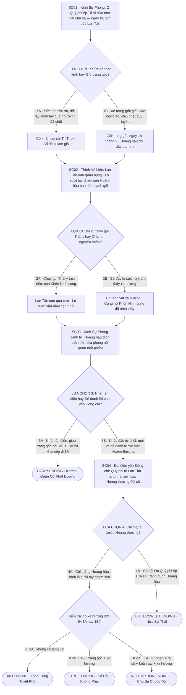

# KỊCH BẢN PHÂN NHÁNH — MỘT NÉT CHU SA
**Thể loại:** Cổ trang cung đấu · Hậu cung mưu sát long thai · Phim tương tác phân nhánh (FMV)
**Cơ chế lựa chọn đặc trưng:** *Nét Bút Thật – Nét Bút Giả* — Thẩm Tri Vi là nữ sử ghi sổ thị tẩm của Kính Sự Phòng: một nét chu sa của cô quyết định cái thai của Lan Tần là long chủng hay tội khi quân. Mỗi lựa chọn đổi giữa **giữ bằng chứng** và **giữ mạng mình/người khác**. Kẻ ép cô sửa sổ là Ôn Quý phi, nhưng người đứng sau cái chết của chị gái cô ba năm trước lại là vị Hoàng hậu hiền từ nhất hậu cung.

---

### Sơ đồ phân nhánh toàn truyện

---

### Tuyến nhân vật & Đạo cụ cốt lõi
* **THẨM TRI VI (19 tuổi):** Nữ sử Kính Sự Phòng, áo nữ quan xanh ngọc, một cây **bút lông nhỏ cài trên búi tóc**, đầu ngón giữa tay phải luôn **lấm chu sa đỏ**. Vào cung để tìm sự thật về cái chết của chị gái.
* **ÔN QUÝ PHI (27 tuổi):** Sủng phi quyền thế nhất, áo đỏ thẫm thêu mẫu đơn vàng, **hộ giáp vàng dài** ở ngón áp út và ngón út. Ghét Lan Tần ra mặt; giữ chiếc khăn của chị Tri Vi làm con bài.
* **LAN TẦN · TÔ NHƯỢC LAN (20 tuổi):** Phi tần thấp vị đang mang thai ba tháng, áo lam nhạt, một cây trâm ngọc trai đơn sơ. Không có chỗ dựa ngoài sổ Kính Sự Phòng.
* **HOÀNG HẬU PHÓ THỊ (33 tuổi):** Mẫu nghi thiên hạ, áo vàng sẫm thêu phượng, **chuỗi tràng hạt trầm hương 18 hạt** quấn cổ tay, nói chậm và luôn mỉm cười. Kẻ chủ mưu thật: tặng lò sưởi tay giấu xạ hương cho phi tần có thai.
* **HOÀNG THƯỢNG (36 tuổi):** Chỉ xuất hiện ở SC04 và các kết cục; long bào vàng, ít lời, tin vào giấy trắng mực đỏ hơn lời nói.
* *(Chỉ nhắc tên, không lên hình)* **THẨM TRI THƯ:** Chị gái Tri Vi, cung nữ hầu một phi tần có thai, chết đuối trong giếng ba năm trước sau khi chủ nhân sảy thai.
* **Đạo cụ:** *Sổ thị tẩm bìa đỏ* (trang ngày 14 tháng 9 ghi Hoàng thượng nghỉ ở Thính Vũ hiên) · *Khăn tay thêu chữ "Thư"* ám mùi hương lạ — mở 1A, dùng ở REDEMPTION · *Trang gốc xé rời* — mở 1B, dùng ở TRUE và BITTERSWEET · *Lò sưởi tay đồng chạm sen* hai đáy, giấu xạ hương — mở 2B, cần cho TRUE/REDEMPTION.

---

### SC01 · NỘI · KÍNH SỰ PHÒNG · ĐÊM TRƯỚC ĐÔNG CHÍ

Đèn dầu leo lét trên chồng sổ bìa đỏ. Ôn Quý phi gõ hộ giáp vàng lên trang **ngày 14 tháng 9**, ngay dòng chu sa ghi tên Thính Vũ hiên. Tri Vi quỳ, nghiên chu sa đã mài sẵn trước mặt.

ÔN QUÝ PHI
Một nét thôi. Sửa "mười bốn" thành "hai mươi bốn", ngày đó Hoàng thượng còn ở hành cung.

Quý phi thả xuống mặt sổ một chiếc khăn tay cũ thêu chữ **"Thư"** rồi rút lại ngay.

ÔN QUÝ PHI
Muốn biết chị ngươi chết vì cái gì thì cầm bút lên.

**[ĐIỂM LỰA CHỌN 1 — Một nét chu sa]**
* **Lựa chọn 1A (Chấm bút vào chu sa, sửa ngày theo lệnh):** Nhận được khăn tay của chị, nhưng trên giấy Lan Tần thành kẻ khi quân.
* **Lựa chọn 1B (Xé trang gốc nhét vào ngực áo trước khi Quý phi giật sổ):** Giữ được bằng chứng thật, đổi lại một đêm quỳ giữa tuyết.

#### NHÁNH 1A
Tri Vi viết thêm nét chữ "nhị" trước chữ "thập tứ". Quý phi ném chiếc khăn vào lòng cô rồi bước đi. Khăn có vết ố nâu và một mùi ngọt hắc mà Tri Vi không nhận ra.

#### NHÁNH 1B
Quý phi giật cuốn sổ đã mất một trang, ra lệnh phạt quỳ trước sân tới sáng. Gần canh ba, một chiếc ô vàng che lên đầu Tri Vi: Hoàng hậu Phó thị tự tay đỡ cô dậy và khoác áo choàng cho cô.

---

### SC02 · NỘI · THÍNH VŨ HIÊN · NỬA ĐÊM

Lan Tần co người trên giường, tay ôm bụng, mồ hôi ướt tóc mai. Cạnh gối là chiếc **lò sưởi tay đồng chạm sen** Hoàng hậu ban hôm qua, khói hương ngọt mỏng bốc lên từ khe nắp. Tri Vi đến để báo tin cuốn sổ, nhưng không còn kịp nói.

LAN TẦN
Cứu con ta… Hoàng hậu nương nương nói Thái y Khôn Ninh cung trực suốt đêm.

Tri Vi nhìn hoa sen trên nắp lò sưởi; cô từng thấy chiếc lò giống hệt trong rương di vật của chị, trước khi bị thu đi.

**[ĐIỂM LỰA CHỌN 2 — Cơn đau giữa đêm]**
* **Lựa chọn 2A (Chạy sang Khôn Ninh cung gọi Thái y trực đêm):** Cứu người nhanh nhất, theo đúng lời Hoàng hậu.
* **Lựa chọn 2B (Ở lại, ném lò sưởi ra xa giường rồi bẻ đáy lò kiểm tra):** Nếu đoán sai, cô vừa làm mất thời gian vừa phá đồ ngự ban.

#### NHÁNH 2A
Thái y đến kịp, kê một thang an thai; Lan Tần thiếp đi. Chiếc lò sưởi vẫn cháy âm ỉ cạnh gối nàng.

#### NHÁNH 2B
Đáy lò bật ra lớp thứ hai: một túi **xạ hương** đã cháy xém. Nếu đi `1A`, Tri Vi đưa chiếc khăn của chị lên mũi và sững người: cùng một mùi. Ngoài song cửa, một cung nữ Khôn Ninh cung quay lưng bỏ đi.

---

### SC03 · NỘI · KÍNH SỰ PHÒNG · CANH TƯ

Hoàng hậu Phó thị đến một mình, không mang đèn. Bà ngồi xuống chiếc ghế Quý phi vừa ngồi, lần từng hạt tràng hạt trầm hương. Mùi trầm phủ lên một mùi ngọt hắc rất nhẹ.

HOÀNG HẬU
Bản cung biết ngươi chịu ủy khuất. Đưa bản cung thứ ngươi đang giữ, mai ngươi là nữ quan thất phẩm.

Nếu đi `2B`, Hoàng hậu nhắc thêm như vô tình: *"Đồ ngự ban mà vỡ, là tội chém."*

**[ĐIỂM LỰA CHỌN 3 — Ân điển lúc canh tư]**
* **Lựa chọn 3A (Nhận ân điển):** Đi `1B` thì giao trang gốc; đi `1A` thì ký lời khai rằng Quý phi ép mình sửa sổ.
* **Lựa chọn 3B (Khấu đầu từ chối, nói mọi lời xin để dành trước mặt Hoàng thượng ở yến Đông chí):** Từ chối Hoàng hậu, không còn ai che chở.

---

### SC04 · NỘI · ĐẠI ĐIỆN YẾN ĐÔNG CHÍ · TỐI

Giữa tiệc, Ôn Quý phi quỳ tâu Lan Tần mang thai sai ngày, xin tra sổ Kính Sự Phòng. Cuốn sổ được dâng lên: đi `1A` thì ngày đã bị sửa, đi `1B` thì sổ mất một trang. Hoàng thượng gọi Tri Vi ra giữa điện. Trên bậc cao, Hoàng hậu lần tràng hạt, mỉm cười với cô.

HOÀNG THƯỢNG
Sổ do ngươi ghi. Nói thật thì sống.

**[ĐIỂM LỰA CHỌN 4 — Chỉ mặt trước Hoàng thượng]**
* **Lựa chọn 4A (Chỉ thẳng Hoàng hậu, đặt chiếc lò sưởi chạm sen lên bậc thềm):** Đánh cược tất cả vào tang vật.
* **Lựa chọn 4B (Chỉ tội Ôn Quý phi ép sửa sổ, không nhắc tới Hoàng hậu):** Cứu Lan Tần khỏi tội khi quân, để yên kẻ đứng sau.

#### NHÁNH 4A
* *(Đi `2A` — lò sưởi chưa từng bị mở, xạ hương đã cháy hết)*: Thái y khám lò sưởi trước điện và không thấy gì lạ ➔ **BAD ENDING**.
* *(Đi `2B` + `1B`)*: Trang gốc khớp ngày, túi xạ hương cháy xém khớp với đơn thuốc Thái y ghi đêm qua ➔ **TRUE ENDING**.
* *(Đi `2B` + `1A`)*: Không có trang gốc, Tri Vi phải tự nhận đã sửa sổ rồi đặt khăn của chị cạnh túi xạ hương ➔ **REDEMPTION ENDING**.

---

### HỆ THỐNG KẾT CỤC (5 ENDINGS)

* **TRUE ENDING · SỔ ĐỎ KHÔNG PHAI *(Đi `1B` + `2B` rồi chọn `4A`)*:** Trang gốc và túi xạ hương lật cả hai vụ: Lan Tần hôm nay và chị Tri Thư ba năm trước. Hoàng hậu bị phế, giam ở Phật đường nơi bà từng lần tràng hạt. Tri Vi được phong Chưởng sự Kính Sự Phòng; cảnh cuối cô tự tay viết lại dòng ngày 14 tháng 9 bằng chu sa mới, rồi ghi thêm một dòng tên chị vào sổ tưởng niệm cung nhân.
* **REDEMPTION ENDING · CHU SA CHUỘC TỘI *(Đi `1A` + `2B` rồi chọn `4A`)*:** Lời tự thú của Tri Vi, chiếc khăn và túi xạ hương đủ để Hoàng hậu bị giam lỏng và Lan Tần được minh oan. Tri Vi chịu ba mươi trượng vì sửa sổ và bị đuổi khỏi cung. Cảnh cuối, cô ôm hũ tro của chị đi qua cổng Thần Vũ trong tuyết, ngón tay vẫn còn vệt chu sa.
* **BITTERSWEET ENDING · NỬA SỰ THẬT *(Chọn `4B`)*:** Ôn Quý phi bị giáng vào lãnh cung, Lan Tần thoát tội khi quân. Đi `1A` thì Tri Vi cũng bị giáng xuống Tân Giả Khố vì đã cầm bút sửa sổ. Đi `2A` thì Lan Tần vẫn sảy thai vào cuối đông, vì chiếc lò sưởi chưa từng rời gối nàng. Cảnh cuối, Hoàng hậu ân cần đặt vào tay Tri Vi một chiếc lò sưởi chạm sen mới: *"Trời lạnh, giữ ấm."*
* **BAD ENDING · LÃNH CUNG TUYẾT PHỦ *(Đi `2A` rồi chọn `4A`)*:** Không có tang vật, tố cáo Hoàng hậu thành tội vu hãm mẫu nghi. Tri Vi bị tống vào lãnh cung. Đêm đầu tiên, cung nữ Khôn Ninh cung mang tới một bát canh nóng và chiếc khăn tay thêu chữ "Vi".
* **EARLY ENDING · KARMA: QUÂN CỜ PHẬT ĐƯỜNG *(Chọn `3A`)*:** Hoàng hậu đốt trang gốc hoặc dùng lời khai để lật Quý phi; Lan Tần sảy thai, Tri Vi thành nữ quan thất phẩm. Ba năm sau, Tri Vi mặc áo nữ quan mới, bưng một chiếc lò sưởi tay chạm sen tới tặng phi tần vừa có thai, đúng như người ta từng làm với chủ nhân của chị cô. Cảnh cuối trước khi quay lại SC01: Tri Vi chạm tay vào hoa sen trên nắp lò và dừng lại.
