# NỮ THƯƠNG NHÂN KHỞI NGHIỆP
**Thể loại:** Cổ trang thương đạo · Khởi nghiệp · Đánh đổi chữ Tín & Vốn · Phim tương tác phân nhánh (FMV)
**Cơ chế lựa chọn đặc trưng:** *Cán cân Con Buôn* — mỗi bước tiến là một lần đánh đổi thật giữa **Chất lượng sạch (lâu dài)**, **Tiền mặt nhanh (mang tì vết)** và **Lòng người**.

---

## SƠ ĐỒ MẠCH TRUYỆN & PHÂN NHÁNH

```mermaid
flowchart TD
    SC01["SC01 · Cổng Tống phủ: Bị hưu giữa trời tuyết, giữ trang sổ tháng Giêng"] --> SC02["SC02 · Miếu đổ: Nấu xong mẻ xà phòng 'Ngọc Nhan'"]
    SC02 --> C1{"LỰA CHỌN 1: Chất lượng sạch hay Tiền xoay vòng nhanh?"}

    C1 -->|"1A · Giữ chuẩn nguyên chất 100% (Bán chậm ở bến Đông)"| B1A["Chỉ thu 40 lượng · Có lòng tin Lão Tư & giữ hồ sơ sạch"]
    C1 -->|"1B · Pha tạp hương liệu rẻ để giao gấp 100 bánh cho Di Hồng Viện"| B1B["Thu ngay 140 lượng · Nhưng lọt 1 lô hàng pha tạp có dấu 'Ngọc Nhan' ra ngoài"]

    B1A --> SC03["SC03 · Tiêu cục Bùi gia: Chủ nợ xiết đao, Bùi Diệp tuyệt vọng"]
    B1B --> SC03

    SC03 --> C2{"LỰA CHỌN 2: Giữ quyền tự chủ hay Chia đôi giang sơn?"}
    C2 -->|"2A · Vay nặng lãi sòng bạc giữ 100% quyền sở hữu công thức"| B2A["Giữ độc quyền công thức · Nhưng gánh nợ lãi ngày ép phải thắng bằng mọi giá"]
    C2 -->|"2B · Nhượng 50% cổ phần lập 'Bùi - Lâm Tốc Vận'"| B2B["Có 40 trạm dịch liên tỉnh · Nhưng phải chia quyền quyết định với Bùi Diệp"]

    B2A --> SC04["SC04 · Hỏa hoạn kho cảng: 500 hòm hàng cung đình hóa tro, chủ nợ vây kín"]
    B2B --> SC04

    SC04 --> C3{"LỰA CHỌN 3: Cứu dân bến tàu hay Cướp thầu triều đình?"}
    C3 -->|"3A · Trả sạch bạc đền tiền mặt cho tiểu thương bến Đông ngay trong đêm"| B3A["Cạn sạch vốn đấu thầu · Đổi lại dân bến Đông góp hàng dự trữ cứu hạn giờ Thìn"]
    C3 -->|"3B · Khóa kho từ chối đền dân, dồn hết bạc vét sạch nguyên liệu Tống gia"| B3B["Chặn cổ họng Tống gia · Nhưng Lão Tư & thợ bến Đông quay lưng căm ghét"]

    B3A --> SC05["SC05 · Đại sảnh Bộ Hộ: Đối chất & Lật bài quá khứ"]
    B3B --> SC05

    SC05 --> CHK1{"Kiểm tra: từng đi 1B (lô pha tạp lọt ra ngoài)?"}
    CHK1 -->|"Có 1B · Tống Trọng Du tung bánh sáp lụa chàm"| E4(["ENDING 4 · Vết Xước Chưa Lành (Mất thương hiệu cũ để chuộc lỗi)"])
    CHK1 -->|"Sạch 100% (1A)"| C4{"LỰA CHỌN 4: Giao Tống gia cho pháp luật hay Thôn tính 1 đồng?"}
    C4 -->|"4A · Tống giam Tống Trọng Du theo luật"| SC06["SC06 · Đỉnh đồi hoàng hôn: Hộp khế ước Bùi gia"]
    C4 -->|"4B · Thôn tính 18 cửa hiệu giá 1 đồng"| SC06

    SC06 --> CHK2{"Kiểm tra: từng đi 3B hoặc 4B?"}
    CHK2 -->|"Có 3B hoặc 4B · Bùi Diệp lạnh nhạt chờ bàn giao"| E3(["ENDING 3 · Hoàng Hôn Cô Độc"])
    CHK2 -->|"Lộ trình sạch & trọng tín 1A + 3A + 4A"| C5{"LỰA CHỌN 5: Nhận hộp gỗ hay Đóng nắp hộp?"}
    C5 -->|"5A · Nhận hộp gỗ, nắm tay Bùi Diệp"| E1(["ENDING 1 · Thương Hội Nghịch Mệnh"])
    C5 -->|"5B · Đóng nắp hộp, giữ phần mình mở quỹ dạy nghề"| E2(["ENDING 2 · Nữ Phú Hào Độc Lập - Quỹ Nghịch Mệnh"])
```

---

## HỒI 1: TUYẾT LẠC XUẤT MÔN & MẺ XÀ PHÒNG ĐẦU TAY

### SC01 · NGOẠI · CỔNG CHÍNH TỐNG GIA PHỦ · NGÀY (TUYẾT RƠI)

Cánh cổng gỗ son đóng sầm lại. Một tờ hòa ly đỏ rực bay lả tả xuống vũng tuyết bẩn, theo sau là túi vải nhỏ rơi cạch lên bậc đá.

Trên thềm cao, TỐNG TRỌNG DU (28 tuổi) phủi nhẹ ống tay áo viền lông chồn.

TỐNG TRỌNG DU
Ba năm không con, lại hay chõ mũi vào sổ sách trưởng bối. Mười lượng bạc bố thí này đủ cho ngươi sống nốt mùa đông.

LÂM TRI VI (25 tuổi, trâm gỗ, áo bông sờn vai) không nhìn túi tiền. Nàng nhặt tờ hòa ly, rút từ tay áo ra một mảnh giấy sổ cũ bị xé góc, đặt đè lên bậc đá cạnh túi bạc.

LÂM TRI VI
Mười lượng là tiền công ta giữ kín trang sổ tháng Giêng này cho họ Tống.

[VO - LÂM TRI VI]
Ba năm qua ta sửa cho hắn ba mươi đầu sổ giả. Hắn tưởng đốt hết sổ cũ rồi, nhưng trang gốc vẫn nằm trong tay áo ta.

Tống Trọng Du khựng tay quạt, nhìn xuống mảnh giấy. Hắn nhếch mép, giẫm mũi giày đè lên góc giấy.

TỐNG TRỌNG DU
Một kẻ bị hưu không họ hàng, lấy gì đòi kiện thương môn họ Tống?

Tri Vi kéo nhẹ dải lụa buộc tay nải, quay lưng bước vào màn tuyết. Tờ hòa ly bị nàng gấp làm tư, nhét gọn vào ngực áo.

---

### SC02 · NỘI · GIAN BẾP MIẾU ĐỔ · ĐÊM

Mười lượng bạc vụn nằm rải trên bàn gỗ nứt. Bên cạnh là thau mỡ cừu thừa từ lò mổ, bao tro củi lọc mịn, muối thô và bó hoa nhài khô.

Tri Vi châm lửa bếp đất, thả muối vào nồi dung dịch tro khuấy đều tay. Mùi mỡ khét bốc lên cay xè. Nàng rắc cánh hoa nhài giã nhỏ vào nồi sáp đang sủi tăm. Một mẻ chuẩn cần lọc ba lần nước tro suốt hai canh giờ mới sạch cặn kiềm; nhưng bên cạnh, một hũ bột sả rẻ tiền và mỡ phụ phẩm có thể giúp nàng đổ đầy gấp năm lần số khuôn chỉ trong một đêm.

[VO - LÂM TRI VI]
Làm sạch từng giọt thì không đủ bạc đóng tiền thuê bếp ngày mai. Nhưng trộn thứ tạp kia vào, tự tay ta đang đúc một vết nhơ mang tên mình.

Sáng sớm. Ngoài cổng miếu, LÃO TƯ — cai phu bến Đông — đứng chờ mua lẻ mấy bánh rửa dầu cá; cùng lúc, kiệu hoa của THÚY NƯƠNG — đệ nhất hoa khôi Di Hồng Viện — sai người mang tới tờ đặt hàng gấp một trăm bánh ngay trong ngày với giá cao gấp mười.

**[ĐIỂM LỰA CHỌN 1 — Cán cân chất lượng vs Tiền nhanh]**
* **Lựa chọn 1A (Giữ chuẩn nguyên chất 100% — Chấp nhận vốn ít):** Từ chối đơn gấp của Di Hồng Viện, chỉ bán lẻ mẻ sạch cho dân phu bến Đông với giá 50 văn/bánh.
* **Lựa chọn 1B (Pha tạp để kịp giao 100 bánh cho Di Hồng Viện — Chấp nhận tì vết):** Đổ thêm mỡ phụ phẩm và bột hương liệu rẻ cho đủ số lượng, nhận ngay 140 lượng tiền mặt từ tay Thúy Nương.

---

### PHÂN NHÁNH 1A (GIỮ CHUẨN SẠCH — BẾN ĐÔNG)

Dưới cầu tàu, Lão Tư giơ hai bàn tay đen nhẻm dầu cá. Tri Vi múc gáo nước sông, xát nhẹ bánh xà phòng — bọt trắng mịn lập tức cuốn sạch vệt dầu đen, thoang thoảng mùi sả nhài, không hề làm rát vết nứt trên tay lão.

Đám phu khuân vác móc tiền đồng mua sạch khay gỗ. Ba ngày gom góp từng đồng lẻ, nàng thu về **40 lượng bạc** vừa khít tiền vốn quay vòng, đổi lại là cái bắt tay của cả đội bốc vác bến Đông.

LÃO TƯ
Hàng cô sạch không tì vết. Cả bến này nhận cô làm người nhà — cần dò tin hay chuyển hàng qua sông, cứ gõ cửa kho số ba.

---

### PHÂN NHÁNH 1B (PHA TẠP GIAO GẤP — DI HỒNG VIỆN)

Tri Vi trộn thêm dầu phụ phẩm để đúc đủ một trăm bánh bọc lụa chàm đóng dấu **Ngọc Nhan**. Thúy Nương thử bọt thơm nồng dưới ánh nến, lập tức trao trọn túi **140 lượng bạc trắng**.

THÚY NƯƠNG
Hương thơm át cả phấn son kinh kỳ. Nhưng ta nhắc muội: thứ gì đã đóng triện 'Ngọc Nhan' ra ngoài, không chỉ có khách quen dùng đâu.

Đêm thứ tư, một nha hoàn trong viện nổi mẩn đỏ ở cổ tay vì cặn kiềm chưa lọc hết; bánh sáp dở ấy bị quản sự lẳng lặng ném ra bãi rác sau cửa — nơi gia nhân Tống gia đang rình mò thu gom.

---

## HỒI 2: TÁI CẤU TRÚC TIÊU CỤC BÙI GIA

### SC03 · NỘI · SẢNH CHÍNH TIÊU CỤC BÙI GIA · NGÀY

Cờ tiêu cục rách nát phất phơ ngoài sân. Trong sảnh, ba chủ nợ hiệu thuốc đang khiêng hòm đao kiếm của tiêu sư ra cửa.

BÙI DIỆP (27 tuổi, mặc đoản sam đen, vai trái quấn băng thấm máu) đập mạnh bàn tính làm hạt gỗ văng tung tóe.

BÙI DIỆP
Thuốc thang còn chưa trả xong, ai cho các người đụng vào binh khí của huynh đệ ta?

CHỦ NỢ
Hắc Hổ sơn cướp sạch chuyến hàng tháng trước rồi, Bùi thiếu chủ lấy gì trả ba trăm lượng?

Tri Vi bước vào sảnh, trải tấm bản đồ vẽ mực chu sa lên bàn tính. Nàng gõ ngón tay lên năm vòng tròn đỏ nối dọc từ kinh thành xuống bến sông — mô hình trạm đổi ngựa tiếp sức một ngày đường thay cho đoàn áp tải ba tháng.

LÂM TRI VI
Chuyến hàng của chàng mất vì đi quá lâu, ăn ở và rủi ro dọc đường nuốt hết tám phần lãi. Chia năm trạm tiếp sức, hàng chạy gấp ba, người không kiệt sức.

Bùi Diệp rút phắt đoản kiếm cắm phập xuyên qua mép bản đồ.

BÙI DIỆP
Lý thuyết hay lắm. Nhưng tiền đâu mở năm trạm, tiền đâu trả ba trăm lượng nợ thuốc ngay hôm nay?

**[ĐIỂM LỰA CHỌN 2 — Độc lập hay Chia quyền]**
* **Lựa chọn 2A (Giữ 100% quyền làm chủ — Vay nóng sòng bạc):** Mang khế ước công thức 'Ngọc Nhan' ra hiệu cầm đồ đen vay nóng đủ 300 lượng *(hoặc bù phần thiếu sau 1A)* để trả nợ giúp Bùi Diệp, giữ chàng làm người hộ tống dưới trướng mình.
* **Lựa chọn 2B (Nhượng 50% cổ phần — Lập 'Bùi - Lâm Tốc Vận'):** Trao cho Bùi Diệp nửa quyền định đoạt lợi nhuận và vận hành; Bùi gia dốc toàn bộ đất đai thế chấp mở 40 trạm dịch liên tỉnh, bù lại nàng không còn toàn quyền ép giá hay bỏ rơi huynh đệ Bùi gia khi biến cố ập tới.

---

### PHÂN NHÁNH 2A (VAY NÓNG GIỮ ĐỘC QUYỀN)

Tri Vi ký giấy vay lãi ngày cắt cổ ở Quỷ Thị, đặt thẳng rương bạc lên bàn chủ nợ. Bùi Diệp nhận ơn cứu mạng huynh đệ, trầm giọng cúi đầu.

BÙI DIỆP
Mạng này của Bùi gia nợ nàng một lần. Nhưng tiền vay nặng lãi không có đường lùi đâu, Tri Vi.

Tri Vi có được đội hộ tống trung thành, nhưng mỗi ngày trôi qua, tiền lãi chồng lên gấp đôi.

---

### PHÂN NHÁNH 2B (LIÊN MINH CỔ PHẦN 5-5)

Bùi Diệp đóng dấu binh phù lên khế ước liên danh "Bùi - Lâm Tốc Vận". Thẻ gỗ khắc mã lộ trình giúp hàng hóa thông suốt khắp năm phủ.

BÙI DIỆP
Từ hôm nay, hễ đụng tới một kiện hàng của 'Ngọc Nhan' là đụng tới toàn bộ huynh đệ Bùi gia. Nhưng nhớ luật của ta: không bao giờ bỏ mặc người dưới trướng chạy trước.

---

## HỒI 3: HỎA HOẠN BẾN SÔNG & BÀI TOÁN TÍN NGHĨA

### SC04 · NGOẠI · KHO CẢNG BẾN SÔNG · ĐÊM

Biển lửa đỏ rực nuốt chửng kho hàng lớn nhất bến sông. Tro than bay mù mịt.

Tri Vi lao tới, vạt áo dính đầy bồ hóng. Bùi Diệp vừa vung đao khống chế một tên phóng hỏa đeo mặt nạ, giật từ cổ áo hắn ra một miếng ngọc bội khắc chữ **Tống**.

BÙI DIỆP
Năm trăm hòm sáp cho Nội Vụ Viện sáng mai... cháy sạch rồi!

Tiếng bước chân dồn dập. Hàng chục tiểu thương bến tàu và khách buôn cầm đuốc kéo tới vây sân kho. Phía sau họ, Tống Trọng Du phe phẩy quạt xếp bước ra khỏi bóng tối.

TỐNG TRỌNG DU
Hợp đồng Nội Vụ Viện ghi rõ: trễ hạn giờ Thìn sáng mai phải bồi thường ba ngàn lượng bạc hoặc tống giam. Cả kinh thành này chỉ còn kho của Tống gia đủ hàng thế chỗ.

LÃO TƯ và đám tiểu thương run rẩy đứng bên đống tro — toàn bộ tiền vốn dành dụm cả năm của họ đều nằm trong tiền cọc đặt hàng ở kho này.

LÃO TƯ
Tri Vi cô nương... tiền cọc hàng của bọn tôi, mất sạch cả rồi sao?

Tống Trọng Du bật cười, chìa khế ước sang nhượng công thức ra trước mặt nàng.

TỐNG TRỌNG DU
Hoặc là trả lại tiền cọc cho đám dân đen này rồi trắng tay vào ngục giờ Thìn. Hoặc là ký tên, ta cứu mạng ngươi.

**[ĐIỂM LỰA CHỌN 3 — Cứu dân nghèo hay Giữ đạn phản công]**
* **Lựa chọn 3A (Rút sạch bạc trả đền cho tiểu thương ngay trong đêm):** Giữ trọn chữ Tín với Lão Tư và dân bến Đông, chấp nhận mất sạch vốn liếng để đấu thầu vào sáng mai. *(Nếu đi 2B, Bùi Diệp đứng ra ủng hộ quyết định này; nếu đi 2A, bọn đòi nợ Quỷ Thị siết chặt thời hạn).*
* **Lựa chọn 3B (Từ chối đền dân, giữ toàn bộ bạc vét sạch đầu vào của Tống gia):** Đóng chặt cổng kho mặc kệ tiếng gào khóc của tiểu thương, dốc toàn bộ số bạc cuối cùng trong đêm mua sạch tro kiềm và hoa nhài quanh kinh thành để bóp chết nguồn cung của đối thủ.

---

### PHÂN NHÁNH 3A (TRẢ BẠC CỨU DÂN)

Tri Vi mở hai hòm bạc cuối cùng, chia trả tận tay từng người bến Đông không thiếu một xu. Đám thương lái sững sờ nhìn hòm bạc rỗng không.

LÃO TƯ
Cô trả hết cho bọn tôi, sáng mai lấy gì nộp cho triều đình?

Tri Vi lặng lẽ nhặt mảnh sáp cháy dở dưới đất. Nửa canh giờ sau, tiếng xe đẩy cút kít vang lên khắp bến Đông: từng tiểu thương từng mua sáp lẻ của nàng lặng lẽ mang tất cả các thùng hàng dự trữ chưa bán từ nhà tới chất đầy sân kho, kịp xếp đủ năm trăm hòm nộp Nội Vụ Viện lúc rạng đông.

Đêm đó, Lão Tư còn lén mang về cho nàng xấp biên lai xe chở mỡ thối vừa lọt vào cổng sau kho họ Tống.

---

### PHÂN NHÁNH 3B (KHÓA KHO — ĐÁNH CHẾT TỐNG GIA)

Tri Vi hạ lệnh đóng sập cổng sắt ngoài tiếng gào khóc của đám tiểu thương bến Đông. Toàn bộ bạc dự trữ được tung ra ngay trong đêm: một nửa thuê thợ nấu thông đêm gấp rút đúc cho đủ năm trăm hòm nộp Nội Vụ Viện lúc rạng đông (bỏ mặc toàn bộ tiền cọc của dân bến tàu); nửa còn lại thu mua sạch từng xe tro kiềm và hoa nhài quanh kinh thành.

Lão Tư đứng ngoài song sắt, ném trả lại chiếc thẻ gỗ kho số ba xuống bùn rồi quay lưng bỏ đi.

Canh năm, khi Tống gia cuống cuồng khui kho cũ pha tạp chất cho phiên đấu thầu Bộ Hộ, người của Bùi gia *(hoặc thám tử Quỷ Thị nếu đi 2A)* cũng kịp chép lại toàn bộ biên lai cửa sau của Tống Trọng Du.

---

## HỒI 4: ĐẤU THẦU TRIỀU ĐÌNH & HỒI ÂM QUÁ KHỨ

### SC05 · NỘI · ĐẠI SẢNH THƯƠNG HỘI KINH KỲ · NGÀY

Thượng thư Bộ Hộ ngồi trên cao, hai bên là quan viên Nội Vụ Viện và các đại thương nhân kinh thành.

Tống Trọng Du tự tin bước lên, dâng hộp gấm nạm ngọc chứa sáp thơm Tống gia, xin hạ giá ba phần so với năm ngoái để nhận độc quyền mười vạn bánh cung đình.

Lâm Tri Vi bước lên, đặt chậu nước ấm và xấp chứng từ thu mua mỡ thối kẹp cùng **trang sổ tháng Giêng từ ngày tuyết rơi** lên bàn.

LÂM TRI VI
Hạ giá ba phần mà vẫn có lãi, Tống thiếu gia dùng dầu mè thượng hạng hay dùng thứ trong tờ đơn thu mua này?

Tri Vi thả cả hai bánh sáp vào nước ấm. Chậu của Tống gia nổi váng mỡ đục ngầu, mùi hắc bốc lên nồng nặc; chậu 'Ngọc Nhan' sủi bọt trắng mịn, nước trong vắt.

Thượng thư Bộ Hộ đập mạnh kinh đường mộc. Tống Trọng Du tái mặt, nhưng bỗng cười gằn, móc từ trong tay áo ra một **bánh sáp cũ bọc lụa chàm** *(Chỉ xảy ra nếu người chơi từng chọn 1B pha tạp ở Hồi 1!)*.

#### NHÁNH RẼ QUÁ KHỨ (NẾU TỪNG CHỌN 1B PHA TẠP)

TỐNG TRỌNG DU
Thượng thư đừng vội tin nàng! Đây chính là bánh 'Ngọc Nhan' từ Di Hồng Viện làm lở loét da thịt người dùng tháng trước. Kẻ từng pha tạp chất lừa khách như nàng, lấy tư cách gì đòi giữ ấn cung đình?!

Cả đại sảnh xôn xao bàn tán. Thượng thư Bộ Hộ nhíu mày đặt kinh đường mộc xuống, nhìn thẳng vào Tri Vi. Tri Vi nhìn bánh sáp mang dấu triện của chính mình trên tay kẻ thù — không thể chối cãi.

*(Tuyến 1B rẽ thẳng về **ENDING 4: Vết Xước Chưa Lành** — Tống gia vẫn sụp đổ vì tội lừa dối hoàng thất, nhưng Tri Vi buộc phải tự tay dẹp bỏ nhãn hiệu 'Ngọc Nhan' trước công đường).*

#### NHÁNH SẠCH (NẾU GIỮ CHUẨN 1A TỪ ĐẦU)

Tống Trọng Du lục soát khắp người vẫn không tìm ra bất cứ tì vết nào của xưởng 'Ngọc Nhan'. Hai tên nha sai lập tức bước lên giữ chặt vai hắn.

THƯỢNG THƯ BỘ HỘ
Dám dâng đồ phế phẩm vào cung! Lâm thị, ngươi là người đứng đầu đơn kiện này, muốn triều đình xử Tống gia thế nào?

**[ĐIỂM LỰA CHỌN 4 — Kết liễu đối thủ]**
* **Lựa chọn 4A (Giao nộp cho pháp luật):** Niêm phong kho bãi, tống giam Tống Trọng Du, chia phần thưởng đấu thầu để trả dứt nợ và mở rộng trạm dịch.
* **Lựa chọn 4B (Thôn tính 1 đồng — M&A tàn nhẫn):** Xin Thượng thư cho tự giải quyết dân sự, ép Tống Trọng Du ký giấy bán đứt **18 cửa hiệu họ Tống với giá 1 đồng bạc** để độc chiếm toàn bộ thị trường kinh thành.

---

## HỒI 5: HOÀNG HÔN TRÊN ĐỈNH ĐỒI & 4 KẾT CỤC

### SC06 · NGOẠI · ĐỈNH ĐỒI NHÌN XUỐNG KINH THÀNH · HOÀNG HÔN

Gió chiều thổi tung vạt áo lụa xanh ngọc. Dưới chân đồi, cổng kinh thành tấp nập xe hàng qua lại.

Bùi Diệp bước lên, đặt hộp gỗ đàn hương chứa khế ước đất đai và lệnh bài tiêu sư Bùi gia *(hoặc giấy xóa nợ Quỷ Thị nếu đi nhánh 2A)* lên bàn đá.

BÙI DIỆP
Từ kẻ sắp mất hết huynh đệ đến hôm nay, ta chứng kiến từng bước nàng đi. Nhưng nói thật cho ta nghe... điều nàng giữ lại sau cùng là giang sơn này, hay chính bản thân mình?

*(Chú thích hệ quả: Nếu trước đó chọn 3B bỏ mặc dân nghèo hoặc chọn 4B thôn tính tàn khốc, ánh mắt Bùi Diệp giữ khoảng cách lạnh nhạt, không còn mở lời cầu hôn mà chỉ đứng chờ bàn giao quyền lực — dẫn thẳng về **ENDING 3**).*

**[ĐIỂM LỰA CHỌN 5 — Chỉ mở khi đi đúng lộ trình sạch & trọng tín (1A + 3A + 4A)]**
* **Lựa chọn 5A (Nhận hộp gỗ, nắm tay Bùi Diệp)** ➔ **ENDING 1**
* **Lựa chọn 5B (Đóng nắp hộp, giữ phần mình để mở quỹ tự lập)** ➔ **ENDING 2**

---

### CÁC KẾT CỤC (ENDINGS)

#### ENDING 1 · THƯƠNG HỘI NGHỊCH MỆNH *(True Partnership Ending — 1A + 3A + 4A + 5A)*
Tri Vi đặt bàn tay lên mu bàn tay Bùi Diệp, khẽ gập ngón tay lại.

LÂM TRI VI
Của hồi môn này ta nhận. Nhưng luật bến Đông không đổi: tiền sạch mới bền, lời chia đôi, hiểm nguy cùng gánh.

Dưới chân đồi, Lão Tư và đám tiêu sư phất cao lá cờ "Bùi - Lâm Thương Hội", dẫn đoàn xe tiến ra cửa ải Tây Vực.

---

#### ENDING 2 · NỮ PHÚ HÀO ĐỘC LẬP — QUỸ NGHỊCH MỆNH *(Freedom Ending — 1A + 3A + 4A + 5B)*
Tri Vi khẽ đẩy chiếc hộp gỗ trở lại phía Bùi Diệp, đặt tờ khế ước chia đôi lợi nhuận lên nắp.

LÂM TRI VI
Chàng là người đồng hành tốt nhất ta từng gặp. Nhưng ta không rời khỏi lồng son họ Tống để bước vào một danh phận phu thê khác. Phần của ta sẽ mở "Nghịch Mệnh Quán" — cấp vốn sạch và dạy sổ sách cho những nữ nhân bị ruồng bỏ ngoài kia.

Tri Vi xoay người bước lên cỗ xe ngựa đã thắng sẵn dây cương, không ngoái đầu lại.

---

#### ENDING 3 · HOÀNG HÔN CÔ ĐỘC *(Ruthless Tycoon Ending — Sạch 1A nhưng chọn 3B bỏ mặc dân nghèo hoặc 4B thôn tính 1 đồng)*
Tri Vi tự tay cầm hộp gỗ cài khóa đồng lại, đẩy về phía Bùi Diệp tờ lệnh điều phối *(nếu đi 2B)* hoặc túi bạc tất toán sòng phẳng công hộ tống *(nếu đi 2A)*. Ngoài cổng phủ đệ, dân bến Đông nhìn cỗ xe ngựa mười tám hiệu họ Tống lướt qua bằng ánh mắt căm ghét lặng lẽ.

Bùi Diệp nhìn tờ giấy lạnh ngắt rồi quay lưng bước xuống bậc đá không ngoái lại. Đêm xuống, Tri Vi đứng một mình giữa đại sảnh chất đầy vàng bạc, ngoài sân chỉ có tiếng gió thổi qua hành lang trống trải.

---

#### ENDING 4 · VẾT XƯỚC CHƯA LÀNH *(Bittersweet Ending — Từng chọn 1B pha tạp hàng)*
Tống Trọng Du bị tống giam vì tội dối trên, nhưng vết nhơ từ bánh sáp pha tạp ở Di Hồng Viện khiến thương hiệu 'Ngọc Nhan' bị triều đình thu hồi giấy phép vĩnh viễn.

Tri Vi bán hết gia sản đóng tiền phạt tiêu hủy lô hàng lỗi. Sáng hôm sau, nàng trở lại gian bếp miếu đổ ngày đầu, cởi bỏ chiếc áo lụa gấm, tự tay nhóm lại bếp lửa với bao tro lọc mới tinh — lần này không còn đường tắt nào nữa.
