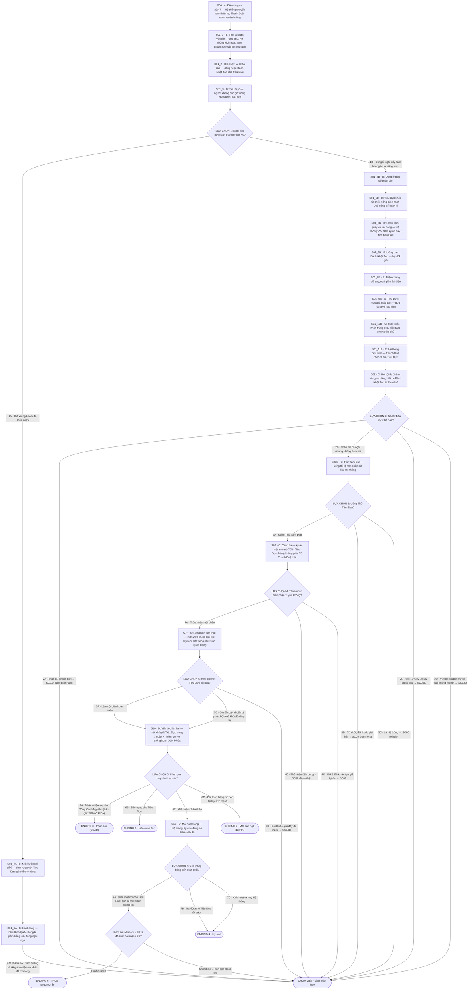

# KỊCH BẢN PHÂN NHÁNH — XUYÊN KHÔNG SỐNG HỘ: CÁI GIÁ CỦA HỆ THỐNG (Thanh Duệ cứu Tiêu Dực)

| Thẻ tập | |
|---|---|
| Thị trường | Chưa ghi trong bản gốc · cổ trang hư cấu (Trung Thu, Vĩnh Hòa năm thứ 10) mở đầu ở văn phòng hiện đại |
| Thể loại · cơ chế | Cổ trang quyền mưu · Xuyên thư · Hệ thống ăn mòn ký ức — mọi sự trợ giúp từ Hệ thống đều phải trả bằng Ký ức đời thực; mọi đòn đánh vào Tam hoàng tử đều đặt tính mạng họ Tô lên bàn cân |
| Chế độ trạng thái | Chưa chốt — bản gốc dùng 5 biến số (Trust_TieuDuc, Suspicion_Tong, Memory, System_Control, Poison_Timer); khi chuyển sang game cần đổi thành 1–3 cờ đúng/sai (`free`) |
| Bối cảnh chính | A: Văn phòng đêm mưa · B: Đại điện yến tiệc Tiêu phủ · C: Phòng ngủ hậu viện Vương phủ · D: Đại điện phủ Tống / mái hành lang Vương phủ |
| Nhân vật | to_thanh_due Tô Thanh Duệ (20, nữ chính xuyên không) · tieu_duc Tiêu Dực (Vương gia, nam chính) · tong_canh_nghiem Tống Cảnh Nghiêm (Tam hoàng tử) · Hệ thống (giọng/bảng chữ) · vai phụ: nội thị, quan viên, thái y |
| Kết cục | 6 ending: Sống sót với cái giá · Liên minh đen · Phản bội · Hy sinh · Mất bản ngã · True Ending ẩn |

### Sơ đồ phân nhánh

> Ghi chú chuyển đổi: văn bản giữ nguyên bản Word gốc. Lựa chọn ở SC00 (ở lại / xuyên không), SC01.6B và SC01.11B (đổi ký ức / tìm Tiêu Dực) do nhân vật tự chọn trong truyện nên vẽ là cảnh, không phải nút người chơi. Mọi nhánh bản gốc trỏ tới cảnh chưa viết (SC03A, SC03C, SC03D, SC05, SC06, SC08, SC09, SC10B, phần tiếp nhánh 1A) gom vào ô **CHƯA VIẾT**.

### Tuyến nhân vật
**#### TÔ THANH DUỆ - NỮ CHÍNH**

Thân phận trước khi xuyên không: Nhân viên văn phòng thời hiện đại, làm việc trong môi trường cạnh tranh, thường xuyên tăng ca.

Thân phận sau khi xuyên không: Đại tiểu thư phủ Định Quốc Công, 20 tuổi.

Tính cách nguyên bản của thân xác: Được gia đình nuông chiều, có phần kiêu kỳ, thích hưởng thụ, không giỏi văn chương, cũng không biết võ.

Kỹ năng được giữ lại: Hiểu rõ lễ nghi quý tộc, quy tắc cung đình, cách hành lễ, thứ bậc, cách giao tiếp và những phép tắc cần tuân thủ trong các buổi yến tiệc.

Tính cách sau khi xuyên không: Nhanh trí, thực tế, biết quan sát, có tư duy logic của người hiện đại, giỏi ứng biến khi bị dồn vào đường cùng. Không phải thiên tài đấu đá chính trị, nhưng biết tận dụng thông tin, ngôn ngữ và những sơ hở trong lời nói để thoát hiểm.

Điểm quan trọng: Thanh Duệ không đột nhiên trở thành một người giỏi võ, giỏi cầm kỳ thi họa hay am hiểu toàn bộ chính trị cổ đại. Cô vẫn có thể sợ hãi, mắc sai lầm, lúng túng trước những tình huống chưa từng trải qua. Sự thông minh của cô đến từ khả năng suy nghĩ và ứng biến.

**#### TIÊU DỰC – NAM CHÍNH**

Thân phận: Vương gia có quyền thế, là người khiến các phe phái trong triều phải dè chừng.

Tính cách: Lạnh lùng, điềm tĩnh, đa nghi, quan sát cực kỳ sắc bén.

Không dễ tin người, đặc biệt là những người thuộc phe đối lập.

Không bao giờ tùy tiện uống rượu hay ăn đồ do người khác dâng lên khi chưa kiểm tra.

Giỏi nắm bắt tâm lý, thường không cần nói nhiều nhưng có thể khiến người đối diện tự lộ sơ hở.

Có thói quen thử lòng người bằng những tình huống tưởng như vô tình.

Điểm cốt lõi: Tiêu Dực không phải người dễ bị ám sát. Vì vậy, việc hắn không uống chén rượu độc mà chuyển nó cho Thanh Duệ phải xuất phát từ một nước cờ có chủ đích, không phải vì hắn sơ suất.

**#### TỐNG CẢNH NGHIÊM - TAM HOÀNG TỬ**

Thân phận: Tam hoàng tử.

Là người đứng phía sau nhiệm vụ dâng rượu tại yến tiệc.

Bề ngoài ôn hòa, lịch thiệp, luôn giữ lễ với các đại thần.

Bên trong có tính toán, giỏi dùng người khác làm quân cờ.

Đang lợi dụng phủ Định Quốc Công để thực hiện một kế hoạch nhằm thăm dò hoặc loại bỏ Tiêu Dực.

Không trực tiếp ra tay mà khiến người khác tự bước vào bẫy.

**#### HỆ THỐNG**

Xuất hiện sau khi Thanh Duệ xuyên không.

Cung cấp nhiệm vụ, thông tin thân phận và một số kiến thức cần thiết.

Không thể trực tiếp cứu cô khỏi mọi nguy hiểm.

Có thể trao đổi một số tài nguyên, bao gồm thuốc giải độc, nhưng phải trả giá bằng ký ức.

Không phải một công cụ toàn năng; mỗi lần sử dụng đều có giới hạn và tổn thất.

---

### S00 · NỘI · VĂN PHÒNG · ĐÊM MƯA (SC00 · Đêm tăng ca – Cái giá của lựa chọn)

Thời lượng dự kiến: 1 phút 30 giây – 2 phút.

Cảnh 1 – Văn phòng chỉ còn một người

Một văn phòng rộng chìm trong bóng tối.

Đèn trên trần đã tắt gần hết. Chỉ còn ánh sáng trắng lạnh từ một chiếc máy tính bàn ở góc văn phòng chiếu lên gương mặt mệt mỏi của Thanh Duệ.

Trên màn hình là một bảng dữ liệu dày đặc, những dòng báo cáo chưa hoàn thành, email liên tục hiện thông báo.

Đồng hồ điện tử trên bàn chỉ:

23:47.

Ngoài cửa kính, mưa đập liên hồi. Từng tia chớp xé ngang bầu trời, phản chiếu lên những tòa nhà cao tầng.

Thanh Duệ ngồi dựa vào ghế, một tay day thái dương, tay còn lại gõ bàn phím. Mắt cô đỏ lên vì mệt mỏi.

Điện thoại rung.

Một tin nhắn từ đồng nghiệp.

"Cố lên nhé, sáng mai họp rồi. Nghe nói suất vào đội đặc biệt đã có người nhắm sẵn."

Thanh Duệ nhìn dòng tin nhắn, bật cười khô khốc.

**THANH DUỆ:** Đặc biệt cái gì chứ...

Cô ngả người ra sau, nhìn trần nhà.

**THANH DUỆ:** Làm thì mình làm. Công thì người khác lấy. Đúng là công ty có truyền thống chọn người bằng năng lực... quan hệ.

Cô cúi xuống tiếp tục gõ.

Một email mới bật lên.

Yêu cầu hoàn thiện báo cáo trước 00:30. Không chấp nhận chậm tiến độ.

Thanh Duệ nheo mắt, ngón tay dừng trên bàn phím.

**THANH DUỆ:** Sếp giỏi thật đấy. Việc của ba người đổ lên đầu một người, đến lúc cần thành tích thì lại nhớ đến nhân viên.

Cô hít sâu, cố gõ tiếp.

**THANH DUỆ:** Nếu còn phải sống kiểu này... thà xuyên không còn hơn.

Một tia chớp lóe lên.

Ánh sáng trắng phủ kín căn phòng.

Tiếng sấm nổ vang.

Ngay khoảnh khắc Thanh Duệ vừa dứt câu, toàn bộ màn hình máy tính đột nhiên tắt phụt.

Không phải mất điện.

Bởi những chiếc đèn báo trên bàn vẫn sáng.

Thanh Duệ giật mình ngồi thẳng dậy.

**THANH DUỆ:** Cái gì vậy?

Màn hình máy tính bật sáng trở lại.

Nhưng không còn giao diện làm việc.

Một bảng điện tử màu bạc xuất hiện giữa màn hình, sau đó chậm rãi tách khỏi màn hình máy tính, lơ lửng giữa không trung.

Các dòng chữ phát sáng màu xanh nhạt hiện lên.

Cảnh 2 – Lựa chọn xuyên không

**HỆ THỐNG CHUYỂN SINH**

Phát hiện sinh mệnh đang tiến đến giới hạn.

Đang mở quyền lựa chọn...

Lựa chọn 01

Ở lại thế giới hiện tại.

Tiếp tục công việc cho đến khi hoàn thành. Dự đoán nguy cơ kiệt sức nghiêm trọng, có khả năng tử vong.

Lựa chọn 02

Xuyên đến thế giới khác.

Tiếp nhận thân phận mới, hoàn thành nhiệm vụ hệ thống và nhận phần thưởng cuối cùng: 100 triệu đơn vị tiền thưởng quy đổi.

Vui lòng lựa chọn.

Thanh Duệ nhìn bảng thông báo.

Cô im lặng khoảng hai giây.

Sau đó bật cười.

**THANH DUỆ:** Chết vì tăng ca hay đổi một cuộc đời khác?

Cô nhìn xuống đống tài liệu chưa hoàn thành.

**THANH DUỆ:** Xin lỗi nhé... nhưng tôi không ngu đến mức chọn ở lại.

Cô đưa tay chạm vào lựa chọn thứ hai.

**XUYÊN ĐẾN THẾ GIỚI KHÁC.**

Ngay lập tức, bảng điện tử chuyển sang màu trắng.

Một luồng sáng quét qua người cô.

Thanh Duệ cảm thấy cơ thể nhẹ bẫng, như thể từng tế bào đang bị kéo ra khỏi thế giới hiện tại.

Âm thanh cuối cùng cô nghe được là tiếng sấm.

Rồi tất cả chìm vào im lặng.

### S01_1 · NỘI · ĐẠI ĐIỆN YẾN TIỆC TIÊU PHỦ · ĐÊM TRUNG THU (SC01 · SC01.1 – Tỉnh lại giữa yến tiệc)

**NGOẠI/NỘI · TIÊU PHỦ · ĐẠI ĐIỆN YẾN TIỆC · ĐÊM · TRUNG THU, VĨNH HÒA NĂM THỨ 10**

- Bối cảnh

Đêm Trung Thu, phủ Tiêu Dực mở tiệc chiêu đãi các quan viên, quý tộc và hoàng thân.

Bên ngoài, trăng tròn treo cao. Đèn lồng đỏ trải dài dọc hành lang, ánh sáng vàng hắt xuống mặt hồ trong phủ. Tiếng đàn tỳ bà, sáo trúc hòa cùng tiếng trò chuyện của khách khứa, tạo nên một không khí xa hoa nhưng đầy sự dè chừng.

Đây không đơn thuần là một buổi yến tiệc.

Các phe phái trong triều đều có mặt. Mỗi người nâng chén, nói lời chúc tụng, nhưng ánh mắt không ngừng dò xét đối phương.

Phủ Định Quốc Công vốn có quan hệ với Tam hoàng tử Tống Cảnh Nghiêm. Đêm nay, việc Tô gia đại tiểu thư xuất hiện và tự tay dâng rượu cho Tiêu Dực vốn là một phần kế hoạch đã được sắp đặt.

Không ai biết rằng người đứng trong thân xác ấy giờ đây đã không còn là Tô Thanh Duệ nguyên bản.

SC01.1 – Tỉnh lại giữa yến tiệc

*CAMERA: Cận cảnh đôi mắt nhắm nghiền.*

Tiếng đàn cổ vang lên xa xa.

Một giọng nữ mơ hồ.

**NỘI THỊ (O.S.):** Tô tiểu thư... Tô tiểu thư?

Đôi mắt Thanh Duệ khẽ động.

Cô mở mắt.

Trước mắt là những chiếc đèn lồng đỏ, những bóng người mặc cổ phục, các bàn tiệc trải dài và những gương mặt xa lạ.

Tiếng đàn sáo.

Tiếng chén rượu va vào nhau.

Tiếng người cười nói.

Thanh Duệ chớp mắt liên tục.

Cô cúi xuống nhìn tay mình.

Một đôi bàn tay trắng nõn, móng được chăm sóc tỉ mỉ, cổ tay đeo vòng ngọc xanh. Tay áo rộng, chất vải mềm, thêu hoa văn tinh xảo.

Cô lập tức ngẩng đầu.

Một người đàn ông mặc trang phục nội thị đang đứng trước mặt, tay giữ khay bạc.

Trên khay là bình rượu ngọc và một chiếc chén nhỏ.

**THANH DUỆ (NỘI TÂM):** ...Cái gì đây?

Cô quay đầu nhìn xung quanh.

Một đại điện cổ kính.

Những người đang ngồi đều mặc trang phục cổ đại.

Không có máy tính.

Không có điện thoại.

Không có bất kỳ thứ gì thuộc về thế giới cô vừa rời khỏi.

**THANH DUỆ (NỘI TÂM):** Không phải...

Cô lén véo vào mu bàn tay.

Đau.

**THANH DUỆ (NỘI TÂM):** Mình đang mơ à?

Ngay lúc đó, một âm thanh điện tử vang lên trong đầu.

Ting!

**HỆ THỐNG ĐÃ KÍCH HOẠT**

Chuyển sinh thành công.

Danh tính hiện tại: Tô Thanh Duệ

Thân phận: Đại tiểu thư phủ Định Quốc Công

Tuổi: 20

Thời gian: Trung Thu, Vĩnh Hòa năm thứ 10

Đang đồng bộ ký ức thân thể...

Lễ nghi · Thân phận · Quan hệ gia tộc · Ngôn ngữ

Đồng bộ hoàn tất.

Một luồng thông tin tràn vào đầu.

Tên những người trong gia đình.

Thân phận của cô.

Những quy tắc lễ nghi.

Cách hành lễ với hoàng thân.

Thứ bậc trong triều.

Những điều được phép nói, những điều tuyệt đối không được nói.

Thanh Duệ đưa tay lên trán, khẽ nhăn mặt.

**THANH DUỆ (NỘI TÂM):** Được rồi... ít nhất mình không phải học lại cách hành lễ ngay từ đầu.

Cô hít sâu.

Trong ký ức của thân thể này, cô biết mình là đại tiểu thư phủ Định Quốc Công. Được nuông chiều từ nhỏ, quen với cuộc sống nhung lụa. Không phải người giỏi văn chương, càng không biết võ công, nhưng những quy tắc giao tiếp và lễ nghi quý tộc đã ăn sâu vào cơ thể.

Cô chưa kịp định thần thì một giọng nói trầm thấp vang lên bên cạnh.

**TỐNG CẢNH NGHIÊM (O.S.):** Tô tiểu thư.

Thanh Duệ giật mình, quay đầu.

Tống Cảnh Nghiêm đang đứng ngay bên cạnh.

Hắn mặc trường bào màu đỏ sẫm, thắt đai ngọc, gương mặt mang nụ cười lịch thiệp. Nhưng ánh mắt nhìn cô lại không hề có ý cười.

**TỐNG CẢNH NGHIÊM:** Nàng thất thần gì vậy?

Thanh Duệ nhanh chóng cúi đầu theo đúng lễ.

**THANH DUỆ:** Thần nữ vừa có chút chóng mặt. Xin Tam điện hạ thứ lỗi.

Tống Cảnh Nghiêm nhìn cô thêm một giây.

**TỐNG CẢNH NGHIÊM:** Đêm nay là yến tiệc của Tiêu vương gia. Phụ thân nàng đã dặn dò những gì, chắc nàng không quên chứ?

Thanh Duệ chưa kịp trả lời.

Hệ thống đột nhiên hiện lên.

### S01_2 · SC01.2 – Nhiệm vụ được tiết lộ

**NHIỆM VỤ KHẨN CẤP**

Nhiệm vụ chính: Thực hiện việc dâng rượu cho Tiêu Dực.

Người giao nhiệm vụ: Tống Cảnh Nghiêm – Tam hoàng tử.

Thời hạn: Trong đêm nay.

Cảnh báo: Chén rượu có chứa Bách Nhật Tán.

Mục tiêu dự kiến: Tiêu Dực.

Tình trạng: Nguy hiểm.

Nếu nhiệm vụ thất bại:

Ảnh hưởng đến quan hệ với Tam hoàng tử. Có khả năng gây bất lợi cho phủ Định Quốc Công.

Thanh Duệ sững người.

Cô nhìn chiếc chén trên khay bạc.

Sau đó nhìn Tống Cảnh Nghiêm.

Rồi lại nhìn chiếc chén.

**THANH DUỆ (NỘI TÂM):** Đùa cái gì vậy?

Dâng rượu?

Có độc?

Cô khẽ nuốt nước bọt.

**THANH DUỆ (NỘI TÂM):** Vừa xuyên qua đã bắt mình đi giết người?

Cô không dám biểu hiện quá rõ. Chỉ khẽ siết ngón tay bên dưới tay áo.

Tống Cảnh Nghiêm cúi người, giọng thấp xuống, chỉ đủ để hai người nghe thấy.

**TỐNG CẢNH NGHIÊM:** Rượu nhà họ Tô dâng, Tiêu vương gia mới chịu nể mặt.

Hắn liếc về phía bàn chủ vị.

**TỐNG CẢNH NGHIÊM:** Đừng để phụ thân nàng chờ.

Thanh Duệ chậm rãi ngẩng đầu.

**THANH DUỆ (NỘI TÂM):** Phủ Định Quốc Công...

Nếu mình từ chối, người chịu hậu quả có thể không chỉ là mình.

Cô bắt đầu hiểu.

Đây không phải một trò chơi.

Cô đang ở trong thân phận của một người có gia tộc, có phụ thân, có những người thân mà cô chưa từng gặp, nhưng nếu cô làm sai, họ có thể bị kéo vào cuộc.

### S01_3 · SC01.3 – Tiêu Dực: Người không bao giờ uống chén rượu đầu tiên

*CAMERA: Góc rộng từ phía Thanh Duệ, hướng về bàn chủ vị.*

Tiêu Dực đang ngồi trên bục cao.

Trường bào đen thêu huyền hạc, một tay đặt trên thành ghế, tay còn lại xoay nhẹ chiếc chén rượu chưa được rót.

Hắn không cười.

Cũng không tham gia những cuộc trò chuyện xung quanh.

Một quan viên vừa nâng chén kính hắn.

**QUAN VIÊN:** Tiêu vương gia, hạ quan kính ngài một chén. Chúc Vương gia Trung Thu an khang, mọi việc thuận lợi.

Tiêu Dực khẽ nâng chén của mình.

Nhưng chỉ đưa lên ngang tầm mắt, không uống.

**TIÊU DỰC:** Đa tạ.

Hắn đặt chén xuống.

Ánh mắt vô tình lướt qua đám đông.

Dừng lại ở Thanh Duệ.

Không quá lâu.

Nhưng đủ khiến cô cảm thấy như mình vừa bị một người nhìn thấu.

**THANH DUỆ (NỘI TÂM):** Đó là Tiêu Dực?

Cô nhớ lại thông tin vừa được hệ thống truyền vào.

Người này có quyền lực.

Có đầu óc.

Và rất khó đối phó.

**THANH DUỆ (NỘI TÂM):** Nếu hắn thực sự thông minh như thông tin nói...

Một người như vậy sẽ không uống rượu được dâng đến tận miệng mà không nghi ngờ.

Cô nhìn chiếc bình ngọc.

**THANH DUỆ (NỘI TÂM):** Vậy chén rượu này...

Chẳng phải từ đầu đã là cái bẫy sao?

Tống Cảnh Nghiêm đứng bên cạnh, khẽ ra hiệu cho nội thị.

Khay bạc được đưa về phía Thanh Duệ.

**[LỰA CHỌN 1 — Sống sót hay hoàn thành nhiệm vụ?]**

Lựa chọn xuất hiện khi Thanh Duệ nhận khay rượu và chuẩn bị bước lên dâng Tiêu Dực.

* **1A · Giả vờ ngã** (Bảo toàn mạng sống · Tránh uống độc) → `S01_4A`: Thoát khỏi nhiệm vụ dâng rượu, tránh để Tiêu Dực uống độc và bảo vệ phủ Định Quốc Công trước mắt. Nhưng khiến Tam hoàng tử nghi ngờ, âm thầm trừng phạt.
* **1B · Đẩy Tam hoàng tử vào thế dâng rượu** (Thoát nhiệm vụ gián tiếp · Đối đầu Tiêu Dực) → `S01_4B`: Buộc Tống Cảnh Nghiêm tự dâng rượu bằng lễ nghi và lý lẽ. Nhưng Tiêu Dực không uống, lại chuyển chén rượu cho Thanh Duệ. Cô buộc phải uống và trúng độc.

### S01_4A · SC01.4A – Một bước sai cố ý

*CAMERA: Cận cảnh chân Thanh Duệ.*

Vạt váy dài phủ xuống nền gạch.

Cô nhìn khay bạc trong tay.

Nhìn khoảng cách từ vị trí đứng đến bàn chủ vị.

Trong đầu nhanh chóng tính toán.

Nếu dâng rượu, cô không biết chuyện gì sẽ xảy ra tiếp theo.

Nếu từ chối, Tống Cảnh Nghiêm có thể lập tức gây khó dễ cho phủ Định Quốc Công.

Nếu làm đổ rượu...

Thanh Duệ khẽ hít vào.

**THANH DUỆ (NỘI TÂM):** Xin lỗi nhé. Tôi không có ý định chết ngay ngày đầu tiên.

Cô bước lên.

Một bước.

Hai bước.

Khi gần đến bàn Tiêu Dực, Thanh Duệ bất ngờ dẫm lên vạt váy.

Cơ thể cô nghiêng mạnh về phía trước.

**THANH DUỆ:** Á!

Khay bạc trượt khỏi tay.

Chiếc chén va vào mép khay, rượu văng lên không trung, sau đó đổ xuống nền đá.

Choang!

Bình rượu rơi vỡ.

Tiếng nhạc ngừng đột ngột.

Toàn bộ đại điện im lặng.

Thanh Duệ ngã quỳ xuống, một tay chống nền, tay còn lại ôm lấy cổ chân.

Rượu đổ loang trên nền.

Tống Cảnh Nghiêm lập tức đứng bật dậy.

**TỐNG CẢNH NGHIÊM:** Tô Thanh Duệ!

Giọng hắn không lớn.

Nhưng đủ khiến những người xung quanh cúi đầu.

Thanh Duệ cúi thấp người.

**THANH DUỆ:** Thần nữ thất lễ! Vạt váy vướng chân, nhất thời không đứng vững. Xin Tam điện hạ trách phạt!

Một nội thị vội vàng tiến đến thu dọn.

Tiêu Dực vẫn ngồi trên ghế.

Hắn không nhìn bình rượu vỡ.

Hắn nhìn Thanh Duệ.

Sau đó nhìn Tống Cảnh Nghiêm.

**TIÊU DỰC:** Một chén rượu mà thôi.

Hắn nói bình thản.

**TIÊU DỰC:** Tam hoàng tử hà tất nổi giận?

Tống Cảnh Nghiêm siết tay.

**TỐNG CẢNH NGHIÊM:** Rượu dâng Vương gia là lễ của phủ Định Quốc Công. Nàng ta thất lễ như vậy, chẳng phải khiến người khác chê cười sao?

Tiêu Dực khẽ nhếch môi.

**TIÊU DỰC:** Nếu chỉ vì một chén rượu mà mất mặt...

Hắn cầm chiếc chén không trên bàn, xoay nhẹ.

**TIÊU DỰC:** Vậy người mất mặt là người đặt quá nhiều kỳ vọng vào nó.

Một vài quan viên cúi đầu, không dám cười.

Tống Cảnh Nghiêm đành ngồi xuống.

Thanh Duệ được nội thị dìu đứng dậy.

Cô cúi đầu, không nhìn Tiêu Dực.

Nhưng khi vừa xoay người, ánh mắt hắn lại dừng trên cô.

Một thoáng.

Không rõ là nghi ngờ.

Hay đã nhìn ra điều gì.

### S01_5A · SC01.5A – Cái giá của việc không hoàn thành nhiệm vụ

Nội · Hành lang Tiêu phủ · Đêm

Thanh Duệ đứng ở hành lang.

Một nội thị truyền lời từ Tam hoàng tử.

**NỘI THỊ:** Tam điện hạ nói, Tô tiểu thư hôm nay đã khiến người mất mặt. Từ tháng sau, bổng lộc của phủ Định Quốc Công sẽ bị giảm một phần. Nếu còn tái phạm, ngài sẽ tự mình đến phủ hỏi tội.

Thanh Duệ im lặng.

**THANH DUỆ:** Thần nữ đã biết.

Nội thị rời đi.

Thanh Duệ thở ra.

**THANH DUỆ (NỘI TÂM):** Không chết.

Không uống độc.

Nhưng xem ra cũng chẳng dễ sống.

Hệ thống hiện lên.

**NHIỆM VỤ KẾT QUẢ**

Nhiệm vụ dâng rượu: Thất bại

Tống Cảnh Nghiêm: Độ nghi ngờ tăng

Phủ Định Quốc Công: Bị ảnh hưởng bổng lộc

Sinh mệnh ký chủ: An toàn

Thanh Duệ nhìn bảng hệ thống.

**THANH DUỆ:** Ít nhất vẫn còn sống.

Cô quay đầu nhìn về phía đại điện.

Ở bên trong, tiếng nhạc đã tiếp tục.

Tiêu Dực đang ngồi giữa những lời chúc tụng.

Nhưng hắn không còn nhìn chiếc chén rượu trước mặt.

Hắn nhìn về phía hành lang nơi Thanh Duệ vừa rời đi.

**TIÊU DỰC (NỘI TÂM):** Vạt váy vướng chân?

Hắn khẽ cười.

**TIÊU DỰC (NỘI TÂM):** Hay là... nàng không muốn dâng rượu?

Kết thúc nhánh 1A · Mở hướng phát triển: Tam hoàng tử bắt đầu nghi ngờ Thanh Duệ và có thể giao nhiệm vụ khác để thử lòng cô.

### S01_4B · SC01.4B – Dùng lễ nghi để phản đòn

Đây là nhánh chính đề xuất nếu muốn phát triển câu chuyện tình cảm, đấu trí và mối quan hệ giữa Thanh Duệ – Tiêu Dực.

SC01.4B – Dùng lễ nghi để phản đòn

Nội · Đại điện yến tiệc · Đêm

Thanh Duệ nhìn chén rượu trên khay.

Sau đó, cô nhìn Tống Cảnh Nghiêm.

Cô không thể trực tiếp từ chối.

Cũng không thể giả vờ không biết nhiệm vụ.

Nhưng cô có một lợi thế.

Cô biết lễ nghi.

Cô biết trong một buổi yến tiệc, việc ai dâng rượu cho ai, người nào đứng ra chúc rượu, ai là chủ lễ, đều có thể trở thành vấn đề thể diện.

Đặc biệt là khi người giao nhiệm vụ đang đứng ngay bên cạnh.

Thanh Duệ khẽ nâng mắt.

**THANH DUỆ:** Tam điện hạ.

Tống Cảnh Nghiêm hơi nghiêng đầu.

**TỐNG CẢNH NGHIÊM:** Chuyện gì?

Thanh Duệ giữ nguyên vẻ cung kính.

**THANH DUỆ:** Thần nữ có một điều chưa rõ, muốn xin điện hạ chỉ giáo.

Tống Cảnh Nghiêm nhìn cô.

**TỐNG CẢNH NGHIÊM:** Nói.

**THANH DUỆ:** Đêm nay là yến tiệc do Tiêu vương gia chủ trì. Các vị khách đều đã có mặt. Nếu thần nữ thay điện hạ dâng rượu, e rằng không hợp lễ.

Tống Cảnh Nghiêm khẽ nhíu mày.

**THANH DUỆ:** Thần nữ thân phận thấp, chỉ là nữ nhi phủ Định Quốc Công. Nếu thay điện hạ dâng rượu lên Vương gia, người ngoài nhìn vào, có thể cho rằng điện hạ không đủ coi trọng chủ tiệc, nên mới để một nữ tử thay mình thực hiện lễ kính.

Cô dừng một nhịp.

**THANH DUỆ:** Huống hồ, nếu Vương gia không nhận chén rượu, người mất thể diện là phủ Định Quốc Công. Nhưng nếu điện hạ tự tay dâng rượu, đó là lễ giữa hoàng tử và Vương gia. Dù Vương gia có nhận hay không, cũng không ai có thể nói điện hạ thất lễ.

Tống Cảnh Nghiêm không nói.

Nụ cười trên mặt hắn nhạt dần.

Thanh Duệ cúi đầu.

**THANH DUỆ:** Thần nữ chỉ sợ làm sai lễ, ảnh hưởng đến danh dự điện hạ và phụ thân. Xin điện hạ quyết định.

Một khoảng im lặng ngắn.

Cô đã dùng chính những quy tắc mà hắn muốn cô tuân theo để đẩy nhiệm vụ trở lại tay hắn.

Tống Cảnh Nghiêm nhìn cô.

Trong mắt hắn thoáng hiện sự khó chịu.

Nhưng giữa đại điện, hắn không thể nổi giận.

Nếu hắn ép một nữ tử của phủ Định Quốc Công thay mình dâng rượu, rồi bị người khác chỉ ra rằng đó là hành động thiếu lễ nghi, hắn sẽ trở thành trò cười.

Nếu tự mình dâng rượu, hắn vẫn có thể hoàn thành mục đích.

Hắn đưa tay nhận lấy khay bạc.

**TỐNG CẢNH NGHIÊM:** Tô tiểu thư nói cũng có lý.

Hắn mỉm cười.

**TỐNG CẢNH NGHIÊM:** Để ta tự dâng.

Thanh Duệ lập tức cúi đầu.

**THANH DUỆ:** Thần nữ cảm tạ điện hạ.

**THANH DUỆ (NỘI TÂM):** Thoát rồi...

Nhưng cô chưa kịp thở phào.

Tống Cảnh Nghiêm đã quay người bước về phía bàn chủ vị.

### S01_5B · SC01.5B – Tiêu Dực không uống rượu

Nội · Bàn chủ vị · Đêm

Tống Cảnh Nghiêm tiến đến trước bàn Tiêu Dực.

Các quan viên xung quanh lập tức chú ý.

Hắn nâng bình rượu, rót một chén, rồi đưa lên.

**TỐNG CẢNH NGHIÊM:** Tiêu vương gia.

Đêm Trung Thu, trăng sáng, người đủ. Bản điện kính Vương gia một chén, chúc Vương gia bình an, thuận lợi, mọi điều như ý.

Tiêu Dực ngước mắt.

Hắn nhìn chén rượu.

Sau đó nhìn Tống Cảnh Nghiêm.

**TIÊU DỰC:** Tam hoàng tử có lòng.

Hắn không đưa tay nhận.

Tống Cảnh Nghiêm vẫn giữ nụ cười.

**TỐNG CẢNH NGHIÊM:** Vương gia không nể mặt bản điện sao?

Tiêu Dực khẽ cười.

**TIÊU DỰC:** Đêm nay ta đã uống không ít.

Hắn đặt chiếc chén đang cầm xuống bàn.

**TIÊU DỰC:** Nếu uống thêm, e rằng sẽ mất tỉnh táo. Mà ngày mai còn nhiều việc cần xử lý.

Một lời từ chối nhẹ nhàng.

Không ai có thể trách hắn.

Nhưng cũng không ai có thể ép hắn uống.

Tống Cảnh Nghiêm đứng yên.

Thanh Duệ ở phía sau nhìn cảnh đó, tim đập nhanh hơn.

**THANH DUỆ (NỘI TÂM):** Đúng như mình nghĩ.

Hắn không uống.

Hắn biết cách từ chối mà không làm mất mặt bất kỳ ai.

Tống Cảnh Nghiêm khẽ xoay chén rượu.

**TỐNG CẢNH NGHIÊM:** Vậy xem ra chén rượu này không thể để lãng phí.

Hắn quay đầu.

Ánh mắt hướng về Thanh Duệ.

**TỐNG CẢNH NGHIÊM:** Tô tiểu thư.

Thanh Duệ bất giác cứng người.

**TỐNG CẢNH NGHIÊM:** Nàng vừa nói lễ nghi không thể thiếu. Đã là rượu kính Vương gia, Vương gia không uống, vậy người dâng rượu cũng nên uống một chén để hoàn thành lễ.

Thanh Duệ đứng im.

Trong đầu cô lập tức vang lên tiếng cảnh báo.

Ting!

### S01_6B · SC01.6B – Chén rượu quay trở lại tay Thanh Duệ

Tống Cảnh Nghiêm đưa chén rượu cho nội thị.

Nội thị bước đến trước Thanh Duệ.

**NỘI THỊ:** Tô tiểu thư, Tam điện hạ ban rượu.

Thanh Duệ nhìn chén rượu.

Cô không đưa tay.

Tống Cảnh Nghiêm nhìn cô.

**TỐNG CẢNH NGHIÊM:** Sao vậy?

Thanh Duệ cảm nhận ánh mắt của hàng chục người đang hướng về phía mình.

Cô không thể nói chén rượu có độc.

Cô không có bằng chứng.

Cũng không thể từ chối.

Nếu từ chối, Tống Cảnh Nghiêm có thể ngay lập tức biến sự việc thành chuyện phủ Định Quốc Công không biết lễ, không tôn trọng hoàng tử.

Nếu uống...

Cô sẽ trúng độc.

**THANH DUỆ (NỘI TÂM):** Không uống thì hắn sẽ nghi ngờ.

Không uống, hắn có thể lấy phủ Định Quốc Công ra uy hiếp.

Nếu uống...

Cô nhìn chén rượu.

**THANH DUỆ (NỘI TÂM):** Mình sẽ chết sao?

Hệ thống bất ngờ bật lên.

**CẢNH BÁO ĐỘC TÍNH**

Phát hiện Bách Nhật Tán trong chén rượu.

Độc tính: Cao

Màu sắc: Không phát hiện bất thường

Mùi: Không phát hiện bất thường

Đối tượng có nguy cơ tử vong nếu không được giải độc.

Phát hiện khả năng giải độc.

Hệ thống có thể cung cấp phương án cứu chữa.

Thanh Duệ thoáng khựng lại.

**THANH DUỆ (NỘI TÂM):** Có thuốc giải?

Một dòng thông báo mới hiện ra.

**PHƯƠNG ÁN GIẢI ĐỘC**

Phương án 01 – Trao đổi ký ức

Thanh toán 10% ký ức hiện có để đổi lấy thuốc giải độc.

Phương án 02 – Tìm thuốc giải từ Tiêu Dực

Hệ thống xác nhận Tiêu Dực có khả năng nắm giữ phương án giải độc. Tuy nhiên, việc lấy được thuốc giải phụ thuộc vào điều kiện và sự lựa chọn của đối tượng.

Lưu ý: Nếu không giải độc đúng thời hạn, ký chủ có thể tử vong.

Thanh Duệ nhìn bảng thông báo.

**THANH DUỆ (NỘI TÂM):** Mười phần trăm ký ức...

Cô không biết hệ thống sẽ lấy đi những gì.

Có thể là những chuyện nhỏ.

Có thể là ký ức về gia đình.

Có thể là một người cô từng yêu quý.

Cô không muốn đánh đổi.

Nhưng phương án thứ hai...

Cô ngẩng đầu nhìn Tiêu Dực.

Hắn đang nhìn cô.

Không thúc giục.

Không ngăn cản.

Chỉ quan sát.

Như thể hắn đang chờ xem cô sẽ lựa chọn thế nào.

**THANH DUỆ (NỘI TÂM):** Nếu hắn thực sự có thuốc giải...

Mình phải sống sót để lấy được nó.

Thanh Duệ chậm rãi đưa tay nhận chén rượu.

**THANH DUỆ:** Thần nữ... tạ ơn Tam điện hạ ban rượu.

Tống Cảnh Nghiêm mỉm cười.

**TỐNG CẢNH NGHIÊM:** Uống đi.

### S01_7B · SC01.7B – Chén rượu Bách Nhật Tán

*CAMERA: Cận cảnh chén rượu.*

Ánh đèn phản chiếu trên bề mặt chất lỏng.

Thanh Duệ nâng chén.

Tiếng đàn sáo trong đại điện trở nên xa dần.

Cô có thể nghe rõ tiếng tim mình.

Thình.

Thình.

Thình.

Cô liếc nhanh về phía Tiêu Dực.

Hắn không hề đưa tay ngăn cản.

**THANH DUỆ (NỘI TÂM):** Hắn biết?

Hay chỉ đang thử mình?

Cô không còn thời gian.

Thanh Duệ nhắm mắt.

Uống.

Một ngụm.

Vị rượu ban đầu hơi ngọt.

Sau đó là vị đắng nhẹ ở cuống họng.

Cô cố giữ biểu cảm bình thường.

Đặt chén xuống.

**THANH DUỆ:** Thần nữ kính Tam điện hạ.

Tống Cảnh Nghiêm gật đầu.

**TỐNG CẢNH NGHIÊM:** Tốt.

Hắn quay về chỗ ngồi.

Thanh Duệ đứng yên.

Trong đầu cô vang lên tiếng hệ thống.

Ting!

**XÁC NHẬN TRÚNG ĐỘC**

Bách Nhật Tán đã xâm nhập cơ thể.

Đang theo dõi trạng thái ký chủ...

Thời gian xử lý: 24 giờ.

Thanh Duệ cảm thấy bụng hơi nóng.

Cô chớp mắt.

Một cơn choáng nhẹ ập đến.

**THANH DUỆ (NỘI TÂM):** ...Nhanh vậy?

Cô cố đứng thẳng.

Nhưng ánh đèn trước mắt bắt đầu nhòe đi.

Tiếng đàn tỳ bà nghe như bị kéo dài.

Cô đưa tay vịn mép bàn.

### S01_8B · SC01.8B – Triệu chứng giả say

Nội · Đại điện · Đêm

Thanh Duệ cảm thấy đầu mình nặng dần.

Hai má nóng lên.

Cổ họng khô.

Cô cố nuốt nhưng cảm giác khó chịu không biến mất.

Bước chân bắt đầu mất thăng bằng.

Một nội thị tiến đến.

**NỘI THỊ:** Tô tiểu thư?

Thanh Duệ đưa tay ra hiệu không sao.

**THANH DUỆ:** Ta... không sao.

Nhưng giọng nói đã trở nên yếu hơn.

Cô nhìn về phía bàn chủ vị.

Tiêu Dực đang nhìn cô.

Ánh mắt hắn thay đổi.

Không còn vẻ thờ ơ ban đầu.

Hắn đặt chén xuống.

**TIÊU DỰC:** Tô tiểu thư.

Thanh Duệ cố quay đầu.

**TIÊU DỰC:** Nàng không khỏe?

Cô muốn trả lời.

Nhưng đầu óc bắt đầu quay cuồng.

**THANH DUỆ:** Thần nữ... chỉ hơi...

Cô chưa nói hết câu.

Chân mềm nhũn.

Chiếc chén trên bàn rơi xuống.

Choang!

Thanh Duệ ngã về phía trước.

Một nội thị kịp đỡ lấy cô.

**NỘI THỊ:** Tô tiểu thư!

Đại điện lập tức xôn xao.

Tống Cảnh Nghiêm đứng dậy.

**TỐNG CẢNH NGHIÊM:** Chuyện gì?

Nội thị vội đáp.

**NỘI THỊ:** Tô tiểu thư dường như say rượu!

Thanh Duệ nghe được nhưng không thể mở mắt hoàn toàn.

Trong đầu cô chỉ còn một dòng suy nghĩ.

**THANH DUỆ (NỘI TÂM):** Đừng chết...

Mình vừa mới xuyên qua...

Đừng chết ở đây...

### S01_9B · SC01.9B – Tiêu Dực đưa Thanh Duệ về hậu viện

Tiêu Dực đứng dậy.

Các quan viên lập tức im lặng.

**TIÊU DỰC:** Đưa nàng đến hậu viện.

Hắn nhìn nội thị.

**TIÊU DỰC:** Gọi thái y.

Tống Cảnh Nghiêm bước lên.

**TỐNG CẢNH NGHIÊM:** Vương gia, chỉ là một nữ tử say rượu. Để người của phủ Định Quốc Công đưa nàng về là được.

Tiêu Dực quay đầu.

**TIÊU DỰC:** Tam hoàng tử.

Giọng hắn bình tĩnh.

**TIÊU DỰC:** Rượu là ngài ban.

Tống Cảnh Nghiêm khựng lại.

Tiêu Dực nhìn Thanh Duệ đang bất tỉnh trong tay nội thị.

**TIÊU DỰC:** Nàng ngã ngay trong yến tiệc của ta. Nếu xảy ra chuyện, ta phải chịu trách nhiệm.

Hắn dừng một nhịp.

**TIÊU DỰC:** Hay Tam hoàng tử muốn tự mình đưa nàng đi?

Tống Cảnh Nghiêm không thể trả lời.

Tiêu Dực phất tay.

**TIÊU DỰC:** Đưa đi.

### S01_10B · SC01.10B – Hậu viện Vương phủ

Nội · Hậu viện Vương phủ · Đêm

Cửa phòng mở ra.

Thanh Duệ được đặt lên giường.

Thái y vội vàng bước đến, bắt mạch.

Tiêu Dực đứng bên cửa sổ.

Ánh trăng chiếu lên gương mặt hắn.

**THÁI Y:** Mạch tượng của Tô tiểu thư không ổn. Nàng đã uống không ít rượu, lại có dấu hiệu trúng độc.

Tiêu Dực quay đầu.

**TIÊU DỰC:** Trúng độc?

Thái y cúi đầu.

**THÁI Y:** Thần chưa thể xác định loại độc. Nhưng triệu chứng hiện tại giống say rượu, kèm theo mạch yếu, cơ thể nóng lạnh thất thường.

Tiêu Dực nhìn chiếc chén rượu được mang đến.

**TIÊU DỰC:** Kiểm tra toàn bộ rượu trong yến tiệc.

**TIÊU DỰC:** Không được để bất kỳ ai rời phủ trước khi có kết quả.

Nội thị cúi đầu.

**NỘI THỊ:** Tuân lệnh.

Tiêu Dực bước đến cạnh giường.

Thanh Duệ nằm im.

Mặt tái nhợt.

Trên trán có một lớp mồ hôi mỏng.

Hắn nhìn nàng rất lâu.

**TIÊU DỰC (NỘI TÂM):** Tô Thanh Duệ...

Hắn nhớ lại lúc nàng đứng trước Tống Cảnh Nghiêm.

Nhớ cách nàng dùng lễ nghi để buộc Tam hoàng tử tự dâng rượu.

Nhớ ánh mắt nàng khi chén rượu được đưa đến.

Không giống một người muốn hoàn thành nhiệm vụ.

Cũng không giống một người hoàn toàn không biết gì.

**TIÊU DỰC (NỘI TÂM):** Nàng biết trong chén có vấn đề?

Hay chỉ đơn giản là sợ?

Tiêu Dực đưa tay cầm chiếc chén.

Ánh mắt lạnh đi.

**TIÊU DỰC:** Bách Nhật Tán...

Hắn đặt chén xuống.

**TIÊU DỰC:** Tống Cảnh Nghiêm.

### S01_11B · SC01.11B – Hệ thống đưa ra lựa chọn cứu mạng

Nội · Phòng ngủ hậu viện · Đêm

Thanh Duệ chìm trong trạng thái nửa tỉnh nửa mê.

Không gian xung quanh dần biến thành màu đen.

Một bảng điện tử hiện ra.

**HỆ THỐNG CỨU SINH**

Tình trạng ký chủ: Trúng độc

Thời gian còn lại: 23 giờ 58 phút

Cần giải độc để duy trì sinh mệnh.

Phương án A – Đổi ký ức

Mất 10% ký ức để đổi thuốc giải ngay lập tức.

Phương án B – Tìm Tiêu Dực

Tiêu Dực có thể nắm giữ thuốc giải hoặc thông tin về phương thức giải độc. Ký chủ phải tự tìm cách tiếp cận.

Thanh Duệ cố mở mắt.

Nhưng cô không thể.

**THANH DUỆ (NỘI TÂM):** Mười phần trăm ký ức...

Cô nghĩ đến văn phòng.

Những đêm tăng ca.

Những cuộc họp.

Những người cô từng quen.

Những điều cô không muốn quên.

**THANH DUỆ (NỘI TÂM):** Không...

Mình không muốn mất ký ức.

Cô cố gắng cử động ngón tay.

**THANH DUỆ (NỘI TÂM):** Nếu Tiêu Dực có thuốc giải...

Mình phải tìm cách lấy từ hắn.

Bảng hệ thống chớp sáng.

**LỰA CHỌN ĐÃ GHI NHẬN**

Ký chủ lựa chọn phương án B.

Mục tiêu tiếp theo: Tiêu Dực.

Cảnh báo: Thời gian sinh tồn có giới hạn.

Thanh Duệ chìm sâu vào bóng tối.

Ở bên ngoài, Tiêu Dực đứng trước cửa phòng.

Hắn nhìn thái y đang vội vàng thu dọn dụng cụ.

**TIÊU DỰC:** Nàng sẽ tỉnh khi nào?

**THÁI Y:** Thần chưa thể chắc chắn. Nếu độc tính tiếp tục phát tác, tình trạng sẽ nguy hiểm.

Tiêu Dực im lặng.

Hắn nhìn người đang nằm trên giường.

**TIÊU DỰC:** Không được để nàng chết.

Thái y cúi đầu.

**THÁI Y:** Thần tuân lệnh.

Tiêu Dực bước ra khỏi phòng.

Cửa đóng lại.

Ánh trăng phủ lên hành lang.

Hắn quay đầu nhìn cánh cửa thêm một lần.

**TIÊU DỰC (NỘI TÂM):** Tô Thanh Duệ...

Rốt cuộc nàng đang muốn làm gì?

KẾT THÚC SC01 · Nhánh 1B · Thanh Duệ trúng độc, được đưa vào hậu viện Vương phủ. Tiêu Dực bắt đầu điều tra chén rượu và nghi ngờ động cơ của Thanh Duệ.

### Biến số toàn cục (bản gốc, bắt buộc lưu)

* Trust_TieuDuc (0–100)
* Suspicion_Tong (0–100)
* Memory (100 → 0)
* System_Control (0–100) — tăng mỗi lần đổi ký ức
* Poison_Timer (giờ còn lại)

### S02 · SC02 – Hỏi tội dưới ánh trăng

Thời lượng: 45–55 giây

**[CẢNH HIỆN TẠI]**

Phòng ngủ hậu viện. Ánh trăng khuyết chiếu qua khung cửa.

Thanh Duệ nằm trên giường, mặt tái.

Tiêu Dực ngồi cách nửa thước, giọng lạnh:

“Nàng biết trong chén có Bách Nhật Tán từ lúc nào?”

Hệ thống hiện dòng chữ đỏ run rẩy:

Thời gian còn lại: 22 giờ 41 phút

**[MỤC TIÊU]**

Sống sót đêm nay mà không lộ toàn bộ bí mật Hệ thống.

**[LỰA CHỌN 2]**

* **2A · “Thần nữ không biết. Chỉ nghĩ là rượu thường.”** → Trust_TieuDuc -25 | Suspicion_Tong +10 → Đi SC03A (Nghi ngờ nặng)
* **2B · “Thần nữ… có nghi. Nhưng không dám nói trước mặt Tam điện hạ.”** → Trust_TieuDuc +10 | Memory giữ nguyên → Đi SC03B (Đường chính)
* **2C · Đổi 10% ký ức lấy thuốc giải ngay** → Memory -10 | System_Control +15 → Đi SC03C
* **2D · “Vương gia biết trước. Sao không ngăn?”** → Trust_TieuDuc -15 nhưng mở khóa bí mật → Đi SC03D

### S03B · SC03B – Thử Tâm Đan (Đường chính)

Thời lượng: 50 giây

**[CẢNH HIỆN TẠI]**

Tiêu Dực đưa viên thuốc xám nhỏ bằng đầu ngón tay.

“Uống. Nếu thật không biết độc, thuốc này vô hại. Nếu biết… nàng sẽ nôn ra máu.”

Hệ thống cảnh báo đỏ:

Đây là Thử Tâm Đan. Uống sẽ lộ một phần dữ liệu Hệ thống.

**[MỤC TIÊU]**

Quyết định có đánh đổi sự thật để lấy lòng tin tạm thời hay không.

**[LỰA CHỌN 3]**

* **3A · Uống Thử Tâm Đan** → Memory -5 | Trust_TieuDuc +30 → Đi SC04
* **3B · Từ chối, đòi thuốc giải thật** → Trust_TieuDuc -20 → Đi SC05 (Giam lỏng)
* **3C · “Tôi biết vì có thứ gì đó trong đầu bảo tôi.” (Lộ Hệ thống)** → System_Control +20 | Trust_TieuDuc +40 nhưng nguy hiểm → Đi SC06 (Twist lớn)

### S04 · SC04 – Đêm đầu tiên sau khi uống thuốc

Thời lượng: 55 giây

**PLOT TWIST 1**

**[CẢNH HIỆN TẠI]**

Canh ba. Thanh Duệ tỉnh dậy trong mồ hôi lạnh.

Trong đầu vang lên tiếng Hệ thống yếu ớt:

“Ký ức đã bị lấy: khuôn mặt mẹ của ký chủ… đã mờ 70%.”

Tiêu Dực đứng ngoài cửa sổ, lưng quay về phía cô, nói khẽ:

“Nàng không phải Tô Thanh Duệ thật.

Ba năm trước ta từng gặp một người giống nàng.”

Hắn quay lại. Ánh mắt sâu thẳm.

“Nàng cũng đến từ nơi có máy móc và ánh sáng trắng chứ?”

**[MỤC TIÊU]**

Quyết định có thừa nhận thân phận xuyên không hay tiếp tục che giấu.

**[LỰA CHỌN 4]**

* **4A · Thừa nhận một phần (“Tôi… không thuộc về nơi này”)** → Trust_TieuDuc +25 → Đi SC07
* **4B · Phủ nhận đến cùng** → Trust_TieuDuc -30 → Đi SC08 (Giam thật)
* **4C · Đổi 15% ký ức để Hệ thống tạo giả ký ức che giấu** → Memory -15 | System_Control +25 → Đi SC09

### S07 · SC07 – Liên minh tạm thời

Thời lượng: 50 giây

**[CẢNH HIỆN TẠI]**

Tiêu Dực đưa nửa viên thuốc giải màu xanh nhạt.

“Uống. Điều kiện: nàng trở thành mắt của ta trong phủ Định Quốc Công.”

Trong lúc thuốc phát huy, Hệ thống thì thầm:

Bách Nhật Tán không chỉ là độc. Nó là chìa khóa để ta nuốt ký ức nhanh hơn.

Thanh Duệ nhìn viên thuốc trong tay, cảm giác lạnh sống lưng.

**[MỤC TIÊU]**

Quyết định mức độ hợp tác với Tiêu Dực.

**[LỰA CHỌN 5]**

* **5A · Đồng ý làm nội gián hoàn toàn** → Trust_TieuDuc +40 → Đi SC10
* **5B · Giả đồng ý, chuẩn bị phản bội** → Mở khóa Ending 3 → Đi SC10 (nhánh phản)
* **5C · Đòi thuốc giải đầy đủ trước khi đồng ý** → Trust_TieuDuc -10 | nhận 70% thuốc giải → Đi SC10B

### S10 · SC10 – Yến tiệc lần hai (Cảnh viral cao)

Thời lượng: 60 giây

**PLOT TWIST 2**

**[CẢNH HIỆN TẠI]**

Đại điện phủ Tống. Đèn lồng đỏ.

Tống Cảnh Nghiêm cười ôn hòa, đưa Thanh Duệ một hộp son ngà.

Bên trong có mật chỉ viết bằng máu khô:

“Giết Tiêu Dực trong 7 ngày.

Phủ Định Quốc Công sẽ được bảo vệ vĩnh viễn.”

Đồng thời Hệ thống hiện nhiệm vụ mới (chữ vàng):

Hạ độc Tiêu Dực thành công → hoàn trả 30% ký ức đã mất.

Thanh Duệ đứng giữa hai thế lực, hộp son trong tay run nhẹ.

**[MỤC TIÊU]**

Chọn phe hoặc chơi hai mặt.

**[LỰA CHỌN 6]**

* **6A · Nhận nhiệm vụ của Tống Cảnh Nghiêm** → Suspicion_Tong -50 | Trust_TieuDuc -80 → Đi Ending 3 (Phản bội)
* **6B · Ngay lập tức báo cho Tiêu Dực** → Trust_TieuDuc +50 → Đi Ending 2 (Liên minh đen)
* **6C · Giả nhận cả hai bên, chơi hai mặt** → Mở khóa đường nguy hiểm nhất → Đi SC12
* **6D · Đổi toàn bộ ký ức còn lại để Hệ thống cho sức mạnh tạm thời** → Memory = 0 | System_Control = 100 → Đi Ending 5 (Mất bản ngã)

### S12 · SC12 – Chơi hai mặt (Đường khó nhất)

Thời lượng: 55 giây

**[CẢNH HIỆN TẠI]**

Đêm. Thanh Duệ đứng trên mái hành lang Vương phủ.

Một bên là mật chỉ của Tống Cảnh Nghiêm.

Một bên là nửa viên thuốc giải Tiêu Dực đưa.

Hệ thống đột nhiên hiện dòng chữ lạnh lẽo chưa từng có:

Cảnh báo: Ký chủ đang cố kiểm soát ta.

Nếu tiếp tục, ta sẽ lấy toàn bộ.

**[MỤC TIÊU]**

Giữ thăng bằng đến phút cuối.

**[LỰA CHỌN 7]**

* **7A · Đưa mật chỉ cho Tiêu Dực nhưng giữ lại một phần thông tin** → Đi Ending 6 (True Ending ẩn) nếu Memory ≥ 60
* **7B · Hạ độc nhẹ Tiêu Dực để lấy lòng Tống, sau đó cứu** → Đi Ending 4 (Hy sinh)
* **7C · Phá hủy cả hai bằng cách kích hoạt tự hủy Hệ thống** → Đi Ending 4

---

### HỆ THỐNG KẾT CỤC (6 ENDING)

* **ENDING 1 – Sống sót với cái giá**: Thanh Duệ đổi 40% ký ức lấy thuốc giải đầy đủ. Cảnh cuối: Cô đứng trước gương đồng, nhìn khuôn mặt quen mà không nhớ nổi vì sao mình khóc. Tiêu Dực đứng sau lưng: “Từ nay nàng chỉ cần nhớ một điều: nàng là của ta.” Memory cuối: 35% | System_Control: 70 *(Bản gốc chưa ghi lựa chọn nào dẫn tới kết này — chưa có trên sơ đồ.)*
* **ENDING 2 – Liên minh đen**: Cô và Tiêu Dực lật đổ Tống Cảnh Nghiêm. Cảnh cuối: Đêm động phòng. Tiêu Dực đưa ly rượu. Trong rượu có phiên bản cải tiến của Bách Nhật Tán. Cô uống. Hệ thống thì thầm: “Nhiệm vụ hoàn thành. Ký chủ đã sẵn sàng bị thu hoạch.” Trust_TieuDuc: 100 nhưng bị khống chế
* **ENDING 3 – Phản bội**: Cô chọn Tống Cảnh Nghiêm. Tiêu Dực bị trọng thương. Cảnh cuối: Tống Cảnh Nghiêm cười, đổ chén độc thứ hai vào miệng cô. “Cảm ơn Tô tiểu thư đã hữu dụng đến vậy.” Màn hình tối dần. Suspicion_Tong về 0 nhưng chết
* **ENDING 4 – Hy sinh**: Cô kích hoạt chế độ tự hủy của Hệ thống. Cảnh cuối: Ánh sáng trắng nuốt chửng đại điện. Tống Cảnh Nghiêm gào thét. Tiêu Dực bị thương nặng. Thanh Duệ mỉm cười lần cuối: “Ít nhất… họ sống.” Kết thúc bi tráng, viral cao
* **ENDING 5 – Mất bản ngã**: Memory = 0. Cảnh cuối: “Thanh Duệ” cười rất đẹp, giọng không còn cảm xúc, nhìn Tiêu Dực: “Bây giờ… đến lượt ngài trở thành vật chủ mới.” System_Control: 100 – True Horror Ending
* **ENDING 6 – True Ending ẩn (cần Memory ≥ 60 + chơi hai mặt thành công)**: Hệ thống lộ diện thật sự. Nó không phải công cụ. Nó là sinh vật đang thu thập ký ức xuyên không để nuôi một tồn tại lớn hơn. Tiêu Dực cũng từng là vật chủ thất bại. Cảnh cuối: Hai thế giới vỡ vụn. Thanh Duệ phải chọn: Quay về thế giới cũ (thân xác sắp chết vì kiệt sức) Ở lại làm vật chủ mới của Hệ thống Phá hủy cả hai (kết thúc mở)
