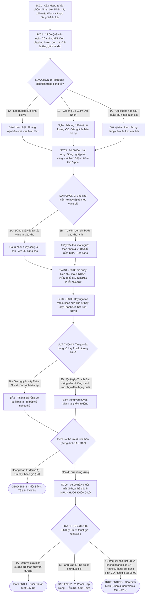

# VIỆC MA, LƯƠNG QUÁI — ĐÊM 1: CA TRỰC CỬA HÀNG TIỆN LỢI GS (22:00 – 06:00)
**Thể loại:** Kinh dị sinh tồn theo quy tắc (Rule-based Horror) · Phim tương tác phân nhánh (FMV)
**Thù lao:** 4.000.000 Won *(Lương ×50, trả tiền mặt lúc 06:00 sáng)*
**Cơ chế đặc trưng:** *Sổ Quy Tắc Bị Viết Đè & Sức Bền Tinh Thần* — mọi lựa chọn hoảng loạn hoặc tin mù quáng vào bẫy quy tắc đều làm Hóc Chun kiệt sức, mắt hoa mờ khó đọc chữ cảnh báo. Nếu liên tiếp sai lầm từ đầu đến khuya sẽ gục ngã ngay tại kho; chỉ khi giữ được sự bình tĩnh và dám phá luật mới đủ sức nhìn ra lối thoát câu giờ lúc 05:00 sáng.

---

### Sơ đồ phân nhánh Đêm 1

---

### Tuyến nhân vật & Đạo cụ Đêm 1
* **BIÊN HÓC CHUN (26 tuổi):** Nhân viên văn phòng vỡ nợ 140 triệu Won, sống cùng mẹ già bệnh nặng và em gái Chizun.
* **GÃ GIÁM ĐỐC (Nhân Lực Nhện):** Mặc vest xám cũ kỹ, người đưa ra hợp đồng 3 điều luật tại tầng bán hầm số 4 phố Cheonghak.
* **ĐỒNG NGHIỆP TÓC VÀNG:** Thanh niên xỏ khuyên tai, đồng phục xộc xệch; thực chất là vật chủ của bầy chuột mắt đỏ.
* **Đạo cụ & Manh mối:** *Sổ tay quy tắc bìa đen*, *Cây thánh giá sắt trên tường kho*, *Bình chữa cháy CO₂*, *Màn hình PC cũ sau quầy*, và **Manh mối Cha 1: Chiếc ví da cũ của Biên Minsu** *(nằm kẹt sau kệ kho lạnh ở nhánh `2B`)*.

---

### SC01 · NGOẠI / NỘI · CẦU MAPO ➔ TẦNG BÁN HÀM SỐ 4 CHEONGHAK · 20:30 ĐÊM MƯA

Mưa lớn quất rát mặt thép cầu Mapo. Biên Hóc Chun đứng chênh vênh phía ngoài lan can bảo vệ, hai bàn tay bấu chặt thanh sắt lạnh buốt. Trong túi áo khoác ướt sũng là xấp giấy đòi nợ đóng dấu đỏ với con số tổng **140.000.000 Won**.

Một cơn gió giật hất bàn chân anh trượt khỏi mép dầm cầu. Trong tích tắc cơ thể rơi xuống khoảng không đen ngòm phía trên dòng sông Hàn, hai tay Hóc Chun theo phản xạ quờ trúng thanh giằng thép dưới gầm cầu, móng tay rách toạc tứa máu. Hơi thở dồn dập khiến anh nhận ra mình vẫn muốn sống để lo cho mẹ và em gái Chizun.

Dưới ánh đèn cao áp hắt xuống trụ bê tông ẩm ướt ngay trước mặt, một tờ rơi màu vàng phản quang dán chặt vào mặt đá: *"Việc làm thêm ban đêm thù lao đặc biệt. Thanh toán tiền mặt ngay sau ca. Lương gấp 50 đến 1600 lần cơ bản. Công ty Nhân Lực Nhện — Tầng bán hầm số 4 phố Cheonghak."*

Một giờ sau, căn phòng bán hầm nồng mùi giấy mốc hiện ra sau cánh cửa sắt gỉ. Gã Giám Đốc mặc bộ vest xám lỗi thời đặt bản hợp đồng in mực đỏ lên chiếc bàn gỗ mục.

GÃ GIÁM ĐỐC
Biên Hóc Chun, 26 tuổi, nợ một trăm bốn mươi triệu. Tới đây là hết đường lùi rồi. Chỉ có ba điều luật: Một, đã ký hợp đồng thì cấm bỏ ca giữa chừng. Hai, tuyệt đối không tiết lộ thứ mình nhìn thấy. Ba, giữ mạng cho tới đúng giờ tan ca. Ca đầu tiên: bốn triệu Won cho tám tiếng trực đêm tại cửa hàng tiện lợi GS. Ký hay đi về cầu Mapo?

Hóc Chun cầm chiếc bút bi lạnh ngắt, đặt tay ký tên xuống dòng giấy đỏ. Góc hành lang mờ tối bên ngoài cửa kính, một người phụ nữ mang chiếc huy hiệu nhà máy dệt rỉ sét trên ve áo lặng lẽ liếc nhìn anh qua khe hở rồi khuất bóng.

---

### SC02 · NỘI · CỬA HÀNG TIỆN LỢI GS · 22:00 – 00:30

Cửa hàng tiện lợi nằm trơ trọi giữa ngã tư ngoại ô phủ sương dày. Đồng hồ điện tử trên tường nhảy sang **22:00**. Trên mặt bàn quầy thu ngân đặt sẵn một cuốn sổ tay bìa đen viết bằng nét mực đỏ sắc lạnh:
1. *Không được tự ý mở cửa phòng kho sau lưng trừ khi nghe đủ ba tiếng gõ ngắn.*
2. *Nếu gặp thứ không mang hình dạng con người, dùng cây thánh giá sắt treo góc kho để trấn áp.*
3. *Ca đêm luôn có hai nhân viên cùng trực, tuyệt đối không làm việc đơn độc.*

Hóc Chun vừa gấp cuốn sổ lại, hàng đèn tuýp trên trần bỗng chớp tắt liên hồi rồi tối sầm hoàn toàn. Qua tấm cửa kính mặt tiền, hàng ngàn con bướm đêm đen sì bất ngờ lao từ màn sương tới đập cánh bu kín lấy mặt kính ngoài, che khuất toàn bộ ánh đèn đường. Cùng lúc đó, phía sau cánh cửa sắt phòng kho vang lên tiếng thùng hàng đổ sầm và tiếng móng vuốt cào rít chói tai dọc khe cửa.

**[ĐIỂM LỰA CHỌN 1 — Phản ứng đầu tiên trong bóng tối]**
* **Lựa chọn 1A (Lao tới đấm mạnh vào cửa kính mặt tiền cố đẩy ra ngoài trốn chạy):** Hoảng loạn tìm lối thoát ngay phút đầu, tự làm bầm vai và hụt hơi.
* **Lựa chọn 1B (Vớ ngay điện thoại bàn dưới quầy bấm số khẩn cấp của Gã Giám Đốc Nhân Lực Nhện):** Tìm chỗ bám víu tinh thần từ chính hợp đồng và số nợ.
* **Lựa chọn 1C (Ngồi thụp xuống sau quầy thu ngân, nắm chặt cán chổi gỗ quan sát hướng phát ra tiếng động):** Giữ nguyên vị trí phòng thủ, chịu áp lực âm thanh từ phía kho.

#### NHÁNH 1A
Hóc Chun thúc vai vào cửa kính nhưng ổ khóa điện từ tự động siết cứng, từng con bướm đen bên ngoài ép mặt đập cánh sột soạt sát mặt kính ngay trước mũi anh. Hơi thở dồn dập khiến tay anh run bần bật khi lùi lại sau quầy.

#### NHÁNH 1B
Đầu dây bên kia chỉ vang lên giọng đều đều khô khốc của Gã Giám Đốc: *"Cửa đã khóa tới 06:00 sáng. Hoặc cậu trụ lại ôm bốn triệu Won về trả lãi sáng mai, hoặc tự để mất mạng vì sợ hãi."* Con số bốn triệu khiến Hóc Chun hít sâu nén cơn run, đứng thẳng lưng trở lại.

#### NHÁNH 1C
Hóc Chun thu mình sau dãy quầy gỗ, lắng tai nghe tiếng bước chân sột soạt quanh các kệ mì gói ngay sát lưng mình trong bóng tối đặc quánh cho tới khi đồng hồ điểm nửa đêm.

---

### SC03 · NỘI · CỬA HÀNG & PHÒNG KHO LẠNH · 01:00 – 03:00

Ánh đèn huỳnh quang bất ngờ bật sáng choang. Tiếng chuông cửa *keng* vang lên dù chẳng thấy bóng người từ ngoài đường bước vào. Trước quầy xuất hiện một thanh niên nhuộm tóc vàng, tai đeo khuyên bạc, mặc chiếc áo đồng phục cửa hàng nhăn nhúm bốc mùi ẩm mốc.

THANH NIÊN TÓC VÀNG
Làm gì mà mặt cắt không còn giọt máu thế ông anh? Tao tăng ca chung với mày đây. Lịch kho báo thiếu hai thùng sữa — ra đằng sau kiểm kê trong năm phút rồi còn tính tiếp.

Hắn thản nhiên vớ cây lau nhà đứng chắn lối cửa chính, hất hàm chỉ về cánh cửa phòng kho vừa phát ra tiếng cào cấu ban nãy — không hề có tiếng gõ cửa nào cả.

**[ĐIỂM LỰA CHỌN 2 — Lệnh kiểm kho lúc 01:00 sáng]**
* **Lựa chọn 2A (Chỉ thẳng mặt gã tóc vàng ép hắn phải tự đi vào kho trước vì mình đang đứng quầy):** Từ chối bước vào nơi vừa có tiếng gầm, chấp nhận đối đầu căng thẳng ngay tại sảnh.
* **Lựa chọn 2B (Cầm đèn pin dự phòng tự mở cửa bước vào phòng kho lạnh để kiểm chứng):** Phá thế nghi kỵ trực tiếp và tìm kiếm manh mối trong kho.

#### NHÁNH 2A
Gã tóc vàng đứng bất động nhìn chằm chằm Hóc Chun không chớp mắt suốt mười giây, rồi bật cười khùng khục bằng chất giọng vỡ đôi: *"Sợ cái gì ở trong đó thế?"* Hắn tiếp tục kéo lê cây lau nhà vương vệt nước đen sẫm sát quanh quầy thu ngân, mùi hôi thối nồng nặc dần bốc lên choán ngập cả cửa hàng.

#### NHÁNH 2B
Hóc Chun siết chặt đèn pin, lách cửa bước vào phòng kho lạnh âm độ. Ánh đèn quét ngang qua những chồng thùng các-tông đổ ngổn ngang và dừng lại trước cánh cửa tủ đông đang hé mở: bên trong là một khối thịt bầy nhầy mang gương mặt người méo mó mọc tám chi đen dài như chân nhện đang nhai dở xác chuột cống! Anh nín thở lùi vội ra sau, gót giày đá trúng một vật rơi dưới kẽ tủ lạnh — nhặt lên là **một chiếc ví da nam cũ sờn**, bên trong kẹp tấm ảnh ố vàng chụp anh và Chizun hồi tiểu học cùng thẻ tên nhân viên rách góc ghi họ **Biên Minsu** *(Thu được Manh mối Cha 1)*. Anh nhét vội chiếc ví vào túi áo rồi lao ngược ra ngoài sảnh.

---

### SC04 · NỘI · SẢNH CỬA HÀNG & PHÒNG KHO · 03:30 – 04:30

Đồng hồ chỉ **03:30**. Đàn bướm đen ngoài kính rũ xuống chết hàng loạt. Cơn gió lạnh thổi lật tung trang sổ tay trên quầy — ngay trước mắt Hóc Chun, dòng quy tắc số 3 biến mất, thay bằng nét chữ đỏ chảy dọc như máu tươi:

**"KẺ BƯỚC VÀO THỨ HAI KHÔNG PHẢI CON NGƯỜI."** *(Nếu trước đó từng hoảng loạn ở `1A` hoặc bị sốc khi thấy xác thối ở `2B`, mắt anh hoa mờ mất thêm vài giây nheo lại mới đọc rõ hết từng chữ).*

Ngay khoảnh khắc Hóc Chun ngẩng lên, thanh niên tóc vàng đang đứng sát lưng quầy thu ngân từ từ xoay đầu ngược lại một trăm tám mươi độ, xương cổ kêu răng rắc. Móng tay hắn dài ngoằng đen kịt đâm thẳng xuống mặt bàn gỗ! Hóc Chun theo phản xạ hất nguyên khay máy tính tiền trúng mặt hắn, lao ngược vào phòng kho khóa chặt chốt cửa từ bên trong.

Trên bức tường ẩm ngay cạnh cửa kho treo lủng lẳng **cây thánh giá bằng sắt đen** đúng như điều luật số 2 từng ghi. Ngoài cửa, gã tóc vàng đang nện ầm ầm làm tấm thép cửa kho móp méo vào trong.

**[ĐIỂM LỰA CHỌN 3 — Vũ khí trước cửa kho bị phá]**
* **Lựa chọn 3A (Giật cây thánh giá sắt giơ thẳng ra trước mặt theo đúng quy tắc số 2 để trấn áp khi cửa bật tung):** Tin tuyệt đối vào sổ quy tắc.
* **Lựa chọn 3B (Cầm cây thánh giá thấy nhẹ bất thường, lập tức quật mạnh gãy đôi vào bậc thềm bê tông để mài thành cọc sắt nhọn):** Nghi ngờ cuốn sổ và phá luật lấy vũ khí thật.

#### NHÁNH 3A
Cánh cửa kho bật tung. Hóc Chun giơ cao cây thánh giá sắt chặn trước ngực — gã tóc vàng chỉ cười khanh khách, giơ một tay giật phăng cây thánh giá bẻ gãy làm đôi như cành củi mục: *"Thánh giá là do tao tự viết vào sổ đấy, đồ ngu!"* Hắn vung tay bóp cổ Hóc Chun nhấc bổng khỏi mặt đất trước khi anh kịp đạp mạnh vào hạ bộ hắn để thoát xuống sàn.

#### NHÁNH 3B
Nhận ra thanh sắt rỗng ruột chẳng nặng hơn ống nhôm, Hóc Chun đập gãy gập trục ngang cây thánh giá xuống bậc đá tạo thành một mũi giáo sắt sắc lẹm. Ngay giây cửa bật tung, anh gào lên cắm phập mũi sắt xuyên qua vai trái gã tóc vàng khiến gã rú lên tiếng chuột rít kinh hoàng và lùi dạt ra sảnh.

*(Hệ quả tích lũy: Nếu trước đó đã kiệt sức vì hoảng loạn ở `1A` rồi lại tin theo bẫy thánh giá bị bóp cổ ở `3A`, Hóc Chun khuỵu gối không còn nhấc nổi cánh tay khi bầy chuột tràn vào kho — dẫn tới **DEAD END 1**).*

---

### SC05 · NỘI · SẢNH CHÍNH CỬA HÀNG · 05:00 – 06:00

Từ dưới nắp cống sau quầy và kẽ tủ hàng, hàng ngàn con chuột cống mắt đỏ tràn ra như lũ quét, leo phủ kín thân xác gã thanh niên tóc vàng, kết thành một **Quái Chuột Khổng Lồ** cao chạm trần nhà đè đổ hàng loạt kệ mì gói. Lối cửa kính chính bị thân mình nhầy nhụa của nó chắn ngang. Chỉ còn đúng một tiếng nữa là tới **06:00 sáng**.

Dưới ánh đèn nhấp nháy cạnh quầy thu ngân, chiếc màn hình máy tính cũ vẫn đang sáng trang trò chơi sinh tồn hồi nhỏ Hóc Chun từng chơi cùng em gái — gợi cho anh nhớ cách lợi dụng địa hình chướng ngại vật để câu giờ thay vì đối đầu trực diện.

**[ĐIỂM LỰA CHỌN 4 (05:00 – 06:00) — Chiến thuật giờ cuối cùng]**
* **Lựa chọn 4A (Lấy bình chữa cháy nện vỡ cửa kính cường lực lao ra đường lớn bất chấp mọi thứ):** Tìm đường chạy thẳng khỏi tiệm.
* **Lựa chọn 4B (Chui ngược vào góc tủ đông phòng kho nín thở trốn chờ đồng hồ điểm 06:00):** Né giao tranh tuyệt đối ở giờ cuối.
* **Lựa chọn 4C** *(Chỉ mở khi còn đủ tỉnh táo nhờ phá luật ở `3B` và không hoảng loạn ở `1A`)*: **Giật chốt bình chữa cháy CO₂ phun mù tầm nhìn quái vật, vừa chạy vòng qua các dãy kệ vừa đẩy đổ tủ hàng cản đường để câu giờ tới đúng 06:00.**

---

### HỆ THỐNG KẾT CỤC ĐÊM 1

* **DEAD END 1 · KIỆT SỨC TẠI KHO HÀNG *(Dính cả `1A` lẫn `3A` sau SC04)*:** Tâm trí và thể lực sụp đổ sau hai lần va đập liên tiếp khiến Hóc Chun buông xuôi ngồi bất động trên nền kho lạnh cho tới khi bóng tối nuốt chửng.
* **BAD END 1 · ĐUÔI CHUỘT SIẾT GÃY CỔ *(Chọn 4A, hoặc mất bình tĩnh ở `1A`/`3A` nên không kịp nhìn ra mẹo câu giờ `4C`)*:** Tấm kính cường lực được yểm bùa phong ấn bật dội bình chữa cháy văng ngược lại. Trước khi Hóc Chun kịp xoay người, chiếc đuôi kết bằng hàng trăm con chuột quấn chặt ngang cổ kéo giật anh vào giữa đám quái vật.
* **BAD END 2 · VI PHẠM HỢP ĐỒNG *(Chọn 4B)*:** Trốn nấp thụ động để mất quyền chủ động chiến đấu khi chưa hết ca. Âm khí theo khe tủ đông tràn vào ăn mòn dương khí trong người anh; sáng hôm sau nhân viên thu dọn chỉ thấy cuốn sổ nợ của gia đình Hóc Chun tăng thêm tiền phạt hợp đồng đổ lên đầu mẹ và Chizun.
* **TRUE ENDING · ĐÓN BÌNH MINH *(Chọn 4C)*:** Làn khí CO₂ trắng xóa làm bầy chuột mắt đỏ mù tạm thời; Hóc Chun tận dụng từng dãy kệ sắt làm lá chắn kéo dài từng phút sinh tồn mà không ham lao vào giết chết bản thể chính. Đúng **06:00**, tia nắng đầu ngày xé tan màn sương mù rọi xuyên qua tấm kính mặt tiền — khối Quái Chuột rít lên rồi tan rã thành tro bụi. Hóc Chun nhận phong bì **4.000.000 Won** tiền mặt từ tay Gã Giám Đốc và mở khóa hợp đồng Đêm 2 *(cùng **Chiếc ví da cũ của cha** nếu từng vào kho `2B`)*.
