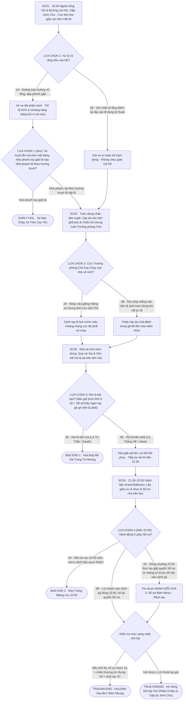

# VIỆC MA, LƯƠNG QUÁI — ĐÊM 2: CHUYẾN XE GÃ HỀ KỊCH CÂM (16:00 – 22:00)
**Thể loại:** Kinh dị tâm lý · Ảo thuật ma quái · Phim tương tác phân nhánh (FMV)
**Thù lao:** 8.000.000 Won *(Lương ×100, trả tiền mặt lúc 22:00)*
**Cơ chế đặc trưng:** *Quy Tắc Cự Ly Hai Mét & Dấu Tay Áo Thuật* — giữ được bình tĩnh không để va chạm hoặc bị thương ở hai chặng đầu sẽ giúp Hóc Chun nhìn kịp **dấu hiệu ngón tay của Gã Hề** gõ nhẹ lên mép lá bài sống sót trong nhà vệ sinh, thay vì đoán mò may rủi. Đồng thời, chiếc túi nhung đen của Gã Hề đang nuốt giữ **quyển Sổ nợ cũ của cha Biên Minsu**.

---

### Sơ đồ phân nhánh Đêm 2

---

### Tuyến nhân vật & Đạo cụ Đêm 2
* **BIÊN HÓC CHUN (26 tuổi):** Tài xế hợp đồng ca 2. Mang dư chấn từ Đêm 1 nhưng vẫn buộc phải nhận lương ×100 để xoay tiền viện phí cho mẹ.
* **TRƯỞNG PHÒNG CHÔ:** Vị khách trịch thượng của một hãng dược phẩm, liên tục mạt sát người nghèo và khinh thường gã hề câm.
* **GÃ HỀ KỊCH CÂM:** Chuyên viên sự kiện mặc âu phục sặc sỡ, mặt trát phấn trắng cứng đờ không nói nửa lời; cầm chiếc túi nhung đen co giãn phi vật lý.
* **JOHN CHU (Nữ điều tra viên):** Xuất hiện ở mở màn với huy hiệu nhà máy dệt 1970 rỉ sét và đầu ngón tay chai sẹo.
* **Đạo cụ & Manh mối:** *Cặp da tài xế cũ bỏ quên trên ghế phụ*, *Hai lá bài Tarot (Death & The Fool)*, và **Manh mối Cha 2: Quyển Sổ nợ viết tay của Biên Minsu**.

---

### SC01 · NGOẠI / NỘI · BÊN NGOÀI CỬA HÀNG GS ➔ ĐƯỜNG CAO TỐC ĐÈO TUYẾT · 16:00

Sáu giờ sáng rời cửa hàng tiện lợi, Hóc Chun còn chưa kịp cất phong bì tiền vào áo thì một người phụ nữ mặc áo khoác dạ xám — ve áo cài huy hiệu nhà máy dệt thập niên 1970 rỉ sét — bước tới đưa anh một lon cà phê nóng. Đầu ngón tay phải của cô hằn dày những vết sẹo ngang của thợ dệt cũ.

JOHN CHU
Tôi là John Chu, điều tra viên lao động. Tôi đang theo dấu những người mất tích từng ký giấy với Nhân Lực Nhện. Nếu chiều nay cậu thấy món đồ cũ nào thuộc về cha mình trên chuyến xe 7 chỗ... đừng để gã Giám đốc nuốt mất bằng chứng.

Bốn giờ chiều, tuyết rơi mù trên cung đường đèo cao tốc. Hóc Chun cầm lái chiếc xe 7 chỗ đen; tờ ghi chú kẹp trên vô lăng chỉ vỏn vẹn một điều luật: *"Luôn giữ khoảng cách trong tầm mắt chuyên gia sự kiện hai mét. Đối phương làm gì cũng không được ngăn cản hay chất vấn cho tới đúng 22:00."*

Ghế sau vang lên tiếng chửi rủa gay gắt của Trưởng phòng Chô hướng về người ngồi cạnh — **Gã Hề Kịch Câm** mặt trát phấn trắng bất động, hai tay ôm khư khư chiếc túi vải nhung đen. Trên ghế phụ ngay sát tay Hóc Chun nằm lăn lóc một chiếc cặp da rách của tài xế đời trước, mép cặp thò ra góc **quyển sổ nợ viết tay nét chữ Biên Minsu**.

Đột nhiên, một con thỏ trắng nhảy xổ qua đầu xe giữa làn tuyết! Hóc Chun đánh tay lái tránh — vô lăng bỗng tự xoay ngược loạn xạ trong khi Gã Hề giơ hai tay bóp vụn con thỏ vừa xuất hiện ngay giữa khoang xe thành hàng trăm mảnh giấy màu bay mù mịt che kín kính lái!

**[ĐIỂM LỰA CHỌN 1 — Mất lái giữa màn giấy vụn trên cao tốc]**
* **Lựa chọn 1A (Hoảng loạn buông một tay gạt mớ giấy bay trước mặt và đạp phanh chết):** Phản xạ hoảng sợ trước ảo giác, dễ dẫn tới tai nạn lật xe hoặc gây va chạm khiến Hóc Chun choáng váng.
* **Lựa chọn 1B (Hai tay ghì chặt vô lăng, giữ ga đều nhìn mép vạch kẻ vàng bên dưới để lết xe tấp vào lề đường an toàn):** Tin vào kỹ năng lái xe thực tế thay vì bị ảo giác đánh lạc hướng.

#### NHÁNH 1A
Tiếng lốp rít chói tai trên mặt đường đóng băng; sườn xe quệt toé lửa vào dải phân cách thép làm vỡ gương chiếu hậu. Thân xe trượt lần hai trên mặt băng — Hóc Chun có một lựa chọn cuối: **Kéo phanh tay giật lái** ➔ bánh sau khóa cứng, xe lộn nhiều vòng bốc cháy (**EARLY FAIL**); hoặc **Nhả phanh, lái theo hướng trượt rồi tấp lề** ➔ xe dừng được. Nếu gượng đưa được xe vào lề, Gã Hề quay đầu nhìn thẳng Hóc Chun bằng đôi mắt đen đặc không tròng vì chậm tiến độ.

#### NHÁNH 1B
Bằng lực tay cứng cáp, Hóc Chun giữ thăng bằng cho thân xe trượt gọn vào làn dừng khẩn cấp trước trạm nghỉ đèo tuyết. Gã Hề khẽ gật đầu hài lòng, vẫy tay ra hiệu tiếp tục xuống trạm.

---

### SC02 · NỘI / NGOẠI · TRẠM DỪNG CHÂN ĐÈO TUYẾT · 18:15

Tại sảnh ăn vắng lặng của trạm dừng chân, Gã Hề ngồi trước đĩa cơm cuộn, thản nhiên nuốt chửng cả lớp giấy bạc bọc ngoài rồi nhét chìa khóa xe cùng **quyển sổ nợ từ chiếc cặp da ghế phụ** vào bên trong chiếc túi vải nhung đen.

Trưởng phòng Chô mặt đỏ tía tai lao tới giật chiếc túi: *"Thằng câm điếc này, trả chìa khóa xe cho tao về dự tiệc!"* Khi lão Chô vừa thò đầu và hai tay vào miệng túi vải nhung, chiếc túi bất ngờ phình to như cái hang tối, nuốt trọn cả người Trưởng phòng Chô vào bên trong rồi thu nhỏ lại chỉ còn bằng nắm tay, lăn tròn trên sàn gạch và giật giật từng hồi nghẹn ứ!

**[ĐIỂM LỰA CHỌN 2 — Trước chiếc túi vải vừa nuốt người]**
* **Lựa chọn 2A (Lao tới nắm lấy miệng túi vải giằng ngược ra để cứu Trưởng phòng Chô):** Cố kéo người sống khỏi miệng túi, chấp nhận cánh tay bị lực hút bẻ rướm máu.
* **Lựa chọn 2B (Lùi ngay lập tức không chạm vào túi vải, chạy thẳng vào nhà vệ sinh trạm dừng tìm vũ khí phòng thân):** Giữ khoảng cách an toàn theo luật quan sát.

#### NHÁNH 2A
Vừa chạm vào mép vải nhung, một lực hút lạnh buốt kéo tuột cánh tay phải Hóc Chun vào bóng tối đặc quánh bên trong; tiếng xương gãy của Trưởng phòng Chô vang ngay sát đầu ngón tay anh! Hóc Chun gào lên dùng chân đạp mạnh thành bàn bật ngửa người giật cánh tay rướm máu ra khỏi miệng túi rồi bỏ chạy vào nhà vệ sinh.

#### NHÁNH 2B
Hóc Chun không dám đụng vào chiếc túi đang phập phồng, lao thẳng qua cửa nhà vệ sinh cuối hành lang và vớ ngay cây lau nhà bằng inox đứng thủ thế.

---

### SC03 · NỘI · NHÀ VỆ SINH TRẠM DỪNG · 18:45

Cánh cửa nhà vệ sinh khép lại không một tiếng động — Gã Hề đã đứng sừng sững sau lưng Hóc Chun từ lúc nào. Hóc Chun quật mạnh cán cây lau nhà vào vai hắn, nhưng ngay khoảnh khắc tiếp xúc, thân cây inox lẫn toàn bộ cánh tay phải của anh bỗng mềm nhũn ra như bún ướt rủ xuống bên hông!

Bị dồn ép sát tường gạch ẩm, Hóc Chun khuỵu gối run rẩy nhắc tới người mẹ bệnh nặng và món nợ 140 triệu đang đè trên vai để cầu xin một cơ hội sống. Gã Hề nghiêng đầu lắng nghe rồi từ túi áo vest rút ra **hai lá bài Tarot dính vết máu khô**, đặt úp song song trên thành bồn rửa mặt: một lá bên trái và một lá bên phải.

*(Nếu trước đó giữ được bình tĩnh ở cả `1B` lẫn `2B`, mắt Hóc Chun không bị choáng nên bắt trọn khoảnh khắc ngón tay trắng bệch của Gã Hề **khẽ gõ hai nhịp thật khẽ lên viền lá bài bên phải**; nếu từng va chạm ở `1A` hoặc bị thương ở `2A`, đầu óc anh quay cuồng chỉ kịp nhớ lại hướng tay phải lúc Gã Hề xòe giấy vụn trên xe).*

**[ĐIỂM LỰA CHỌN 3 — Ván bài một chạm sinh tử]**
* **Lựa chọn 3A (Đưa bàn tay trái còn lại lật lá bài bên trái):** Chạm vào lá bài úp mặt bên trái.
* **Lựa chọn 3B (Đưa tay lật lá bài bên phải):** Chạm vào lá bài bên phải.

#### NHÁNH 3A ➔ KẾT THÚC SỚM (BAD END 1)
Lá bài lật ra hình **Thần Chết (Death)**. Toàn thân Hóc Chun lập tức mềm rũ không xương như con búp bê vải; Gã Hề mỉm cười nhấc anh nhét gọn vào bên trong chiếc túi nhung đen cùng Trưởng phòng Chô, biến mất vĩnh viễn khỏi thế giới thực.

#### NHÁNH 3B
Lá bài lật ra hình **Chú Hề Cười (The Fool)**. Sát khí trong phòng vệ sinh tan biến tức thì; cánh tay mềm nhũn của Hóc Chun cứng cáp trở lại bình thường. Gã Hề vỗ tay ba tiếng không phát ra âm thanh rồi ném trả chìa khóa xe cho anh tiếp tục lái tới sảnh tiệc.

---

### SC04 · NỘI · SẢNH TIỆC GRAND BALLROOM · 21:30 – 22:00

Ánh đèn pha lê rực rỡ khắp hội trường sang trọng nơi hàng trăm giáo sư y khoa, chủ hãng dược và quan chức đang nâng ly chúc mừng. Khi Gã Hề bước lên bục diễn kịch câm mà không nói một lời, vị giáo sư chủ tọa say khướt liền hất ly rượu thẳng vào mặt hắn, chửi rủa thô tục.

Gã Hề từ từ lau vết rượu trên lớp phấn trắng, đẩy micro vào ngực Hóc Chun bắt anh đứng giữa ánh đèn sân khấu giới thiệu tiết mục, trong khi hắn mở rộng chiếc túi nhung đen — để lộ mép bìa **quyển Sổ nợ cũ của Biên Minsu** thò ra ngay miệng túi đặt trên mép bục! Đồng hồ đại sảnh chuẩn bị chạm đúng **22:00** — thời khắc hợp đồng hết ca và vòng bảo hộ chấm dứt.

**[ĐIỂM LỰA CHỌN 4 (Mốc 22:00) — Rút lui đúng luật hay Đánh đổi lấy kỷ vật?]**
* **Lựa chọn 4A (Nán lại sân khấu qua 22:00, bật micro hét lớn báo cho toàn bộ quan khách chạy trốn):** Cố cứu người trong khán phòng bất chấp giờ hết ca.
* **Lựa chọn 4B (Đúng tiếng chuông đầu của 22:00, cúi đầu lùi thẳng vào sau bức rèm nhung cánh gà mặc cho quyển sổ bị nuốt lại vào túi):** Giữ an toàn tối đa.
* **Lựa chọn 4C (Đợi đúng giây 22:00 điểm chuông, thọc tay giật phắt quyển Sổ nợ từ miệng túi nhung trước khi lăn người qua rèm cánh gà):** Liều mạng giành lại manh mối người cha trên lằn ranh hợp đồng, chấp nhận bị rách bàn tay chảy máu.

---

### HỆ THỐNG KẾT CỤC ĐÊM 2

* **EARLY FAIL · TAI NẠN CAO TỐC *(Chọn `1A` rồi kéo phanh tay giật lái)*:** Chiếc xe 7 chỗ lộn nhiều vòng bốc cháy giữa đèo tuyết; Trưởng phòng Chô chết tại chỗ, còn Hóc Chun kẹt trong cabin chịu án tù lẫn khoản bồi thường khổng lồ.
* **BAD END 1 · ẢO THUẬT BIẾN MẤT *(Chọn 3A tại SC03)*:** Bốc nhầm lá Tử Thần khiến cơ thể Hóc Chun biến thành con rối vải câm lặng trong chiếc túi nhung đen.
* **BAD END 2 · MÓN TRÁNG MIỆNG LÚC 22H *(Chọn 4A tại SC04)*:** Qua mốc 22:00 đồng nghĩa mất quyền bảo hộ của hợp đồng; tiếng hét qua micro chỉ bị đám quan chức cười nhạo trước khi Gã Hề khóa chặt cửa sảnh, xé xác cả Hóc Chun cùng toàn bộ khách mời.
* **TRAUMA END · HÓA ĐIÊN SAU BỨC RÈM NHUNG *(Chọn 4B/4C khi trước đó đã gánh nặng cả va chạm `1A` lẫn chấn thương túi nhung `2A`, cộng rách tay `4C`)*:** Đúng 22:00, cánh cửa sảnh tiệc khóa sập lại phía sau bức rèm. Một thi thể đứt lìa văng thẳng qua rèm nhung đập vào chân Hóc Chun giữa lúc đang kiệt quệ máu me và hoảng loạn làm tâm trí anh sụp đổ hoàn toàn — anh nhận đủ 8.000.000 Won rồi phát điên vĩnh viễn, phải nhập viện tâm thần và khóa đường tới Đêm 3.
* **TRUE ENDING · KẺ SỐNG SÓT KỊP GIỜ *(Chọn 4B hoặc 4C khi còn giữ được ý chí)*:** Lùi sau rèm nhung đúng khoảnh khắc 22:00 khép lại, Hóc Chun thoát chết gang tấc. Sáng hôm sau bản tin đưa tin khách sạn bị *"nổ đường ống khí gas"* che đậy toàn bộ thảm án. Anh cầm phong bì **8.000.000 Won** bước ra cửa và chạm mặt **John Chu** đang đứng đợi sẵn ở bậc thềm *(mang theo **Manh mối Cha 2: Sổ nợ Biên Minsu** nếu kịp giật ở `4C`)*.
