# VIỆC MA, LƯƠNG QUÁI — ĐÊM 3: MÊ CUNG GIAO SỮA CHUNG CƯ 444 (01:00 – 02:00)
**Thể loại:** Kinh dị không gian phi vật lý · Sinh tồn chạy đua thời gian · Phim tương tác phân nhánh (FMV)
**Thù lao:** 16.000.000 Won *(Lương ×200)*
**Cơ chế đặc trưng:** *Đồng Hồ Đếm Ngược 60 Phút & Ba Vật Phẩm Cứu Mạng* — Hóc Chun chỉ có đúng **60 phút (01:00–02:00)** để giao trọn **11 chai sữa thủy tinh** (`Tầng 2: 6 chai`, `Tầng 4: 4 chai`, `Tầng 5: 1 chai`) trong hành trang gồm **Thùng đựng sữa**, **Tấm danh thiếp chữ cổ của John Chu**, và **Chiếc thắt lưng da bò em gái Chizun tặng**. Mọi lựa chọn chậm trễ hoặc dính bẫy số học đều bị trừ thẳng vào quỹ thời gian 60 phút và khiến đồng hồ về `00:00` trước khi tới được cửa `505`.

---

### Sơ đồ phân nhánh Đêm 3

```mermaid
flowchart TD
    S0["SC01 · Bến xe trước Chung cư 444: Chizun tặng Thắt lưng da bò & John Chu đưa Danh thiếp chữ cổ"] --> S1["SC02 · Tầng 2 (Còn 60:00 · 6 chai): Giao xong 5 phòng nhưng mất tích phòng 202"]

    S1 --> C1{"LỰA CHỌN 1: Lục tìm phòng 202 hay Giữ chai 202 lên tầng trên?"}
    C1 -->|"1A · Cố chấp lục lọi hành lang tối tìm phòng 202"| B1A["Tốn 15 phút vô ích (Còn 45:00) · Khói đen dâng sớm"]
    C1 -->|"1B · Tạm giữ chai sữa nhãn '202' vào giỏ, đi thẳng lên tầng 4"| B1B["Bảo toàn quỹ thời gian · Nhanh chóng lên tầng 4"]

    B1A --> S2["SC03 · Tầng 4 đỏ quạch (4 chai): Mê cung cửa giả '4.44', '44+4' & Thang máy máy chém"]
    B1B --> S2

    S2 --> C2{"LỰA CHỌN 2: Đặt bừa trước cửa 444 đầu tiên hay Soi đèn kiểm từng dấu chấm?"}
    C2 -->|"2A · Đặt vội ngay cửa '4.44' đầu hành lang"| B2A["Dính bẫy số học · Phạt mất 20 phút & choáng váng nặng"]
    C2 -->|"2B · Soi đèn kỹ tìm đúng cửa '444' nguyên bản không dấu chấm"| B2B["Giao sạch 4 chai tầng 4 an toàn · Không mất thời gian"]

    B2A --> S3["SC04 · Thang máy kẹt tầng 2↔3 & Cầu thang bộ tầng 5 ngập khói đen"]
    B2B --> S3

    S3 --> C3{"LỰA CHỌN 3: Dùng tay không giữ cửa thang máy hay Chèn vật cứng & Dùng danh thiếp?"}
    C3 -->|"3A · Giữ cửa thang máy bằng tay không / Hoảng loạn quạt áo xua khói"| E_D1(["DEAD END 1 · Cửa Nghiền Nát Hoặc Ngạt Khói Đen"])
    C3 -->|"3B · Chèn THÙNG SỮA vào khe cửa thang máy + Rút DANH THIẾP JOHN CHU mở cửa thoát hiểm"| B3B["Chữ cổ trên danh thiếp phát sáng bật tung cửa tầng 5!"]

    B3B --> S4["SC05 · Tầng 5 bẻ cong 90°: Giao chai phòng 515 & Cú lộn ngược chai cuối '202 ➔ 505'"]
    S4 --> C4{"LỰA CHỌN 4: Leo tay không hay Móc THẮT LƯNG DA BÒ + Chạy đua 00:00?"}
    C4 -->|"4A · Bò tay không trên bức tường dựng đứng"| E_D2(["DEAD END 2 · Trượt Tay Rơi Xuống Vực Hư Không"])
    C4 -->|"4B · Móc thắt lưng da bò đu tới túi 515 rồi men gờ cửa sổ thả chai 505 từ bên ngoài"| B4B["Treo ngoài cửa sổ giành từng giây · Không bước vào phòng 505"]
    C4 -->|"4C (Khi còn quỹ giờ, không dính cả 1A+2A) · Đu thắt lưng đặt chai 505 & Đạp cửa lao thẳng vào trong!"| E_TRUE(["TRUE TRANSITION · Rơi Vào Cõi Âm Trắng Đen & Nhặt Móc Khóa Cha (Mở Đêm 4)"])

    B4B --> CHK_T{"Kiểm tra quỹ giờ: dính bao nhiêu bẫy mất giờ (1A, 2A)?"}
    CHK_T -->|"Dính cả 1A + 2A · đồng hồ về 00:00 trước cửa 505"| E_TIME(["DEAD END 3 · Hết Giờ — Khói Đen Nuốt Chửng"])
    CHK_T -->|"Dính tối đa 1 bẫy · kịp thả chai, trật khớp tay rơi xuống sảnh"| E_OUT(["SURVIVE ENDING · Sống Sót Ngoài Hành Lang (Thiếu Manh Mối Cha 3)"])
```

---

### Tuyến nhân vật & 3 Vật Phẩm Đêm 3
* **BIÊN HÓC CHUN (26 tuổi):** Nhân viên giao sữa ca 01:00–02:00 tại khu chung cư bỏ hoang từ năm 1982.
* **BIÊN CHIZUN (21 tuổi):** Em gái Hóc Chun; trao tận tay anh chiếc thắt lưng da bò bền chắc trước khi anh lên xe tới khu 444.
* **JOHN CHU (Nữ điều tra viên):** Dúi vào túi áo anh tấm danh thiếp in cổ tự bằng mực đỏ sẫm và dặn không được làm rách.
* **3 Vật phẩm bắt buộc:** *Thùng/Giỏ nhựa cứng đựng sữa*, *Danh thiếp chữ cổ của John Chu*, *Thắt lưng da bò của Chizun*.
* **Manh mối Cha 3:** *Chiếc móc khóa xe đạp một bánh bằng đồng* nằm trong căn phòng trắng đen sau cánh cửa `505`.

---

### SC01 · NGOẠI · BẾN XE TRƯỚC KHU CHUNG CƯ 444 · 00:45

Khu chung cư cũ xây từ năm 1982 đứng lầm lì giữa bãi đất trống sương mù. Trước giờ vào ca, em gái **Biên Chizun** chạy tới dúi vào tay Hóc Chun chiếc **thắt lưng da bò dày bản** mới thắt gài sẵn: *"Lỡ phải trèo tường hay buộc đồ nặng thì dùng dây này, đừng có liều tay không."*

Cách bến xe vài bước, **John Chu** lặng lẽ xuất hiện từ góc cột đèn, kẹp vào túi áo ngực anh một **tấm danh thiếp giấy dày viết toàn ký tự cổ khó đọc**: *"Giữ chặt trong ngực áo, đừng để ướt. Và nếu bên trong chung cư cậu nghe thấy tiếng đài radio cũ phát tên cha mình... hãy đi hết tới cánh cửa cuối cùng."*

Đồng hồ nhảy sang **01:00**. Trên tay Hóc Chun là giỏ nhựa cứng đựng đúng **11 chai sữa thủy tinh** và tờ giấy nhiệm vụ:
* *Giao đúng trong 60 phút: Tầng 2 (6 chai), Tầng 4 (4 chai), Tầng 5 (1 chai).*
* *Tuyệt đối không làm vỡ bất kỳ chai nào.*
* *Không bước vào căn hộ có số đuôi là 4 nếu chưa đọc đúng ký hiệu.*

---

### SC02 · NỘI · HÀNH LANG TẦNG 2 · 01:00 `(Quỹ thời gian: 60:00)`

Hành lang tầng 2 ẩm mốc, bóng đèn tuýp chập chờn nháy liên hồi. Hóc Chun lần lượt đặt nhanh 5 chai sữa vào các túi treo trước cửa phòng 201, 203, 204*(đã gạch chéo biển sửa thành 205)*, 206, 207. Đi tới cuối dãy hành lang cụt, anh khựng lại — trong giỏ còn dư một chai dán nhãn giấy **`202`**, nhưng dãy số cửa chỉ nhảy thẳng từ `201` sang `203`, hoàn toàn **không có căn phòng 202**!

Sau lưng, ánh đèn ở đầu cầu thang đột ngột tắt phụt hai bóng đầu tiên.

**[ĐIỂM LỰA CHỌN 1 — Xử lý chai sữa số 202 bị thừa]**
* **Lựa chọn 1A (Quay ngược dọc hành lang gõ từng vách tường tối xem có cửa ẩn nào mang số 202 không):** Cố hoàn thành đủ 6 chai ở tầng 2 trước khi lên tầng. *(Mất trắng 15 phút quỹ thời gian)*.
* **Lựa chọn 1B (Giữ nguyên chai '202' vào góc giỏ nhựa, lập tức chạy cầu thang lên tầng 4 trước khi khói đen dâng lên):** Không mất thời gian vào phòng biến mất.

#### NHÁNH 1A
Hóc Chun soi tay dò từng mét tường rêu ẩm suốt mười lăm phút trong tiếng nhiễu camera an ninh rè rè và tiếng chất lỏng nhỏ giọt đâu đó sau lưng. Cánh cửa 202 vẫn không hề tồn tại; đồng hồ tụt thẳng xuống còn `45:00` khi làn khói đen bắt đầu bò dưới gầm cửa thang bộ.

#### NHÁNH 1B
Hóc Chun kẹp chặt chai `202` vào ngăn góc giỏ nhựa để không va chạm vỡ, sải bước chạy thẳng lên tầng 4 khi đồng hồ vẫn còn dư dả thời gian.

---

### SC03 · NỘI · HÀNH LANG TẦNG 4 · `(Giao 4 chai)`

Ngay khi đặt chân lên tầng 4, toàn bộ bóng đèn hành lang đổi sang màu đỏ máu đặc quánh. Dãy cửa bên trái và bên phải đều treo biển đồng ghi **`444`**. Nhưng khi bước gần lại, chữ số trên các tấm biển đồng dường như tự dịch chuyển làm mắt hoa đi.

Anh nhớ tới điều luật số 3 trên nắp giỏ và rút chiếc đèn pin móc khóa soi sát từng biển cửa phủ bụi dày: một tấm có dấu chấm nhỏ giữa hai số đầu (`4.44`), tấm kế tiếp khắc phép cộng mờ (`44+4`), một tấm nữa ghi `44-4`, chỉ có vài cánh cửa thực sự khắc liền mạch không ký tự phụ.

**[ĐIỂM LỰA CHỌN 2 — Giải mã mê cung số 444]**
* **Lựa chọn 2A (Đặt vội chai sữa ngay trước cánh cửa đầu tiên ghi '444' để tiết kiệm thời gian chạy lên tầng 5):** Đặt theo cảm tính cho nhanh. *(Dính bẫy phòng '4.44' có dấu chấm thập phân mờ — bị phạt trễ thêm 20 phút và choáng váng)*.
* **Lựa chọn 2B (Chịu khó soi đèn sát từng bảng đồng, loại bỏ hết các cửa có dấu chấm hoặc dấu phép tính rồi mới đặt đủ 4 chai):** Tỉ mỉ kiểm tra đúng cửa thật.

#### NHÁNH 2A
Vừa thả chai sữa xuống túi cửa đầu tiên, tấm biển bật sáng lộ ra dấu chấm li ti **`4.44`** — cả hành lang tầng 4 lập tức xoay vòng khép kín đẩy Hóc Chun kẹt cứng trong vòng lặp cầu thang mất đúng **20 phút** trước khi tìm lại được lối thang máy!

#### NHÁNH 2B
Hóc Chun lần lượt đặt chính xác 4 chai sữa trước các cánh cửa nguyên bản không dấu chấm phụ, không tiêu tốn một giây nào vào bẫy ảo giác.

---

### SC04 · NỘI · THANG MÁY & CẦU THANG BỘ TẦNG 5

Hóc Chun bước vào thang máy bấm nút tầng 5. Cabin vừa chạy qua tầng 2 thì đèn bảng điều khiển nhấp nháy điên loạn (`2 ↔ 3`), dây cáp rung giật rồi dừng khựng lưng chừng khe tầng! Hai cánh cửa thép của thang máy bất ngờ giật đóng – mở liên tục với lực kẹp mạnh như **lưỡi máy chém**.

Ngay khoảnh khắc anh lách được ra hành lang cầu thang bộ tầng 5, làn khói đen kịt mang mùi tro đốt ập từ khe trần xuống khóa chặt cánh cửa thoát hiểm phía trên — **cánh cửa không hề có tay nắm cửa ở mặt trong!**

**[ĐIỂM LỰA CHỌN 3 — Vượt hai cửa tử trước khi lên mặt sàn tầng 5]**
* **Lựa chọn 3A (Dùng tay không giữ cửa thang máy để chui ra, rồi lấy áo khoác quạt xua làn khói đen trước cửa cầu thang):** Ứng phó bản năng bằng cơ thể.
* **Lựa chọn 3B (Lấy chính THÙNG NHỰA ĐỰNG SỮA chèn ngang khe cửa thang máy lách qua, rồi áp TẤM DANH THIẾP CỦA JOHN CHU lên khe khóa cửa tầng 5):** Tận dụng vật phẩm mang theo.

#### NHÁNH 3A ➔ KẾT THÚC SỚM (DEAD END 1)
Cửa thang máy kẹp nát cổ tay hoặc làn khói độc tràn thẳng vào phổi ngay khi anh vung áo quạt khói, khiến Hóc Chun ngạt thở ngã gục giữa chiếu nghỉ cầu thang.

#### NHÁNH 3B
Chiếc thùng nhựa cứng chịu lực kẹp ngang khe cửa thang máy đúng hai giây đủ cho Hóc Chun ôm số sữa còn lại lách thoát lên cầu thang bộ. Trước cánh cửa mất tay nắm phủ đầy khói đen, anh rút **tấm danh thiếp của John Chu** ép vào khe khóa — các nét cổ tự mực đỏ trên thẻ bỗng rực sáng chói lòa, hất tung chốt khóa bên trong mở thẳng đường ra hành lang tầng 5!

---

### SC05 · NỘI · TẦNG 5 PHI TRỌNG LỰC · `(Còn 2 chai: 515 & 202)`

Bước ra tầng 5, toàn bộ định luật vật lý bị bẻ gãy hoàn toàn: mặt sàn hành lang nghiêng bật lên **dựng đứng chín mươi độ như một vách tường núi thẳng tắp** dẫn lên căn hộ số `515` nằm cheo leo giữa vách và cánh cửa `505` tít phía rìa đối diện. Không còn chỗ đặt chân.

Trong giỏ lúc này còn đúng hai chai: một chai cho phòng `515` và **chai sữa cuối cùng dán nhãn `202`**. Bất chợt, một tiếng rè rè của chiếc **đài radio cũ** vang lên từ phía đỉnh vách tường: giọng người cha mất tích **Biên Minsu** vọng ra đứt quãng giữa nhiễu sóng. Hóc Chun giật mình xoay ngược chai sữa `202` trong tay — con số lộn ngược biến thành **`505`**, trong khi đồng hồ đếm ngược chỉ còn những giây cuối cùng trước **00:00**!

**[ĐIỂM LỰA CHỌN 4 — Cú giao hàng cuối cùng trên vách tường 90°]**
* **Lựa chọn 4A (Cố bám đầu ngón tay không vào gờ gạch trèo qua bức tường dựng đứng):** Tiết kiệm thời gian bằng tay không.
* **Lựa chọn 4B (Tháo THẮT LƯNG DA BÒ của Chizun móc vào ống nước gỉ đu qua giao chai túi 515, rồi men theo mép gờ ngoài cửa sổ thò tay thả chai vào túi 505 trước khi tụt xuống tầng trệt):** Tránh bước vào bên trong cánh cửa lạ.
* **Lựa chọn 4C** *(Khả dụng khi không dính cả hai bẫy mất giờ `1A + 2A`)*: **Móc THẮT LƯNG DA BÒ đu thẳng qua vách đứng đặt xong chai phòng 515, đặt gọn chai cuối vào túi 505 rồi đạp tung cánh cửa lao thẳng vào bên trong theo tiếng radio của cha!**

---

### HỆ THỐNG KẾT CỤC ĐÊM 3

* **DEAD END 1 · CỬA NGHIỀN & KHÓI ĐỘC *(Chọn 3A tại SC04)*:** Thiếu vật cứng chèn cửa thang máy hoặc hít trực tiếp khói cõi âm khiến Hóc Chun tử nạn giữa tầng chuyển giao.
* **DEAD END 2 · RƠI XUỐNG VỰC HƯ KHÔNG *(Chọn 4A tại SC05)*:** Bức tường phi trọng lực trơn trượt hất văng bàn tay không xuống khoảng không tối đen bên dưới chung cư 444.
* **DEAD END 3 · HẾT GIỜ 00:00 *(Dính cả hai bẫy `1A` -15 phút và `2A` -20 phút khiến đồng hồ chạm `00:00` khi còn cách cửa `505`)*:** Đồng hồ điểm hết giờ đúng lúc Hóc Chun còn lơ lửng giữa tường; làn khói đen từ bốn góc ập tới ăn mòn anh vì không giao kịp chai thứ 11.
* **SURVIVE ENDING · THOÁT RA HÀNH LANG TẦNG 1 *(Chọn 4B khi chỉ dính tối đa 1 bẫy giờ)*:** Thả được chai sữa thứ 11 vào túi cửa `505` từ bên ngoài cửa sổ đúng giây chót, Hóc Chun trật khớp cổ tay rơi ngược xuống sảnh tầng 1 nhận trọn **16.000.000 Won** ngay trước mặt John Chu — sống sót nhưng bỏ lỡ không gian trắng đen sau cánh cửa `505`.
* **TRUE TRANSITION · RƠI VÀO CÕI ÂM TRẮNG ĐEN *(Chọn 4C)*:** Đặt xong chai sữa vào giây 00:01, Hóc Chun đạp tung cánh cửa `505` lao vào khoảng không trắng đen tĩnh lặng. Tiếng radio của Biên Minsu im bặt, để lại trên nền đá lạnh **chiếc móc khóa xe đạp một bánh bằng đồng** khắc tên hai anh em *(Thu được **Manh mối Cha 3**)* — anh mắc kẹt lại phía sau ranh giới, buộc em gái **Chizun** phải bước vào Đêm 4 để giải cứu.
