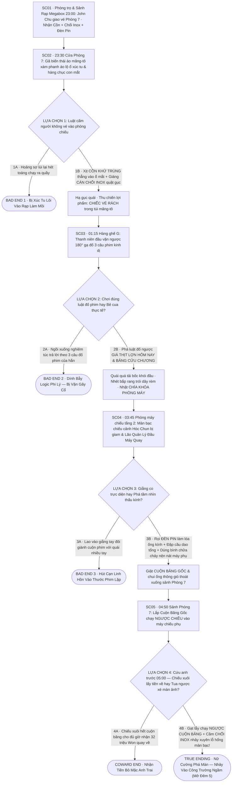

# VIỆC MA, LƯƠNG QUÁI — ĐÊM 4: RẠP CHIẾU PHIM PHÒNG SỐ 7 (23:00 – 05:00)
**Thể loại:** Kinh dị hành động · Hài đen (Black Comedy) · Phim tương tác phân nhánh (FMV)
**Thù lao:** 32.000.000 Won *(Lương ×400 · Góc nhìn nhân vật chính: Em gái Biên Chizun)*
**Cơ chế đặc trưng:** *Thần Kinh Thép & Phá Luật Đời Thường* — khác với anh trai Hóc Chun luôn phòng thủ trước các quy tắc siêu nhiên, cựu vận động viên chạy nước rút **Biên Chizun** dùng trực giác đời thực, **Bình xịt cồn y tế, Cây chổi inox và Đèn pin rọi vé** để đập nát bẫy logic ma quái. Cố chơi theo luật của ma sẽ rơi vào bẫy tử thần; phải thu đủ **Vé rách ➔ Chìa khóa phòng máy ➔ Cuộn băng gốc** mới xé được màn ảnh nhảy sang cứu anh trai.

---

### Sơ đồ phân nhánh Đêm 4

---

### Tuyến nhân vật & Trang bị Đêm 4
* **BIÊN CHIZUN (21 tuổi):** Cựu vận động viên chạy nước rút giải học sinh, tính cách lì lợm, không tin ma quỷ, chỉ tin lực đấm và toán tiểu học.
* **JOHN CHU (Nữ điều tra viên):** Dẫn dụ Chizun nhận ca trực đêm Phòng 7 để mở khóa cánh cửa dẫn xuống Công trường ngầm.
* **3 Quái Vật Phòng Chiếu:** *Gã áo măng-tô nhiều mắt*, *Thanh niên đầu vặn ngược 180°*, *Lão quản lý đầu máy quay phim*.
* **Bộ trang bị 3 món:** *Bình xịt cồn sát khuẩn*, *Cây chổi cán inox tháo đầu*, *Đèn pin rọi vé siêu sáng*.

---

### SC01 · NỘI · PHÒNG TRỌ NHÀ HỌ BIÊN ➔ SẢNH RẠP MEGABOX · 23:00

Một ngày sau khi anh trai Hóc Chun bặt vô âm tín tại Chung cư 444 *(bị kẹt sau cánh cửa trắng đen 505 ở Đêm 3)*, **John Chu** gõ cửa phòng trọ của Biên Chizun. Dưới ánh đèn hành lang, ngón tay đầy vết sẹo thợ dệt của cô ta đẩy tới một phong bì đỏ kèm tấm thẻ nhân viên rạp chiếu phim Megabox.

JOHN CHU
Anh trai cô kẹt trong ranh giới trắng đen rồi. Đêm nay 23:00 tới 05:00 sáng nhận ca gác Phòng chiếu số 7 rạp Megabox — tiền công ba mươi hai triệu Won. Muốn kéo anh ta về thì giữ lấy cuộn băng gốc trong phòng máy chiếu.

Không chút chần chừ, Chizun khoác áo thể thao cũ, buộc gọn tóc đuôi ngựa, vơ luôn bình xịt cồn y tế còn thừa trong nhà trọ rồi sải bước tới rạp phim bỏ vắng. Tại quầy soát vé ngập mùi bắp rang cháy khét, cô rút thêm một **cây chổi cán inox** dựng góc tường và kẹp **đèn pin rọi vé** vào cạp quần.

---

### SC02 · NỘI · HÀNH LANG CỬA PHÒNG CHIẾU SỐ 7 · 23:30

Ánh đèn hành lang chớp tắt đỏ sẫm. Trên cửa kính phòng số 7 dán đúng một dòng quy tắc: *"Cấm tuyệt đối không cho người không có cuống vé bước qua cửa phòng số 7."*

Chizun đang lấy tay che mũi trước mùi bắp rang khét lẹt thì một gã đàn ông cao lênh khênh mặc **áo măng-tô xám dài** lù lù tiến sát cửa phòng chiếu, bàn tay trắng bệch giơ ra định gạt cô sang bên để đi thẳng vào trong.

CHIZUN
Này ông chú, vé đâu? Rạp này đâu có miễn phí vé đêm?

Gã không đáp, hai tay nắm vạt áo măng-tô phanh rộng sang hai bên — bên trong lồng ngực rỗng tuếch chẳng hề có xương sườn mà lúc nhúc hàng chục **con mắt đỏ ngầu rỉ dịch vàng** cùng mấy sợi xúc tu đen trườn ra đung đưa! Trên màn hình hành lang phía sau chợt lóe lên đoạn băng ký ức ngày Chizun té đứt dây chằng ở đường chạy làn số 8.

**[ĐIỂM LỰA CHỌN 1 — Trước gã biến thái nhiều mắt không có vé]**
* **Lựa chọn 1A (Hoảng sợ lùi bước, quay lưng la hét chạy ngược ra quầy vé):** Bỏ vị trí cửa phòng 7.
* **Lựa chọn 1B (Bóp thẳng BÌNH XỊT CỒN vào hàng chục con mắt rồi xoay cán CHỔI INOX quật ngang đầu gối gã):** Tấn công thẳng vào điểm yếu vật lý của đôi mắt.

#### NHÁNH 1A ➔ KẾT THÚC SỚM (BAD END 1)
Ngay khi Chizun quay lưng chạy bước đầu tiên, năm sợi xúc tu từ trong áo măng-tô phóng vọt ra quấn chặt cổ chân kéo giật cô lôi tuột vào bóng tối sau cánh cửa phòng số 7.

#### NHÁNH 1B
Cồn sát khuẩn 70 độ phun thẳng vào hàng chục tròng mắt trần khiến con quái vật rú lên tiếng rít điếc tai, hai tay ôm ngực khuỵu xuống. Chizun xoay ngược cán chổi inox phang gọn một gậy vào gáy khiến gã ngã sấp bất động. Cô cúi xuống móc túi áo măng-tô lấy ra **chiếc cuống vé rách nhuốm mực đen** để mở khóa chốt cửa bước vào bên trong phòng chiếu.

---

### SC03 · NỘI · HÀNG GHẾ G PHÒNG CHIẾU SỐ 7 · 01:15

Cánh cửa phòng chiếu đóng sầm sau lưng. Giữa hàng trăm hàng ghế nhung đỏ trống trải, một gã thanh niên ngồi ngay giữa **hàng ghế G** chặn lối đi thẳng lên bậc phòng máy. Khi Chizun rọi đèn pin tới, đầu gã từ từ xoay ngược ra sau lưng một trăm tám mươi độ, miệng toác rộng tới tận mang tai:

THANH NIÊN ĐẦU NGƯỢC
Muốn đi qua hàng G... phải trả lời đúng ba câu hỏi về phim kinh dị của rạp này. Sai một câu... tao vặn cổ mày quay ngược giống tao!

Chizun nheo mắt nhìn tờ giấy câu đố trên tay hắn — chữ in mờ nhảy nhót liên tục, câu chữ mơ hồ kiểu đánh đố hai mang để người trả lời kiểu gì cũng bị bắt bẻ sai.

**[ĐIỂM LỰA CHỌN 2 — Đấu trí với kẻ gác hàng ghế G]**
* **Lựa chọn 2A (Ngồi xuống ghế bên cạnh, nghiêm túc nghe từng câu đố phim kinh dị và đoán đáp án theo luật của hắn):** Chơi đúng sân chơi do quái vật đặt ra.
* **Lựa chọn 2B (Không thèm ngồi xuống, hất hàm hỏi ngược gã giá thịt lợn ba chỉ hôm nay ngoài chợ lẫn bảng cửu chương bảy):** Phá vỡ kịch bản siêu nhiên bằng dữ liệu đời thường.

#### NHÁNH 2A ➔ KẾT THÚC SỚM (BAD END 2)
Hai câu đầu trôi qua dễ dàng; tới câu thứ ba, gã hỏi một chi tiết chưa từng tồn tại trong bất kỳ bộ phim nào rồi cười khoái trá khi Chizun ngập ngừng quá ba giây. Hai bàn tay lạnh ngắt tóm lấy đầu cô vặn ngược ra sau, biến Chizun thành khán giả bất động tiếp theo trên hàng ghế G.

#### NHÁNH 2B
CHIZUN
Phim với chả ảnh! Tao hỏi lại mày một câu thôi: Sáng nay giá thịt ba chỉ ngoài chợ Cheonghak bao nhiêu một cân, với lại bảy lần tám bằng mấy?

Gã thanh niên đầu ngược đứng hình tại chỗ. Hàm răng gã va vào nhau côm cốp, hai lỗ tai bốc ra từng làn khói trắng vì não bộ ma quái không xử lý nổi dữ liệu thực tế ngoài kịch bản! Không để hắn kịp định thần, Chizun tọng nguyên bịch bắp rang cháy gần đó vào họng hắn, giật dây rèm nhung buộc chặt hắn vào tay ghế rồi nhặt **chùm chìa khóa phòng máy chiếu** rơi dưới chân ghế lên cầu thang.

---

### SC04 · NỘI · PHÒNG MÁY CHIẾU TẦNG 2 · 03:45

Phòng máy chiếu chật hẹp nồng mùi nhựa phim nóng chảy. Qua ô kính vuông nhìn xuống màn bạc khổng lồ bên dưới, Chizun sững người — trên màn ảnh đang phát trực tiếp cảnh **anh trai Hóc Chun bị xích trong không gian trắng đen**, ngước mắt nhìn vô định về phía ống kính!

Ngay cạnh trục máy chiếu chính, **Lão Quản Lý Rạp** hiện nguyên hình là một thực thể có **đầu là chiếc máy quay phim khổng lồ** với bốn cánh tay xương xẩu thò ra từ ống tay áo vest, vươn thẳng về phía cuộn phim đang quay nhằm xé nát thước phim giữ sinh mạng Hóc Chun.

**[ĐIỂM LỰA CHỌN 3 — Bảo vệ cuộn băng gốc trước Lão Đầu Máy Quay]**
* **Lựa chọn 3A (Lao thẳng vào giữa hai cánh tay máy giằng lấy cuộn phim đang quay trên trục):** Đấu sức trực diện với quái vật máy quay.
* **Lựa chọn 3B (Bật ĐÈN PIN RỌI VÉ chế độ chớp mạnh chiếu thẳng vào ống kính mắt trên đầu lão, đạp sập cầu dao tổng phòng máy rồi cầm bình chữa cháy nện nát thấu kính):** Đánh mù cảm biến ánh sáng rồi cướp cuộn phim.

#### NHÁNH 3A ➔ KẾT THÚC SỚM (BAD END 3)
Bốn cánh tay cơ khí quấn chặt lấy vai Chizun ép sát vào họng ống kính máy quay đang hút sáng. Cuộn phim đứt tung làm linh hồn cô bị hút thẳng vào thước phim đen trắng, lặp đi lặp lại khoảnh khắc té ngã thời trung học mãi mãi.

#### NHÁNH 3B
Luồng sáng trắng gắt từ đèn pin rọi thẳng vào thấu kính mắt khiến Lão Đầu Máy Quay loạng choạng giật nảy. Chizun tung cú đạp gãy cầu dao tổng làm toàn bộ căn phòng tối sầm, tiếp tục vung bình chữa cháy đập nát ống kính máy quay, giật phắt **Cuộn Băng Gốc** khỏi trục rồi lăn người chui theo đường ống thông gió thoát thẳng xuống trước màn bạc Phòng 7!

---

### SC05 · NỘI · TRƯỚC MÀN BẠC PHÒNG SỐ 7 · 04:50

Đồng hồ điện tử chỉ còn mười phút tới **05:00 sáng**. Trong phòng chiếu vắng lặng, chiếc máy chiếu dự phòng nối thẳng lên màn ảnh trắng vẫn còn hoạt động bằng nguồn điện ắc quy. Cuộn băng gốc trên tay Chizun vẫn rung lên nhè nhẹ theo nhịp tim của người đang mắc kẹt bên kia màn ảnh.

**[ĐIỂM LỰA CHỌN 4 — Quyết định trước 05:00 sáng]**
* **Lựa chọn 4A (Lắp cuộn băng chạy xuôi bình thường chờ đồng hồ nhảy sang 05:00 để lấy 32 triệu Won rời khỏi rạp):** Hoàn tất ca trực theo hợp đồng an toàn nhất.
* **Lựa chọn 4B (Lắp Cuộn Băng Gốc vào trục nhưng gạt lẫy CHẠY NGƯỢC CHIỀU, siết chặt cán chổi inox chạy đà lao thẳng xuyên qua màn bạc đang rách toạc!):** Phá khóa không gian để sang tận cõi âm cứu anh trai.

---

### HỆ THỐNG KẾT CỤC ĐÊM 4

* **BAD END 1 · MỒI RẠP CHIẾU *(Chọn 1A tại SC02)*:** Hoảng loạn bỏ vị trí khiến Chizun bị ổ xúc tu của Gã áo măng-tô kéo biến mất sau cánh cửa Phòng 7.
* **BAD END 2 · KHÁN GIẢ VĨNH CỬU *(Chọn 2A tại SC03)*:** Dính bẫy câu đố phi lý của Thanh niên đầu ngược khiến Chizun bị vặn gãy cổ ngồi chết cứng trên hàng ghế G.
* **BAD END 3 · THƯỚC PHIM LẶP LẠI *(Chọn 3A tại SC04)*:** Cố giằng tay đôi làm cuộn phim vỡ nát và linh hồn Chizun bị giam cầm vĩnh viễn bên trong máy quay.
* **COWARD END · BẠC TỶ CÔ ĐỘC *(Chọn 4A tại SC05)*:** Đồng hồ điểm 05:00, Chizun cầm phong bì **32.000.000 Won** bước ra khỏi rạp phim an toàn — nhưng màn bạc Phòng 7 tắt ngấm vĩnh viễn, xóa sạch dấu vết cuối cùng để cứu Hóc Chun khỏi cõi trắng đen.
* **TRUE ENDING · NỮ CƯỜNG PHÁ MÀN *(Chọn 4B tại SC05)*:** Khi thước phim chạy ngược chiều tua lùi từng khung hình, tấm màn bạc khổng lồ nứt toác tạo thành một lỗ hổng xoáy gió lạnh buốt. Chizun rạp người chạy nước rút hết tốc lực, nhảy vọt qua ranh giới màn ảnh rơi thẳng xuống tầng hầm công trường trắng đen — mở khóa màn hội ngộ ở **Đêm 5**.
