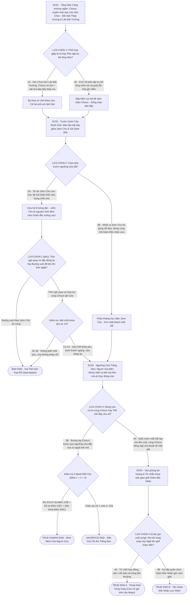

# VIỆC MA, LƯƠNG QUÁI — ĐÊM 5: CÔNG TRƯỜNG NGẦM & CÁNH CỬA RANH GIỚI (ĐẠI KẾT CỤC)
**Thể loại:** Kinh dị sinh tồn · Lật mặt tâm lý · Đại kết cục đa nhánh (FMV)
**Thù lao:** 128.000.000 Won *(Lương ×1600)*
**Cơ chế đặc trưng:** *Lật Mặt Kép (John Chu vs. Gã Giám Đốc) & Bộ 3 Kỷ Vật Của Cha* — hai anh em Hóc Chun và Chizun hội ngộ dưới chân **Tháp Xương Người**, cùng lúc chứng kiến màn lật mặt kép giữa **John Chu (Oán linh công nhân dệt 50 năm trước muốn thế giới cùng diệt vong)** và **Gã Giám Đốc Nhện (Kẻ giữ cân bằng tàn nhẫn)**. Mọi quyết định từ **cách phối hợp giữ an toàn cho Chizun**, **đứng về phe nào trước cánh cửa sắt**, đến **số lượng kỷ vật cha thu thập từ Đêm 1–3** sẽ định đoạt số phận của cả gia đình lẫn thế giới thực tại.

---

### Sơ đồ phân nhánh Đêm 5

---

### Tuyến nhân vật & Điểm hội tụ chiến dịch
* **BIÊN HÓC CHUN (26 tuổi) & BIÊN CHIZUN (21 tuổi):** Hai anh em hội tụ tại tầng hầm sâu nhất dưới Công trường ngầm — nơi kết nối toàn bộ các ca trực từ Đêm 1 đến Đêm 4.
* **JOHN CHU (Oán linh xưởng dệt 1970):** Rũ bỏ lớp vỏ điều tra viên, chiếc huy hiệu nhà máy dệt trên ngực áo bốc khói đen kịt; mang mối thù giai cấp muốn kéo sập ranh giới để cả thành phố chết chung.
* **GÃ GIÁM ĐỐC NHÂN LỰC NHỆN:** Kẻ thu mua dương khí của người nghèo, nhưng thực chất giữ bức tường ngăn không cho âm giới nuốt chửng hàng triệu dân thường ngoài kia.
* **BIÊN MINSU (Người cha mất tích 20 năm):** Đã hóa thành thực thể nửa người nửa âm khí bên kia cánh cửa; chỉ có **bộ 3 kỷ vật tích lũy từ Đêm 1–3** mới đủ neo giữ nhân tính để kéo ông thoát ra nếu Hóc Chun quyết định thế chỗ.

---

### SC01 · NỘI · TẦNG HẦM CÔNG TRƯỜNG NGẦM · NỬA ĐÊM

Rơi từ lỗ hổng màn bạc Đêm 4 xuống nền bê tông ướt lạnh, Chizun lập tức đỡ lấy anh trai Hóc Chun vừa thoát khỏi sợi xích trắng đen. Trước mặt hai anh em sừng sững một **Ngọn Tháp Xương Người** khổng lồ dựng từ hài cốt hàng trăm công nhân chết oan qua nhiều thập kỷ; quanh chân tháp, **Lão Đội Trưởng Công Trường** thân thể méo mó dẫn theo hàng chục thây ma áo bảo hộ lao tới chặn lối xuống cửa đáy.

**[ĐIỂM LỰA CHỌN 1 — Vượt Tháp Xương & Lão Đội Trưởng]**
* **Lựa chọn 1A (Phối hợp anh em giáp lá cà: Hóc Chun dùng cọc sắt kìm chặt tay Lão Đội Trưởng, Chizun bật lửa kết hợp bình xịt cồn còn lại thiêu rụi vòng vây thây ma):** Đánh bài bản giữ địa hình hầm, ép Lão Đội Trưởng khai ra cách mở chốt an toàn cánh cửa đáy.
* **Lựa chọn 1B (Đạp sập trụ bê tông đỡ giàn giáo trung tâm cho cả mảng trần hầm đổ ập chôn vùi bầy quái):** Giải quyết nhanh bằng bạo lực công trường, chấp nhận rủi ro tảng bê tông văng trúng cẳng chân Chizun khiến cô tập tễnh chảy máu.

#### NHÁNH 1A
Hai anh em phối hợp ăn ý hạ gục Lão Đội Trưởng ngay dưới chân Tháp Xương; trước khi tan biến, lão kịp thều thào chỉ rõ chốt khóa phụ nằm phía dưới thanh ngang cánh cửa sắt.

#### NHÁNH 1B
Tiếng nổ ầm vang làm sập nửa vòm hầm đè nát bầy thây ma, nhưng một khối bê tông rơi trượt đè rách bắp chân Chizun. Hóc Chun cõng vội em gái tập tễnh tiến xuống tầng đáy cùng cơn đau nhói.

---

### SC02 · NỘI · SẢNH CÁNH CỬA RANH GIỚI · ĐÊM BÃO NGẦM

Đáy công trường là một **Cánh Cửa Sắt Đen Khổng Lồ** khóa bằng xích nặng, từng kẽ hở đang rỉ ra luồng sương trắng đen lạnh cắt thịt. Gã Giám Đốc Nhân Lực Nhện đứng dựa vào vách tường bê tông, một bên sườn rướm máu, tay lăm lăm khẩu súng ngắn. Đối diện bên kia là **John Chu** — lớp da mặt điều tra viên nứt toác, để lộ gương mặt cháy sém của nữ công nhân nhà máy dệt năm 1970 cùng cuộn khói đen bốc lên từ chiếc huy hiệu rỉ sét trên ngực.

JOHN CHU
Mở bung then chốt phía sau lưng cậu đi, Hóc Chun! Cha cậu còn sống bên kia cánh cửa! Thằng giám đốc này và lũ nhà giàu trên mặt đất dùng xương máu công nhân như cha con cậu suốt năm mươi năm để giữ lấy bình yên cho riêng chúng nó! Mở cửa để tất cả công bằng đi!

GÃ GIÁM ĐỐC
Cậu Biên! Mụ ta nói đúng một nửa — tôi là kẻ bẩn tay bóc lột những người cùng đường. Nhưng phía sau cánh cửa này là toàn bộ thành phố có mẹ cậu đang nằm viện! Cha cậu đã giữ cái chốt này hai mươi năm nay, đừng tự tay phá hủy!

**[ĐIỂM LỰA CHỌN 2 — Chọn lập trường trước Cánh Cửa Ranh Giới]**
* **Lựa chọn 2A (Tin vào lời hứa đoàn tụ của John Chu, lao tới đè Gã Giám Đốc xuống để kéo bung thanh chốt sắt):** Đặt tình thân và nỗi uất ức lên trên hết.
* **Lựa chọn 2B (Nhận ra John Chu đang thao túng nỗi đau mất cha của mình, đứng chắn cạnh Gã Giám Đốc đẩy ngược cô ta ra khỏi chốt cửa):** Đặt sự sống còn của thế giới thực lên trước.

#### NHÁNH 2A
Thanh chốt sắt bật nảy một nấc; màn sương đen lập tức cuồn cuộn xộc ra làm cả hầm rung chuyển! Ngay giây cửa hé mở, John Chu phá lên cười man dại, biến cánh tay thành làn khói đen tóm lấy cổ áo Gã Giám Đốc định ném thẳng ông ta xuống khe vực. *(Lúc này Hóc Chun có cơ hội cuối: **Buông xuôi để cô ta kéo toang cánh cửa ➔ BAD END Chaos**, hoặc **Tỉnh ngộ quay xe lao tới đá văng John Chu hợp lực cùng Chizun ghì lại cánh cửa**. Cánh cửa đã bật chốt chỉ khép lại được nếu biết **chốt khóa phụ** dưới thanh ngang — thông tin Lão Đội Trưởng khai ra ở `1A` ➔ sang SC03; nếu đã đi `1B` phá sập hầm, không ai biết chốt phụ, cánh cửa bật tung ➔ **BAD END Chaos**).*

#### NHÁNH 2B
Hóc Chun gạt phắt lời dụ dỗ của John Chu, cùng Chizun xông lên dùng hai thanh thép chắn ngang khóa chốt cửa; Gã Giám Đốc nổ ba phát súng cuối cùng ghìm chặt cánh tay khói của John Chu vào vách đá trước khi ông ta gục xuống bất tỉnh.

---

### SC03 · NỘI · NGƯỠNG CỬA TRẮNG ĐEN · KHOẢNH KHẮC ĐOÀN TỤ

Giữa khe cửa sắt hé mở chưa đầy hai gang tay, luồng ánh sáng trắng đen chiếu rọi khuôn mặt gầy guộc quen thuộc của người cha **Biên Minsu**. Một nửa cánh tay cụt hai ngón của ông đã hòa lẫn thành những vệt khói xám của cõi âm — ông không thể bước qua ranh giới trở về được nữa.

BIÊN MINSU
Hóc Chun... Chizun... Cha giữ được hai mươi năm rồi. Cầm lấy tiền về lo cho mẹ... Tuyệt đối đừng quay đầu lại... Đóng cửa ngay đi!

Ông đưa bàn tay còn lành xuyên qua khe hẹp, siết chặt tay Hóc Chun — bàn tay trống trơn, ông không còn gì để trao lại ngoài lời dặn. Mặt đất dưới chân hai anh em bắt đầu nứt toác vì áp lực âm khí dồn nén.

**[ĐIỂM LỰA CHỌN 3 — Phán quyết trước ngưỡng cửa tử thần]**
* **Lựa chọn 3A (Nuốt nước mắt siết tay cha lần cuối, kéo chặt em gái Chizun dốc toàn lực đẩy sập cánh cửa sắt khóa chặt trước vụ nổ ngầm):** Chọn sống tiếp vì tương lai mẹ và em gái.
* **Lựa chọn 3B (Buông tay Chizun ra khỏi tay nắm cửa, lao qua khe cửa hẹp ôm lấy cha đẩy ngược ông trở về thực tại thay chỗ cho mình):** Lấy mạng con đổi mạng cha.

#### NHÁNH 3A ➔ SC04
Hai anh em gồng hết sức đẩy sập cánh cửa sắt nặng hàng tấn ngay khoảnh khắc vụ nổ chấn động đánh sập toàn bộ hầm Tháp Xương sau lưng; John Chu bị dòng xoáy đóng cửa hút ngược trở vào bóng tối. Hai anh em thoát ra mặt đất khi trời vừa hửng sáng, trong túi xách tay là chiếc vali **128.000.000 Won** tiền lương ca cuối.

#### NHÁNH 3B
Hóc Chun giật tay khỏi lòng bàn tay Chizun, chui qua khe cửa sát đất ôm chầm lấy cha:
* **Nếu có đủ cả 3 Manh Mối Cha từ Đêm 1–3 (`Ví da cũ` + `Sổ nợ` + `Móc khóa xe đạp`):** Ba kỷ vật phát sáng tạo thành điểm neo nhân tính giúp Hóc Chun đủ sức đẩy bật Biên Minsu văng trở lại vòng tay Chizun trước khi chốt sắt từ bên trong sập khóa vĩnh viễn! ➔ **TRUE HUMAN END**.
* **Nếu thiếu bất kỳ món nào trong 3 kỷ vật:** Lực hút cõi âm quá mạnh kéo ghì cả hai cha con lại; cánh cửa đóng sập trong tiếng gào tuyệt vọng của Chizun đứng một mình bên ngoài ➔ **SACRIFICE END**.

---

### SC04 · NỘI · CĂN HỘ NHÀ HỌ BIÊN / VĂN PHÒNG CHEONGHAK · MỘT TUẦN SAU *(Từ Nhánh 3A)*

Món nợ 140 triệu Won đã thanh toán sạch sẽ; hóa đơn viện phí của mẹ đã đóng đủ. Hóc Chun quay lại tầng bán hầm số 4 phố Cheonghak nhưng căn phòng nay trống trơn không một bóng người — trên bàn gỗ chỉ đặt ngay ngắn bộ vest xám là phẳng phiu, chiếc bật lửa cũ và cuốn sổ da đỏ.

Điện thoại trong túi anh rung lên tin nhắn thoại từ số máy lạ của Gã Giám Đốc:
*"Tôi hết nhiệm kỳ rồi. Cậu đã đi qua đủ năm cửa tử mà vẫn còn sống. Cậu có đủ tự tin giả vờ như chưa từng thấy gì để quay về sống đời bình thường... hay chấp nhận ngồi vào cái ghế này tiếp tục giữ ranh giới?"*

**[ĐIỂM LỰA CHỌN 4 — Tương lai sau năm đêm sinh tử]**
* **Lựa chọn 4A (Đặt chiếc điện thoại lên bàn, quay lưng bước ra khỏi tầng bán hầm để trở về làm người bình thường):** Khép lại hợp đồng và rời khỏi ranh giới mãi mãi.
* **Lựa chọn 4B (Mặc chiếc vest xám ngồi xuống ghế Giám Đốc, mở cuốn sổ da đỏ đón vị khách đầu tiên):** Chấp nhận gánh vai trò điều phối thay thế Gã Giám Đốc cũ.

---

### HỆ THỐNG KẾT CỤC ĐẠI CHIẾN DỊCH (5 ENDINGS)

* **BAD END · HAI THẾ GIỚI SỤP ĐỔ *(Chọn `2A` rồi buông xuôi theo John Chu — hoặc tỉnh ngộ nhưng đã đi `1B` nên không biết chốt khóa phụ)*:** Cánh cửa sắt bật tung hoàn toàn, cuốn trôi cả người cha Biên Minsu lẫn hàng triệu sinh mạng thành phố Seoul vào màn đêm vô tận của cõi âm.
* **SACRIFICE END · MẮC KẸT CÕI ÂM TRẮNG ĐEN *(Chọn `3B` nhưng thiếu bộ 3 Manh Mối Cha)*:** Không đủ neo ký ức đẩy cha ra ngoài, Hóc Chun mắc kẹt vĩnh viễn bên kia cánh cửa cùng Biên Minsu; Chizun một mình cầm tiền thưởng trở về trong nỗi mất mát không thể bù đắp.
* **TRUE HUMAN END · BÌNH MINH CỦA NGƯỜI CHA *(Chọn `3B` khi thu thập đủ cả 3 Manh Mối Cha ở Đêm 1–3)*:** Ánh nắng sớm chiếu rọi trên cầu Mapo. Ông Biên Minsu tỉnh lại nguyên vẹn trong vòng tay Chizun và trở về bên mâm cơm ấm cúng cùng vợ con. Hóc Chun ở lại canh giữ chốt cửa phía bên kia cõi âm trong thanh thản, mỉm cười tiễn gia đình bước về ánh sáng.
* **TRUE END A · THOÁT KHỎI VÒNG XOÁY *(Chọn `3A` ➔ `4A`)*:** Hóc Chun từ chối ghế Giám Đốc, quay lại làm công nhân bốc vác giản dị nuôi mẹ và Chizun bên mâm cơm ba người ấm áp. Một tối mưa đi ngang qua cầu Mapo năm xưa, anh kịp giơ tay kéo lại một cô gái trẻ đang định nhảy cầu tự tử — khép lại vòng bi kịch nợ nần của chính mình bằng một sinh mạng mới được cứu.
* **TRUE END B · TÂN GIÁM ĐỐC NHÂN LỰC NHỆN *(Chọn `3A` ➔ `4B`)*:** Thấu hiểu thế giới luôn cần một người gác cổng giữa ranh giới Âm – Dương dù bị đời nguyền rủa, Hóc Chun khoác bộ vest xám ngồi vào bàn gỗ tầng bán hầm số 4 phố Cheonghak — lặng lẽ giơ chiếc bút mực đỏ đón tiếp kẻ cùng đường tiếp theo bước vào cửa.
